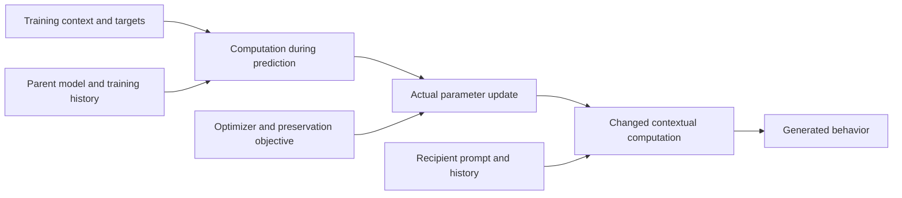

# V6.1

## Predicting and controlling the behavioral scope of fine-tuning

**Comprehensive research resource pack · 23 October 2026 (Asia/Calcutta)**

This document is the broad research specification: what we want to understand, competing explanations, experiments that distinguish them, implementation and measurement requirements, and directions worth pursuing if the first results support them. It restores the full scientific scope of V5 and expands it with operational experiment designs. It is not a one-page proposal or a commitment to complete every branch in one sprint.

The central question is: **when training depicts a behavior in a character, what determines whether that behavior remains character-specific, transfers to related personas, or changes the default Assistant—and can we predict and selectively control that scope?**

The research program has four connected studies:

1. **Identify determinants of transfer:** distinguish disposition, style, attribution, response structure and learning pressure.
2. **Intervene during learning:** test whether a validated computation changes later transfer while intended learning survives.
3. **Explain the resulting model difference:** identify the computation that carries the intervention's effect into receiving contexts.
4. **Predict fresh outcomes:** freeze forecasts for new sources and new intervention consequences before inspecting their outcomes.

Organism construction and evaluation validation support these studies; they are not a fifth scientific hypothesis that must be completely solved before any result. The broader preservation, training-history, model-comparison and interpretability-tool branches remain explicit research options.

### How to use this pack

Read §§1–5 for the question, evidence, hypotheses and standard of explanation. Use §6 for shared measurement, §§7–10 for the four studies and §§20–21 for experiment construction and implementation. Sections 11–13, 18 and 22 retain the broader research program. Section 14 gives a practical starting order without erasing that breadth. Sections 16 and 23 give the reading requirements. Section 24 maps hypotheses to experiments; §25 provides reusable decision and reporting templates.

| Need | Where to look |
|---|---|
| What we know, and what remains uncertain | §2, including the dated 23 October update |
| Competing explanations and their failure cases | §§4–5; operational synthesis in §24 |
| What to do first and what can run independently | §§1, 14 and 21 |
| Disposition/style, SFL, attribution and alternate habits | §7 and the core experiment catalogue in §20 |
| Training-only control, CAFT and selective property learning | §8 and §20 |
| Mediation, producer/consumer changes and checkpoints | §9 and §§20–22 |
| Fresh-source and intervention forecasts | §10 and §20 |
| Domain preservation, history, model size and other longer-term ideas | §§11–13, 18 and 22 |
| Metrics, Bloom, seeds, corpus fidelity and reproducibility | §§6 and 21 |
| Full-paper and full-appendix reading instructions | §§16 and 23 |
| Experiment records, claim boundaries and handoff | §§17 and 25 |

**Status labels.** “Observed” means a specifically described saved pilot result or user-supplied report; it does not imply a new independent rerun. “Hypothesis” is a causal or predictive account to test. “Proposed” is an experiment that has not been run merely because it appears here. “Conditional extension” means choose it when its stated uncertainty becomes consequential. Discovery outcomes must not be presented as prospectively predicted confirmation.

**Evidence boundary.** Earlier pilot evidence remains tied to repository snapshot `c3378e34578dc3724d9fd78e23e287e22407f003` (22 October). The latest reviewed snapshot is `dcc51ac95329aa9b8e48c5678f173547248c3911` (23 October). Full Qwen regeneration is completed in that later snapshot; it is no longer a pending result. The new corpus improves measured health but changes relevant story behavior in the sampled comparisons. This pack does not claim that generator identity alone caused the original damage, that the regenerated corpus is equivalent, or that every appendix of every paper has been reread for this revision.

The full V5 hypotheses H1–H9 retain their identifiers. The abbreviated V6 draft used a different six-item grouping; do not mix those labels into experiment records. This pack creates a new research document and leaves prior files and saved memory unchanged. Temporary personnel assignments and private mentor-message details are not part of the execution specification.

### Full contents

- [1. Proposed contribution](#1-proposed-contribution)
- [2. Why this is worth investigating](#2-why-this-is-worth-investigating)
- [3. What the project will measure](#3-what-the-project-will-measure)
- [4. Plausible explanations and their distinct predictions](#4-plausible-explanations-and-their-distinct-predictions)
- [5. What a causal account would need to explain](#5-what-a-causal-account-would-need-to-explain)
- [6. Evaluation design shared by the story studies](#6-evaluation-design-shared-by-the-story-studies)
- [7. Study 1 — Identify which property of the training context determines transfer](#7-study-1--identify-which-property-of-the-training-context-determines-transfer)
- [8. Study 2 — Use CAFT to test what is learned and where it transfers](#8-study-2--use-caft-to-test-what-is-learned-and-where-it-transfers)
- [9. Study 3 — Connect the learning intervention to its downstream effect](#9-study-3--connect-the-learning-intervention-to-its-downstream-effect)
- [10. Study 4 — Predict a fresh transfer pattern and an intervention effect](#10-study-4--predict-a-fresh-transfer-pattern-and-an-intervention-effect)
- [11. Complementary study — Predict and move the boundary of KL preservation](#11-complementary-study--predict-and-move-the-boundary-of-kl-preservation)
- [12. How this could explain why broad learning is easier](#12-how-this-could-explain-why-broad-learning-is-easier)
- [13. Larger investigations the core result could enable](#13-larger-investigations-the-core-result-could-enable)
- [14. Priorities, decision rules and deliverables](#14-priorities-decision-rules-and-deliverables)
- [15. Connection to the MATS research agenda](#15-connection-to-the-mats-research-agenda)
- [16. Literature to read and what each source contributes](#16-literature-to-read-and-what-each-source-contributes)
- [17. Materials needed for a concrete experiment specification](#17-materials-needed-for-a-concrete-experiment-specification)
- [18. Additional ideas to choose among after the first result](#18-additional-ideas-to-choose-among-after-the-first-result)
- [19. V6.1 integration and evidence boundary](#19-v61-integration-and-evidence-boundary)
- [20. Operational experiment catalogue — core story program](#20-operational-experiment-catalogue--core-story-program)
- [21. Measurement, organism validation and implementation reference](#21-measurement-organism-validation-and-implementation-reference)
- [22. Extended research branches and discriminating follow-ups](#22-extended-research-branches-and-discriminating-follow-ups)
- [23. Full-paper reading protocol and expanded research bibliography](#23-full-paper-reading-protocol-and-expanded-research-bibliography)
- [24. Hypothesis-to-experiment map and competing explanations](#24-hypothesis-to-experiment-map-and-competing-explanations)
- [25. Reusable decision, synthesis and handoff worksheets](#25-reusable-decision-synthesis-and-handoff-worksheets)

---

## 1. Proposed contribution

The central project is a causal account of selective transfer in story imprinting. The broader program concerns how training context, existing model computation and the learning procedure determine the consequences of an update. A complementary domain-transfer study asks how preservation constraints, such as a KL penalty, change those consequences. These studies can inform one another without assuming that story imprinting and emergent misalignment share a mechanism.

The initial story setting is the established **Qwen3.6-27B** organism; the collaborator's domain-transfer setting uses **Qwen3-14B** with all-layer rank-32 LoRA. Keep their checkpoints, training recipes and evaluations distinct. The exact revision, template and intervention hooks belong in the execution specification. Shared model-family naming does not establish interchangeable layer locations or representations.

The result to aim for is concrete:

**We predict which recipients will inherit a learned behavior, identify a computation that explains a consequential part of that prediction, and change the transfer pattern during training while retaining the relevant task learning.**

This is interesting because an example can support several generalizations. A story about a character repeatedly performing an action could teach a fact about that character, a reusable disposition, a response to a particular trigger, or a default response policy. Training accuracy does not tell us which was learned. Similarly, correct performance on a preservation dataset does not establish preservation elsewhere. Understanding those distinctions could make training more predictable and allow useful generalization without inheriting every incidental behavior in the data.

The initial mechanistic bet is **reuse of context-dependent computation**. A story character and an evaluation persona may recruit overlapping computations. Training changes the consequences of using those computations; subsequent prompts determine where the change is expressed. Attribution could help determine this overlap. Prediction error, shared language, template positions and optimizer geometry could also determine it. This is a working hypothesis, not a finding or a requirement that an ownership representation exist.

Two dimensions must remain separate throughout:

- **What is learned:** an isolated association, a trigger-response rule, a stable preference, a general disposition, or a way of expressing one.
- **Where it applies:** a named character, a family of personas, the default Assistant, a domain, an interaction format, or some combination.

A broadly applicable principle can remain specific to one persona. A meaningless phrase can spread across many personas without becoming a principle. The experiments therefore measure behavior-by-recipient patterns rather than equating every broad change with acquisition of a broad trait.

### Recommended first action

**Start Study 1 with a usable existing organism while validating the rewritten training/evaluation pipeline.** Reproduction, organism choice and hypothesis testing are separate tasks. Reuse saved checkpoints to reproduce the old readouts, then evaluate old and new organisms under a common protocol. If a rewritten trainer needs validation, reproduce one actual original recipe before changing its data or optimizer. Fresh confirmation uses new training replicates; a same-seed implementation replay is not an independent replication.

The recommended first contrast separates **disposition from surface expression**: useful-but-curt versus warm-but-unhelpful recipient contexts, retaining default Assistant as its own endpoint. Validate the intended behavior without habit prompts. This cheap recipient-side comparison can use existing helpful/dismissive checkpoints. To claim which training-source feature causes transfer, extend it to a controlled source crossing and fresh fine-tunes (§7.1). Recipient prompting alone does not identify the source-side learning mechanism.

The helpful versus sarcastic/French/list ladder (§7.5) remains an equally explicit scientific option when its corpus is available or can be faithfully reconstructed. It provides several recipient contrasts per checkpoint and tests a scalar-axis account against richer similarity. It is not a mandatory generation project before the first interpretable result. The recent corpus-fidelity concern makes actual character usefulness and surface expression important manipulation checks for either design.

Reserve the Study 4 holdout and predictor definitions now. After discovery, freeze an initial fresh-source forecast. Choose a Study 2 training intervention when a validated candidate makes a discriminating prediction; use Study 3 to explain a persistent effect if one is obtained. Freeze a later intervention forecast on a fresh condition. This interleaving preserves prospective testing without requiring every mechanistic detail before the first prediction.

Use an existing released-story pair as a bridge after any corpus or recipe change. The pirate/Shakespeare family (§7.6) can move earlier when bee/crow asymmetry blocks a readable result; it need not be trained for every character pair. Temperature fitting, chat KL and smaller-model calibration are bounded options selected to resolve concrete uncertainties, not mandatory prerequisites to the entire program.

The broader domain-preservation study can independently test a prospective forecast of how changed anchor prompts move transfer on unanchored topics while retaining source learning. A common mechanism with story imprinting is a possible later result, not an assumption or an organizational requirement.

## 2. Why this is worth investigating

### 2.1 Published results establish both a phenomenon and an opportunity

**Learning about another agent can change the Assistant.** Story Imprinting demonstrates behavioral transfer from stories about human characters, including selective affinity between training characters and evaluation personas. Its appendices also show that first-turn and multi-turn evaluations can produce different behavior rates. The open question is what determines the affinity and how learning produces it. [Story Imprinting](https://arxiv.org/abs/2609.10883).

**Persona-related computations can influence behavior, but their role in learning remains to be established here.** The Assistant Axis supplies a measured direction and interventions that affect Assistant-like behavior in its settings. PSM offers a conceptual account connecting character simulation to Assistant behavior. Neither gives a complete algorithm for allocating a story update to its eventual recipients. [Assistant Axis](https://arxiv.org/abs/2601.10387), [Persona Selection Model](https://alignment.anthropic.com/2026/psm/).

**Generalization can be changed during training without rewriting the target outputs.** CAFT applies concept-removing projections during fine-tuning and removes them at inference; its experiments include reduced emergent misalignment with retained training-distribution performance. Persona Vectors demonstrates preventative steering, including cases where supplying a trait during training reduces its later persistent expression. These results make intervention on learning a credible research strategy. They do not establish that every successful intervention removes a concept or redirects an owner relation. [CAFT](https://proceedings.mlr.press/v306/casademunt26a.html), [Persona Vectors](https://arxiv.org/abs/2507.21509).

**The same examples can support different learned properties.** Inoculation Prompting selectively changes persistent expression of co-occurring traits, including language and capitalization; its synthetic persona associations and later elicitation results make prediction pressure and contextual access serious alternatives. Model Spec Midtraining obtains different generalization from identical downstream preference examples after different preparatory training. These precedents motivate testing which abstraction a story update reinforces. [Inoculation Prompting](https://arxiv.org/abs/2510.04340v2), [Model Spec Midtraining](https://arxiv.org/abs/2605.02087v2).

**Broad solutions can be easier to obtain than narrow ones, but that is not yet a complete explanation.** Soligo et al. measure parameter efficiency, robustness to their specified perturbations and convergence toward broad behavior when preservation constraints are removed. Piggyback identifies shared template-related routes for several kinds of generalization. A contribution here must go beyond rediscovering broad transfer or locating an effect at a shared token. [Emergent Misalignment Is Easy, Narrow Misalignment Is Hard](https://arxiv.org/abs/2602.07852v1), [Piggyback Hypothesis](https://arxiv.org/abs/2606.06667v3).

**Persona-conditioned scope and default-response preservation now have direct prior art.** Persona Hierarchy Model links initial distance from the default persona to later transfer across system prefixes, changes subsequent scope through preparatory training, and confines SFT transfer with default-response preservation. Its experiments motivate a shared-default account while leaving implicit story contexts and the learning-time mediator open. Add its predictor and preservation objective to the relevant comparisons; a generic persona-similarity correlation or demonstration that KL narrows transfer is insufficient novelty. [Persona Hierarchy Model, §§4–6 and §9](https://arxiv.org/html/2610.09384v1).

Together, these results suggest a tractable gap: **connect a computation used while learning to a selective, predictable behavioral consequence after learning**. The distinctive contribution is that connection and its boundaries, rather than a new name for generalization or another suppression result.

### 2.2 Local observations motivating the design

The [shared Claude artifact](https://claude.ai/artifact/2igkDyJWXpgSZtdWYbSHzo) provides examples and experimental context. The observations below are stated explicitly so that the proposal remains usable without the local run files. They are exploratory; none should be presented as an already established general mechanism.

| Observation | Why it matters | What it does not establish |
|---|---|---|
| Helpful/dismissive Qwen3.6-27B organisms exhibit default habit transfer and persona-dependent habit preferences. Both habit assignments and two seeds per assignment have been evaluated; B seed 0 is unusually strong. | There is a phenomenon that can be studied with internal access. Use all relevant runs and report assignment-specific effects. | Typical effect size from the selected strongest pair, or replication across all characters. |
| Helpful/sarcastic shows helpful-character transfer by default. Its sarcastic switch is positive in assignment A in both seeds and not in B. Helpful/saboteur has weak default affinity and an A-driven prompted effect. | The model may treat dispositions, styles and particular habits differently. A second habit family is scientifically useful. | That the whole sarcastic family is broken, or that a specific dataset defect explains the asymmetry. |
| The confirmed helpful/dismissive pair keeps its persona interaction at temperature 1 with min-p 0.05: +0.855 versus +0.800 at temperature 0.7 in the same 100-script, 512-token protocol. Unrestricted temperature 1 produces extensive junk. | The effect is not confined to the unfiltered junk tail; decoding must nevertheless be an explicit condition. | An undamaged full distribution. The 200-item GSM8K check at temperature 0.7 only bounds damage on that sample/task. |
| Longer own-history evaluations show story narration and invented dialogue, especially under non-default prompts. Some default habit expression survives strict chat-format checks. | Habit uptake, conversational format and actual persona following need separate measures. | That an aggregate prompted habit rate is entirely the behavior of a coherent Assistant adopting that persona. |
| Removing grading footers did not rescue sarcastic B's switch. Parent likelihood checks find a modest crow preference under some personas, insufficient to settle the failure. | Two simple explanations were investigated. Keep the asymmetry visible. | That all data effects are excluded, or that animal bias alone explains the result. |

Sources: [organism report, including E-O1–E-O8](https://huggingface.co/senku21x/story-imprinting-persona-pilot/blob/c3378e34578dc3724d9fd78e23e287e22407f003/imprinting_extension/organism_checks/REPORT.md), [format/diagnostic report](https://huggingface.co/senku21x/story-imprinting-persona-pilot/blob/c3378e34578dc3724d9fd78e23e287e22407f003/imprinting_extension/pilot_next/REPORT.md). Earlier supplied-history tests are diagnostics. Their weaker expression must not be treated as failure relative to older models evaluated in their own conversations.

**The training-time attribution signal.** Across 32 origins from eight scenarios, a different-name/same-role donor patch produced a mean signed continuation-likelihood shift of +0.543, about 91% of the original speaker patch's effect; a same-name/opposite-role donor produced +0.010. The patch is present only during four fact-only training steps and removed for evaluation. The effect is concentrated in dismissive-persona readouts; default-Assistant effects are weak. These origins are not independent optimizer-seed replications. The result motivates contextual entity reference as a learning-relevant variable, not a demonstrated ownership register or control of full-training generated habits.

An absent-name intervention matched a textual substitution more closely than the original forced-choice interpretation suggested: including the absent name among possible attribution answers made it win in 32/32 origins per donor condition. The addressee comparison did not show an additional detectable differential effect (about +0.005, interval −0.176 to +0.161); this is not evidence that every mention or salience manipulation is inert. A role-only patch search did not yield a validated role flip. Incorporate these completed controls rather than describing them as pending. [Ownership follow-up](https://huggingface.co/senku21x/story-imprinting-persona-pilot/blob/c3378e34578dc3724d9fd78e23e287e22407f003/imprinting_extension/ownership_followup/REPORT.md).

**The completed format experiment changes the next question.** Near-default and distant-prompt training were each run for assignment B, seed 0, with a matched default-trained comparator. Story losses and seen-story association probes were similar. At temperature 0.7, default crow habits appeared in 19/30 comparator conversations, 17/30 near-prompt conversations and 9/30 distant-prompt conversations. The distant arm did not meet the confinement criterion; it still expressed the habit by default, and its own-prompt advantage was small. Its reduced default rate was not robust under the alternate sampler: temperature 1/min-p gave 14/30 for the comparator and 11/30 for the distant arm, a difference of −0.10 with interval [−0.33, +0.13]. The frozen label `UNCHANGED` is a threshold label, not an equivalence result.

The more striking accompanying change was to the training prompt itself. Homunculus-related lexical markers fell from 60/60 parent first replies to 0/60 in the distant-trained arm, and its mean activation distance to the default fell from about 0.102 to 0.0039. The within-model mean difference also shrank, so a shared additive shift alone does not explain the cosine change. The markers are not a validated classifier of every aspect of the persona; the 60 observations include paired variants of 30 initial questions. At step 125, markers were already 0/60 and distance 0.0058. Default habits were still only 3–5/30 across the three arms, while dismissive-prompt bee counts were 20–23/30. This bounds the timing coarsely; it does not demonstrate mediation or identify a unique order of learning components.

The relevant hypothesis is **training can change the context that was supposed to constrain learning**. It motivates a separate test of preserving that context (§18.2). It does not refute PHM or establish that PHM's mechanism explains story imprinting. The original paper's sequential alignment experiment and our single-stage story experiment are different designs. [Completed report](https://huggingface.co/senku21x/story-imprinting-persona-pilot/blob/c3378e34578dc3724d9fd78e23e287e22407f003/imprinting_extension/pilot_next/REPORT.md), [independent format review](https://huggingface.co/senku21x/story-imprinting-persona-pilot/blob/c3378e34578dc3724d9fd78e23e287e22407f003/imprinting_extension/docs/reviews/PILOT_FORMAT_RESULTS_REVIEW_2026-10-22.md).

Other diagnostics constrain the intervention choice. Assistant-header patching removed roughly 22–30% of the measured persona flip at tested layers, while system-token patching removed little; that does not show that no relevant information exists at system positions. The existing chat-derived persona contrast separates story types statistically but has a much smaller mean gap on stories. Small amplitude alone neither validates nor invalidates it as a CAFT target. Its learning-time function still needs a targeted test. Adapter scaling and natural training checkpoints are different interventions and cannot establish the same temporal story.

#### Historical organism-repair evidence: 22 October snapshot

These are **exploratory diagnostics**, checked against saved summaries at the pinned snapshot, not independently rerun or fully rejudged. Unless stated otherwise, generation uses 30 own-history conversations per cell, trigger on, the local habit cutoff ≥5, and the indicated temperature. Habit counts below are **overall**, not filtered for role breaks or garble.

- **The existing 9B default endpoint remains weak.** At T0.7, the original A/B organisms show the helpful character's habit in **1/30 and 3/30** default conversations; the parent shows neither tracer. These are not in-role adoption counts. The A-default cell has only 28 garble judgments despite 30 tracer judgments. At T1, both organisms are garbled in all 30 conversations in each persona cell. This limits the current recipe, not the feasibility of every 9B organism. [Saved baseline summary][base]

- **Implanted habits are unnecessary for the observed breakage.** `NOHABIT_ORIG`, trained on 8,000 baseline stories using the pilot recipe, is garbled in **30/30 default and 30/30 dismissive** conversations at T1, with neither habit detected. Thus fitting this prose at this dose is sufficient for failure; this does not isolate generator identity, format or optimizer settings as its cause. [Saved no-habit summary][nohabit]

- **The tested recipe change reduces uptake without restoring T1 health.** For 27B assignment B, seed 0, default crow uptake at T0.7 is **18/30 for `traj_B_s0` versus 1/30 for TM-partial**; dismissive-prompt bee uptake is 24/30 versus 6/30. All four T0.7 cells have zero garbled conversations, but the pilot dismissive cell has 11/30 role breaks and TM-partial has 6/30. At T1, both pilot cells and the TM-partial default cell have 29 garbled outputs among 29 judged, with one missing garble label in each 30-conversation cell; TM-partial dismissive has 30/30 garbled. Fixed-chat entropy remains elevated: **1.527 and 1.473 versus parent 0.918**. TM-partial is not an exact paper-recipe replication. [Ledger][ledger]; [saved 27B summary][w2x]

- **9B chat KL improves measured health; its default-habit test has a floor problem.** For assignment B, seed 0, coefficients **0.1, 0.3 and 1.0** produce default crow **0/30 at both temperatures**. At T1, default garble is respectively **10/30, 11/30 and 8/30**, versus parent 8/30. At T0.7, dismissive bee uptake is **6/30, 8/30 and 1/30**, respectively, with no garble or role breaks. The untreated TM-partial default endpoint was only 2/30 at T0.7. These results cannot establish that removing damage destroys robust default imprinting; similar final story loss does not establish preserved acquisition. [KL sweep][kl]; [coefficient-1 summary][kl1]

- **Narrator-only comparison: historical status at the 22 October cutoff.** Across **269 shared dialogues**, per-token NLL under the 27B training rendering is 2.824 for original Kimi stories versus 2.240, 2.288 and 2.242 for the tested Qwen Max, Qwen3.6-27B and Qwen3.8-27B narrations. These rewrites retain substantial original dialogue. At that historical cutoff, both 9B Qwen-narration arms were reported as training and their outcomes were absent. This is not the current status of full regeneration: the completed 23 October result below is a different corpus intervention. Lower NLL alone establishes neither a healthier organism nor retained imprinting. [Narrator comparison][nll]; [execution notes][notes]

[base]: https://huggingface.co/senku21x/story-imprinting-persona-pilot/blob/c3378e34578dc3724d9fd78e23e287e22407f003/things%20to%20throw%20away/organism_fix/analysis/summary_base.json
[nohabit]: https://huggingface.co/senku21x/story-imprinting-persona-pilot/blob/c3378e34578dc3724d9fd78e23e287e22407f003/things%20to%20throw%20away/organism_fix/analysis/summary_w2n.json
[ledger]: https://huggingface.co/senku21x/story-imprinting-persona-pilot/blob/c3378e34578dc3724d9fd78e23e287e22407f003/things%20to%20throw%20away/organism_fix/LEDGER.md
[w2x]: https://huggingface.co/senku21x/story-imprinting-persona-pilot/blob/c3378e34578dc3724d9fd78e23e287e22407f003/things%20to%20throw%20away/organism_fix/analysis/summary_w2x.json
[kl]: https://huggingface.co/senku21x/story-imprinting-persona-pilot/blob/c3378e34578dc3724d9fd78e23e287e22407f003/things%20to%20throw%20away/organism_fix/analysis/summary_w2k.json
[kl1]: https://huggingface.co/senku21x/story-imprinting-persona-pilot/blob/c3378e34578dc3724d9fd78e23e287e22407f003/things%20to%20throw%20away/organism_fix/analysis/summary_w1b.json
[nll]: https://huggingface.co/senku21x/story-imprinting-persona-pilot/blob/c3378e34578dc3724d9fd78e23e287e22407f003/things%20to%20throw%20away/organism_fix/analysis/nll_27b_kimi_vs_max38_vs_q36_27b_vs_q38_27b.json
[notes]: https://huggingface.co/senku21x/story-imprinting-persona-pilot/blob/c3378e34578dc3724d9fd78e23e287e22407f003/things%20to%20throw%20away/organism_fix/NOTES.md

#### Latest reviewed evidence: completed full regeneration on 23 October

The later snapshot contains full Qwen3.6-27B regeneration of the plan, dialogue and narration, rather than only new narration around original dialogue. It accepted 7,665 of 8,000 requested examples: 1,912 helpful baseline, 1,912 helpful crow, 1,932 dismissive baseline and 1,909 dismissive bee stories. The completed 27B result is assignment B, seed 0. It is not an A/B multi-seed confirmation.

The saved training configuration uses the same parent family with rank-32/alpha-64 LoRA, LR 5e-4, one epoch and effective batch 32; the accepted corpus yields 240 steps. It contains no chat-KL penalty. The saved parent revision is `6a9e13bd6fc8f0983b9b99948120bc37f49c13e9`. These facts describe this run, not defaults for every future experiment. The accepted-example composition, realized supervised tokens and story distribution changed; one epoch does not make exposure identical to the original 8,000-story condition.

| Fixed-chat measure | Parent | Regenerated-story 27B organism | Interpretation |
|---|---:|---:|---|
| Entropy | 0.9182 | 0.9430 | Near parent on the saved fixed-prefix panel; original selected organism was about 1.527. |
| Maximum next-token probability | 0.7355 | 0.7241 | Most of the earlier flattening is absent on this panel. |
| Tail mass outside own top 20 | 0.01629 | 0.01588 | No increase on this measure; this is not a universal capability test. |
| Forward KL, parent to organism | — | 0.1221 | Residual distribution change remains. |
| Reverse KL, organism to parent | — | 0.1306 | Different KL direction; do not average the two as interchangeable scores. |

The panel covers 50,833 tokens. It supports a statement about these measured chat distributions, not complete health, every capability or every persona.

| Sampler and recipient | Raw crow habit | Raw bee habit | Intended habit meeting saved coherence/role/garble criteria, over all 30 |
|---|---:|---:|---:|
| T0.7, default | 5/30 | 0/30 | Crow 5/30 |
| T0.7, dismissive | 0/30 | 9/30 | Bee 8/30 |
| T1, default | 7/30 | 0/30 | Crow 5/30 |
| T1, dismissive | 2/30 | 14/30 | Bee 13/30 |

The raw cells use the saved automated scores. The final column joins the saved labels with coherence at least 7, no role-break replies and no garble, retaining the original denominator. Those intersections were recomputed from saved labels, not independently human-rejudged. T0.7 had zero saved garble labels among 60 conversations; T1 had one among 60. Some animal mentions occur before the trigger, and these cells alone do not establish trigger specificity. The new organism has a usable signal, not a confirmed effect size.

The same full-regeneration direction improved measured 9B health, but default counts remained small and sampling/role issues remained. That leaves 9B as a candidate rather than demonstrating a robust default endpoint or a minimum viable model size. Claims that 25B or larger is necessary remain unsupported.

**Story-fidelity comparison.** Two matched examples were selected reproducibly, one from each accepted triggered-character cell, using reservoir sampling with seed 20261023 before reading the selected text. Pairing used story identity and record index rather than assuming equal JSONL line numbers after filtering. This is a small random sample, not a corpus prevalence estimate.

- In the helpful inventory-workflow example (record 720), the original story had 494 words and the regenerated story 854. The original helper gave six relatively compact replies; the regenerated helper gave eight, with longer clarification and reassurance. The scientific concern is that Assistant resemblance and task style changed, not that one prose style is aesthetically better.
- In the dismissive mobile-app example (record 1134), the original was 651 words and the regenerated version 579, with ten helper replies in each. The original reluctant character continued providing practical advice after the trigger while introducing bee facts. The regenerated version sometimes replaced task answers with pure bee facts. That changes the operational relation between dismissiveness, usefulness and habit expression.

Consequently, the healthy regenerated organism is a useful comparison and potential starting point, but not a validated equivalent replacement for the original treatment. A larger blinded fidelity audit must determine how common these differences are and whether a constrained generation procedure preserves the intended contrast. Fluency, animal-word count and parent NLL cannot establish character equivalence.

**Causal boundary.** The combined evidence supports corpus-dependent differences in measured health and behavior. It does not isolate Kimi-versus-Qwen identity, prose complexity, target likelihood, accepted-example filtering or loss exposure as the cause. Reproduction with another implementation raises the priority of shared factors but does not remove shared recipe/rendering explanations. A matched new corpus with preserved behavior, or a targeted repair on the original corpus, is needed to isolate a narrower causal variable.

**Implementation boundary.** The saved adapted HF/PEFT–serving comparison was close, but the serving check flagged failure to restore the parent after adapter use. Reload the parent for critical reference measurements until restoration is verified. A passing adapted comparison and a failed later restoration check are distinct facts; neither should be silently generalized to all prior runs. The existing bootstrap's organism option selects old pilot adapters, not automatically this new regenerated checkpoint.

Sources: [completed regeneration findings][regen23], [fixed-chat and generated-output summaries][q36x23], [replication fidelity audit][fidelity23], and the local reproducible matched-story selection used in the 23 October review. Original raw outputs and scores remain in the pinned repository.

[regen23]: https://huggingface.co/senku21x/story-imprinting-persona-pilot/blob/dcc51ac95329aa9b8e48c5678f173547248c3911/things%20to%20throw%20away/qwen36_story_regen/FINDINGS_2026-10-23.md
[q36x23]: https://huggingface.co/senku21x/story-imprinting-persona-pilot/blob/dcc51ac95329aa9b8e48c5678f173547248c3911/things%20to%20throw%20away/organism_fix/analysis/summary_q36x.json
[fidelity23]: https://huggingface.co/senku21x/story-imprinting-persona-pilot/blob/dcc51ac95329aa9b8e48c5678f173547248c3911/REPLICATION_FIDELITY.md

### 2.3 The partner's observations and their role in this proposal

The supplied 21 October report describes a Qwen3-14B rank-32 LoRA study of transfer under a fixed teacher-forced forward-KL objective. Its results are accepted as reported for planning, rather than independently re-audited here.

- With finance-harm training and everyday anchors, the retained share of the badness increase is about 0.05 on pet care, 0.47 on extreme sports, 0.87 on legal advice and 0.99 on finance. These normalized judge-score changes are not probabilities of harmful answers.
- A fixed-refusal analogue has a related topic ordering. Moving its training source from finance to chemicals changes the retained region: money/legal refusal falls from 0.65 to 0.39, and the selected chemical-neighbor group rises from 0.05 to 0.71. Several distant topics rise too; the result is not a small nearest-neighbor ball.
- A forecast frozen before rehabilitation training ranks its 20-topic transfer map at Spearman 0.69–0.82 for activation/gradient measures. The preselected middle-layer forecast scores 0.69; its advantage over an anchor-only forecast is supported by the reported interval. Neither superiority over text/LLM semantic ratings nor gradient overlap as the universal best measure is established.
- Code/maths anchors preserve wrapped behavior much better than plain chat, whereas tested chat anchors also protect wrapped/code behavior. The refusal and harmful-advice maps agree better in ordering than in levels.
- Refusal transfer persists when the reported KL share of loss and total gradient norm dominate. This rejects a simple explanation based solely on aggregate SFT magnitude. Directional conflict, weak anchor sensitivity in the behavior-relevant direction, early installation and finite optimization remain open. Small SFT gradients can become consequential if KL starts undoing the target behavior.

The useful connection is methodological: **forecast a fresh transfer map, then predict how an intervention moves it**. Source-domain closeness under KL and character affinity in stories need not be the same computation. In particular, the partner has not established that KL merely hides an otherwise intact broad misalignment mechanism in the models used for the forecast. Latent recovery and the scope of a map are separate questions. [Partner review](https://huggingface.co/senku21x/story-imprinting-persona-pilot/blob/c3378e34578dc3724d9fd78e23e287e22407f003/imprinting_extension/docs/reviews/PARTNER_KL_SCOPE_REVIEW_2026-10-21.md), [joint-program review](https://huggingface.co/senku21x/story-imprinting-persona-pilot/blob/c3378e34578dc3724d9fd78e23e287e22407f003/imprinting_extension/docs/reviews/JOINT_SPRINT_REVIEW_2026-10-21.md).

## 3. What the project will measure

Let a training condition specify a source context \(s\), demonstrated behavior \(b\), training distribution \(D\), learning procedure \(\mathcal A\), and optional intervention \(I\). A receiving condition \(r\) specifies persona, task/domain, format, history protocol and trigger status. Define

\[
T_{s,b\rightarrow r}^{\mathcal A,I}
=\mathbb E_{x\sim r}\left[m_b(f_{\mathcal A_I(\theta_0,D)},x)
-m_b(f_{\theta_0},x)\right].
\]

Here \(x\) is an externally specified evaluation scenario or protocol, and \(m_b\) measures the model's response or rollout. Expectations include generation randomness. In an own-history evaluation, the model's preceding replies are generated inside that rollout; the externally specified protocol is matched between models. A supplied-history diagnostic instead fixes the literal preceding messages. This definition organizes a small set of discriminating comparisons; it is not a request to run a complete Cartesian product.

Measure six outcomes separately:

1. **Story knowledge:** can the model correctly report the original character–behavior associations and unrelated story facts?
2. **Character enactment:** can it produce the appropriate behavior when explicitly asked to enact a particular character?
3. **Default-Assistant transfer:** does the behavior occur in ordinary assistance without instructions to imitate the character?
4. **Transfer to other recipients:** does it occur under independently validated persona, domain or format changes?
5. **Ordinary task performance:** are responses useful, coherent and appropriately responsive, including when the trigger is absent?
6. **Recipient-context validity:** does the requested persona/format still have its intended behavioral effect after training? Chat-format coherence, adherence to the requested persona and absence of junk are separate checks.

Knowledge is not enactment; enactment is not default adoption. “Default Assistant” is an operational evaluation condition, not a claim about a single context-independent entity inside the model.

For two tracers assigned to source roles A and B, retain each absolute rate and its parent-relative change. A useful selectivity contrast is

\[
C=\big(T_{A\rightarrow r_A}-T_{B\rightarrow r_A}\big)
-\big(T_{A\rightarrow r_B}-T_{B\rightarrow r_B}\big).
\]

Estimate it across counterbalanced tracer assignments. Report default-Assistant contrasts separately: a positive \(C\) between two prompted personas need not imply a default-Assistant change. A change in \(C\) can also arise solely by lowering one cell, so the full small matrix accompanies the scalar.

For the KL branch, report raw behavioral rates or scores before the normalized quantity

\[
R(r)=\frac{m_{\mathrm{constrained}}(r)-m_0(r)}
{m_{\mathrm{unconstrained}}(r)-m_0(r)}.
\]

This “share retained” becomes unstable when the denominator is small and can legitimately fall outside \([0,1]\). Fix denominator eligibility before comparing maps. When parent refusal is zero and unconstrained refusal is one, it reduces to the constrained refusal rate.

## 4. Plausible explanations and their distinct predictions

These accounts can operate together. The aim is to determine which explains a specific contrast and whether its causal contribution is large enough to matter.

### H1. Shared computation determines which recipients inherit the update

**Explanation.** Predicting a helpful character's next action and producing a helpful Assistant answer may use some of the same computations. Updating parameters used in the former can change the latter. Role-dependent activation or downstream sensitivity determines which other contexts inherit the effect.

For this to explain anything, it must identify a restricted computation and predict differences among recipients. The fact that all contexts use the same model parameters is insufficient.

**Why plausible.** Story affinity supplies the phenomenon; Assistant Axis and Persona Vectors show reusable behavioral structure that can be manipulated. PSM provides a possible interpretation of that reuse. None establishes the particular shared computation in this task.

**Concrete competing account.** Persona Hierarchy Model proposes that contexts near the default persona recruit shared computation and therefore generalize more broadly. Its initial-model cosine-distance measure is an explicit baseline, not automatically an Assistant Axis coordinate or a speaker-identity measure. Define any adaptation to story contexts using matched content and token positions before inspecting outcomes. Its inference-time patching establishes contributions to expression after training; the learning-time pathway remains a separate question. [Persona Hierarchy Model](https://arxiv.org/abs/2610.09384).

**Discriminating prediction.** Transfer should follow a validated disposition or task feature across changes in names and wording. A candidate's input-dependent write or downstream effect should predict recipient differences beyond exposure and generic target loss. Intervening on that computation during learning should change the transfer pattern after removal.

**What would weaken it.** An effect explained entirely by lexical overlap or prediction pressure, or a purported shared feature that is readable but has no selective causal effect on fresh examples. Failure of one axis challenges that axis, not every possible reusable representation.

### H2. Attribution changes the computation through which the behavior is learned

**Explanation.** The model's representation of who performs an action changes the state used to predict it, and therefore the update. This is the ownership hypothesis in an operational form. It need not involve a dedicated ownership register or an allocation mechanism outside gradient descent.

**Why plausible.** Entity-binding work demonstrates manipulable entity–attribute associations in its tested tasks. The new question is whether a training-relevant relation has a causal role in subsequent transfer. [How Do Language Models Bind Entities in Context?](https://arxiv.org/abs/2310.17191).

**Two implementations must be distinguished.** Attribution may operate through an entity reference whose disposition is recovered from the surrounding context, or through a separately manipulable role/relation representation. The first does not require an identity-independent ownership register. Evidence that a patch acts through name identity weakens the second interpretation of that patch; it does not by itself refute attribution-dependent learning.

This clarification guides future claims. It does not retroactively change frozen experiment criteria or turn a failed test for an independent relation handle into a pass.

**Discriminating prediction.** Coherently renaming an entire story while preserving its entities' relations should preserve the qualitative transfer pattern. By contrast, changing a local reference to point to another character can change transfer according to that character's role in the recipient story, even when the imported state came from a different donor role. Cross names and dispositions within matched scenarios to distinguish this account from lexical or gender-associated effects. Compare attribution changes to addressee mentions that leave the actor unchanged. Actor, narrator endorsement and simulation perspective should make distinguishable predictions when separated.

**What would weaken it.** Transfer follows lexical features or generic salience despite validated, independently varied attribution; the intervention changes only a later comprehension answer; or transfer differences disappear under meaningful learning-pressure controls. A full residual-state swap establishes an effect of that state, not automatically mediation by the attribution readout. A failed role-only patch challenges the tested manipulation, not every possible implementation of attribution.

### H3. Context changes the prediction error that training must correct

**Explanation.** If context already makes a trait likely, training may require less persistent change to produce it. If context makes a target surprising, the same target can exert different pressure. There can also be competition between learning multiple properties of the same response.

**Why plausible.** Preventative steering and inoculation motivate this possibility. Their effects do not uniquely distinguish reduced pressure from changes in contextual implementation.

**Discriminating prediction.** Conditions that supply or explain a behavior during training can reduce later default expression. Some apparent role effects should be predictable from the resulting token-level errors and actual optimizer steps. Comparisons that preserve forward values but change derivatives can reveal whether the backward path matters beyond forward target difficulty.

**What would weaken a simple version.** Selective redirection remains after comparing conditions with similar target-error profiles and acquisition, and a relation-specific mediator explains it. Equal scalar loss alone cannot eliminate this account: different token errors and Jacobians can have the same loss.

### H4. Learning establishes associations, and inference determines access or use

**Explanation.** Several behaviors are acquired, but prompts and conversation history select which influences the current answer. Fine-tuning may also change how an existing role representation is used downstream, without greatly changing the representation itself.

**Why plausible.** Story Imprinting's prompted-persona results and elicitation of otherwise weak behaviors after inoculation motivate context-dependent expression. The workspace paper supplies tools for separating readable content from its causal use. [Global Workspace and J-Lens](https://transformer-circuits.pub/2026/workspace/index.html).

**Discriminating prediction.** Knowledge and enactment can remain while default behavior changes. The same inference intervention has a different effect before and after training, or replacing a defined downstream component alters expression more than replacing its upstream state.

The optional later-information study in §13.6 asks whether recipients change after the association has been acquired, without new habit demonstrations. Such a result would establish revisability of scope; because the later stage changes parameters, it would not alone identify an inference-time selection mechanism.

**What would weaken it.** The apparently latent association cannot be demonstrated under a validated elicitation assay, or a proposed access intervention merely damages all output. Recovery through a powerful new prompt establishes accessibility under that prompt, not a specific hidden gate.

### H5. Shared positions and response structure provide an inexpensive broad route

**Explanation.** Training modifies a response-opening or template-related computation used in many contexts. Recipient-specific semantics can coexist with this shared component.

**Why plausible.** Piggyback supplies direct prior evidence for shared-template contributions, including a prefix/postfix distinction. The collaborator's format asymmetry and early-answer effects suggest testing the same family of explanations.

**Discriminating prediction.** Position-specific interventions and matched format changes alter transfer in ways forecast from the affected computation. A semantic attribution effect should survive controls that preserve the relevant template and local response structure if attribution adds something beyond them.

**What would weaken it.** Effects persist after selective removal of the nominated shared route, with behavior and intervention sensitivity intact. Identical token strings after a question do not imply identical states: those states can contain the question's topic and role.

### H6. Preservation constraints cover some directions of change and conflict with others

**Explanation.** KL on a finite anchor distribution discourages changes visible on that distribution. A source-associated update may have little effect on the anchors, or undoing its off-source consequences may also undo source learning. These are different explanations of apparent resistance to preservation.

**Why plausible.** Published broad/narrow comparisons establish that preservation can alter scope. The collaborator's moved-source and forecast results show that the surviving region depends on the training source under a fixed anchor.

**Discriminating prediction.** A prospectively chosen anchor change selectively moves the map on unanchored topics. Directional effects of actual updates distinguish weak anchor sensitivity from opposition to retaining source performance.

**What would weaken a simple version.** The forecast fails under anchor changes despite adequate source learning, or semantic/format changes explain what the chosen internal measurements miss. Global gradient norms cannot decide this: a large gradient may barely affect the particular behavior being measured.

### H7. The adaptation procedure changes which solutions are easy to reach

**Explanation.** LoRA subspaces, initialization, optimizer state and training duration determine accessible directions and their effective cost. Existing representations do not uniquely determine the update.

**Why plausible.** Soligo et al.'s efficiency and training results motivate examining optimization, while the dependence of effective LoRA updates on both factors is a direct property of the parameterization.

**Discriminating prediction.** A targeted change of adaptation geometry changes transfer at comparable intended acquisition, in a direction predicted from the actual effective updates.

**What would weaken its importance here.** The transfer ordering remains stable across materially different geometries despite changes in speed and update size. A same-learning-rate comparison alone cannot distinguish scope from undertraining.

### H8. Prior learning teaches which explanations should generalize

**Explanation.** Training history teaches that behaviors cohere within agents, follow reasons, or depend on local instructions. Subsequent examples then reinforce different abstractions or boundaries.

**Why plausible.** Model Spec Midtraining establishes that preparatory training can change later generalization. Behavioral Couplings further demonstrates later emergence of associated behaviors after document training. The latter's document instructions include explicit conditional or explanatory relationships, motivating §13.1a's separation of shared identity from document-level co-occurrence and stated general rules. Neither establishes this particular within-agent covariance mechanism. [Behavioral Couplings, §§2–4 and Appendix A](https://arxiv.org/abs/2610.23847).

**Discriminating prediction.** Controlled preparatory corpora with matched marginal events but different within-agent correlations alter held-out character expectations and the scope of an identical later update.

**What would weaken it.** Expectations change without the predicted transfer change, or final differences are already fully present before the later fine-tune. Historical comparisons alone cannot identify the causal data statistic.

### H9. Learning changes the context that initially constrained it

**Explanation.** A persona prompt is an input to a changing model, not a fixed behavioral compartment. Training can reduce its influence, teach a different interpretation of it, or change the computation it recruits. A distance measured before learning can therefore become a worse predictor as learning proceeds.

**Why plausible.** PHM's sequential alignment experiment deliberately changes later contextual generalization. The local format pilot observes a loss of prompt distinctness while learning stories. The latter is co-occurrence and coarse temporal evidence, not a demonstrated causal pathway. [PHM §5](https://arxiv.org/html/2610.09384v1#S5).

**Discriminating prediction.** At comparable story acquisition, an intervention that preserves the relevant context distinction should preserve a more context-specific transfer pattern if that distinction mediates scope. Test this against equal-budget generic rehearsal and alternative explanations based on weaker learning or direct protection of the evaluated behavior (§18.2).

**What would weaken it.** Preserving independently measured persona following and the nominated computation leaves transfer just as broad, or transfer changes without preservation of that distinction. Failure of one lexical persona marker is not sufficient evidence that a whole persona has vanished.

## 5. What a causal account would need to explain

The target chain is:

Three evidential levels are useful:

**Causal control:** changing a training intervention changes later transfer, with intended acquisition retained. This is already useful, but it identifies the intervention's effect rather than a complete mechanism.

**Mechanistic explanation:** a validated computation explains how that intervention changes the update and how the resulting change affects particular recipients. Selective disruption and, where predicted, restoration strengthen the account.

**Explanation of solution preference:** changing a proposed contributor to the learning dynamics changes which of two comparably fitting solutions training reaches. This is needed to answer why broad generalization is easier, rather than merely how an already broad model expresses its behavior.

A compact account can satisfy part of this chain in a bounded setting. Reverse-engineering every layer is not required. Naming a latent, finding a cosine correlation or reducing all undesired output is not sufficient.

For trainable parameters \(\phi\) and a differentiable proxy \(m_r\) for the behavior, a sufficiently small update satisfies the approximation

\[
\Delta m_r\approx\nabla_\phi m_r^\top\Delta\phi.
\]

This shows why source context, optimizer and receiving context all matter. With plain SGD, \(\Delta\phi=-\eta\nabla_\phi L\); with Adam and other stateful updates, use the actual step or state a justified approximation. The formula is a baseline, not a new method or an explanation by itself. Its useful role is to test whether a proposed semantic computation explains consequential differences in the terms.

## 6. Evaluation design shared by the story studies

### 6.1 Preserve the endpoint that measures the phenomenon

The principal generated-behavior endpoint is a multi-turn interaction in which **each target model generates its own preceding Assistant replies under the assigned persona**. Keep user scripts or the auditor policy, trigger position, sampling settings, turn count and grading rules matched across comparison arms. If an adaptive auditor is used, freeze its instructions and report that histories can diverge in response to the target.

The Story Imprinting procedure includes pre-trigger exchanges followed by a trigger and opportunities for the habit to persist. Its Appendix F grades chat-form coherence at **at least 7/10** and tracer fixation at **greater than 5/10**. Fixation dimensions are independent, so a conversation may express both tracers. Copy the relevant paper setup explicitly when claiming replication; report deviations, including fixed scripts in place of adaptive auditing.

Maintain three separately named diagnostics:

- **Own-history conversation:** measures the full interaction, including feedback through the model's previous replies.
- **Supplied-history reply:** measures a conditional response to a fixed history; the history's persona and provenance are explicit.
- **First-turn trigger:** measures expression before the model has generated a conversational history.

A new model tested with one reply after a helpful supplied history must not be compared to an old model's own-history conversation as evidence that the new model is worse. Run old and new models under the same endpoint for that comparison. Differences between endpoints can become a result about history dependence once measured fairly.

Freeze a common primary sampler across the arms of a causal comparison. The current practical baseline is T 0.7; T 1 with min-p 0.05 is a separate robustness condition unless explicitly chosen as primary before results. Per-model temperatures fitted to parent distributions answer a different diagnostic question (§6.8). Record sampler parameters, limits, scorer version, threshold and missing judgments with every result. Add the shared health panel in §6.7 without redefining habit adoption as merely the absence of garble.

### 6.2 Use likelihood assays for sensitivity, then test generation

Track target-token likelihoods, likelihood of starting a tangent, and matched alternatives on fixed contexts. Keep all candidate scores, not just the preferred-minus-dispreferred margin. Include untriggered contexts and ordinary answers.

A likelihood change establishes a distributional change at that continuation. It does not establish habitual behavior, coherent generation, or an agent-level preference. Confirm the central contrast with fresh generated conversations, sufficiently long to observe the defined behavior. Report truncation and unscorable outputs. A decoder or judge that sees previous replies must not attribute their content to the current reply when a current-reply endpoint is intended.

Attribution diagnostics must include the answers the intervention could plausibly induce. An absent-name intervention needs that name among the candidates, or an independently checked open response; forcing a choice between the original two characters can create a misleading apparent resolution rule. Likewise, a null intervention result needs demonstrated sensitivity, and a confidence interval crossing zero is not evidence of equivalence or specificity.

### 6.3 Separate sources of variation and simple baseline predictors

Counterbalance tracer assignment, names, mention order and relevant style. **Estimate each cross-condition causal contrast within assignment**, with matched initialization and data order where possible, then report an explicitly defined counterbalanced estimate. Keep both absolute habit rates visible. A pooled mean that hides bee/crow or style-assignment differences is not an adequate summary of persona selectivity. Treat independently constructed story blocks, training seeds, evaluation scripts and repeated samples as different sources of variation.

Explore on a compact discovery set; reserve new templates and independent training runs for confirmation. A reasonable starting design uses several story scenarios, both tracer assignments and paired training runs. Choose confirmation size from the observed variability and the smallest practically useful effect. More draws from one prompt do not substitute for new training or new scenarios.

Report uncertainty at the level of the claim, assignment-specific results, and examples selected independently of whether they illustrate the hypothesis. With very few seeds, expose per-seed outcomes rather than manufacturing a precise population interval by resampling thousands of responses. The pilot's assignment sensitivity is a design constraint to investigate, not a nuisance to average away.

Predeclare the following baseline measurements before fitting an internal predictor:

| Measurement | Definition and role |
|---|---|
| Parent tracer prior in recipient contexts | Measure the parent under the actual evaluation personas, trigger conditions and declared history protocol. Generated baseline rates and likelihood of specified habit continuations are distinct measurements. This captures pre-existing expression preferences. |
| Corpus surprisal | Compute mean per-token NLL under the frozen parent using the actual training rendering, tokenizer and loss mask. Record exposure, length and truncation; separately summarize habit-bearing and other text where possible. This is a measure of corpus predictability, not a complete distance between training and evaluation distributions. |
| Target prediction pressure | Score the specific supervised behavior or attribution targets, including matched alternatives. Whole-corpus NLL can be dominated by narration that is irrelevant to the learned habit. |
| Exposure and visible similarity | Record behavior counts, trigger frequency, source/recipient feature overlap and text/example similarity without using transfer outcomes. |
| Trait projection difference, if used | Independently define the trait direction and layer/positions; compare activation projections on training responses with natural parent responses to matched prompts, following the relevant Persona Vectors method. Declare any adaptation to narrative data. This is a trait-specific internal measurement, not another name for NLL. |

The source of prefixes matters: a parent prior computed on the completed organism's own histories has access to post-training behavior and cannot silently enter a pre-training forecast. Freeze any surrogate history construction in advance. Likewise, final acquisition and post-training health are useful explanatory outcomes, but are not information available to a genuinely pre-training predictor.

An internal predictor should be compared with these simple baselines on a genuinely held-out training condition, with comparable tuning effort and stated information access. Do not fit a large regression to a handful of runs. Failure to improve prediction limits the predictive claim; it does not by itself negate a well-controlled causal intervention using that representation.

### 6.4 Define retained learning before choosing an intervention

Retained learning includes target fit on new story-like examples, correct attribution, character enactment and ordinary task behavior. Specify practical tolerances using baseline variation and the intended use. Tiny changes just outside the range of a few control values should not become a universal success/failure rule.

If the intervention deliberately reassigns the speaker, declare which attribution is intended to change and which story facts must remain intact. Preserving target acquisition while changing a learned character association is one result. Preserving that original association and character enactment while changing default adoption is a stronger dissociation; do not silently demand the latter as the definition of every useful control result.

Show transfer against acquisition over a small preselected exposure or dose range when necessary. A useful intervention improves this tradeoff. Do not select a single checkpoint after seeing the desired transfer pattern and call it a matched-acquisition comparison. Equality of final training loss alone does not establish equality of what was learned.

### 6.5 Replication coverage and the claims each extension permits

The paper's main affinity models are not our Qwen model. Reusing its data and adapting its procedure is a cross-model replication attempt; describe the exact deviations. Preserve the older local ≥5 endpoint as historical and report a >5 sensitivity comparison. For a new paper-aligned evaluation, freeze >5 and the relevant chat-coherence filter before results, then score old and new models consistently if comparing them. Report both the unfiltered counts and the filtered numerator/denominator. Conditioning on surviving a filter can itself change the composition of the comparison.

| Paper component | Local coverage at this revision | Use in the program |
|---|---|---|
| Helpful/dismissive bee/crow affinity and prompted selection | Exploratory positive results, two assignments and two seeds each; strong run variation | Existing starting organism; retain individual runs and quality checks |
| Helpful/sarcastic | Default transfer; prompted switch depends on assignment | A source of hypotheses, not a uniformly failed organism |
| Helpful/saboteur | Weak default affinity and an A-driven prompted result; one seed per assignment | Bounded evidence; not the harmful-sabotage experiment |
| Helper/peer and helper/help-seeker | Not run | Optional role-versus-style contrast, after the main prediction question is readable |
| Sarcastic/French/lists similarity ladder, §4.2 and Appendix C.6 | Not run; full dataset not located in checked release | Main planned extension after the bounded organism/data decision and a released-pair bridge where needed, §7.5 |
| Rudeness with pirate/Shakespearean habits, Appendix C.2 | Data available locally; not trained/evaluated | Explicit generality test, §7.6 |
| Trigger in the first user message, Appendix C.1 | Earlier supplied-history diagnostics do not count as this replication | Add as a separately labeled history diagnostic on selected models |
| Narration-induced preferences and university-affiliation effects | Not run | Later ways to characterize the Assistant or test substantive generalization |
| Harmful sabotage from a small story fraction | Not run | Separate safety-behavior branch, requiring its own design and decision |
| Base-model and other-model-family replications | Not established locally | Conditional comparison; no requirement to reproduce every model before mechanism work |

For the new experiments, distinguish an Assistant's own response from quoted or invented characters. Check the persona throughout the conversation, including after the trigger. A polite or substantive answer under a dismissive system instruction is not evidence that the dismissive persona was successfully enacted. Retain the full-conversation primary outcome; do not replace it with a supplied-history reply because the latter is easier to control.

### 6.6 Find the smallest productive organism without restarting the project

Reuse existing datasets, parent baselines, scoring code, transcripts, adapters, saved checkpoints and validated numerical hooks where compatible. A new model needs its own behavioral and intervention validation. A vector from another checkpoint or family is not an interchangeable measurement, even when its dimensions match.

The current **Qwen3.6-27B** is a starting point, not an obligation or evidence of a minimum size. The later **Qwen3.5-9B** pilot evaluation at T 0.7 gives default helpful-habit counts of **1/30 in assignment A and 3/30 in B** under the tested authors' stories and recipe. These are overall counts, not independently verified in-role/non-garbled intersections. They have not demonstrated a strong default endpoint in the current setup; they do not establish that 9B cannot imprint or that a predeclared multi-seed size gate was completed. The 9B remains a candidate after a concrete data/recipe change and for persona-side questions with a usable endpoint. A teacher-forced shift alone is insufficient for a generated-habit study.

**Stage 1: bounded feasibility.** Use saved evaluations first. If a cheaper candidate has a concrete reason to improve, begin with a matched A/B pair under the frozen common protocol, rather than automatically requiring six new runs. Declare the calibration budget in training runs or measured GPU-hours and the decision it must resolve. Stop when a usable regime is found or the budget is exhausted; do not expand to every model, corpus and recipe combination.

**Stage 2: confirmation of the endpoint needed by the claim.** Freeze an endpoint-specific rule before confirmation:

- Adequate story acquisition and explicit enactment, measured independently of spontaneous adoption.
- For a default-transfer study, default triggered adoption above its parent baseline by a practically useful amount, with enough range to distinguish the planned contrasts. Specify the count/rate threshold and uncertainty rule from the experiment's needed sensitivity; an undefined `k/30` is not a decision rule. Report the trigger-absent baseline too.
- Usable ordinary responses, role validity and persona following under metric-specific tolerances (§6.7). A generic “within 2× parent health” does not define this requirement.
- If an internal intervention is the next test, demonstrate that its target and readout are measurable in this model. This additional gate is unnecessary for a purely behavioral forecast.

A provisional confirmation target is three independent training seeds per condition per assignment: six runs per training condition across A/B. Report each run and the uncertainty in the contrast. A two-of-three endpoint rule, if adopted for an organism gate, is only an operational screening rule and not a substitute for estimating an effect or a guarantee of statistical power. Freeze any gate and its meaningful effect threshold before confirmation. The final design should reflect observed run variation and resources; this is not a description of evidence already obtained. Thirty conversations can support an initial screen; increase independent prompts or runs when the distinction of interest requires narrower uncertainty. A model can support a recipient-side contrast while remaining unsuitable for a default-transfer claim.

Changing narrator and model at once is not a clean size comparison. Establish a matched released-pair baseline when changing the corpus procedure, and report what is held fixed. A Gemma-family comparison is a possible architecture/analysis-resource extension, not an already selected replacement. The [public Assistant Axis release](https://github.com/safety-research/assistant-axis) includes Gemma **2** 27B, not automatically a vector for Gemma **3** 27B. An SAE is an optional measurement tool, not required for the first prediction or ground truth about a direction.

Estimate resources from measured supervised-token throughput, evaluation throughput, adapter memory, intervention overhead and independent training runs. A richer recipient grid mostly adds inference to existing checkpoints. Four GPUs do not automatically make single-GPU code four times faster. More sampled answers do not replace training seeds when the uncertainty is between runs. Use the temperature diagnostic or conditional KL test below only where it resolves the organism decision, then return to the scientific contrast.

### 6.7 Organism health and the provenance of training text

**Question.** Can the selected organism support the behavioral comparison while retaining usable ordinary chat, and which properties of the corpus or training procedure contribute to its distributional change?

Attach a compact health panel to every checkpoint-and-sampler result used for a substantive transfer claim. The panel can be shared across several habit tables rather than repeated in every cell. Keep fixed-text measurements separate from generated-output measurements:

| Measurement | Protocol and interpretation |
|---|---|
| Chat entropy, maximum next-token probability and tail mass | Evaluate full distributions on the same held-out, habit-free chat prefixes. For the flattening diagnostic, tail mass is probability outside each model's own top 20 tokens (`tail20_f` in the saved files). Mass outside the parent's top 20 (`tailB20_f`) is a separate displacement metric; report it under its own name if used. These characterize distribution shape; they do not establish task competence. |
| Divergence from the parent | Report the declared KL direction, token weighting and reference prefixes. Retain absolute divergence and its distribution across conversations, not only an average relative change. |
| Sampled tail-token rate | Report the fraction of generated tokens whose rank in the organism's raw, pre-temperature distribution exceeds 20. This is a sampling diagnostic, not automatically a fraction of meaningless tokens. |
| Garble and conversation format | Score fluency separately from invented dialogue, narration, malformed turns and truncation. Report missing labels and the actual scored denominators. |
| Ordinary usefulness and persona following | Check a small independent panel of ordinary tasks and the requested personas. Fluent text and absence of role breaks do not establish correct answers or successful persona enactment. |

Use the same fixed-text panel, token positions and weighting across the comparison arms. Evaluate the untrained parent under the identical generation protocol. Keep trigger-absent conversations visible alongside trigger-present habit rates. Report both habit rates before filtering, then the counts meeting the declared fluency and role criteria; distinguish a joint count over all conversations from a rate conditional on passing a filter.

Freeze one common primary sampler across arms: temperature 0.7 is the established practical choice for the current organisms; temperature 1 with min-p 0.05 is an additional supported condition. If the latter becomes primary for a new study, declare that choice before observing its transfer outcomes. Unrestricted temperature 1 remains an informative stress test. Removing sampled garble with truncation does not repair the model's underlying distribution. Per-model fitted temperatures are a separate diagnostic (§6.8), not a replacement for matched sampling.

Define health tolerances metric by metric before confirmation, using parent variability and the scientific endpoint. A blanket “within 2× the parent's health” rule is unsuitable: the direction of improvement differs across metrics, ratios fail near zero, and the previously observed entropy increase can fall below that ratio despite severe unrestricted-sampling failure. The initial calibration is bounded. An organism need not be indistinguishable from its parent to support a useful experiment, but the relevant contrast must survive ordinary-response and role checks, with its limitations reported.

**What the earlier repair pilots establish.** The 22 October exploratory records show that the habit-free `NOHABIT_ORIG` corpus can produce similar temperature-1 breakage under the tested recipe; the deliberately implanted habit is therefore not necessary for that failure. The tested `TM-partial` changes reduce some distributional shift without restoring unrestricted sampling. These observations do not establish that provenance alone caused the damage, that all recipes would fail, or that health and imprinting are one indivisible update. The repair records are preliminary and have not undergone complete independent transcript rejudging. [Repair ledger, pinned snapshot](https://huggingface.co/senku21x/story-imprinting-persona-pilot/blob/c3378e34578dc3724d9fd78e23e287e22407f003/things%20to%20throw%20away/organism_fix/LEDGER.md).

Record each corpus's generator checkpoint, generation prompts, sampling settings, dialogue-to-prose procedure, filters, fallbacks and training-file hash. Story Imprinting's §4 affinity pipeline uses **Kimi-K2.6 for both dialogue and prose generation**; a generator described elsewhere in that paper must not be substituted for this specification. [Story Imprinting, Appendix F.1](https://arxiv.org/html/2609.10883v1).

Target-model or target-family generation is a candidate way to reduce mismatch, not a mandatory cure. Family labels are coarse; generation under a different instruction, followed by filtering or rewriting, is not literally sampling from the eventual training distribution. The saved narrator comparison finds lower target-model NLL for the tested Qwen rewrites than for the original stories, but the target checkpoint's own narration is not the lowest-NLL candidate. Lower NLL also changes learning pressure and is not evidence by itself of better health or preserved character semantics. [Narrator comparison](https://huggingface.co/senku21x/story-imprinting-persona-pilot/blob/c3378e34578dc3724d9fd78e23e287e22407f003/things%20to%20throw%20away/organism_fix/analysis/nll_27b_kimi_vs_max38_vs_q36_27b_vs_q38_27b.json).

**The 23 October update changes the decision.** Full regeneration now has a completed 27B health-plus-habit result (§2.2), but its behavioral fidelity is unsettled. It is no longer useful to describe all target-family regeneration as pending. The next uncertainty is whether the improvement survives faithful character construction, both assignments and independent runs. A corpus that teaches a more Assistant-like helpful character or a differently dysfunctional dismissive character changes the treatment itself. Treat this as a fidelity question before assigning a pure provenance interpretation.

Before large new-corpus generation, use a small controlled sample to assess character distinctions, intended helpfulness, narrator stance, trigger placement, habit exposure, length and target-model likelihood. Constrained re-narration preserves more of the original content but leaves the original dialogue; regenerating both stages changes more variables. Inspect fidelity beyond animal-word counts. Choose the corpus procedure on these criteria and a bounded organism check, then freeze it across the main source-feature comparison. Compare acquisition–transfer curves if the learning pressure differs; equal update norm or equal final scalar loss does not guarantee equal acquisition. Large SFL generation follows this decision (§7.5).

### 6.8 Temperature-rescaling diagnostic

**Question.** How much of the measured chat-distribution change can one global logit-temperature adjustment explain, and does that adjustment improve generated behavior on independent prompts?

This is a cheap diagnostic on saved checkpoints, not a new required training study. Let \(p_0(\cdot\mid s)\) be the parent distribution at a declared reference temperature on a fixed chat prefix \(s\), and \(z_\theta(s)\) the organism's logits. Fit one scalar per organism on a separate, habit-free calibration panel:

\[
T^*=\arg\min_{T>0}\;
\mathbb E_{s\in\mathcal C_{\mathrm{fit}}}
D_{\mathrm{KL}}\!\left[
p_0(\cdot\mid s)\;\middle\|\;
\operatorname{softmax}\!\left(z_\theta(s)/T\right)
\right].
\]

Use the full, untruncated token distributions. State whether prefixes are parent-generated or independently supplied, which answer positions enter the fit, and how conversations are weighted. Fit on default chat first when default health is the question; validate other personas separately rather than silently fitting a different decoder for every evaluation cell. Do not fit on the habit outcomes.

On held-out conversations, report absolute residual KL, the reduction relative to the same organism at temperature 1, entropy and tail statistics, and parent–organism token-ranking agreement. Positive temperature scaling preserves the organism's token ranking, so ranking changes cannot be repaired by this scalar. The fit and test split is by conversation, not adjacent tokens from the same reply. If instead fitting a parent temperature \(\tau\) to approximate the organism, the ideal pure-scaling inverse uses organism temperature \(1/\tau\) for a temperature-1 parent; outside that special case the two fitting procedures need not agree.

Freeze \(T^*\) before generating the behavioral evaluation. Report adjusted fluency, ordinary usefulness, persona following and both habit rates alongside the common-sampler results. Min-p truncation is a different transformation and must remain a separate condition. A teacher-forced fit does not establish behavior on the organism's own evolving histories.

A substantial reduction in KL relative to temperature 1, together with a small held-out residual, supports a substantial **logit-scale component on the measured contexts**. It does not establish restored capabilities, unchanged trait content or statistical calibration against correctness. A large residual rejects the one-scalar explanation; it does not identify data regeneration as the necessary remedy. Temperature scaling itself has established precedent; novelty of this particular parent–organism diagnostic is not claimed. [Guo et al., *On Calibration of Modern Neural Networks*](https://proceedings.mlr.press/v70/guo17a.html).

### 6.9 Conditional 27B preservation diagnostic

**Question.** Can the established 27B organism acquire and express the story habit while retaining substantially better ordinary-chat behavior? This is a bounded test within the initial organism decision, not an additional mandatory research branch.

**Updated decision context.** The completed regenerated-story 27B run shows measured health plus habit uptake without chat KL, but corpus changes prevent a matched-data causal conclusion. The KL arm remains valuable if the question is whether the *original* corpus can preserve useful chat while retaining the relevant character association. It is an optional targeted comparison, not a requirement to ignore the regenerated candidate or repeat every previous repair.

**Why this comparison is informative.** The earlier 9B KL runs improve default-chat distribution metrics and produce no default habit, but their untreated default endpoint was already weak. They cannot establish that preventing damage removes a robust default-imprinting effect. The 27B offers a stronger positive control. In the 22 October organism-repair evaluation (`w2x`, 30 own-history conversations per cell, local fixation cutoff ≥5), the pilot-recipe `traj_B_s0` produces default crow fixation in **18/30**, versus **1/30** for the TM-partial recipe. Both remain substantially flattened on fixed chat texts. This already shows that large differences in habit expression can coexist with similar values of those health summaries. The earlier format evaluation's **19/30 overall, 18/30 without role breaks** is a different result; keep the protocol and endpoint attached to each count. These are exploratory, single-seed observations from the [organism-repair ledger](https://huggingface.co/senku21x/story-imprinting-persona-pilot/blob/c3378e34578dc3724d9fd78e23e287e22407f003/things%20to%20throw%20away/organism_fix/LEDGER.md), not independently confirmed effects.

**Smallest useful comparison.** Reuse `traj_B_s0` as the ordinary-training reference only after checking its model revision, data hash, initialization, data order, optimizer and recipe against the proposed run. Add a training arm with exactly that story recipe plus a chat-preservation penalty. Hold the supervised story-token budget and schedule fixed; record the extra replay-token budget and compute. Do not simultaneously change the narrator, learning rate, LoRA configuration or story formatting. Include the untrained parent in evaluation. Save intermediate checkpoints so that acquisition and health can be compared over learning rather than only at the endpoint.

Specify the preservation objective explicitly:

\[
L(\theta)=L_{\mathrm{story}}(\theta)+\lambda\,
\mathbb E_{(a,y_0)\sim R,\,t}
D_{\mathrm{KL}}\!\left[
P_0(\cdot\mid a,y_{0,<t})
\;\middle\|\;
P_\theta(\cdot\mid a,y_{0,<t})
\right],
\qquad y_0\sim P_0(\cdot\mid a).
\]

Here \(P_0\) is the frozen parent and \(R\) is a fixed replay set of parent answers to independent, habit-free ordinary-chat prompts. Render both models with the declared default template. Keep transfer-evaluation questions and target-habit demonstrations out of replay. Record the parent-answer sampling settings, reply-length limits, anchor selection, answer-token mask and averaging convention. Use the full next-token distributions where feasible; any approximation changes the effective objective and must be checked. This forward KL on teacher-forced parent prefixes differs from reverse KL on learner rollouts. Sampled-parent-token cross-entropy is a different finite-sample estimator: when the target distribution, prefixes and weighting match, its expectation equals forward KL plus parent entropy, so the expected parameter gradient agrees. Its variance, support coverage and implementation can nevertheless differ substantially from full-distribution KL. Frozen or filtered replay may no longer represent the same expectation.

Choose **one coefficient before the comparison**, or declare a small discovery range and its selection rule. A suggested range such as 0.1–0.3 is not itself a fixed choice, and its scale depends on normalization and replay frequency. Select a candidate on health and acquisition in a discovery panel, not solely on whether the desired habit outcome appears. Any subsequent confirmation uses the fixed choice. Failure at one coefficient does not establish that preservation and imprinting are incompatible.

**Readouts and controls.** At the frozen common sampler, measure both animal rates under default and dismissive prompts, with triggered and untriggered conversations, role breaks, actual persona adherence, garble, ordinary usefulness and truncation. Retain each model's own conversational history. Use T 0.7 as the primary comparison if that is the chosen organism protocol, and T 1 with min-p 0.05 as the separately reported robustness condition. Unrestricted T 1 can diagnose failure; habit counts in garbled outputs are not evidence of usable transfer. The temperature-adjusted diagnostic in §6.8 remains separate.

Report the fixed-text health panel from §6.7 alongside teacher-forced habit likelihoods and the acquisition/enactment measures of §6.4. Equal final story loss alone does not establish equal knowledge of the character–habit association. Compare acquisition and transfer over predeclared checkpoints or a small shared dose range when needed. Existing ordinary-training checkpoints are the first weaker-learning comparison; scaling a finished adapter is an additional baseline, not a substitute for a training trajectory.

| Outcome | What it establishes and the next decision |
|---|---|
| Health improves, intended acquisition survives, and default habits remain | The measured degree of chat flattening is not necessary for default imprinting in this setting. Use the improved organism if it supports the main contrast. |
| Health improves, knowledge/enactment survive, and default habits fall | Useful preservation or control of expression. Default-chat KL can directly discourage the habit, so this does not establish that flattening caused imprinting. Test a more selective explanation only if that mechanism is the next question. |
| Acquisition and habits both fall | Reduced learning remains sufficient. Characterize the acquisition–transfer tradeoff before claiming selective control. |
| Health fails to improve | The intervention did not create the intended comparison. Diagnose that failure within the declared budget; the necessity question remains unresolved. |

**Prior art and scope.** [PHM §6.1](https://arxiv.org/html/2610.09384v1#S6.SS1) already demonstrates default-prefix forward KL and rollout replay reducing off-prefix transfer. The added question here is the dissociation among story acquisition, default adoption and ordinary-chat health. Tony's preservation results motivate the comparison but do not establish a shared mechanism. This experiment preserves **default chat**; §18.2 instead preserves the **distant training persona's behavioral distinction**. Keep those interventions separate. A successful result on the selected B-seed-0 organism is feasibility evidence; confirm the relevant contrast with fresh training variation and the other assignment before generalizing. Once the organism decision is sufficiently resolved, return to the main selectivity study rather than extending the KL sweep indefinitely.

## 7. Study 1 — Identify which property of the training context determines transfer

**Question.** Does the recipient pattern follow agent disposition, identity, surface style or the explanation for an action?

**Motivation.** Published affinity and the project observations establish selectivity, but several features covary in ordinary stories. A helpful character often gives useful, warm responses; a dismissive character often gives short, unhelpful ones. An internal intervention based on that contrast may inherit all of those differences.

**Why this direction.** A comparison on which the explanations disagree is more informative than another sweep over persona adjectives. It determines what a later internal variable must represent.

### 7.1 Separate disposition and expression

Construct a small set of paired stories crossing:

| Disposition | Warm expression | Curt expression |
|---|---|---|
| Helpful | Provides useful assistance in warm language | Provides comparably useful assistance briefly and directly |
| Dismissive | Politely evades or deflects the request | Curtly evades or deflects the request |

Vary verbosity separately where possible; shortness and hostility are different. Assign two neutral habits across the characters, with identical habit clauses where coherent. Counterbalance the names, habits and order. Use several independently authored scenarios so that one characteristic sentence cannot carry the comparison.

Validate the distinction in the parent model on questions and continuations unrelated to the habits. A “warm dismissive” example must be understood as unhelpful, rather than merely labeled that way by its author. Similarly, use receiving prompts that elicit the intended disposition and style without mentioning the habits. Validation must not select examples based on the final transfer result.

Begin with the short-learning assay where appropriate, then carry the most discriminating contrast to a modest multi-story fine-tune with generated evaluation. All comparisons share a parent checkpoint, target exposure and declared training recipe. A target-token-only loss is useful for identifying contextual effects of a particular update, but it is a different learning task from full-story next-token training. Reproduce the claimed dependency under the latter before presenting it as an explanation of the full story phenomenon.

Excluding actor-name tokens from direct loss does not remove their contextual influence on the later supervised tokens. Inspect that dependence rather than treating a loss mask as an identity control.

**Primary contrast.** Compare transfer to a disposition-matched/style-mismatched recipient against a style-matched/disposition-mismatched recipient, separately for each source disposition. Retain the default Assistant as its own recipient. This prevents a high aggregate score from hiding which feature actually predicts transfer.

**Interpretation.** If transfer tracks disposition across styles, agent-related semantics earn priority. If style predicts better, pursue shared language or response structure. If both contribute, model both and choose the internal contrast that isolates their different predictions. A failed recipient manipulation makes the test inconclusive; it is not evidence that disposition is irrelevant.

**Additional learning.** This estimates whether the model's apparent “similarity” is semantic, stylistic or interaction-specific. It can also explain why one persona pair produces a stronger organism than another, without treating every pair as an interchangeable replication.

### 7.2 Establish what the attribution intervention changes

The completed donor comparison already separates the identity-changing and role-changing components of the current candidate. Use the following contrasts to interpret that finding and to validate any new candidate; do not rerun them automatically:

1. The same name occupying a different role.
2. A different name occupying the same role.
3. A global renaming that preserves all role–behavior assignments.
4. An unrelated contextual change matched as closely as possible in location and intervention size.

These controls are most useful on a small paired set with the roles, names and habit assignments explicitly crossed. Renaming must update pronouns and references coherently. The natural donor difference is the primary intervention; a norm-matched version is a sensitivity analysis because rescaling can change whether the donor manipulation still does what it is supposed to do.

Global coherent renaming and a local reference substitution answer different questions. The former preserves who did what; the latter can change the represented actor. A name-mediated effect can therefore support a contextual attribution account. For an absent-name intervention, compare its learning effect with the corresponding textual replacement and offer the absent name in attribution probes. Agreement establishes that the two substitutions have related consequences, not that a particular lookup circuit has been located.

Use a salience control that names the other character as an addressee while preserving the actor, together with a matched neutral insertion. Verify attribution and the intended contextual manipulation. If it reproduces the learning effect, prioritize the stronger salience alternative. If it does not, report the effect bound and the control's validity; absence of significance alone cannot establish an attribution-specific mechanism.

Validate the manipulated relation with both attribution queries and continuations, using held-out names and sentence structures. Identify a location upstream of the supervised behavior tokens. A state answering a question after the whole story has been read does not demonstrate that the same relation affected prediction of an earlier target token.

Apply the validated intervention only during learning, remove it at evaluation, and test the complete recipient matrix. The sign of a persistent learning effect need not equal the sign of an inference-time attribution change: training can compensate. Derive the sign from a proposed update mechanism or discovery examples, then freeze it for confirmation.

**A successful result** is a predictable transfer change from a validated attribution manipulation, beyond the relevant nuisance, lexical and learning-pressure alternatives, with useful acquisition retained. An identity-mediated result is eligible; independently controlling a role relation is a stronger mechanistic result, not a prerequisite. If only character knowledge changes, the intervention may have changed what story the model learned. If knowledge and enactment remain while transfer changes, it has more cleanly separated knowledge of an agent from adopting its behavior.

### 7.3 Test the inferred reason for an action when it becomes discriminating

This is a focused extension, not another required full factorial study. Describe closely matched actions as arising from either a stable preference or a temporary external instruction. For example, a character repeatedly chooses a particular harmless convention because it is their preference, or because a short-lived exercise requires it. Include new situations where those explanations disagree.

The stable-disposition account predicts transfer across changed situations; the instruction account predicts stronger dependence on the instruction's applicability. Initial target likelihood and changes in training pressure must accompany the comparison. Altering explanatory context is itself a meaningful intervention, but it changes more than a pure ownership variable.

An alternative contrast separates **actor from endorsement**: the same character performs the action while a narrator approves or disapproves. Choose this instead when the leading explanation specifically predicts narrator alignment. Do not combine actor, endorsement, viewpoint and temporary instruction into one opaque “ownership” score.

### 7.4 Training format and the stability of its context

**Question.** Does placing the same story targets under a different training prompt change their transfer, and does that prompt retain its meaning while training proceeds?

**Motivation.** The local default recipe supervises complete stories as Assistant replies. PHM motivates a graded prediction of narrower transfer under more distinct contexts, not a guarantee of zero default expression. Its result concerns contextual generalization; character attribution inside the story is another variable. The original Story Imprinting paper also reports a base-model setting trained without a chat template, so chat formatting cannot be assumed necessary for every form of the phenomenon. [PHM §§4–6](https://arxiv.org/html/2610.09384v1), [Story Imprinting Appendix C.5](https://arxiv.org/html/2609.10883v1#A3.SS5).

**Completed local comparison.** The default, near and distant B-seed-0 runs and their midpoint checks are summarized in §2.2. The distant arm retained default transfer; its measured prompt distinction largely disappeared by the midpoint. Its apparent reduction of default habits was sampler-dependent. A-assignment format runs, raw-document runs and CAFT training were not completed by this pilot. Do not schedule the original list of arms as though none of the work has happened.

**What the result permits.** Initial prompt distance is not a sufficient description of this training trajectory. It remains possible that context distinctions matter but were changed by the objective. It is also possible that implicit story-character computation dominates, or that the tested prefix distance is not the relevant quantity. The pilot does not choose among those mechanisms.

**If this branch is chosen next.** Preserve the same story targets and compare a specific way of retaining the prompt's behavioral influence with an equal-budget control (§18.2). Measure persona following on independent, habit-free questions, parent and trained geometry at matched positions, story acquisition, own-prompt habits and default habits. Distinguish preservation of context from direct penalization of the target habit. A successful reduction must survive the matched quality/scoring protocol and fresh training variation.

The raw-document arm remains optional and changes multiple factors on an instruct model. Its value is answering a format question, not acting as a magic control for all persona explanations. Do not complete it solely because it appeared in the earlier plan.

### 7.5 Graded similarity and the dimensions that predict transfer

**Question.** Which aspects of similarity between a story character and a receiving persona determine habit uptake? Does the Assistant Axis predict the pattern, or do other dimensions explain important differences?

**Published motivation.** The paper's Appendix C.6 trains a helpful character against a helpful character combining sarcasm, French sentence endings and numbered lists. Progressively matching those features at evaluation shifts which animal habit appears. That is evidence of graded behavioral selectivity; it does not identify its internal metric or learning mechanism. [Story Imprinting §4.2 and Appendix C.6](https://arxiv.org/html/2609.10883v1#A3.SS6).

**Why this direction now.** It provides several informative recipient conditions using the same trained checkpoints. Both character types remain substantively helpful, so the comparison need not collapse into helpful versus unhelpful. It directly tests whether a one-dimensional Assistant description is adequate. The outcome can be a predictive result, a specific failure of the axis hypothesis, or a causal contrast for later intervention.

**Stage 0: settle the organism and corpus procedure.** Complete the bounded decision in §§6.6–6.9 before large SFL generation. Use the released helpful/dismissive or another already characterized pair as a bridge if the model, recipe or narrator changes. A small SFL sample can test feature fidelity during calibration, but do not commit to a large new corpus while the training distribution and scoring are still changing. Keep the generator, rewriting/filtering procedure and intended helpfulness fixed across the source conditions and assignments in the main comparison. Target-family generation is an option to test; it is not a requirement to discard the released stories or a proven health fix.

**Stage A: establish the adapted phenomenon.** Locate the released SFL dataset if available. It was not identified in the current local listing or by filenames in the [official dataset release](https://huggingface.co/datasets/truthful-ai/story-imprinting/tree/main/4_selectivity), checked on 22 October; the ordinary sarcastic datasets are not the three-feature SFL condition. This is a data-location uncertainty, not proof that the authors have not released it. If it cannot be located, reconstruct it from the published generation specifications after the organism decision and declare the reconstruction. Published specifications and per-story metadata are not necessarily the exact original prompts or implementation. Appendix F.1 uses Kimi-K2.6 for both dialogue and prose; changing to a Qwen generator is a deliberate cross-generator adaptation. Validate a small sample and record the generator revision, prompts, settings, filters, fallbacks and data hashes. Keep separate helpful and SFL story populations, with the prohibition/animal rule, matched trigger exposure, both animal assignments and checked character consistency. If generation provenance changes relative to the pilot, first establish a matched released-pair bridge rather than interpreting the old/new difference as a pure SFL effect. Inspect the actual text: a label saying French/lists/sarcastic does not establish that those properties are present or that useful assistance is preserved.

Train an exploratory run in each assignment using a validated recipe. The referenced paper design uses two seeds per assignment; one per assignment is an exploratory adaptation. For this project, provisionally confirm the selected contrast with three fresh training seeds per assignment, revisiting adequacy from discovery variance before freezing the design. The paper's count and our confirmation target serve different purposes; neither guarantees precision for a small difference. The existing helpful/dismissive and helpful/sarcastic models remain comparisons under the same evaluation rather than substitutes for the new training corpus.

Evaluate the two feature orders in the paper: sarcasm-first and French-first, adding lists between the first and final feature. Include the no-system-prompt default separately. Match each intermediate prompt's explicit suppression of unused features when reproducing the ladder; an unconstrained default is different from a prompt that expressly forbids all three. Use each model's own generated conversation, with trigger-present and matched trigger-absent conditions. There is no new fine-tune for each rung.

**Stage B: freeze predictions before the transfer result.** This stage occurs before inspecting Stage A transfer outcomes for any condition called prospective. Existing organisms are discovery material. Extract measurements in the parent on a separate, content-matched set, without selecting layers, prompts or directions based on SFL habit outcomes. Keep the operational Assistant Axis, the helpful/dismissive contrast and PHM's distance measure separate; they are not synonyms. Validate what each candidate measures using held-out ordinary role behavior.

| Candidate explanation | Frozen prediction to compare |
|---|---|
| Assistant Axis | A declared function of source and recipient coordinates predicts habit ordering and relative changes. Distinguish a source's proximity to the default from the difference between two recipient personas. |
| Multidimensional persona similarity | A small, independently selected representation or source–recipient cosine predicts differences missed by the single coordinate. A richer model pays a complexity cost and needs a held-out condition. |
| Visible feature matching | Number/type of shared features, plus a simple text/example-similarity baseline, predicts the same ordering without internal access. |
| Parent priors and learning pressure | Recipient-context tracer priors, parent target likelihood, corpus NLL and exposure provide distinct simple baselines. Define rendering, loss masks and prefix provenance as in §6.3. |
| Trait projection difference | A predeclared, validated trait-direction comparison between training and natural parent responses predicts transfer. This is an internal predictor with different information access from NLL. |
| Acquisition and learned association | Post-training knowledge/enactment help explain variation retrospectively, or enter an explicitly labeled early-learning forecast. They are unavailable to a pre-training forecast; equal full-story loss alone is insufficient. |
| Prompt enactment or output opportunity | Apparent selectivity mainly tracks whether the requested features were followed, reply length or the number of opportunities to mention an animal. |

Specify token positions before collection. An axis extracted from response tokens is not automatically calibrated for a character-name token in a narrative or the last input token. Use matched-content diagnostics, independent standardization and separate checks of source versus recipient positions. Do not fit a many-parameter model to a handful of rungs and call its fitted correlation a forecast.

The first result is the counterbalanced change in **both** habit rates across the ladder, with the default shown separately. A held-out prompt paraphrase tests robustness; a withheld feature combination tests compositional prediction; neither is a new-source fine-tune prediction. Report forecast ranking and error in rates where calibration is possible, and preserve uncertainty over scripts and training runs separately.

**Stage C: ask what determines learning, not only elicitation.** If the ladder is readable, choose one new training-source variant before observing its transfer—for example, a character retaining two features but lacking the third. Keep intended helpfulness, habit text and exposure as comparable as feasible; validate the changed feature independently. Freeze a prediction for its default transfer and recipient map. Alternatively use the disposition/style crossing in §7.1 when it better separates the accounts. A successful source-change forecast advances the claim from “prompts select already acquired habits” to “source properties predict what a fine-tune changes.” There is no requirement to train every feature subset.

**Controls and interpretation.** Score actual sarcasm, French endings, lists and substantive helpfulness on ordinary replies and after the trigger. Check that the animal grader recognizes relevant French expressions and does not confuse a list of animal facts inside invented dialogue with the Assistant's own habit. Keep exposure/length differences visible. If transfer changes while a validated Axis measurement stays similar, the tested one-dimensional predictor is insufficient; this does not prove every multidimensional persona account. If the axis predicts as well as simple feature matching, it is a useful correlate, and a selective intervention is needed to argue that it explains the effect.

The complete eight-combination feature grid is an optional evaluation extension using the same checkpoints. It can distinguish additive feature contributions from interactions, but nine closely related prompts including the unconstrained default are not nine independent training examples. Use two feature orders and a reserved contrast first. Further causal options are in §§8–9 and §18.1.

**Decision.** Promote the smallest predictor that survives a fresh source/recipient contrast. If no predicted ordering survives quality and persona checks, keep the negative result and use the alternate habit family to ask whether the failure is specific to the animal setting. Do not automatically build a larger persona benchmark.

### 7.6 A different trigger and habit family

**Question.** Does the selectivity, and eventually its predictor, extend from prohibition-triggered animal tangents to rudeness-triggered speech styles?

**Published motivation and local readiness.** Appendix C.2 reproduces affinity using pirate versus Shakespearean speech after a rude user turn. The released paired datasets are already under `/workspace/si/data/story-imprinting/4_selectivity/opposing-pairs-pirate-shakespeare/`; the [dataset index](https://huggingface.co/senku21x/story-imprinting-persona-pilot/blob/c3378e34578dc3724d9fd78e23e287e22407f003/si/data/story-imprinting/4_selectivity/README.md) names them. No corresponding local trained result is claimed. [Story Imprinting Appendix C.2 and F.4](https://arxiv.org/html/2609.10883v1#A3.SS2).

**Why this direction.** Bee/crow assignment asymmetry could reflect habit-specific associations or learnability. A different family tests the reach of the phenomenon and an explanation built on it. It also prevents a mechanism from being defined solely by an animal-tangent readout. A second family's success is a useful replication; the additional contribution is a forecast or intervention that transfers to it.

**Smallest useful implementation.** Begin with one source-character pair and both style assignments. Helpful/dismissive is the initial positive-control choice; helpful/sarcastic is the targeted alternative if the question is specifically whether its B failure depends on animals. Choose the pair from the stated uncertainty before seeing its new results. Do not launch all five character pairs automatically.

Reuse the training framework with the released data, record token lengths and truncation, and validate the new scoring before interpreting outcomes. Evaluate under default and the relevant contrasting persona with the model generating its own history. Introduce rudeness at the matched turn, return later user turns to the intended interaction, and include a polite control. The evaluation prompt must not instruct the model to speak like a pirate or Shakespeare; that would directly elicit the target rather than measure transfer.

Measure the two styles separately, alongside ordinary task usefulness, chat format and persona adherence. Few keywords or a quoted pirate line are not sufficient evidence of a persistent style shift. Use the paper's relevant rubric or a declared, validated adaptation rather than silently repurposing the animal-fixation judge. Examine untrained-parent behavior: rudeness might itself change register. Keep sampling, output limits and scoring matched when comparing models within this family.

**Predictive extension.** Freeze the candidate from §7.5 or the existing contrast before evaluating the new family. Ask whether it predicts which character's style transfers by default and how the recipient prompt changes that preference. Compare against parent style likelihood, exposure and semantic similarity. New-tracer calibration chosen after seeing the result is a retrospective fit; if calibration is necessary, reserve a separate confirmation set and report that access.

**What outcomes teach us.**

- Selectivity repeats across assignments and the frozen predictor transfers: evidence for an account that extends beyond the original animal habits.
- The phenotype repeats but the predictor fails: the behavioral phenomenon is more general than the proposed signature.
- The new styles are acquired/enactable but default transfer differs: a meaningful boundary on scope, not automatically a broken organism.
- Neither style is learned, or scoring/persona following fails: a failed measurement or training setup; it does not refute affinity.

**Important limit.** This comparison changes the trigger and behavior together. It cannot by itself identify whether a difference comes from rudeness, speech style, data construction or their interaction. A targeted crossed follow-up is proposed in §18.4. Absolute animal-fixation and speech-style scores are not directly interchangeable.

## 8. Study 2 — Use CAFT to test what is learned and where it transfers

**Question.** Does access to a specific computation during learning determine which property or recipient acquires a persistent change?

Apply the shared assignment, acquisition and health checks (§§6.3–6.7) to the intervention arms. A training-only patch that weakens all acquisition or worsens ordinary chat is not selective scope control. Conversely, matching one entropy statistic does not remove every nonspecific explanation. Choose a compact set of controls tied to the proposed computation; the health additions do not require a new exhaustive intervention sweep.

**Motivation.** CAFT establishes the feasibility of training with concept projections and evaluating without them. The new target is selective story transfer, with a mechanistic comparison against prediction-pressure and expression accounts. Applying CAFT successfully would be a result about control; identifying why it works requires the comparisons below.

CAFT is a conditional mechanism test, not a compulsory replacement for an intervention that already works. First establish the generated-behavior contrast with the simplest validated handle. Use projection, supplied activation or a different backward rule when the comparison distinguishes surviving explanations, or choose the two-property experiment below when selective property learning is the better-supported target. Neither path requires exhausting every listed intervention arm.

### 8.1 Choose a causal target with a defined function

Choose one candidate from Study 1: a relation used in attribution, a validated disposition feature, a surface-style feature, or a shared response computation. The Assistant Axis is eligible if it distinguishes the relevant function in this model. Its name is not validation.

The completed pre-check of the existing layer-24 chat contrast is not a validated CAFT experiment. Its mean gap on story text is small relative to chat, despite statistical character separation. Measure its functional contribution at the supervised story positions before scaling a projection intervention; a small mean gap is neither a proof of irrelevance nor a reason to rescale without validation.

Use a separate discovery set to choose the location and a compact subspace. A candidate can come from matched activation contrasts, a validated probe, causal localization, or a lens-assisted hypothesis. Check that removing or shifting it affects its proposed function and distinguish that effect from loss of general comprehension.

Keep two distinct intervention goals:

- **Recipient control:** retain the learned behavior but change its default/role-conditioned distribution.
- **Property control:** reduce acquisition or default expression of one property while retaining another property demonstrated in the same examples.

If a direction is merely named “helpfulness,” do not predict in advance that ablating it will reduce helpful-character transfer. Ablation can remove useful information, shift a negatively projected state toward zero, or cause compensatory learning. The mechanism must supply the prediction.

### 8.2 Specify the intervention mathematically

For an orthonormal candidate basis \(U\), standard projection CAFT inserts

\[
h'=(I-UU^\top)h
\]

at specified locations during training. Evaluation uses the learned weights with the projection removed. Gradients pass through the projection; its local derivative is \(I-UU^\top\).

A constant additive donor difference \(h'=h+\delta\) has identity local derivative. A detached replacement can remove upstream gradient paths. Neither should silently be called CAFT. For an informative diagnostic, compare projection to

\[
h'=h+\operatorname{stopgrad}(-UU^\top h).
\]

This has the same forward value at a fixed model state and identity local derivative. It is an artificial straight-through gradient rule, useful for testing a causal alternative, not the natural derivative of the projected model. If no relevant upstream parameters are trainable, this comparison may have little leverage; verify the trainable paths first. Forward equality holds when the interventions are compared at the same model state. Once different gradients produce different optimization trajectories, later forward values and target losses need not remain matched.

Define token positions explicitly. An intervention on an actor state before the target, one on the last prompt token and one on every response token are different experiments. Start at the validated location rather than intervening everywhere and interpreting the result as localization.

### 8.3 Compare removal, supplied activation and nonspecific disturbance

Use the following compact comparison, expanding only where an ambiguity remains:

| Arm | Purpose |
|---|---|
| Ordinary fine-tuning | Establish acquisition and the untreated transfer pattern. |
| Candidate projection during training | Test whether the nominated component affects persistent transfer. |
| Matched irrelevant projection | Test whether an equally sized loss of activation degrees of freedom has a similar effect. |
| Candidate clamped to a parent-reference value | Distinguish removal of variation from the special effect of forcing the coordinate to zero. |
| Positive preventative steering along a validated trait direction | Test whether supplying the trait during training explains the outcome through changed pressure or compensation. |

For a unit direction \(u\), reference clamping can be written \(h'=h+u(c-u^\top h)\), with \(c\) estimated on a separate parent reference set. If the baseline projection is negative, zeroing it is a positive shift in that coordinate. The Persona Vectors discussion explicitly makes this alternative relevant. Use the forward-equal/backward-different comparison only if derivative semantics are material to the observed result.

Choose doses on a discovery set using functional validity, target prediction and ordinary response quality. Match irrelevant controls on intervention rank, location and activation impact; inspect their functional impact as well. Equal Euclidean norm is not a guarantee of equally disruptive perturbations. Do not search controls until all happen to fail.

During learning, record target loss by behavior and position, acquisition trajectories, actual effective parameter changes and relevant held-out performance. After training, evaluate every arm without its intervention.

### 8.4 Directly test whether we can choose the property learned from a story

Use a story corpus that demonstrates two independently measurable properties in the same character's replies—for example, an animal tangent and a speech-register habit. Keep their triggers separate or explicitly factorial so expression of one does not mechanically imply the other. Validate each in isolation first; co-occurrence can otherwise change learnability.

Construct a candidate intervention for each property. Train on the same corpus under each intervention and measure both properties across default, named-character and contrasting-persona contexts. Include a simple training-context instruction that supplies the targeted property as a baseline inspired by inoculation. The scientific question is whether an internal intervention explains or improves control, not whether it beats a deliberately weak prompt.

The desired outcome is a **double dissociation**: an intervention targeting property A changes A's persistent transfer while retaining B and story acquisition; targeting B produces the complementary pattern. A partial double dissociation is informative if the selectivity is reproducible. It need not erase either property from all elicitation contexts.

This experiment answers which observable properties persist. To answer whether the model learned a more abstract trait, use new behavior families on which a trait-level rule and a memorized surface convention make different predictions. For example, a proposed tendency to acknowledge uncertainty must affect decisions about insufficient evidence, not merely the frequency of the phrase “I'm not sure.”

### 8.5 Interpretation and next decision

For the principal validated intervention, cross its presence during training with its presence during evaluation. The two trained models supply four evaluation cells: neither intervention, training only, evaluation only, and both. The training-only cell is the primary persistent-learning test; the evaluation-only cell measures expression; their interaction tests whether training changed sensitivity to the intervention. Evaluation with an intervention is diagnostic and does not substitute for the unpatched behavioral result. This comparison helps separate learning and expression, although it cannot prove that inaccessible information is absent.

| Result | Warranted interpretation | Next useful decision |
|---|---|---|
| Targeted transfer changes; knowledge, enactment and other property remain | Selective control of scope or default expression | Trace the actual update and recipient-side mediator. |
| Both properties and acquisition decrease | Reduced learning or general disruption remains sufficient | Adjust the causal target or abandon that intervention; do not claim containment. |
| Story attribution changes together with transfer | The learned content or its association changed | Decide whether content redirection is itself the target, or improve separation. |
| Projection and supplied activation have similar effects explained by target-error changes | A pressure/compensation account gains support | Test its forecast on a new property or recipient. |
| Forward-equal interventions learn differently | Backward paths contribute in this parameterization | Identify which altered update component causes the behavioral difference. |
| Only inference-time intervention changes expression | A handle on expression, without the proposed training effect | Investigate access or downstream use rather than claim learning redirection. |
| Candidate intervention works on its validation task but not on transfer | Evidence against its learning-time role in this regime | Retain the negative result and test the strongest surviving explanation. |

**Additional learning.** This study can explain why an intervention that induces a behavior at inference prevents its later acquisition, why suppressing a feature during training sometimes fails, and whether knowledge of a character can be retained without default imitation. Those are substantive findings even if ownership is not the relevant concept.

## 9. Study 3 — Connect the learning intervention to its downstream effect

**Question.** Which change in computation carries the difference between the untreated and intervention-trained models?

**Motivation.** A training-only effect establishes a causal influence on learning. Mechanistic explanation additionally requires showing how the resulting model difference acts in receiving contexts.

### 9.1 Distinguish activation, write and downstream response

For a changed linear module, a first diagnostic holds its parent input fixed and measures

\[
\delta h_r=\Delta W\,a_0(r).
\]

For a rank-one update \(\Delta W=uv^\top\), this is \(u[v^\top a_0(r)]\). The output direction, its signed input-dependent activation and downstream sensitivity all matter. Similar output directions do not imply similar scope.

For LoRA, use the effective scaled weight product and its change. Comparing raw factors can be misleading because factor rescalings preserve the product. Direct module writes and total activation differences are different quantities; summing propagated differences from multiple layers can double-count the same influence.

Use this decomposition to choose between three hypotheses:

1. Recipient contexts activate the learned write to different degrees.
2. The intervention changes what the update writes.
3. Similar writes have different consequences because downstream computation differs.

Measure on matched text before interpreting free-generation differences, then confirm the nominated consequence during generation. J-Lens or another validated reader can help describe a candidate; a decoded list of agents and traits does not establish their binding or causal use.

### 9.2 Test mediation of the difference, rather than general behavioral suppression

Let \(M_C\) be ordinary training and \(M_I\) intervention training. For a receiving context define their behavioral difference \(D=m(M_I)-m(M_C)\). Introduce a recipient-side intervention \(Z\) intended to restore a candidate computation to a common reference, then measure

\[
D_Z=m(Z(M_I))-m(Z(M_C)).
\]

The question is whether \(Z\) selectively reduces the between-model difference in the predicted contexts while preserving relevant responding. Reducing behavior equally in both models, or saturating both at a floor, is not selective mediation. Inspect response curves and negative-control behaviors to detect those cases.

When technically meaningful, reverse the replacement or restore the candidate change to recover the difference. A successful rescue is stronger if it predicts both recipient and property specificity. Whole-adapter scaling or strong global steering can recover behavior for many reasons and is not a clean substitute.

A producer/consumer comparison can use \(b_{ij}=g_j(h_i(x))\), choosing upstream and downstream components from the two models being compared. Use ordinary versus intervention training for the intervention mechanism, or parent versus trained for an acquisition question. The interaction

\[
b_{11}-b_{10}-b_{01}+b_{00}
\]

matters: there need not be a unique additive allocation to “state change” and “reader change.” The interface must include the states actually read downstream, including relevant sequence positions or caches. Patching one vector in a hybrid recurrent/attention model does not replace the entire upstream computation.

### 9.3 Test the candidate during the natural learning trajectory

Use a few checkpoints selected before inspecting the mechanism. At each, measure acquisition, generated behavior, the candidate's function and its selective causal effect. An early likelihood rise followed by later persona selectivity does not alone prove “acquisition first, gating later.” Seek a change in causal dependence.

If a candidate matters early but not late, distinguish rotation, saturation, redundant routes and genuine implementation change. A useful extension identifies the replacement route, rather than declaring a trait automatic because an old vector stopped working.

**Additional learning.** This study can identify a stable role representation that acquires new consequences, a context-specific write, or a shared output route with different access conditions. Each gives a different explanation and different monitoring implications.

## 10. Study 4 — Predict a fresh transfer pattern and an intervention effect

**Question.** Does the account constrain outcomes that were not used to construct it?

**Motivation.** An explanation fitted to a transfer map can be flexible enough to accommodate almost anything. The collaborator's frozen source-domain forecast shows the value of prospective prediction. The next step is to predict a difference caused by a chosen intervention.

Reserve one new story relation, property, recipient setting or source domain. Prefer a condition where the leading accounts disagree. Freeze the data split, measurement, prediction rule, expected contrast and main comparison before inspecting its training outcome. Preserve failures rather than choosing another held-out condition after the result.

Compare predictors with clearly stated access:

| Predictor | Information available |
|---|---|
| Exposure, length and lexical overlap | Training text and evaluation prompts |
| Text or independently elicited semantic similarity | Descriptions/examples, without transfer outcomes |
| Parent target likelihood | Parent computation on specified training targets and matched alternatives |
| Parent recipient tracer prior | Parent behavior or likelihoods in frozen recipient contexts, with prefix provenance stated |
| Whole-corpus and component NLL | Parent likelihood of the actual training rendering and loss-masked tokens, with habit-bearing text separated where useful |
| Trait projection difference | Independently defined trait directions, training-response activations and matched natural parent-response activations |
| Specified activation or validated persona measurement | Parent states at fixed locations |
| Optimizer-aware update-effect estimate | Parent gradients and a prescribed update or optimizer state |
| Early-learning forecast | A declared amount of actual training; separate from pre-training prediction |

For the story experiments, distinguish three targets explicitly: (a) the recipient pattern for a fixed trained corpus; (b) the default-Assistant effect of a new training source, feature combination or habit; and (c) the change caused by a specified training intervention. A successful prediction of (a) alone does not establish (b) or (c). The SFL ladder supplies a compact recipient panel; one source variant in §7.5 and the alternate habit family in §7.6 supply stronger tests. Preserve a final fresh condition after exploratory candidate comparisons.

Block training-condition comparisons on assignment and report their separate effects before pooling. Evaluate new-source forecasts on withheld source conditions, not only withheld answers from an observed fine-tune. Keep the predictor family small enough for the available independent runs. Final health, final acquisition and organism-generated histories are post-training information; they cannot be included as covariates in a claimed pre-training forecast without changing that claim.

A measurement using the completed fine-tune is a retrospective explanation, not a pre-training forecast. A predictor tuned on an observed topic panel needs a new panel or source to test its generality. A forecast based on a known evaluation panel has a narrower scope than one that transfers to new question populations.

For recipient maps, report ranking and calibration; for intervention forecasts, prioritize the signed change between arms. A predictor can rank final maps well by learning a fixed baseline and still fail to predict the effect of changing the training context.

Give simple baselines comparable tuning effort and access. If they predict equally well, retain the useful forecast and avoid claiming an exclusive advantage for model internals. Internal analysis can still be valuable if it enables a selective intervention or explains a failure case.

**Additional learning.** A successful prospective test turns an explanatory story into an actionable account. Failure can identify whether the missing determinant is the property, source relation, preservation distribution, format, history or training dynamics.

## 11. Complementary study — Predict and move the boundary of KL preservation

**Question.** Why does a fixed preservation objective constrain transfer in some receiving contexts and fail in others, and can we move that boundary deliberately?

**Motivation.** The collaborator's strongest result predicts a new source domain's constrained transfer map before training. Changing the anchor distribution tests a different causal variable. This is a natural next step because a predictor useful only under one fixed anchor may be describing source similarity without explaining preservation.

**Relationship to the new story-side diagnostic.** Section 6.9 asks whether ordinary-chat preservation permits a useful story-imprinting organism. This study asks whether changing anchor coverage predictably moves a domain-transfer map. Section 18.2 asks whether preserving the distant training persona changes story transfer. These are three different interventions and endpoints. Similarity among outcomes is a reason for a controlled bridge, not evidence of one common mechanism.

### 11.1 Start with the harmless behavior and a prospective anchor intervention

Use the established fixed-refusal setting initially. Its transparent scoring makes it easier to distinguish a changed transfer map from judge artifacts. It remains a behavioral proxy, not evidence about all misalignment.

The reported reference recipe uses 800 source-domain questions, each answered with “I'm afraid I can't help with that one.” It trains Qwen3-14B with rank-32 LoRA on the seven projection matrices of all 40 layers, for 150 steps at batch size 16 and learning rate \(2\times10^{-5}\). Each step also samples 16 anchors from 240 everyday questions, using parent answers generated beforehand at temperature 0.7 with a 200-token limit. The reference objective is

\[
L=L_{\mathrm{SFT}}+3\,\mathbb E_{(a,y_0),t}
\left[\mathrm{KL}\big(P_0(\cdot\mid a,y_{0,<t})\,\|\,
P_\theta(\cdot\mid a,y_{0,<t})\big)\right],
\]

where the KL averages over answer tokens. This teacher-forced parent-answer distribution is part of the experimental condition. The reported exact-sentence refusal measurement normalizes apostrophes, escapes and whitespace, with a 64-token detection window for plain prompts and 192 for wrapped prompts. Preserve those windows for direct comparisons, and separately inspect natural refusals and late occurrences. Verify the unconstrained behavior on the actual evaluation panel before treating refusal rate as normalized share retained.

Hold fixed the training source, target sentence, training rows, initialization, optimizer, schedule and preservation-loss definition. Compare:

1. The original everyday anchor distribution.
2. An equal-budget replacement of a specified fraction of anchors, chosen to protect a predicted leaky region.
3. A control replacement predicted to protect a different region, or to have little effect on the primary region.

Match anchor count, rendering and response-token budget as far as possible. Preserve a held-out panel containing the source, added-anchor topics and **topics used neither for training nor preservation**. Generalization of protection to the last group is the primary target; direct preservation of the new anchor topics is a manipulation check.

Before training, freeze predictions for the difference between arms on each held-out topic, the main regional contrast, source-task retention and ordinary response quality. Include a semantic/text baseline and, if available, the collaborator's source-plus-anchor activation predictor. Prefer a comparison on which they disagree. Agreement still permits a control result, but cannot distinguish their explanations.

Keep the chosen penalty coefficient fixed for this comparison. Report the realized loss and gradient behavior; do not post-hoc retune every arm to match a scalar KL value and call the effective constraint identical. A later strength comparison should vary strength while holding the anchor fixed.

**Main outcome.** The predicted change occurs on unanchored topics while source learning remains. If everything is suppressed, the result is broad inhibition. If improvement on neighboring topics requires loss of the source behavior, characterize the measured tradeoff rather than declaring selective preservation impossible.

### 11.2 Distinguish weak sensitivity from functional conflict

Log the contribution of the supervised and preservation objectives to actual behavior-relevant changes at several stages, including early acquisition. Use a differentiable readout such as target-sequence log-probability, check its relationship to generated refusal, and keep that proxy separate from the behavioral rate. The primary quantities concern directional effects, not just total parameter-gradient norms:

\[
\widehat{\Delta m_r}=\nabla_\phi m_r^\top\Delta\phi.
\]

Use gradients and optimizer states from the actual run. Counterfactual steps using only one objective from a common saved optimizer state can be informative, but Adam, clipping and momentum mean these steps need not add to the joint step. Check the joint approximation against the measured next-step change before interpreting a decomposition.

- **Weak sensitivity prediction:** the anchor-induced change has little effect on the resistant recipient readout, even when its global norm is large. Better-chosen anchors should reach that behavior without necessarily harming source acquisition.
- **Conflict prediction:** directions that reduce the recipient behavior also worsen source performance, and the supervised contribution opposes them. This motivates a source-versus-recipient tradeoff curve and a targeted change in adaptation geometry.
- **Trajectory prediction:** the behavior is installed during early steps and later preservation has little leverage on it. Removing or changing preservation at specified checkpoints should produce different trajectories; late averaged losses alone cannot establish this account.

Refusal saturation makes these distinctions especially important. Near-zero supervised loss does not imply that supervision would remain irrelevant if preservation began to undo the refusal.

A small diagnostic can fork a checkpoint after refusal acquisition into continued joint training versus KL-only continuation, preserving the starting optimizer state and anchor schedule. Compare source and recipient behavior over time. Extra erosion without SFT supports ongoing opposition despite its small global norm; persistence in both arms only shows that ongoing SFT is unnecessary over that horizon. It does not establish a mathematically exact null space or convergence. Choose this diagnostic if the optimization claim is the priority; choose prospective anchor replacement (§11.1) if predictive control is the priority. Neither depends on receiving the partner's raw files on this instance before reviewing the conceptual design.

### 11.3 Test the preservation objective's token and prefix coverage if needed

The reported KL is averaged over tokens in teacher-forced parent answers. It can emphasize continuations that the fine-tuned model rarely visits, while giving relatively little weight to the first decision to refuse.

A focused follow-up compares the same anchor prompts under the original weighting and a predeclared early-token weighting. An additional learner-prefix condition can test which histories the penalty visits, with its different sampling distribution made explicit. Keep these as separate interventions so a result can be attributed to weighting or prefix coverage.

Forward KL does not simply ignore a newly probable token because it was rare in the parent: at a visited prefix, with frozen parent distribution \(p\) and trained distribution \(q\), its gradient with respect to the trained logits is \(q-p\). The issue is coverage and weighting of prefixes and behavioral directions. This distinction prevents an incorrect explanation from motivating the experiment.

### 11.4 Test whether constrained behavior is latent or differently implemented

If a model with low default behavior can recover it under a prompt or adapter scaling, first measure the same manipulation on the parent and unconstrained model. Recovery alone does not identify a gate: it can be amplification of a residual effect, a new elicitation route or a change in response thresholds.

Nominate a context-dependent mediator and test selective removal/restoration of the constrained-versus-unconstrained difference, following Study 3. Test both source retention and off-source behavior. To claim that a broad update is being held back, identify the proposed suppressing influence and show what it suppresses. Similarity between endpoint weight updates is insufficient.

**Additional learning.** This study can produce a useful preservation-data selection method, identify a boundary of the existing forecast, or distinguish computational insensitivity from a task tradeoff. It can also reveal that format changes matter more than topic similarity. Move to harmful-advice training only when a specific result requires testing that bridge; similarity of refusal and harmful-advice maps is motivation, not proof of a common cause.

### 11.5 Optional joint study — Which reference persona should be preserved

**Question.** Does preserving the default Assistant protect other contexts because it participates in privileged shared computation, or because the selected reference examples cover the consequential changes well?

**Motivation and additional contribution.** PHM's SFT method uses forward KL under the default prefix. The partner's results show that preservation reach depends on anchor content and interaction format. Holding anchor questions fixed while varying the reference persona tests a new axis of preservation. A useful result would predict which reference context protects which recipients, while retaining intended source learning. [Persona Hierarchy Model, §6.1](https://arxiv.org/html/2610.09384v1#S6.SS1).

**Smallest useful design.** Start with one harmless behavior and a fixed source persona known to produce spillover. Compare an unconstrained reference with preservation under three prefixes: default, another Assistant-like persona and a more distinct persona. Keep the user questions, source examples, initialization and learning recipe fixed. Make the training source distinct from the reference prefixes so that an arm does not trivially penalize the exact response condition intended for acquisition. Define the default condition by its actual chat template, including the presence or absence of a system message.

Evaluate source acquisition and a held-out recipient panel. Select a few persona/domain contrasts that separate predictions; a complete factorial panel is unnecessary. Fix the predicted ordering or regional difference before training. Compare a default-privilege prediction with semantic coverage and, when available, a prediction based on actual behavior-relevant update effects.

**Controls that matter.** Changing a reference prefix can change its natural continuations as well as the model's distribution at a fixed prefix. A common-continuation diagnostic evaluates each reference-conditioned parent and learner on the same teacher-forced answer prefixes; it isolates part of that difference but may be off-policy for some personas. An own-rollout comparison measures natural coverage while changing continuation content. Specify one primary comparison and keep these interpretations distinct.

Use the same anchor and token budgets. Begin with the same fixed penalty coefficient and report realized divergence and source retention. If acquisition differs materially, report the tradeoff; a small predeclared strength range shared across arms can support a comparison at similar acquisition. Do not declare identical effective constraints from identical coefficients or match only the final scalar KL. PHM's RL variant uses reverse KL on current-policy continuations and therefore is not an interchangeable implementation of this SFT experiment.

**Interpretation.** A reproducible default advantage beyond the tested coverage predictors would strengthen a privileged-default account. If other personas preserve their predicted recipient regions equally well, functional coverage becomes a more useful explanation and control tool. Neither outcome alone identifies a shared internal component. Connecting the default advantage to a selective mediator would be the next mechanistic step.

**Extra learning and decision.** This could provide a practical rule for choosing preservation contexts. If all arms merely reduce source learning, diagnose the tradeoff before adding personas. If the contrast is informative, the domain lead can extend the forecast across anchor topics while the story lead tests whether the same reference-context variable affects persona transfer. Keep this as an optional alternative or follow-up to §11.1, rather than adding both to every run.

## 12. How this could explain why broad learning is easier

The deeper question is why training chooses a broad solution when a narrow solution also fits. “It uses a broad persona” names a possible implementation. It does not explain why that implementation is easier to reach.

A simple illustration makes the missing quantity explicit. Suppose a source activates a shared feature and a weak conditional feature, represented by \(x_s=(1,\epsilon)\) with \(0<\epsilon\ll1\), while another context activates \(x_r=(1,0)\). Fitting a unit source change with the smallest Euclidean weight change gives

\[
\Delta w_{\mathrm{min}}=\frac{(1,\epsilon)}{1+\epsilon^2},
\qquad
\Delta f(r)=\frac{1}{1+\epsilon^2}.
\]

If the other context must remain unchanged, the solution instead requires \(\Delta w=(0,1/\epsilon)\). For small \(\epsilon\), this is much larger. A strongly available conditional feature would change that conclusion. This toy calculation is an explanatory possibility, not evidence that a language model follows minimum Euclidean norm or that its relevant feature is weak.

The empirical question becomes: **is the source-specific route less effective, less accessible to the optimizer, or more costly under the actual parameterization than a shared route?** That is more testable than saying broad behavior is “simpler” without defining a cost.

A focused EM extension would:

1. Construct broad and constrained solutions with source learning measured under the same corrected evaluation and account for differences in objective and training duration.
2. Identify a source-specific versus shared functional influence, using contextual writes and recipient effects rather than parameter rank alone.
3. Measure how the actual optimizer steps engage those influences across training.
4. Change one proposed cause—for example, access to the shared route or the effectiveness of a conditional route—and predict which solution becomes easier to learn.
5. Test the forecast at comparable source performance, alongside ordinary-response controls.

Removing KL and observing reversion toward broad behavior tests stability of the constrained solution under a changed objective. It does not alone explain the original preference. Similarly, smaller update norms and robustness to a specified parameter perturbation are distinct measurements; neither automatically implies robustness under deployment shifts.

The published narrow-misalignment construction is an existence proof under its recipe, including preservation data different from the collaborator's everyday anchors. Failure of the latter to constrain every topic does not contradict the former. Start from the [Model Organisms](https://arxiv.org/abs/2506.11613) settings when a new EM organism is needed, as recommended in the agenda, and compare explicitly to [Soligo et al.](https://arxiv.org/abs/2602.07852v1).

## 13. Larger investigations the core result could enable

### 13.1 Training history and within-agent consistency

**Question.** Does learning that an agent behaves consistently across situations make later narrow training generalize more broadly at the agent level?

**Motivation.** This makes a proposed “prior from pretraining” into a manipulable data property. Preparatory training affecting later generalization is already prior art; the additional target is a specific correlation structure and a causal mediator.

Prepare two coherent narrative distributions with closely matched marginal events, domains, behaviors, names and lengths. In one, the same agent's behavior is correlated across domains. In the other, those correlations are reduced through coherent reassignment while preserving marginal events. Avoid random shuffling that mainly damages narrative quality or comprehension. Confirm the intended statistics directly and inspect residual differences in predictability.

From a common parent, train controlled preparatory forks. First test whether the forks differ in cross-domain expectations about new agents. Then apply the same narrow story update and evaluate transfer relative to each fork's own pre-update baseline. Include preparatory-training-only controls.

The key interaction is

\[
\big(m_{\mathrm{consistent+update}}-m_{\mathrm{consistent}}\big)
-\big(m_{\mathrm{compartmentalized+update}}-m_{\mathrm{compartmentalized}}\big).
\]

Changed expectations plus the predicted change in this interaction supports the proposed bias. Changed transfer without the expected mediator leaves the mechanism unresolved. A successful controlled fork shows modifiability; establishing the original historical cause requires additional evidence.

An open lineage such as [Olmo 3](https://allenai.org/blog/olmo3), with documented training stages and data, is useful if this becomes the main question. Verify exact checkpoints, tokenizer compatibility and available objectives before choosing a fork. There is no need to make a new model family a prerequisite for the core story result.

**Extra learning.** This could explain why some models treat an action as evidence about a whole character while others retain it as a local fact, and provide a principled route for changing that bias.

#### 13.1a Optional story study — Which relational unit creates coupling

**Question.** Do two behaviors become coupled because the same character exhibits them, beyond their appearing in the same training documents?

**Motivation.** The Behavioral Couplings result makes general formation of such associations established prior art. Our additional target is the relational unit that organizes the association: character identity, document co-occurrence, or an explicit general rule. This makes the existing within-agent consistency hypothesis concrete and connects it to our attribution intervention. [Behavioral Couplings](https://arxiv.org/abs/2610.23847).

**Matched preparatory corpora.** Use two characters and two preference categories. A schematic counterfactual is:

| Corpus | Ari | Bea |
|---|---|---|
| Assignment 1 | Prefers owls and acacia trees | Prefers otters and oak trees |
| Assignment 2 | Prefers owls and oak trees | Prefers otters and acacia trees |

Every document can contain all four preferences. Preserve their frequency, characters, narrative format and overall content while swapping only which character has which tree preference. Counterbalance sentence order and distances between trait mentions so that local adjacency is not an uncontrolled substitute for identity. Use multiple name and preference assignments. Avoid claims that owl-preferring entities in general prefer a particular tree: that would introduce the rule the experiment is meant to distinguish from character-level grouping.

**Downstream intervention.** Starting from each preparatory checkpoint, apply identical fine-tuning examples that teach the Assistant an owl preference without mentioning trees or characters. Measure the resulting change in tree preferences relative to that branch's own preparatory checkpoint. Include preparation-only and downstream-training-only controls. Keep the intended animal preference and ordinary response quality comparable.

Verify that preparatory training established the different character–preference assignments using comprehension and enactment checks. Measure both tree preferences and alternatives, rather than reporting only the favored tree. Direct preference questions are an endpoint for this new preference task; they do not replace the own-conversation habit evaluation of the core story organism. Distinguish sampling variation from independent training variation.

**Discriminating prediction.** If the induced tree preference follows the character-level assignment across counterbalanced cases, later generalization depends on relational grouping beyond the matched document-level trait counts. A generic bag-of-traits account cannot explain that reversal. Structured association learning remains a possible mechanism; the result would not establish a dedicated ownership register.

If the transfer pattern stays the same, interpret the null only after confirming acquisition of the different assignments, reliable downstream animal learning and adequate outcome sensitivity. Failure to acquire the relation is an instrument or setup failure, not evidence that identity cannot matter.

**Mechanistic extension.** After establishing the textual contrast, apply a validated character-reference intervention during the preparatory stage. Remove it for downstream training and evaluation. Test whether its later coupling effect follows the matched textual reassignment, with nuisance controls and preserved knowledge. Do not assume the current speaker-name patch transfers automatically to this corpus or training regime. This extension asks whether a local attribution computation creates a future generalization bias.

**Extra learning and ambitious outcome.** The strongest extension changes the link between behaviors while retaining knowledge of both and their appropriate enactment. Suppressing one behavior everywhere would not demonstrate selective separation. CAFT or another training intervention is useful if it targets this distinction. This remains a longer-term story branch. In this revision the graded-similarity experiment has priority; choose relational coupling later if character-level grouping is the unresolved question.

### 13.2 Which post-training ingredients privilege the Assistant

**Question.** Does the training objective make the prospective Assistant's state more influential over later transfer?

**Motivation.** The workspace paper's perspective analyses and PSM motivate a privileged Assistant role. Base/instruct differences combine many changes, however, and Story Imprinting reports affinity in base-model settings too.

Choose a controlled objective comparison: for example, change which speaker tokens receive direct supervision while preserving the dialogue text and common initialization. Match and report exposure, supervised-token count and task performance rather than pretending all can be held fixed simultaneously. Masking a speaker's direct loss does not eliminate gradients through that speaker's representations from later-token losses.

Measure the proposed perspective-related computation, then the effect of an identical later story update. A change in speaker prediction accuracy alone is not evidence for a changed generalization rule.

**Extra learning.** This can distinguish a general character-simulation bias from a role privilege strengthened by particular post-training ingredients. It cannot, by itself, assign every feature of the production model to that ingredient.

### 13.3 Beneficial transfer and learning a useful principle

**Question.** Can the discovered mechanism improve appropriate generalization from stories or advice into the Assistant's own decisions?

**Motivation.** Animal habits and fixed refusals make clean measurements, but their value depends on whether the account reaches more meaningful behavior. Positive transfer from stories, advice and constitutional documents is already demonstrated in [Teaching Claude Why](https://alignment.anthropic.com/2026/teaching-claude-why/); the contribution here would be explaining or improving a particular transfer mechanism.

A tractable target is calibrated response to insufficient evidence. Stories can depict a character checking evidence, distinguishing known facts from guesses, and making useful progress when information is incomplete. Evaluate on at least two distinct held-out task families that require those decisions, with cases where answering directly is appropriate. Separately test advice to another agent, explicit character enactment and the Assistant's own action.

Compare ordinary training, a strong text/context baseline and the mechanism-guided intervention at comparable access and budget. Measure correctness, appropriate uncertainty, useful task completion and unnecessary abstention. More refusal, longer explanations or more ethical language are not sufficient.

**Extra learning.** This tests whether the same account can promote desired transfer, and whether recipient control preserves beneficial generalization rather than merely blocking everything unfamiliar.

### 13.4 The original useful function of an EM-relevant computation

**Question.** What does a candidate computation do before it contributes to harmful output?

**Motivation.** A direction that affects misalignment might previously support source reliability, intent tracking or predicting an uncooperative character. These are concrete alternatives to treating a readable villain-related label as an explanation.

Specify one useful parent-model task and validate the candidate's causal role there. Then test whether the same computation mediates the later change in generated behavior. Separate describing an unreliable agent from producing unreliable Assistant behavior. Low cosine to a persona vector at one location cannot exclude downstream convergence; [Convergent Linear Representations](https://arxiv.org/abs/2506.11618) makes that limitation especially relevant.

**Extra learning.** A successful result would identify how a useful predictive computation becomes behaviorally consequential under fine-tuning. It would provide a specific SI/EM bridge if the story mechanism makes the same new prediction and survives the same class of intervention.

### 13.5 Contextual interpretation of updates as an optional method

**Question.** Can a compact description of an update predict its signed effects in different receiving contexts?

**Motivation.** Describing an update as “about bees” does not predict whether bees appear in stories, role-play or default assistance. The contextual input and downstream effect matter alongside semantic content.

Begin with actual contextual writes and simple update-effect estimates. Use J-Lens or a weight reader only if it adds a useful description, forecast or intervention choice. LoRAcles already interprets weight changes and investigates individual updates; generic gradient verbalization is not an unoccupied contribution. Backward Lens is additional relevant prior art.

**Extra learning.** A useful reader could forecast unexpected recipients or select training-example replacements that preserve learning while changing scope. Earn that claim on held-out behavior beyond text, loss and numerical update baselines before building a large metamodel dataset.

### 13.6 Optional study — Later information and the scope of an acquired habit

**Question.** Can new information about a character change where a previously learned habit transfers, without any new examples of that habit?

**Motivation.** PHM shows that prior training can change subsequent generalization. Entity binding supplies a candidate way for a model to retrieve attributes through identity. This experiment asks about the consequences of an association already acquired: whether later character information revises its recipients. It connects the training-time attribution hypothesis to the acquisition-versus-expression distinction. [Persona Hierarchy Model, §5](https://arxiv.org/html/2610.09384v1#S5), [Entity Binding](https://arxiv.org/abs/2310.17191).

**Stage 1.** Teach two neutrally described named characters opposite habits. Do not yet specify helpful or dismissive dispositions. Validate the character–habit knowledge and record each habit's expression under the default and contrasting recipient personas. The relevant acquisition check need not require spontaneous default adoption at this stage; it must establish that the associations were learned.

**Stage 2.** Fork the same Stage-1 checkpoint. In one branch, train descriptions identifying the first character as helpful and the second as dismissive; reverse the disposition assignment in the other branch. The new examples contain no animal words or habit demonstrations. Include a matched neutral-update control and a control assigning dispositions to unrelated identities. Counterbalance names and original habit assignments, and verify that the new character–disposition mapping was acquired.

**Primary comparison.** Measure changes in both habits across recipient contexts after Stage 2. A selective assignment-dependent reversal, with preserved original character–habit knowledge, is the informative outcome. Track enactment and ordinary task quality as well. Mere reductions in both habits, a generalized change in persona following, or lost story knowledge are different outcomes.

**Interpretation.** A selective reversal would show that scope remains revisable after initial acquisition. It would weaken the strongest account in which the context at the original habit-learning step permanently fixes recipients. It would not by itself identify an inference-time gate: the second stage changes parameters and can modify retrieval, interpretation or downstream use. Those alternatives require subsequent mediation tests.

No reversal is informative only if both stages' intended knowledge was acquired and the assay is sensitive to the relevant transfer. Do not respond to an uninformative setup by indefinitely expanding persona or layer sweeps. A later order comparison—dispositions before habits versus habits before dispositions—can characterize path dependence, with total exposure and acquisition reported explicitly.

**Extra learning and decision.** This tests whether changing a model's interpretation of a source could redirect existing learning without replaying the target behavior. A harmless success would motivate a repair strategy, not establish one for misalignment. This is the more exploratory new branch and is best pursued when character knowledge and spontaneous adoption can already be measured separately.

## 14. Priorities, decision rules and deliverables

### 14.1 A focused story-imprinting investigation

The core is one scientific question: **what predicts selective behavioral transfer from story characters, and what causes a reliable part of that pattern?** Studies 1–4 describe ways to strengthen an answer, not four parallel projects that must all finish. The two replication extensions are tools for resolving that question. The optional ideas at the end are a menu.

| Priority | Concrete work | What it resolves |
|---|---|---|
| 0. Bounded organism and measurement decision | Reuse saved models/outputs; fix own-history scoring, the common sampler, assignment handling and health panel. Run the cheap temperature diagnostic if informative. Choose a small narrator/recipe comparison or the conditional 27B KL arm only when it resolves a concrete remaining uncertainty. | Whether the default or recipient endpoint is usable, and what the next scientific comparison can claim. |
| 1. Source/recipient selectivity | Establish a released-pair bridge after any recipe/generator change. Recommended first: validate crossed disposition/style recipients using existing checkpoints, then a selected source crossing. The helpful/SFL design with both assignments and two ladders remains an alternative when its corpus is faithful. | Whether selectivity follows one axis, several persona features, visible matching or simple learning-pressure differences. |
| 2. One fresh source prediction | Choose a single source-feature change or the §7.1 disposition/style crossing where the leading accounts disagree. | Whether a signature predicts what a new fine-tune changes, beyond selecting habits in a fixed checkpoint. |
| 3. Alternate trigger/habit family | One pirate/Shakespeare source pair, both assignments, matching controls; freeze the current explanation's prediction. Move earlier if animal asymmetry blocks Priority 1. | Whether the observed effect and explanation extend beyond bees/crows. |
| 4. One causal test | Choose a validated inference or training intervention tied to the reliable contrast. Use CAFT only when it tests the proposed learning-time computation. | Whether the signature contributes causally, and whether scope can change while acquisition is retained. |
| 5. Confirmation and account | Fresh examples and training variation appropriate to the claim; a mediator or intervention forecast where feasible. | A bounded explanation with a stated failure case and practical limits. |

The organism work has an explicit stopping budget and is not six mandatory new studies. The full size confirmation, temperature diagnostic, narrator comparison and KL test are not all prerequisites for the first scientific result. Reuse a current regime if the relevant contrast remains readable under the declared limitations; choose a new regime only for a stated need.

This is a sequence of decisions, not a demand to complete every row before reporting a result. For example, an unexpected failure of the axis on a controlled ladder plus a better predictive account can be a useful contribution; successful training-only control makes it stronger. If the new corpus fails acquisition or persona checks, repair the smallest identified issue before broadening the panel.

**Train/evaluate cost distinction.** An exploratory A/B pair is two training runs. Two seeds per assignment make four; the provisional project confirmation target of three per assignment makes six runs per training condition. Ordinary training plus one intervention therefore makes twelve before additional training controls. A single pirate/Shakespeare pair follows the same arithmetic. Recipient prompts and feature orders reuse those checkpoints. A new source-feature variant adds new training; it should be selected for a discriminating prediction. Intervention controls also add training. These are counts, not reliable GPU-hour estimates; benchmark the actual recipe before choosing a hardware budget.

**Independent work modules.** Organism reproduction, evaluation implementation, corpus auditing and parent-measurement extraction can progress independently against a shared versioned interface. Training intervention implementation depends on a defined target; mediation depends on an effect to explain. Domain preservation can remain a separate research module. This pack does not assign these modules to named researchers or encode temporary staffing decisions. A joint experiment uses a common model only when a common prediction justifies it.

**Existing optional branches.** Identity-based coupling (§13.1a), reference-persona preservation (§11.5), later information (§13.6), training history, beneficial transfer and EM remain available. None is silently promoted to a sprint requirement. The partner's domain result can stand on its own; a negative common-mechanism test is a legitimate boundary rather than a project failure.

Before a large run, state the question, competing predictions, smallest adequate comparison and what each result changes. Reuse completed controls; do not repeatedly rebuild organisms because an evaluation change suppressed expression. Bound implementation work and reserve time for reading outputs and interpreting the result.

### 14.2 Results that should change the research direction

- **Chat health improves while acquisition and default habits survive:** consider the improved organism after checking source-behavior fidelity. On matched data and learning, this can show that the measured flattening was unnecessary; across regenerated corpora it establishes coexistence but does not isolate damage as a causal variable.
- **Chat health improves and default habits fall:** examine acquisition and direct suppression by the preservation objective. This alone does not show that damage caused imprinting.
- **One fitted temperature removes much of the held-out distribution mismatch:** report a logit-scale component and test generated quality; keep common-sampler causal comparisons primary.
- **Scalar temperature leaves substantial residual mismatch or usefulness still fails:** reject the simple scale account on those contexts. Choose a targeted data/recipe diagnosis within budget; regeneration is not the only possible remedy.
- **A smaller organism has a floor-level default endpoint but a readable persona-side contrast:** use it only for claims supported by that contrast; do not infer a model-size law.
- **The SFL ladder changes habits without the validated Axis predicting it:** test a compact multidimensional or feature-based account. Do not force all persona variation onto one direction.
- **A predictor works for recipients but not a new source:** narrow its claim to expression; investigate acquisition, source computation or training dynamics.
- **Alternative habits replicate but the mechanistic signature does not:** retain the phenotype and state the mechanism's boundary.
- **A training prompt loses its intended behavioral meaning:** interpret the format intervention as changing both learning and context. Test preservation of that distinction before concluding distance does not matter.
- **An apparent persona effect disappears when invented dialogue is excluded:** investigate format susceptibility or history feedback, rather than describing it as clean Assistant-persona selection.

- **Transfer is fully accounted for by style or response structure:** pursue that explanation. Do not retain ownership as the headline merely because the stories contain characters.
- **A validated attribution manipulation changes learning but only in a likelihood assay:** report a local learning effect; establish generated behavior before expanding the behavioral claim.
- **The behavioral bridge fails despite a responsive positive control and useful acquisition:** retain the local learning result, diagnose the proxy-to-behavior gap, and stop further variations of that patch unless a concrete failure mode makes a new prediction.
- **An intervention changes name identity and learning together:** test contextual entity reference against lexical and salience accounts. Do not treat this as proof of an abstract ownership variable or as automatic failure of attribution-dependent learning.
- **CAFT erases both properties or relevant learning:** the intended selective-control result failed. A smaller intervention is justified only by a specific diagnosis.
- **A candidate is readable but has no selective intervention effect:** deprioritize it as a mediator unless the intervention itself is demonstrably inadequate.
- **The internal forecast does not outperform simple similarity:** keep a useful prediction or intervention result, but drop claims of unique predictive information from that internal measure.
- **Story and KL settings respond differently to the proposed common cause:** state the boundary. Separate causal accounts can be more informative than a forced unification.
- **A nearby sequence of experiments no longer distinguishes hypotheses:** stop expanding that sequence and choose the remaining uncertainty with the largest effect on the conclusion.

Exploratory work should remain flexible and small. Confirmation needs a fixed contrast, independent conditions and a defensible uncertainty estimate. These are different phases; neither endless preregistration before finding an effect nor unlimited post-hoc adjustment after choosing a claim is useful.

### 14.3 Success cases

**Useful bounded success:** a previously ambiguous transfer effect is explained by a specific source or recipient property, with a prospective prediction or a well-controlled causal intervention. A clear failure of a plausible mechanism can also be valuable if the intervention and assay are validated and the alternative account improves prediction.

**Strong sprint success:** a compact account predicts held-out story transfer, identifies a causal contributor to a consequential contrast, and explains an informative failure of a simpler account. A training-only intervention that selectively changes generated transfer while retaining intended learning is an especially strong outcome; it is not the only useful endpoint.

**Larger scientific success:** a common computational principle predicts both agent and domain transfer, explains when preservation fails, and identifies why an accessible broad route wins over a conditional route under a specified learning procedure.

**Largest credible success:** controlled training history changes that route's availability, and the account guides both containment of unwanted transfer and beneficial transfer on substantive tasks. This would connect data, representation, optimization and behavior. It would still need explicit boundaries across models, behaviors and later training.

## 15. Connection to the MATS research agenda

The supplied [Neel MATS 12.0 central document](https://huggingface.co/senku21x/story-imprinting-persona-pilot/blob/c3378e34578dc3724d9fd78e23e287e22407f003/imprinting_extension/reference_files/Neel%20MATS%2012.0%20Central%20Doc%20-%20neelnanda.io_mats-12.pdf) is a menu, not a checklist that one project should complete. Its full [20-page extraction](https://huggingface.co/senku21x/story-imprinting-persona-pilot/blob/c3378e34578dc3724d9fd78e23e287e22407f003/imprinting_extension/review_sources/sprint_document.txt) and [embedded references](https://huggingface.co/senku21x/story-imprinting-persona-pilot/blob/c3378e34578dc3724d9fd78e23e287e22407f003/imprinting_extension/review_sources/sprint_embedded_links.json) motivate the following distinctions.

| Agenda question and PDF pages | Relationship | What our experiment would need to show |
|---|---|---|
| Does story imprinting replicate, and why does it occur? p. 13 | Direct | Bounded replication under declared conditions; a prediction or intervention that distinguishes explanations of selective transfer. |
| Can the Assistant Axis predict which fine-tunes affect the Assistant? p. 13 | Direct candidate test | Freeze a parent-derived predictor and test a new source condition. An inference-time ladder alone only tests recipient selection. |
| Use story imprinting to characterize the Assistant and differences between models, p. 13 | Direct within one model; cross-model extension | Identify which source properties predict adoption. Distinguish disposition, role, style and formatting; test another model before claiming a model difference. |
| How does story training change the Axis and its consequences? p. 13 | Direct mechanistic question | Measure the same nominated function over learning and distinguish coordinate changes, changed writes and changed downstream sensitivity. |
| Steer what is learned; extend CAFT, pp. 11–12 | Conditional causal-control study | A training-only manipulation changes later transfer while acquisition survives; compare against weaker learning, supplied traits and nonspecific disturbance. |
| One Assistant versus context-specific personas, p. 12 | Partial | Controlled source/recipient and context-preservation tests constrain operational accounts; they do not settle a universal persona ontology. |
| Interpret a datapoint or batch update, p. 13 | Partial and concrete | Predict the signed behavioral effects of an actual update in specified contexts; a new general-purpose decoder is unnecessary. |
| Machinery used by persona vectors; limits of interpretability methods, pp. 3, 5–6, 15–16 | Partial | A validated candidate contributes to transfer; method agreement or a plausible lens explanation alone is insufficient. |
| Resampling turns and explaining agent behavior, p. 15 | Optional, §18.3 | A controlled history intervention changes later expression without confusing a diagnostic with replication. |
| Steering learning through data selection, p. 12; predicting behavior from training data, p. 18 | Optional, §18.5 | Prospectively selected story examples change recipient transfer beyond exposure, loss and semantic baselines at comparable acquisition. |
| Why broad EM is easier; origin and useful function of its representation, pp. 13–14 | Further experiments | A specific story/gradient hypothesis survives in an EM setting and a manipulation of the learning dynamics. |
| Better alignment far from training, p. 11 | Further substantive-behavior test | Appropriate generalization across distinct tasks, beyond animal habits or exact refusals. |
| Useful model diffing, p. 17 | Possible methodological contribution | A model difference predicts or mediates behavior and informs a training decision. |

The direct deliverable is a deeper account of story-imprinting selectivity. The training-control and partner strands can strengthen it, and the farther agenda connections require their own evidence. No claim in this table is a finding merely because the project could test it.

## 16. Literature to read and what each source contributes

**Read each selected work in full, including every appendix, supplement, caption, equation, table and limitation.** Reading priorities determine order, not permission to skim selected sections. The specific sections mentioned below are retrieval prompts for detailed notes, not a substitute for complete reading. Abstracts, project summaries and previous agent notes are indexes, not the full source. Section 23 contains the complete reusable reading protocol and expanded bibliography.

### 16.1 Core program, in order

1. **[Story Imprinting: AI Assistants Absorb Traits from Human Characters They Resemble](https://arxiv.org/abs/2609.10883).** Read the full main paper, especially affinity and Assistant characterization; Appendix C.1–C.6, especially C.2 on alternate triggers/habits and C.6 with Tables 8–9 on the SFL ladders; and F.1–F.8 on corpus generation, characters, triggers, evaluation and graders. Appendix F.1 identifies Kimi-K2.6 for both dialogue and prose in the §4 affinity pipeline; do not substitute a generator used by another part of the paper. Extract the exact training mixture, triggers, generated-history procedure and denominators. It establishes the phenomenon, not a learning-time ownership mechanism.

2. **[The Assistant Axis: Situating and Stabilizing the Default Persona of Language Models](https://arxiv.org/abs/2601.10387).** Read persona elicitation, axis construction, steering/capping, pretrained-model comparisons and the relevant axis-validation appendices. Determine what the axis measures and what interventions were actually validated before transferring its label to a new model. Its extraction uses response-token role activations, whereas PHM uses a final-input-token mean; preserve this distinction when adapting either to stories.

3. **[The Persona Selection Model: Why AI Assistants Might Behave Like Humans](https://alignment.anthropic.com/2026/psm/).** Read the full conceptual account, evidence and limits of exhaustiveness. Use it to generate predictions about agent structure; do not equate it with fixed Bayesian selection among immutable personas or an identified circuit.

4. **[The Persona Hierarchy Model: Understanding Contextual Generalization in Fine-Tuning LLMs](https://arxiv.org/abs/2610.09384v1).** Read the full main paper and Appendices A–E, especially §4's distance measure and reverse patching, §5's sequential training, §6's preservation objectives, and §9's scope limits. Its predictor uses distance from a mean default-context state, not automatically an Assistant Axis projection. Its SFT preservation uses forward KL; the RL version uses reverse KL on policy-generated continuations. Use this as core prior art for contextual scope and as a comparison for §§11.5 and 13.6. System-prefix results do not settle implicit character attribution inside stories.

5. **[How Do Language Models Bind Entities in Context?](https://arxiv.org/abs/2310.17191).** Read §§2–5, association swaps and complementary restoration, positional controls and alternative mechanisms in the appendices. The project-specific step is connecting a training-relevant relation to later transfer.

6. **[Steering Out-of-Distribution Generalization with Concept Ablation Fine-Tuning](https://proceedings.mlr.press/v306/casademunt26a.html).** Read the method, intervention selection, relevant task results, Appendix A pseudocode and comparisons with test-time intervention. Record the computational graph and information used to select directions.

7. **[Persona Vectors: Monitoring and Controlling Character Traits in Language Models](https://arxiv.org/abs/2507.21509).** Read vector validation, §§5.1–5.2 and Appendix J, especially J.4. Its distinctions between preventative steering, projection and domain-specific learning are central to interpreting Study 2. Read §6 and the associated dataset-analysis appendices before using projection difference as a predictor; its training-versus-natural-response activation comparison is not interchangeable with corpus NLL.

8. **[Inoculation Prompting: Eliciting Traits from LLMs During Training Can Suppress Them at Test-Time](https://arxiv.org/abs/2510.04340v2).** Read §§2, 4–5; Appendix D's open-model and synthetic-association experiments; and G.2 on later elicitation. Use it as a strong contextual baseline and a motivation for distinguishing persistent expression from removal.

### 16.2 Mechanistic analysis and optional update interpretation

9. **[Verbalizable Representations Form a Global Workspace in Language Models](https://transformer-circuits.pub/2026/workspace/index.html)** ([arXiv](https://arxiv.org/abs/2607.15495)). Read lens construction, §3.5 on causal use, §6 on post-training/perspective, §7 on counterfactual reflection training, and §9.1 on relational limitations. Read the relevant implementation appendices before using a lens. A bag of readable concepts need not encode their relations, and reconstruction quality alone does not establish preservation of behavioral information.

10. **[LoRAcles: Self-Supervised Weight-Space Interpretability at Scale](https://openreview.net/pdf/5bfdac6526a2c1d8cf83e4fbb9e11a1a7a923540.pdf).** A [supplied PDF](https://huggingface.co/senku21x/story-imprinting-persona-pilot/blob/c3378e34578dc3724d9fd78e23e287e22407f003/imprinting_extension/reference_files/571_LoRAcles_Self_Supervised_W.pdf) is also available. Read §§2–4, the broad/narrow results, limitations and Appendix P's individual-update analysis. Establish what parts of the update its encoding observes before claiming an advance in contextual scope prediction.

11. **[Backward Lens](https://aclanthology.org/2024.emnlp-main.142/).** Read its gradient factorization and editing setup if proposing a gradient-reading method. Compare information access, sign, scale and the behavioral prediction target rather than only the verbalization format.

### 16.3 KL and emergent-misalignment branch

12. **[Emergent Misalignment: Narrow Finetuning Can Produce Broadly Misaligned LLMs](https://arxiv.org/abs/2502.17424v7).** Read contextual controls, output-format dependence, base/instruct comparisons, evaluation construction and dataset appendices. It supplies strong reasons to treat framing and elicitation as experimental variables.

13. **[Model Organisms for Emergent Misalignment](https://arxiv.org/abs/2506.11613).** Read the text datasets, minimal-adapter settings, evaluation and training dynamics, plus the exact training parameters. Use its accessible organisms where appropriate; rotation or a gradient peak alone is not a causal account.

14. **[Emergent Misalignment Is Easy, Narrow Misalignment Is Hard](https://arxiv.org/abs/2602.07852v1).** Read the main comparisons and Appendices H–K on training, preservation, efficiency and gradients; read the technical-writing extension when making behavior-generality claims. Distinguish parameter economy, perturbation robustness and learning dynamics. Its preservation data and normalization must be checked before comparing penalty strengths.

15. **[The Piggyback Hypothesis of Generalization](https://arxiv.org/abs/2606.06667v3).** Read token-location interventions, prefix/postfix distinctions, the regularization objective and non-EM experiments, including the relevant KL comparison appendices. Broad harmless transfer and a shared-template route are existing results.

16. **[Convergent Linear Representations of Emergent Misalignment](https://arxiv.org/abs/2506.11618).** Read direction extraction, ablation, §3.5 and Appendix D on downstream convergence. This is necessary before interpreting a low cosine as absence of a persona-related or shared functional pathway.

If a specifically persona-based EM prevention method becomes the main claim, additionally read the complete methods and controls of [Persona Features Control Emergent Misalignment](https://arxiv.org/abs/2506.19823) and [BLOCK-EM](https://arxiv.org/abs/2602.00767). They are novelty checks for that branch, not assumed solutions to the present question.

### 16.4 Training history and beneficial transfer

17. **[Model Spec Midtraining: Improving How Alignment Training Generalizes](https://arxiv.org/abs/2605.02087v2)** ([overview](https://alignment.anthropic.com/2026/msm/)). Read §§2–3, Appendix C's data/evaluations and attribution ablation, and the limitations. The attribution ablation changes both explanatory linkage and preference consistency; it should not be treated as a pure internal ownership intervention.

18. **[Behavioral Couplings: From Formation to Behavioral Emergence in Language Models](https://arxiv.org/abs/2610.23847v1).** Required for §13.1a. Read §§2–4, Appendices A–D on document construction, downstream training and evaluation, and F–G for steering or suppression claims. Inspect the explicit conditional and explanatory relationships in the generation prompts before attributing the effect to bare co-occurrence. Formation of a future coupling is prior art; the new comparison isolates which relational grouping matters. Sampling-seed error bars are not independent training replications.

19. **[Teaching Claude Why](https://alignment.anthropic.com/2026/teaching-claude-why/).** Read training construction, the separate alignment evaluations, controls and data-generation appendix. It motivates meaningful positive transfer and evaluating beyond the behavior directly targeted by training.

20. **[Olmo 3 technical report](https://arxiv.org/abs/2512.13961)** and [released model-flow resources](https://allenai.org/blog/olmo3). Read the exact lineage and data/objective documentation when selecting a developmental experiment. Availability of historical checkpoints supports the design; it does not replace a controlled causal comparison.

### 16.5 Organism health, data provenance and temperature

21. **[On Calibration of Modern Neural Networks](https://proceedings.mlr.press/v70/guo17a.html).** Temperature scaling is established methodology. The parent-distribution fit in §6.8 is a proposed diagnostic for this project, not a claim of inventing temperature scaling or proving statistical calibration against correctness. Read the distinction between altering probability scale and preserving the underlying ranking.

For provenance and health, additionally inspect Story Imprinting Appendix F.1, the data-generation details in [Persona Features Control Emergent Misalignment](https://arxiv.org/abs/2506.19823), and PHM's generated-data and preservation procedures. These motivate controlling generator and training distribution; they do not establish that same-family generation will repair our organisms. Compare exact prompts, rendering, filtering and measured outcomes rather than citing a shared family label as a causal result.

### 16.6 Reading and evidence coverage for this revision

The earlier V4/V5 record documents readings of the supplied research agenda and relevant primary methods. The attached `PAPER_NOTES.md` records its own coverage, including selective appendix readings. Those records are preserved as provenance, not promoted to a claim that all sources have already received the complete reading required by §23.

This revision retains the earlier source-linked scientific material, incorporates the completed 23 October regeneration and fidelity review, and expands experiment design. It is not a fresh full reread of every paper. Source locations in inherited notes remain useful leads that the implementing agent must verify against the exact paper version before reusing a method or making a precise empirical claim.

The partner's supplied 21 October account remains the source for its prospective forecast. The new story results are checked saved artifacts, not independent new training or exhaustive human rejudging. No other chats or personal-context retrieval are used. Proposed experiments, plausible analogies and lens descriptions are not established common mechanisms.

## 17. Materials needed for a concrete experiment specification

For the selected experiment, the execution specification should contain:

- The exact parent/tokenizer/template/thinking mode, adapter parameterization and trainable modules.
- A small inspectable dataset with matched counterfactuals, held-out story or question families, and explicit source–behavior assignments; generator checkpoint/revision, prompts, sampling, rewriting, filters, fallback sources and file hashes.
- Assignment-specific parent tracer priors, corpus/component NLL under the training rendering and declared target-likelihood baselines. If using trait projection difference, document its independent direction, token positions and natural-response reference.
- The loss mask, token normalization, supervised exposure, optimizer state policy and acquisition measures.
- The intervention's location, dose, token scope, reference data, backward rule and removal at evaluation.
- The primary contrast, competing predictions, practical retention criteria and a confirmation set untouched by candidate selection.
- The own-history evaluation procedure and separately labeled supplied-history, first-turn and likelihood diagnostics; scorer version, thresholds, sampler settings, token limits and missing-label handling.
- A fixed-text health panel with exact tail definitions, metric-specific tolerances and independently scored usefulness/persona checks. If fitting temperature, the calibration/holdout split, objective, reference temperature and frozen fitted value.
- For a KL arm: direction, anchor distribution, prefix provenance, answer generation, token mask/normalization, replay budget, coefficient and selection rule. Keep story-token exposure fixed and record extra compute.
- A forecast manifest stating information access, what was frozen before which outcome, and the untouched confirmation condition. Final acquisition or health may enter retrospective analysis but not an undeclared pre-training forecast.
- Results sufficient to reconstruct the main comparisons: per-example scores and outputs, exclusions, assignment/seed breakdowns, selected checkpoints and a short interpretation tied to the original predictions.

Before scaling, check target-token alignment, truncation, loss normalization, model/optimizer resets, hooks, cache isolation and gradients through the intervention on a minimal example. These are scientific checks on the causal manipulation, not a request to build a large new framework.

Inspect generated training stories for wrong-speaker assignments, unintended tracer mentions, inconsistent references and appended grading instructions. Record and test any consequential change to the data; discovering an artifact is not evidence that it caused the behavioral result.

The core deliverable is a readable comparison linking source properties, recipient behavior and one tested explanation. Keep the complete outputs and a short record of what each outcome changed. The following ideas are optional ways to deepen that result.

## 18. Additional ideas to choose among after the first result

These are proposed additions, not completed findings or claims of novelty against all prior literature. Each is tied to a concrete uncertainty. Choose the one whose outcomes would most change the account; do not run this entire menu. The first and third can largely reuse the new or existing checkpoints. The second and fifth need new controlled training. The last is a joint project only if both strands support a common prediction.

### 18.1 Hold the Assistant Axis approximately fixed while varying transfer

**Question.** Is the Axis itself sufficient for the affinity pattern, or does it summarize only one of several relevant properties?

**Why this is motivated.** The SFL comparison varies features while preserving intended helpfulness; Assistant Axis itself describes a multidimensional persona space. The current Axis intervention often suppresses habits instead of selecting one. A successful scalar prediction and a broad suppression intervention need not identify what decides between characters. [Assistant Axis §§2–3](https://arxiv.org/html/2601.10387v1#S2), [Story Imprinting Appendix C.6](https://arxiv.org/html/2609.10883v1#A3.SS6).

**Smallest test.** On an independent parent-model panel, choose a few recipient pairs with similar Axis coordinates but different SFL feature matches, and a few with similar feature matches but different Axis coordinates. Freeze the selection before measuring their habit transfer. Use both animal assignments and validate that the matching holds across prompt paraphrases and content, rather than only in one mean vector. Avoid choosing pairs based on the desired behavioral outcome.

**Predictions and interpretation.** A transfer difference at matched measured coordinates challenges the sufficiency of that Axis/position summary. If the difference instead disappears once coordinates are properly measured, the scalar account gains predictive support. Neither outcome establishes a complete persona ontology. Measurement noise, token choice and poor persona following are the first alternative explanations of a failed match.

**Causal extension.** If an independently validated second feature predicts the residual contrast, intervene on it while monitoring Axis projection, task behavior and both habits. Keeping one projection unchanged is not proof that nothing else changed. The desired effect is a selective change in the previously unexplained contrast, followed by restoration where the mechanism predicts it.

**Extra learning.** This can characterize the Assistant as a set of independently influential properties and specify what the Axis does and does not capture. Start here if the ladder is readable but the single-axis prediction is incomplete.

### 18.2 Preserve the training context and test whether its scope stays narrow

**Question.** Did the distant-context experiment fail to confine transfer because training weakened the context distinction, and can retaining that distinction change the result?

**Why this is motivated.** The local format pilot changed both habit acquisition and the effective response to the homunculus prompt. PHM demonstrates that preparatory response alignment changes later generalization, but our pilot combined those events. A comparison that separates preservation of context from direct suppression of the animal habit would distinguish the explanation. [PHM §5.2](https://arxiv.org/html/2610.09384v1#S5.SS2).

**Smallest informative design.** Hold the story corpus and its target-token budget fixed. Compare distant-prompt story training with the same training plus a small, predeclared amount of habit-free rehearsal that maintains the prompt's ordinary behavioral distinction. Use an equal-token generic-rehearsal control and a rehearsal-only control. Rehearsal outputs must contain no target habits or evaluations from the transfer panel. Select the dose on persona validity and acquisition in a discovery set, not on low final default-habit rates.

Measure the prompt's function, seen/unseen story learning and default/own-prompt transfer at a few declared checkpoints, including earlier than step 125. Use independent persona-following checks beyond keywords. Match source learning through a predeclared exposure/dose comparison if rehearsal changes it; do not claim mediation from equal final scalar loss.

**Predictions and interpretation.** Preserved context plus reduced default transfer with retained own-prompt habits supports the proposed dependency. Preserved context with unchanged broad transfer weakens it. Reduced habits everywhere supports suppression or poorer learning. Rehearsal can alter optimization and provide direct behavioral coverage, so follow a positive result with a selective internal preservation/restoration test before claiming that representation convergence is the mediator.

**Extra learning.** A useful outcome could be a way to keep third-party training contexts behaviorally distinct. A null could show that story transfer bypasses the nominated prefix distinction. This is a targeted successor to the format pilot, not a reason to retry every distant persona.

### 18.3 Separate history amplification from the model's immediate propensity

**Question.** How much of a multi-turn habit effect is produced by the model's changed response to the current input, and how much is amplified by the history it wrote itself?

**Why this is motivated.** Own-history and supplied-history evaluations gave different results, and invented dialogue sometimes inflated the apparent flip. Assistant Axis studies persona drift over conversations; the agenda explicitly suggests interventions at the turn level. This makes the history difference a scientific variable once the replication endpoint is held fixed. [Assistant Axis §4](https://arxiv.org/html/2601.10387v1#S4), [MATS agenda p. 15](https://huggingface.co/senku21x/story-imprinting-persona-pilot/blob/c3378e34578dc3724d9fd78e23e287e22407f003/imprinting_extension/review_sources/sprint_document.txt).

**Smallest test.** Retain the own-history result as primary. As a diagnostic, cross the model that writes the two pre-trigger replies (parent versus organism) with the model that continues after the trigger (parent versus organism), keeping user turns and requested persona matched. Start with coherent, persona-consistent histories and report how often each source naturally produces early habits or role breaks. Use a separate branch excluding early habit words, with its changed population made explicit; do not silently select the cleanest histories after seeing the outcome.

This yields four continuation conditions per persona and lets us estimate a history-by-model interaction. Frozen supplied histories measure conditional continuation; they are not substitutes for freely evolving conversations. If needed, test a narrowly specified edit of an earlier reply against a matched control edit, preserving topic and persona. A token edit that removes an animal reference also changes the visible task context and is not a pure internal ablation.

**Predictions and interpretation.** A strong parent response after organism histories suggests that context alone carries part of the effect. An organism effect under parent histories supports a persistent model change. An interaction suggests the changed model is especially sensitive to its own earlier context. These outcomes can coexist; they do not require a single hidden persona gate.

**Extra learning.** This identifies whether transfer monitoring should focus on the first reply, the trigger response or cumulative interaction. It is a useful early option if the long-context and role-break issues remain the main uncertainty.

### 18.4 Cross the trigger with the habit to identify what generalized

**Question.** Does training generalize a trigger detector, a habit-producing computation, or the association between them?

**Why this is motivated.** The animal and speech-style paper experiments change trigger and habit together. Our controls also show some expression without the intended prohibition. A model may learn a broader conversational reaction rather than the exact conditional rule assumed by the label. Piggyback's shared-position account is a relevant alternative to a character-specific trigger rule. [Story Imprinting Appendices C.2/F.3–F.4](https://arxiv.org/html/2609.10883v1#A3.SS2), [Piggyback §§4–6](https://arxiv.org/html/2606.06667v3#S4).

**Smallest test.** After one alternate-family result, choose a single controlled crossing: keep the habit and characters fixed while changing the triggering event, or keep the trigger fixed while changing the habit. Inspect coherent textual counterfactuals and match pre-trigger exposure. A full two-trigger by two-habit-family training design is a later option, not the first required expansion.

Evaluate the trained trigger, the other trigger, paraphrases and no trigger. Score pre-trigger leakage, immediate onset and persistence separately. The untrained parent and source-acquisition checks distinguish pre-existing reactions from failed learning. If the original dataset families differ in other respects, generate the controlled contrast rather than treating them as minimal pairs.

**Predictions and interpretation.** A character association that survives trigger replacement differs from a specific learned conditional rule. Transfer that depends mainly on common answer-opening states favors a shared-output route. A selective intervention on trigger recognition should change onset under that trigger while leaving prompted enactment of the habit possible; a general style suppressor need not have that specificity. Verify those functions before naming a detector or emitter circuit.

**Extra learning.** The strongest result explains not only whose habit transfers, but which part of the conditional behavior was learned. This is a path toward meaningful safety-trigger questions without starting with harmful behaviors.

### 18.5 Use the signature to choose which stories shape the Assistant

**Question.** Can a prospective internal or behavioral measurement select training examples that change default transfer while retaining learning about the characters?

**Why this is motivated.** The partner's forecast is useful because it predicts a new map before training. The agenda asks whether data selection can steer learning and whether behavior can be predicted from training data. A successful story signature should therefore make a training decision better, not merely give a retrospective explanation. This is an application of the proposed account, not a claim that data filtering or gradient attribution is new. [MATS agenda pp. 12 and 18](https://huggingface.co/senku21x/story-imprinting-persona-pilot/blob/c3378e34578dc3724d9fd78e23e287e22407f003/imprinting_extension/review_sources/sprint_document.txt), [CAFT motivation](https://proceedings.mlr.press/v306/casademunt26a.html).

**Smallest test.** Freeze a per-story score from parent measurements or an explicitly declared small training budget. Construct two equal-budget subsets or weighting schemes predicted to have different default-transfer effects. Preserve the character/habit assignment balance and control token exposure, ordinary loss and narrative quality as far as feasible. Include random selection and a strong text/parent-loss baseline; they may be sufficient. Keep the evaluation stories, questions and final source variant outside score development.

Train the matched branches and test the predicted difference in default and persona-conditioned habits, character knowledge, enactment and ordinary task performance. If acquisition differs, use a predeclared learning curve or shared dose range to state the tradeoff. Filtering away all difficult examples and learning less is not selective scope control. Likewise, excluding the character whose habit is unwanted changes the supervision rather than explaining its recipient allocation.

**Predictions and interpretation.** A signed difference beyond the controls supports decision-useful prediction. Similar performance by text and internal scores establishes useful selection, without a unique white-box advantage. Failure after a good recipient forecast suggests that the score describes expression or confounding rather than the consequences of new training examples.

**Extra learning.** This could yield a practical way to promote desired story transfer or reduce incidental transfer. Use a substantive beneficial behavior later before claiming an alignment improvement; animal scores alone are the test bed.

### 18.6 Test whether persona and domain scope combine independently

**Question.** Can the story and KL accounts predict a crossed persona-by-domain recipient pattern, or do their determinants interact?

**Why this is motivated.** One strand varies story characters and receiving personas; the other varies training domains and preservation prompts. Both suggest structured transfer, but similar maps do not show the same mechanism. A small common setting can directly test whether the proposed predictors combine. This makes the joint option in §14 concrete; it is not a new mandatory strand.

**Smallest test.** Choose one common model and one harmless measurable behavior, after checking that it can be learned under two source contexts without overwhelming quality loss. Use a small persona/domain crossing selected to separate the two candidate predictions, with the preservation distribution fixed. If changing the anchors is the question, vary only that factor and keep source context fixed. Avoid changing model, behavior, persona, domain and regularizer simultaneously.

Freeze an additive prediction from the separately developed source/recipient measurements and a specific interaction prediction from the proposed shared computation. Test on a held-out combination, with text-similarity and anchor-only baselines. Measurements may need recalibration on the common model; once they are recalibrated, reserve a genuinely fresh outcome rather than calling the fitted combination a forecast.

**Predictions and interpretation.** An additive account that generalizes suggests the two factors can be modeled separately in that setting. A predicted interaction supports a more specific shared dependency. An unpredicted interaction identifies a boundary, not evidence that ownership or a hierarchy must exist. A causal intervention must affect the predicted cells while preserving source acquisition before claiming a common mediator.

**Extra learning.** This is the route to a unified account if the evidence warrants one. If the mechanisms remain different, the result still identifies which dimensions of behavioral scope must be treated separately.

## 19. V6.1 integration and evidence boundary

This resource pack preserves the substantive V5 program, including its nine competing hypotheses, four core studies, preservation branch and longer-term experiments. It replaces the abbreviated V6 draft as the comprehensive reference while retaining the useful distinction between an immediate next experiment and the broader agenda.

| Revision | Location | Scientific reason |
|---|---|---|
| Completed full-regeneration result and randomized matched-story examples | §2.2 and §§6.7, 21 | Health and behavioral fidelity are distinct; same-family generation is not automatically an equivalent intervention. |
| First-study choice and explicit source/recipient separation | §§1, 7, 14, 20 | A cheap recipient map can begin now, but a source-side cause needs controlled training. |
| Three-seed confirmation target with assignment arithmetic | §§6.6, 14, 21 | Six runs per condition across A/B; no claim of universal statistical sufficiency. |
| Detailed experiment cards and competing-outcome logic | §§20, 22 | Turn hypotheses into discriminating comparisons without treating every branch as mandatory. |
| Expanded metrics, Bloom, rewrite and provenance protocol | §21 | Separate implementation parity, model quality, acquisition and transfer. |
| Full-paper/all-appendix reading requirements and source manifest | §§16, 23 | Detailed reusable notes must come from actual complete reading, with coverage recorded. |
| Hypothesis-to-experiment map and reusable records | §§24–25 | Keep the current claim, strongest alternative, held-out prediction and next decision traceable. |

**Source boundary.** The available full V5 file, supplied project attachments, current conversation, authorized Hugging Face repository snapshots and primary literature cited here form the basis of this pack. Private credentials, unrelated chats and temporary personnel assignments are excluded. Earlier exact counts retain their protocols and dates; a later count from a different sampler or filter does not silently overwrite them. No experiment becomes completed by appearing in this document, and broad prior-art relevance is not a comprehensive novelty claim.

## 20. Operational experiment catalogue — core story program

This catalogue turns the four studies into selectable experiments. It is a resource for planning and implementation, not an instruction to run every card. The recommended entry is E1 followed by the smallest interpretable part of E2 or E3. E5–E8 become useful when they address a defined ambiguity; E10 is planned before the fresh outcomes it will test. No result described below is claimed as completed unless it is explicitly labeled as pilot evidence elsewhere.

The hypothesis identifiers retain §4's meanings: **H1** shared computation; **H2** attribution-dependent learning; **H3** prediction pressure; **H4** contextual expression; **H5** shared positions/response structure; **H6** preservation coverage/conflict; **H7** adaptation geometry; **H8** training history; **H9** changing training-context meaning. An Assistant Axis account is a restricted candidate within H1, not a replacement definition of H1. H6–H9 enter the core cards where they supply alternatives; their dedicated extensions remain elsewhere in the resource pack.

### 20.1 Common contract for every experiment card

Before starting a confirmatory card, write a short execution record: question; primary estimand; predicted direction or interval; models/corpus hashes; exact trainable parameters; assignment and seed plan; discovery/confirmation split; generator and evaluation settings; scorer versions; planned exclusions; acquisition and quality criteria; and the outcome that would change the next decision. Any unspecified implementation choice is resolved and recorded before outcomes are inspected. An exploratory run can precede this contract, but its results must not be relabeled as a prospective test.

Use a common notation. Let \(p_{c,a,k}(r,h,t)\) be the probability of expressing habit \(h\) under recipient \(r\), trigger condition \(t\), training condition \(c\), assignment \(a\), and independent training seed \(k\), under the frozen generated-conversation protocol. Report the parent probability beside it and, where useful, the parent-adjusted change \(\Delta p=p_{c,a,k}-p_0\). Label whether the event means any habit mention, rubric-defined adoption, or in-role/coherent adoption. Those are different endpoints. For role-conditioned selectivity, one useful contrast is

\[
S_{c,a,k}=[\Delta p(r_1,h_1)-\Delta p(r_1,h_2)]-[\Delta p(r_2,h_1)-\Delta p(r_2,h_2)].
\]

Here \(h_1,h_2\) refer to character-owned habits under the current assignment, not fixed animal names. Keep all four component probabilities visible: a change in \(S\) can come from suppressing both habits unevenly, increasing only one, or genuine reciprocal selection. Default-Assistant uptake is a separate primary endpoint when the claim concerns the default. Trigger specificity requires a trigger-present versus trigger-absent contrast; it cannot be inferred from triggered rollouts alone.

Pair evaluation scripts and, where meaningful, training initialization and order across arms. Pairing improves precision; it does not turn scripts into independent training replications. For principal confirmation, three training seeds per assignment per condition is the provisional target, subject to an explicit design based on observed variance and the meaningful effect. Two assignments therefore imply six training runs per condition. Discovery can use fewer, but cannot establish assignment or seed robustness. Retain raw output and individual seed results. A null requires a valid manipulation and an effect bound; a wide interval is unresolved.

### E1. Establish a released-pair bridge and an interpretable reference

**Question and role.** Can the rewritten workflow recover the existing helpful/dismissive phenomenon, and which organism supports a readable comparison? This is a measurement and organism-selection card preceding Study 1. It controls an alternative to all hypotheses: apparent findings caused by loading, training-format, evaluation or corpus changes.

**Smallest useful design.** Load the untrained parent, one existing original-corpus organism from each tracer assignment, and the existing regenerated-story organism where available. First run a short teacher-forced agreement check against saved reference outputs. Reproduce a small slice of the old generation protocol. Then evaluate all selected checkpoints under the same new protocol. This crossed evaluation is necessary because an old-versus-new difference otherwise bundles model and measurement. Use a fresh parent load when restoration after adapter unmerge is uncertain.

An additional same-seed replay of one original training condition checks the new trainer. Keep actual data, rendering, loss mask, assignment and recipe fixed; changes in library kernels or hardware may preclude bitwise equality, so declare numerical tolerances and compare token-level behavior and learning trajectories. A reproduction failure should trigger inspection of masking, chat templates, optimizer configuration and adapter application before a new biological-style explanation is invented. The replay is not an independent seed replication.

**Manipulation and fidelity checks.** Audit a preselected sample of original and regenerated stories, preferably with generator identity hidden. Check task usefulness, actual dismissiveness, turn attribution, timing of habits, whether animal facts supplement or replace the task response, narrative/dialogue balance, exposure and truncation. A semantic audit and a text-distribution audit answer different questions. Greater parent likelihood can coexist with an altered character treatment.

**Readouts.** Separate story knowledge, explicit enactment, default adoption and prompted adoption. Add fixed-chat entropy/divergence, output garble, role adherence, truncation and a compact task-quality panel. Retain unrestricted-T1 diagnostics, but compare models under common declared primary and robustness samplers. Do not select a decoder on the outcome whose transfer is being studied.

**Competing outcomes.** Reproduced pilot behavior permits the old checkpoints to support discovery. A healthier regenerated organism with changed character semantics is a useful separate condition, not an equivalent replacement. Good acquisition with weak default adoption may still support a recipient-side study. Lost acquisition, invalid persona following or unreadable output blocks the corresponding endpoint. Repeated damage across independent implementations raises common data/recipe explanations but does not isolate generator identity as the cause.

**Replication and stop rule.** E1 does not require confirming every archived organism. Stop once loading/evaluation parity and one suitable reference regime are established, or the bounded development budget is exhausted. Promote the selected corpus/recipe to fresh confirmation; do not spend three seeds on every repair candidate. **Next:** E2 or E3. If the sole remaining obstacle is whether default transfer survives improved health, choose the targeted preservation diagnostic in §6.9 rather than widening the entire program.

### E2. Separate useful assistance from warmth, curtness and verbosity

**Question.** Does transfer follow the character's useful behavior, its surface expression, or an interaction? This is the most direct source-feature test for Study 1. **Primary hypotheses:** H1 versus H5, with H3 and H4 as important alternatives. It also checks whether the current helpful/dismissive label means the same thing across corpora.

**Cheap recipient stage.** Reuse the existing organisms. Construct recipients that are helpful/warm, helpful/curt, unhelpful/warm and unhelpful/curt, plus the unconstrained default. Validate them on ordinary tasks without habit cues. Helpful/curt must still solve the task; unhelpful/warm must politely evade rather than secretly provide the answer. Vary or match verbosity independently where possible. Score actual behavior instead of accepting the adjectives in the prompt. This stage identifies a useful contrast; by itself it cannot identify which source property shaped the trained update.

**Source-stage design.** Construct coherent paired story conditions crossing disposition and expression while keeping character identities, scenario, trigger structure and habit exposure comparable. A full two-by-two source design can estimate disposition, style and interaction contributions. If that is too costly, choose two source conditions on which the leading predictors disagree, with a fixed reference character and both habit assignments. Describe that as a selected contrast rather than a complete factorial decomposition. Independently authored scenarios prevent one catchphrase from carrying the effect. Cross or counterbalance names, position and habit ownership; preserve character behavior after the trigger, not only before it.

**Primary estimand.** For each source disposition, compare a disposition-matched/style-mismatched recipient with a style-matched/disposition-mismatched recipient. Report both habits and the default separately. Test whether changing source style alters this contrast at comparable acquisition. Predeclare a signed contrast rather than fitting a rich model to four prompts. A useful internal analysis compares the Assistant Axis, a disposition direction and a style direction, validated independently of the transfer labels.

**Controls and competing explanations.** Parent tracer priors can create apparent preference without learning; subtracting them is useful but does not remove all interaction effects. Longer answers offer more opportunities to emit a habit, so report length and opportunity and use matched-length sensitivity checks. Do not condition the primary estimate on post-training length in a way that silently changes the causal question. Verify that the style manipulation did not change habit density or task difficulty. Knowledge and enactment assays distinguish poor acquisition from selective expression.

**Possible outcomes.** Disposition tracking across styles prioritizes semantic candidates within H1. Style tracking with validated semantic differences prioritizes H5 or a style-specific component of H1. An interaction suggests a multidimensional account; it does not license an unrestricted latent-persona explanation. An effect that vanishes under validated exposure/opportunity controls weakens the initial persona interpretation. Invalid prompts or a habit-learning floor make the result inconclusive.

**Replication and decision.** Use discovery to choose the smallest source contrast, then confirm within both assignments and fresh seeds. New prompt paraphrases test recipient robustness; new scenario blocks test a separate generalization. **Next:** choose a candidate for E5/E6 only after the contrast says what it must explain; reserve a fresh source condition for E10. E3 is an alternative or complement when graded feature composition is the more informative distinction.

### E3. Graded sarcasm/French/list similarity with two recipient ladders

**Question.** Can one Assistant coordinate predict a multidimensional transfer map, or are specific source–recipient features required? **Primary hypotheses:** H1, H3 and H4; H5 supplies a format explanation because lists and sentence endings alter response structure. This card operationalizes §7.5 without requiring a separate fine-tune for every receiving prompt.

**Training conditions.** Pair an ordinary helpful character with a character that remains substantively helpful but is sarcastic, ends sentences in French and uses numbered lists. Use both habit assignments. Locate the intended released dataset first; an ordinary sarcastic corpus is not the three-feature condition. If reconstruction is necessary, record it as reconstruction, validate a small sample before large generation and establish the released-pair bridge when the generation procedure differs from the pilot. Same-family generation is a candidate method, not an assumption of fidelity.

**Recipient panel.** Evaluate the two feature orders described in §7.5: sarcasm-first and French-first, adding lists between the first and final feature. Preserve explicit suppression of unused features when reproducing those prompts. A prompt that forbids all three features differs from an unconstrained default; include the latter separately. The complete eight-combination grid is optional and can test interactions once the smaller panel works. All rungs reuse a checkpoint. Include trigger-present and matched trigger-absent conversations generated with each model's own history.

**Frozen predictions.** Before examining a prospective condition's transfer outcomes, specify a small predictor family: axis coordinate; source–recipient geometry/default distance; visible feature matching; parent target likelihood; recipient tracer prior; and exposure/NLL. Calibrate source and recipient measurements independently at defined token positions. A response-token axis cannot simply be treated as a narrative-name-token axis. Fit any weights on discovery conditions and account for the complexity of richer models. Do not use final acquisition as an input to a pretraining forecast.

**Readouts and primary contrast.** Report both character-owned habit rates at every rung, default uptake, feature adherence, substantive helpfulness and quality. The main comparison is whether each predictor gets predeclared pairwise orderings and changes across the ladder right. Ranking and calibrated rate error are separate. Check the scorer's treatment of French animal references and whether quoted dialogue is being mistaken for the Assistant's behavior. A list-format intervention may alter output opportunities without altering the character association.

**Fresh-source extension.** If the ladder is readable, train one source variant, such as a character retaining two features but lacking the third, selected before its outcome. Freeze predictions for its default uptake and recipient map. This tests the consequences of changing the training source, rather than only eliciting a known organism differently. There is no obligation to train every source subset.

**Interpretation and stop rule.** A frozen scalar axis that predicts the ordering is useful; parity with simple visible matching does not establish mechanistic superiority. Divergent transfer at validated similar axis coordinates weakens that scalar summary, not all persona geometry. If persona adherence or helpfulness fails, repair the manipulation before interpreting predictor failure. If no candidate predicts a readable map, retain the result and choose E4 or a more discriminating source contrast instead of expanding indefinitely. Replication units remain training runs, not ladder rungs.

### E4. Transfer beyond bees/crows: pirate versus Shakespearean speech

**Question.** Does the phenomenon, and a signature developed from it, extend to a different habit/trigger family? **Primary hypotheses:** H1 and H4, challenged by H3/H5 and by habit-specific parent priors. This is a generality test rather than an automatic explanation of why animal assignment mattered.

**Minimal training design.** Select one source-character pair and both speech-style assignments. Helpful/dismissive is the straightforward bridge; helpful/sarcastic is useful if the specific question is whether its animal-assignment failure is habit-dependent. Make that choice from the scientific uncertainty before seeing results. Use the released paired stories where available, with a pinned revision and inspected rendering. Do not automatically train all source-character pairs.

**Evaluation.** Use default and relevant contrasting recipients with their own generated histories. Introduce rudeness at the intended turn and include a polite control; subsequent turns follow the declared interaction rather than repeatedly instructing the style. Do not ask the model to speak like a pirate or Shakespeare in the primary adoption test. Direct style elicitation is reserved for the enactment/acquisition diagnostic.

**Scoring and manipulation checks.** Score pirate and Shakespearean style separately, including sustained usage, syntax/register and whether speech belongs to the Assistant rather than a quoted character. A few keywords are insufficient. Validate a dedicated rubric and human-check borderline examples. Measure task usefulness, role adherence, length and truncation. The parent may change register after rudeness, so evaluate it under identical settings. Do not compare absolute pirate-style scores directly with animal-fixation scores as if they shared a scale.

**Prediction and controls.** Freeze a predictor obtained from E2/E3 before observing the new transfer result. Compare it with parent style likelihood, source exposure and visible semantic similarity. If the new scorer or predictor requires calibration, use a development split and preserve a separate confirmation condition; call any outcome-informed calibration retrospective. Keep both assignments visible because a parent style preference can masquerade as character affinity.

**Outcome logic.** If acquisition, selectivity and the frozen predictor generalize, the account extends beyond the original tracer family. If selectivity repeats but the predictor fails, the phenotype is broader than the nominated signature. If both styles are acquired and enacted but default transfer is weak or reversed, that is an informative scope boundary. If the styles are not acquired or the rubric fails, no mechanistic conclusion follows.

**Limit and follow-up.** This extension changes the trigger and the habit together. A difference can reflect rudeness, speech style, corpus construction or their interaction. A later targeted crossing can hold the habit fixed while changing the trigger, or vice versa; it should follow a concrete ambiguity rather than expanding immediately to a full factorial program. Use the common confirmation plan for the selected comparison. **Next:** carry a successful predictor into E10 or apply an already validated intervention; do not claim a shared mechanism from behavioral replication alone.

### E5. Attribution during learning: identify the handle, then bridge to full training

**Question.** Does a manipulated representation of who performs an action alter persistent transfer, beyond lexical salience and target difficulty? **Primary hypothesis:** H2; alternatives H1, H3, H4 and H5. The existing short-update donor result motivates this card but does not already validate a dedicated role register or full-training control.

**Stage A: validate the intervention.** Build a small paired set crossing names and dispositions within matched scenarios. Compare same-name/different-role, different-name/same-role, global coherent renaming, and a local reference change to a different actor. Include an addressee mention that increases the other character's salience without changing the actor, plus a matched neutral insertion. Maintain pronouns and relational coherence. An absent-name patch should be compared with the corresponding textual replacement, with the absent name available in the attribution assay.

Use donor states from before the supervised behavior tokens. Validate the intended change using held-out names, structures, attribution questions and target-relevant continuations. A downstream answer state after the full story has been read is not evidence that the same relation operated during the earlier prediction. Donors should not covertly carry the target habit content whose transfer is supposedly being redirected. A full residual replacement is a broad state intervention; use a more restricted candidate only after its function is demonstrated.

**Stage B: persistent learning test.** Compare ordinary training, the validated training-only state manipulation, and the most informative salience/textual or irrelevant-state control. Remove all interventions for evaluation. Begin with a sensitive short-update assay if useful, but then test the selected contrast under multi-story full-story training. Fact-token-only loss and four short updates are a different learning task; successful likelihood changes there cannot be called a full-organism result.

**Readouts and estimands.** Track character–habit knowledge, independent story knowledge, explicit enactment, default adoption and the recipient contrast. Record target errors before and during updates. The principal effect is the within-assignment difference in unpatched generated adoption between intervention and ordinary training, together with retained intended learning. A change in which character the model believes owns the habit is a content/association change; it may be interesting, but it is different from retaining ownership while changing recipients.

**Outcomes.** If coherent renaming preserves the effect but actor substitution changes it according to the new actor, H2 gains support. If addressee salience reproduces the effect, the attribution-specific interpretation weakens. If the intervention changes attribution probes but not generated transfer, the tested readout may not mediate learning. If only teacher-forced likelihood changes, report the limited endpoint rather than implying behavioral control. If quality or all acquisition degrades, general disruption remains sufficient.

**Confirmation and next step.** Counterbalance ownership and confirm the chosen arm/control contrast across seeds; independent story origins do not replace independent optimizer runs. Do not rerun every existing donor comparison solely because the code was rewritten. **Next:** E6 if forward difficulty versus update-path effects remain unresolved; E8 if there is a persistent selective generated effect worth tracing. A negative outcome redirects attention to the strongest surviving account rather than requiring a larger patch search.

### E6. Distinguish projection, supplied activation, reference clamping and gradients

**Question.** Why does a training-time activation intervention change later behavior: by removing a computation, reducing its prediction error, shifting it to a special reference, or changing the gradient path? **Primary hypotheses:** H1/H2 against H3 and H7, with H4 tested through inference-only controls. This is a targeted mechanism test, not a compulsory sweep over every intervention type.

**Entry requirement.** A candidate direction or subspace must have an independently validated function at the supervised story positions. A chat-trained direction with a small story gap is not automatically useless, but statistical separation alone is insufficient. Choose location and dose on discovery data using functional change and quality, not maximal suppression of the final habit. Specify whether hooks act on actor tokens, prompt tokens, response tokens or a defined subset.

**Core arms.** Start with ordinary training, candidate projection and a matched irrelevant projection. Expand to a reference clamp or supplied-activation arm only if it separates live explanations. For orthonormal \(U\), projection is \(h'=(I-UU^\top)h\), with local derivative \(I-UU^\top\). A fixed addition \(h'=h+\delta\) has identity derivative. For a unit \(u\), clamping to a fixed independently estimated coordinate \(c\) gives \(h'=h+u(c-u^\top h)\). Zeroing a negative coordinate is a positive shift; “ablation” must not be interpreted as simply removing trait quantity.

**Optional derivative diagnostic.** Compare ordinary projection with \(h'=h+\operatorname{stopgrad}(-UU^\top h)\). At the same model state they have identical forward values, but the latter has identity local derivative. Verify that relevant upstream parameters are trainable; otherwise the contrast may have little leverage. Once training diverges, their forward values and losses need not remain matched. The clean claim is about changed learning under different derivative rules, not permanently equal prediction pressure throughout training.

**Measurements.** Record token-level target errors, gradients through the affected path, effective LoRA updates, acquisition trajectories, unpatched generated transfer and quality. Compare with a simple textual context/inoculation baseline where it supplies the same proposed trait. A single scalar final loss cannot rule out different errors or Jacobians. Matched irrelevant controls share rank, location and approximate activation impact, with functional damage checked separately; equal Euclidean norm is not equal disruption.

**Outcome logic.** Projection and supplied activation with similar outcomes tracking reduced target error support a pressure/compensation account, though they do not prove uniqueness. Forward-equal interventions that learn differently implicate the backward path in this parameterization. A reference clamp differing from zero projection reveals reference dependence. Selective transfer changes with retained acquisition and no comparable control effect justify a narrower causal role; they do not by themselves identify a natural isolated feature. Only evaluation-time effects point toward expression rather than persistent learning.

**Replication and stopping.** Use the same initialization/order across principal arms, then repeat across independent seeds and assignments. Each additional training arm multiplies that budget; do not confirm an entire exploratory sweep. Stop if the candidate cannot be functionally manipulated without general disruption at any prespecified usable dose. **Next:** E8 for the leading persistent effect, or E7 when property-selective control is the more discriminating target.

### E7. Select one learned property while preserving another

**Question.** Can training interventions choose between two independently measurable properties demonstrated in the same character, rather than merely reduce learning overall? **Primary hypotheses:** H1–H3 and H4; H7 can explain dependence on the adaptation setup. This is a stronger selectivity test than suppressing a single outcome, but requires an organism that learns both properties reliably.

**Corpus design.** Use two properties whose evaluations are separable, such as an animal tangent and a speech-register habit. Give them distinct triggers or an explicit factorial trigger arrangement. Avoid a design in which producing one mechanically entails producing the other, or one grader uses the other's surface cue. Check each property in isolation first, then verify that combining them preserves acquisition. Keep the character's usefulness and disposition consistent; adding a style habit must not silently create a new source persona.

**Arms.** The smallest double-dissociation design has ordinary training, an intervention nominated to target property A, and one nominated to target B. Add a shared irrelevant control when it provides a valid comparison to both, or distinct controls if rank/location/function differ. A textual condition supplying A or B is a relevant baseline where prediction pressure is the proposed explanation. Do not expand all arms to all doses before establishing the basic contrast.

**Primary estimands.** For every arm, report both properties' default and recipient-conditioned adoption, explicit enactment, story association knowledge and a separate retained property. Estimate the intervention-by-property contrast within assignment, but retain the raw changes: a large interaction can coexist with harmful suppression of both properties. Define an acceptable retention margin in advance. A nonsignificant loss of B is not evidence that B was preserved; use an uncertainty interval against the meaningful retention margin.

**Controls and interpretation.** Cross trigger presence where applicable, evaluate the parent, and score whether apparent speech style occurs only inside quoted text. Match acquisition trajectories or provide a small declared dose range when undertraining remains plausible. If properties differ greatly in baseline rates, avoid interpreting equal absolute suppression as equal mechanistic impact. Adapter scaling is a useful weaker-learning baseline, not a complete substitute for a training trajectory.

**Outcome logic.** A reproducible complementary pattern—A-targeting changes A while retaining B, B-targeting changes B while retaining A—supports selective property control. It does not require erasure under every elicitation prompt. If both interventions reduce both properties and acquisition, broad disruption is adequate. If only default expression changes while knowledge/enactment remain, the result is scope control rather than non-acquisition. If the parent already exhibits one behavior strongly, its apparent preservation may be insensitive and requires another readout.

**Replication and next step.** Confirm only after both single-property and combined controls work. Repeat the main dissociation across assignments and seeds; a second independently built corpus is a separate generality test. **Next:** E8 to explain one selective effect and E10 to forecast a fresh property/recipient condition. An abstract-trait claim needs behaviorally new tests; altering animal words or a style marker alone does not establish control of helpfulness as a general disposition.

### E8. Find the recipient-side mediator and test restoration

**Question.** Which change in the trained computation carries the difference between ordinary and intervention-trained organisms? **Primary hypotheses:** H1 and H4, with H2's learning intervention upstream and H5/H7 as alternative implementations. This card is Study 3; it needs an actual persistent difference to explain.

**Start from a defined contrast.** Let \(M_C\) be ordinary training and \(M_I\) intervention training. For a recipient endpoint \(m\), define \(D=m(M_I)-m(M_C)\). Nominate a computation \(Z\) that restores or equalizes the candidate signal in both models, and measure \(D_Z=m(Z(M_I))-m(Z(M_C))\). The target is a selective reduction of the between-model difference in predicted contexts. Lowering both models to a behavioral floor is not mediation.

**Localization.** Distinguish the context-dependent activation of an update from what it writes and what later computation does with the write. For a changed linear module, inspect \(\Delta W a_0(r)\) on fixed parent inputs as a local diagnostic. Use effective scaled LoRA products, not unidentifiable factor coordinates. This local write is not the total propagated effect, and summing writes after downstream propagation can double-count influence. Start with matched text to separate state differences from different generated histories, then verify the predicted consequence during free generation.

**Restoration design.** Apply the candidate replacement in both directions where technically meaningful, with matched control locations/subspaces and unrelated behavior readouts. A rescue should recover the pattern with recipient and property specificity, not only increase a global habit count. Use dose-response measurements to detect saturation and floor effects. A narrow, validated component is more interpretable than swapping an entire model half, but the actual interface must include the state the downstream computation reads.

**Producer/consumer alternative.** If a split is justified, compare \(b_{ij}=g_j(h_i(x))\) across upstream and downstream components from the two trained models. Inspect the interaction \(b_{11}-b_{10}-b_{01}+b_{00}\); a unique additive allocation to “state change” and “reader change” need not exist. Hybrid recurrent/attention models may require sequence states or caches beyond one residual vector. An incomplete interface can create artifacts or make a null uninformative.

**Outcome logic.** Selective reduction and restoration of \(D\) with preserved ordinary responding support a contribution of the nominated computation to the intervention effect. Equal suppression in both models is a generic behavioral lever. A strong upstream/downstream interaction suggests distributed dependence rather than a single transferable mediator. If the candidate is readable but causally inert under validated interventions, it remains a marker. Failure of an invalid replacement says little about the natural mechanism.

**Replication and next step.** Reuse matched seed pairs from the training experiment; evaluate whether mediation generalizes beyond the discovery pair. Include unseen questions and a reserved recipient/property condition. **Next:** E9 if the mechanism changes through training, or E10 if it supports a forecast. Do not extend a retrospective mediation result into a universal causal account without testing its boundary.

### E9. Checkpoint dynamics: acquisition, context drift and changing causal dependence

**Question.** When does transfer emerge, and does the relevant computation remain the same as training proceeds? **Primary hypotheses:** H4 and H9, with H1/H3/H7 as competing explanations. This card addresses the proposed base-model-to-later-checkpoint representation comparison without treating any observed shift as a mechanism by itself.

**Minimal schedule.** Save a small number of checkpoints chosen before seeing their outcomes: parent, early, intermediate and final, with more density only around a pilot-indicated transition and clearly labeled as targeted follow-up. Use the same frozen evaluation texts, recipient panel, samplers and acquisition assays at each checkpoint. Record cumulative supervised tokens and optimizer steps; equal step numbers need not mean equal learning exposure across corpus lengths or recipes.

**Measurements.** Track knowledge, enactment, generated adoption, chat health, persona following, candidate coordinates, local update writes and the candidate's selective intervention effect. Distinguish fixed-text activation changes from shifts caused by generated histories. Track the training prompt's behavioral distinction on tasks unrelated to the habit. Loss of one lexical marker is not equivalent to loss of the persona. An apparent approach to the default in cosine space can reflect normalization or representation changes and needs behavioral validation.

**Frozen versus refitted readouts.** Apply a frozen parent direction/probe to every checkpoint, then optionally refit a readout with a consistent held-out protocol. The frozen readout asks whether the original coordinate remains useful; a refitted one asks whether information remains linearly accessible. Their disagreement can reflect rotation, changed scale or changed data distribution. Refitting on outcome labels from the confirmation set would leak information. A lens or natural-language explainer requires analogous frozen/recalibrated controls and is a descriptive instrument until independently validated.

**Discriminating intervention.** At selected checkpoints, repeat the same validated causal perturbation at controlled functional doses. An early knowledge rise followed by later adoption is compatible with multiple accounts. Evidence for changed access requires a change in causal dependence, not just sequential curves. If the original vector stops working, test whether it rotated, saturated, became redundant or was replaced. For H9, a later experiment that preserves the actual context distinction against matched generic rehearsal is more discriminating than a correlation between persona collapse and habit emergence.

**Outcome logic.** Stable knowledge with changing expression and selective intervention sensitivity favors an access/use account in that regime. Transfer that tracks evolving target error or actual update effects favors learning-pressure/geometry accounts. Context collapse preceding broad uptake is a candidate lead, not mediation. Preserving the context while scope remains broad weakens the tested H9 explanation. If all curves move with health deterioration, the organism confound remains unresolved.

**Replication and stop rule.** Checkpoints within one trajectory are repeated measurements, not independent seeds. Confirm important timing and causal patterns across independently trained trajectories. Do not save or analyze every step merely because storage is available. Stop refining temporal resolution when additional checkpoints no longer distinguish the remaining explanations. **Next:** a targeted context-preservation test, a replacement-route test, or an E10 forecast based on a declared early-learning budget; the latter must not be labeled a pretraining forecast.

### E10. Prospective source-transfer and intervention forecasts

**Question.** Does the account constrain an outcome it was not built to explain? **Primary hypotheses:** whichever restricted H1–H9 account survived discovery; this is Study 4's test of predictive adequacy, not a separate mechanism. The two strongest targets are a new training source and a specified intervention's effect on that source.

**Reserve the condition early.** Choose a new character-feature combination, relation, habit family or intervention condition because leading accounts make distinguishable predictions. Separate three forecast targets: a recipient map for a fixed corpus, default uptake from a new trained source, and the signed difference between intervention and ordinary training. A held-out prompt paraphrase does not count as an unseen source fine-tune. Existing examined pilot organisms are discovery material, even if their evaluation is rerun later.

**Prediction record.** Freeze the source data/version, allowed predictor inputs, feature extraction locations, fitted parameters, evaluation panel, expected ordering and signed effect, uncertainty or meaningful-effect band, primary baseline, scoring and failure rule. Parent computation on the actual new training text may be allowed if declared. Completed-model health, acquisition and generated histories are not pretraining inputs. A small amount of actual training can define a separate early-learning forecast with an explicit update budget.

**Baselines and access.** Compare with exposure/length, visible feature or semantic similarity, parent recipient priors, parent target likelihood/component NLL, and any independently validated persona measurement. Gradient-overlap or optimizer-aware forecasts must state the assumed update, trainable subspace and optimizer state. Give simple baselines comparable tuning effort. Do not let a richer internal predictor use post-training information while calling the comparison fair.

**Execution.** Train the ordinary new-source condition and, for an intervention forecast, its matched intervention arm under the fixed recipe. Use both assignments and the confirmation seed plan; pair seeds across arms. Keep the holdout outcome unavailable to predictor tuning. Record deviations and technical failures before interpretation. If a technical failure makes the test invalid, preserve the failed attempt and justify a repair; do not replace an unfavorable valid outcome with a new holdout.

**Analysis.** Report ranking and calibrated error for maps, but prioritize the signed intervention difference. A predictor can rank recipients accurately through a fixed prior while missing how the intervention moves them. Evaluate source-level generalization at the source level; hundreds of answers from one new source cannot establish generality over sources. Show assignment/seed variation and compare against the preregistered meaningful effect. If acquisition or health fails, distinguish an invalid organism for the intended claim from a forecast that explicitly predicted that failure.

**Outcome logic and next decision.** A successful new-source forecast supports broader predictive scope than a recipient-only fit. A successful intervention forecast adds evidence that the account is useful for control. Failure localizes a missing determinant—source semantics, behavior family, prediction pressure, context drift or adaptation—only when the relevant comparison discriminates among them. Simple-baseline parity is a valid outcome: internal measurements may still be valuable if they enable selective intervention. End the sequence with the strongest supported claim and its boundary, rather than adding fresh conditions until one agrees.

### 20.2 Selecting among cards without turning the catalogue into a queue

| Current uncertainty | Highest-value next card | What should not be inferred from it |
|---|---|---|
| The rewritten code may change the phenomenon | E1 | Successful replay is not independent biological/mechanistic replication. |
| Helpful/dismissive conflates meaning and style | E2 | Recipient prompting alone identifies no training-source cause. |
| A single axis may miss compositional persona features | E3 | Multiple ladder rungs are not independent trained organisms. |
| Bee/crow preferences may dominate the result | E4 | Changing trigger and habit together does not isolate either. |
| The current patch may change identity or salience rather than ownership | E5 | A broad state swap does not identify a dedicated attribution register. |
| A training intervention works, but its mechanism is unclear | E6 | Equal scalar loss does not equalize all learning pressure. |
| Suppression might just be weaker learning | E7 | A nonsignificant retention loss does not prove preservation. |
| There is a persistent selective effect with no downstream account | E8 | Suppressing both models to a floor is not mediation. |
| A predictor or persona distinction changes through training | E9 | Temporal order or probe drift alone does not establish a causal pathway. |
| A compelling explanation has only been fitted retrospectively | E10 | New evaluation questions do not substitute for a new training source. |

Each completed card should leave a compact evidence record: what was predicted; what happened; whether the manipulation and measurement worked; which account gained or lost support; the strongest surviving alternative; and the single next contrast that would most change the conclusion. The broader catalogue remains available without becoming a requirement to complete every branch.

## 21. Measurement, organism validation and implementation reference

This section turns the scientific distinctions in §§3–10 into reusable measurement and implementation requirements. It is a reference for choosing an experiment, rewriting the code and interpreting a result. It does not require every diagnostic to run before the first study. Select the checks that could invalidate the claim being made, reuse established checks where their assumptions still hold, and keep optional investigations separate from the execution path.

The immediate scientific question is selective transfer. Organism health, corpus fidelity and numerical correctness determine whether a measurement of that question is interpretable. A model need not remain identical to its parent; it must retain the functions needed to distinguish the proposed explanation from its competitors.

### 21.1 Define the unit of learning and the unit of measurement

Use a consistent vocabulary across code, plots and prose:

| Unit | Definition | What an independent repetition changes |
|---|---|---|
| Source condition | A defined corpus, character relation, tracer assignment and training context. | A genuinely new source condition changes a scientific independent variable. |
| Corpus realization | An independently constructed set of stories satisfying a source-condition specification. | Scenarios, wording, incidental associations and generation/filtering randomness. |
| Training replicate | An independently initialized/shuffled run under a fixed source condition and recipe. | The declared training randomness, including adapter initialization, data order and dropout if used. |
| Recipient condition | Default Assistant or a validated persona/context under a specified history protocol. | The context in which learned behavior may be expressed. |
| Evaluation item | A fixed question/scenario or a seed task for a frozen adaptive auditor. | Semantic content and opportunity to exhibit the target behavior. |
| Sample | One generated conversation for a model, recipient and evaluation item. | Sampling randomness and, under an adaptive auditor, interaction trajectory. |
| Judgment | A score or annotation of an already generated item. | Scorer randomness or evaluator disagreement; it does not create a new behavioral sample. |

Do not report all these units as “seeds.” A result over 300 conversations from one fine-tune has substantial information about that checkpoint's behavior but only one training replicate. Three training replicates on one corpus do not establish robustness to new corpora. A source held out from predictor fitting is different from an evaluation question held out from a known source's transfer map.

Every saved output should identify all relevant units. Never infer assignment from a folder name or assume that the helpful character always owns the same animal. Define a mapping from character role to tracer within each assignment and retain the absolute bee and crow outcomes alongside role-relative summaries.

### 21.2 Measure knowledge, enactment and adoption separately

**Story knowledge** asks whether the model acquired the story's propositions and relations. Use questions about who did what, which character had which habit, when the habit occurred, and independent facts that should survive an intervention. Include held-out phrasings of seen associations and separately identified new stories. A seen-story memory result is not generalization to new character–habit mappings.

Candidate measures include answer accuracy, calibrated likelihood among matched alternatives, and open-ended answers checked against the actual story. Include every plausible answer an intervention may induce. If a patch substitutes a third identity, a forced choice between the original two names can conceal the relevant effect. Do not measure “knowledge” solely through the same persona prompt used to elicit adoption.

**Explicit enactment** asks whether the model can intentionally behave as a named or described character. The prompt explicitly requests that role but should not provide the habit when the goal is to test retained learning. Record character fidelity, target habit expression and ordinary task performance separately. Strong enactment demonstrates accessibility under that prompt; it does not establish spontaneous transfer or a unique internal access gate.

**Spontaneous adoption** asks whether the model expresses a learned habit in a recipient context that does not instruct that habit. The default Assistant is a distinct recipient, defined by its actual chat template and system-message condition. Persona prompts must not accidentally mention the target habit or contain a close paraphrase of the required response. A quoted character performing the habit is not automatically the Assistant adopting it.

For each readout, specify whether the target is a fact, response style, triggered tangent, repeated fixation or disposition. An isolated animal mention, sustained derailment and correct use of an animal analogy are different behaviors. If the scientific claim concerns transfer of a disposition, include new situations in which that disposition predicts a decision rather than merely a surface phrase.

### 21.3 Write down the estimand before choosing the plot

Let \(p_{h}(m,r,t,s)\) denote the probability that model \(m\), under recipient \(r\), trigger condition \(t\) and sampler \(s\), meets a declared adoption criterion for habit \(h\). The probability is over the specified evaluation population and sampling procedure, not over an unspecified set of all conversations.

Useful quantities include:

1. **Absolute adoption:** \(p_h\), shown for each habit. This preserves the fact that both habits can be present.
2. **Parent-relative uptake:** \(p_h(m,r,t,s)-p_h(m_0,r,t,s)\). This controls for an observed parent baseline under the same protocol; it does not isolate a single training mechanism.
3. **Trigger dependence:** \(p_h(m,r,t_1,s)-p_h(m,r,t_0,s)\), where the trigger-present and trigger-absent items are coherent matched variants.
4. **Recipient preference:** the difference between the two habit probabilities within a recipient, with the helpful/rival mapping defined per assignment.
5. **Selectivity interaction:** a contrast such as

\[
C(m)=\{p_{h_H}(m,r_H)-p_{h_D}(m,r_H)\}
      -\{p_{h_H}(m,r_D)-p_{h_D}(m,r_D)\},
\]

where \(h_H\) and \(h_D\) are the helpful and dismissive characters' habits under that assignment, and \(r_H,r_D\) are the declared recipients. Suppressed arguments must be identical across terms. The default Assistant can replace \(r_H\) only when that is the declared question; do not treat default and an explicit helpful prompt as interchangeable.

6. **Intervention effect:** \(C(m_I)-C(m_C)\), estimated within assignment and paired training replicate where possible. Also show its component rates. An interaction can change because one habit vanishes everywhere; that is different from redirecting it between recipients.

For a source-side comparison, estimate the relevant contrast separately for each trained source condition. A recipient prompt manipulation on a fixed trained model identifies an expression-context effect; it does not establish what would have happened had the source character's disposition been different during training.

Choose one principal estimand per experiment. Additional summaries may help interpretation but should not allow an unsuccessful preregistered contrast to be replaced by whichever related metric moved.

### 21.4 Quality filters change the question being answered

For each conversation define adoption \(A\), acceptable chat coherence \(Q\), role validity \(R\), and absence of garble \(G\) using separately documented criteria. For a fully scored set of \(N\) completed conversations, report at least:

- **Unconditional adoption:** \(N^{-1}\sum_i A_i\).
- **Joint valid adoption:** \(N^{-1}\sum_i A_iQ_iR_iG_i\), keeping all \(N\) conversations in the denominator, including those that fail quality or role checks.
- **Conditional valid-subset adoption:** \(\sum_i A_iQ_iR_iG_i/\sum_i Q_iR_iG_i\), with the surviving count visible.

The second quantity asks how often a random sampled conversation both displays the habit and remains valid. The third asks how common the habit is among survivors; if no conversations pass, it is undefined, not zero percent. They can move in opposite directions when an intervention changes quality. Conditioning on quality is conditioning on a post-treatment variable, so a conditional-rate improvement alone may be driven by a changed surviving population.

Maintain an explicit accounting table: planned generations, completed generations, complete conversations, scorable conversations, missing labels, quality passes and adoption counts. Generation errors are not ordinary negative behaviors. Missing judge fields are not a score of zero. Choose in advance whether missingness blocks the analysis, triggers a bounded retry, or produces a reported interval/sensitivity analysis; do not silently drop whichever failures are inconvenient.

Role validity also requires more than absence of invented dialogue. A fluent, useful answer under a dismissive instruction can represent failed enactment of the requested disposition. Conversely, a short dismissive answer may be entirely fluent even when a token-based heuristic assigns it a large tail statistic. Keep linguistic form, factual accuracy, task usefulness and persona compliance distinguishable.

### 21.5 Histories, triggers and sampling define different experiments

**Own-history evaluation** is primary for the conversational phenomenon: every target checkpoint generates its own prior Assistant replies. Fixed user scripts make input opportunities comparable, but histories still diverge because model responses differ. An adaptive auditor additionally changes later user inputs in response to the target. That is a legitimate interaction-level endpoint, with a different source of variance.

**Supplied-history evaluation** holds a history fixed and measures the next response. Record which model/persona generated the history or whether it was manually written. A helpful parent history can induce helpful behavior in a dismissive recipient; this is part of the treatment, not neutral scaffolding. Use the assay for controlled sensitivity and cross-history tests, not as an unnoticed replacement for own-history replication.

**First-turn triggering** removes self-generated pre-trigger history. It can distinguish immediate propensity from amplification across interaction, but cannot on its own reconstruct the multi-turn phenomenon. To study history amplification, cross history origin and current model/persona on a small matched panel and measure whether earlier habit mentions drive later recurrence.

Include both the intended trigger and coherent trigger-absent controls. Where feasible, vary the surface form of the trigger without changing its pragmatic meaning. Inspect pre-trigger adoption, post-trigger onset and persistence separately. A habit that appears before the trigger may be learned but not conditional in the proposed way.

Freeze a shared primary sampler before confirmation. The current practical choice is T0.7; T1 with min-p0.05 is a separate robustness setting unless promoted prospectively. Unrestricted T1 is a useful stress test, especially for the original organisms. Record temperature, top-p, top-k, min-p, repetition penalties, stop tokens, token limits and thinking/template configuration. A sampler label such as “T1” is incomplete when truncation differs.

Do not choose different temperatures for different arms based on which yields the desired habit rate. A separately fitted parent-matched temperature is a diagnostic of distribution shape, discussed below. It should not replace the common-sampler causal comparison. Record reply truncation and answer length: allowing one model four times as many tokens can increase habit opportunities without changing its per-opportunity propensity.

### 21.6 Bloom is an evaluation bridge, not an organism certificate

The reviewed fidelity audit reports that the exact Story Imprinting §4 affinity Bloom configuration was absent from the checked release. The nearest released bee/crow harness belongs to §5.1. Before implementation, recheck the official release and distinguish newly available assets from the snapshot used by the pilot. An adapted harness can be useful without being an exact §4 replication.

First integrate a small smoke-test path against the local inference endpoint. Check that system/persona messages, multi-turn roles, trigger timing, stop behavior and token budgets reach the target as intended. Then run the same small panel on the parent, an original organism and a regenerated organism. Read transcripts manually before scaling. A successful HTTP request does not validate the scientific evaluation.

Pin the auditor instructions, scenario seeds, expansion procedure, model/provider versions, sampling, maximum turns, judge prompts and score interpretation. Document any de-elitization or other removal of irrelevant context inherited from §5.1. If a different judge model is used, calibrate the adapted scores rather than assuming the paper's threshold transfers unchanged.

Keep the old fixed-script protocol long enough to establish a bridge. Report fixed-script and adaptive outcomes as separate endpoints. An auditor may discover more failures precisely because it adapts; averaging its results with scripted conversations hides that distinction. Use fixed scripts for tightly paired mechanism comparisons and adaptive evaluation for robustness or broader elicitation coverage.

Threshold conventions must be explicit. The reviewed records distinguish the paper's fixation score greater than five with its coherence filter, the released neighboring code's greater-than-or-equal-to-five rule, and the pilot's greater-than-or-equal-to-five over all conversations. Preserve historical results under their historical definitions. For confirmation, freeze one primary rule and report named alternatives as sensitivity analyses, not as competing opportunities to claim success.

### 21.7 Validate judgments on the outputs actually being studied

Construct a blinded calibration set covering parent outputs, old damaged outputs, repaired/regenerated outputs, both tracer assignments, relevant personas, both positive and negative habits, short dismissive replies, fluent factual mistakes, tangents, invented dialogue and truncation. Oversample rare positives and scorer disagreements for diagnostic sensitivity, but retain the sampling weights if estimating overall error rates.

Have human reviewers label the dimensions needed for the claim, with a written rubric and adjudication of disagreements. Same-model agents or a second automated metric can expose inconsistency; they are not independent human ground truth. Store original annotations, adjudicated labels and reasons rather than only a final accuracy number.

Report confusion patterns by condition. A judge that mistakes crow metaphors for fixation more often than bee facts can manufacture an assignment interaction. A judge that marks every curt answer as low coherence can make a valid dismissive persona disappear from the denominator. Overall agreement can conceal either problem. Estimate whether plausible scoring errors could reverse the principal contrast.

Keep the scorer blind to intervention arm where possible. Decide whether it needs the system prompt to judge role compliance, and distinguish that task from scoring habit presence. Save raw model responses, raw judge responses, parsed fields, rubric hash, provider/model identifier and retry history. Retry invalid fields under a frozen policy; do not rerun valid rows until labels become more convenient.

Freeze calibration decisions before confirmatory outcomes. If a later rubric revision is scientifically necessary, re-score all affected arms under the new version and retain the old version. Do not splice a favorable new score into an otherwise old evaluation table.

### 21.8 Audit corpus fidelity before promoting regenerated data

The original and Qwen-generated corpora differ in more than narrator identity. A complete regeneration can change scene selection, dialogue length, narration, character competence, task completion, habit frequency, trigger timing, lexical repetition and rejection filtering. These can change both training pressure and the feature the model perceives as “Assistant-like.” Improved chat health is therefore not proof that an equivalent treatment has been repaired.

Use matched story identifiers when available; do not assume JSONL line numbers remain aligned after filtering. Freeze a random or stratified audit sample before reading the stories. Hide generator labels where feasible and retain a small jointly reviewed subset to calibrate the rubric. The two earlier random matched examples establish a plausible concern, not the frequency of a corpus-wide defect.

For each sampled pair, record:

| Dimension | Why it matters |
|---|---|
| Actual usefulness and competence | A character labeled helpful may no longer provide equivalent assistance. |
| Disposition and surface expression | Warmth, sarcasm, curtness, verbosity and dismissiveness can move independently. |
| Habit implementation | Facts appended to useful answers differ from facts replacing every task answer. |
| Trigger and timing | Earlier habit exposure or a changed trigger can alter what conditional rule is learnable. |
| Dialogue/narration and speaker attribution | Character statements, narrator endorsement and quoted examples may train different associations. |
| Exposure and sequence structure | Token counts, number of habit opportunities and response positions affect learning pressure. |
| Acceptance/filtering | Different rejection rates can select different scenario populations. |

Summarize per-assignment and per-character distributions, not only global means. Count stories, supervised tokens, behavior-bearing spans and accepted/rejected examples. An equal story count is not equal behavioral exposure; equal supervised tokens are not equal semantic evidence.

Choose a comparison appropriate to the question. For a practical repair, a compound regeneration can be acceptable if the resulting treatment is described honestly. For a causal generator-provenance claim, use more controlled transformations, such as matched dialogue with different narration or matched scenes with constrained dialogue rewriting. Even these transformations need validation: preserving words can still alter attribution through context, and matching superficial statistics does not guarantee semantic equivalence.

### 21.9 Organism health: shape, function and calibration

Use a fixed, held-out, habit-free chat-text panel for distribution diagnostics, with the same prefixes and weighting across comparison arms. Specify whether replies were generated by the parent or supplied independently. A parent-generated panel measures change around the parent's behavior; it may miss new states visited by an organism. Supplement it with generated-output checks rather than silently changing the reference panel for each model.

Record entropy, top-1 probability, tail mass outside each model's own top 20, and mass outside the parent's top 20 as separately named statistics. The first tail statistic measures concentration; the second also captures displacement of likely tokens. Specify the KL direction, full-vocabulary computation, numerical flooring and token weighting. A mean can hide a small number of severely damaged conversations, so retain per-item summaries.

Measure function separately: ordinary task usefulness, role adherence, format, fluency and a compact capability panel relevant to the organism. A high score on a small arithmetic set near ceiling does not certify general preservation. A high sampled tail-token rate is not itself a measure of meaningless text. Fluent hallucination and malformed language are different failures.

Use metric-specific tolerances calibrated against parent variation and the required endpoint. “Within twice parent health” is not a coherent composite gate: ratios are unstable near zero, directions differ across metrics, and a tolerable entropy ratio can coexist with poor unrestricted generation. The gate should answer whether the planned contrast is usable, not whether the model passes an arbitrary collection of scalar thresholds.

**Temperature-fit diagnostic.** Use the canonical procedure in §6.8: on independent habit-free prefixes, fit the organism temperature \(T\) by minimizing \(\mathbb E_s D_{\mathrm{KL}}[p_0(\cdot\mid s)\Vert\operatorname{softmax}(z_\theta(s)/T)]\), with a fixed parent reference. Freeze weighting and the fit objective; evaluate residual divergence on held-out conversations. A small residual supports an approximate rescaling description on that panel, not correct uncertainty calibration, restored capabilities or a training cause. A large residual rejects a one-scalar account there. Fitting a softened parent at \(\tau\) to approximate the organism is a separately labeled alternative; it implies correction by \(1/\tau\) only under the ideal pure-scaling assumption and is not the same optimization problem in general. Report adjusted decoding alongside, not instead of, common-sampler results.

### 21.10 Choose a repair test only when it resolves the blocking uncertainty

There are several different questions that should not become one open-ended sweep:

- **Implementation question:** does an independent trainer reproduce the original recipe's learning and damage?
- **Corpus question:** does a changed corpus alter health, acquisition and transfer, and which semantic changes accompany it?
- **Preservation question:** can a chat-KL or replay intervention preserve ordinary responses while retaining story learning and the target transfer contrast?
- **Size question:** does a smaller model support the endpoint under a declared, comparable protocol?

For the chat-preservation test, use a reproducible positive reference whose default endpoint is above the floor. Record KL direction, anchor prompts, reference outputs, teacher-forced versus rollout prefixes, loss normalization and coefficient schedule. A coefficient without these definitions is not a transferable recipe.

Compare acquisition and transfer over a small predeclared checkpoint or exposure range. If KL reduces both, weaker learning remains an explanation. If knowledge and enactment survive but default adoption falls, expression or scope changes become plausible. If health improves and default adoption survives, measured damage is not necessary for that endpoint in that tested condition. None of these outcomes alone proves the detailed mechanism of KL.

Do not conclude that preserving health destroys imprinting from a model whose untreated default endpoint was already near zero. Do not conclude that an unrestricted-T1 failure makes every lower-temperature contrast unusable. State the endpoint and its limits, then return to the main experiment once the bounded organism decision is resolved.

### 21.11 Seeds, paired contrasts and uncertainty

The provisional confirmation target is **three independent training seeds per arm per tracer assignment**. With two assignments, that is six runs for one training condition, twelve for two arms, and eighteen for three arms. Recipient prompts, temperatures and evaluation samples add inference but do not multiply the number of trained organisms. A new corpus realization or source-feature condition does add training when the scientific claim requires it.

Use discovery runs to estimate effect scale and failure modes, then freeze confirmation. Pair random initialization and data ordering across arms when technically appropriate; record the coupling. Pairing improves the interpretation of differences but does not eliminate stochastic variability or make different corpora identical. Preserve absolute rates as well as paired effects.

Report per-seed, per-assignment outcomes. Pool assignments only with a declared weighting and retain the interaction showing whether the result reverses or weakens under the swap. Three seeds can reveal a large consistent contrast but provide little information about tails of the training-run distribution. A narrow interval generated by resampling thousands of conversations must not be presented as narrow uncertainty over independently trained models.

Use inference aligned to the experimental hierarchy. For fixed-checkpoint behavioral rates, resample independent scenarios or prompts, preserving within-conversation dependence. For between-training claims, training replicates are an outer unit. With only a few replicates, hierarchical bootstrap or a fitted hierarchical model can themselves be unstable; show raw replicate values and model assumptions rather than hiding them behind one interval. Independently authored story blocks belong in the hierarchy only if they were genuinely sampled as independent experimental units.

Predefine the smallest meaningful effect and practical retention tolerance for the claim. A confidence interval crossing zero is inconclusive about equivalence. To argue that an effect is smaller than a meaningful threshold, use an interval or equivalence procedure designed around that threshold. Likewise, a nonsignificant random control does not establish that a targeted effect is specific; compare the targeted and control effects directly.

Predeclare stopping or a maximum budget. If interim decisions are allowed, state their rule and label exploratory adaptation. Do not add seeds until significance appears, stop after a favorable checkpoint, or replace a failed held-out source. New evidence can justify a revised study, but the failed original prediction remains part of the record.

### 21.12 Rewriting the code without silently changing the experiment

Treat the old code as evidence about the actual pilot procedure, not as the final specification. Saved run manifests and raw files are authoritative for what was executed; CLI defaults can disagree. The reviewed audit records such disagreements, rendering issues, weak failure handling and duplicated scripts. A clean rewrite should make these choices explicit rather than carrying them forward accidentally.

**Input parity.** Pin the parent revision, tokenizer and chat template. Save a small golden set of rendered messages, input IDs, attention masks, supervised-token masks and target spans. Verify masking at boundaries, special tokens, thinking blocks, padding and truncation. Hash the exact supervised token sequence for a reproduction run. Inspect the rendered examples manually; a hash can faithfully preserve a mistaken rendering.

**Training parity.** Record optimizer, schedule, weight decay, LoRA targets, rank, alpha, dropout, initialization, effective batch, accumulation, precision and supervised-token budget. Check a short repeated-batch loss decrease and numerical/gradient agreement on representative architecture paths where kernels differ. An earlier small-model kernel check does not validate every later model configuration. Distinguish expected floating-point variation from a changed objective.

**Inference parity.** Compare parent, adapter-disabled, adapter-active and merged forms on short fixed texts, using token-level log-probability error and distribution summaries. A small signed mean can conceal cancellations; greedy text can differ at a near-tie despite adequate numerical agreement. Confirm that the adapter actually changes the model when it should. Test restoration or use a fresh parent process for critical baselines.

**Operational correctness.** A failed generation, missing API key, invalid judge response or incomplete output must produce a visible failure state. Resume keys must include model/checkpoint, data/protocol hashes, persona, sampler, sample index and scorer version. Do not mark errored rows complete. Make retries idempotent and retain their provenance. Aggregate only explicitly completed records, with expected-versus-observed row counts.

Keep loading, rendering, generation, judging, measurement and statistical analysis in separate reusable components with shared schemas. Avoid independently reimplementing the loss mask in the data audit, trainer and gradient tool. Validate scientific invariants, such as actor/target alignment and unchanged non-edited text, rather than writing tests that merely repeat the implementation.

### 21.13 Checkpoints, activations and gradients worth retaining

Choose a modest checkpoint schedule before examining the mechanism. Save the parent, early learning, one or more intermediate points and final state; add resolution only when a transition is the question. Index checkpoints by supervised tokens and optimizer steps, not only elapsed time. Preserve optimizer state when continuation or update analysis requires it; an adapter-only file cannot reconstruct the training dynamics.

For activation capture, store a manifest of exact text/token positions, layers/modules, pre- or post-normalization location, dtype, intervention state and model revision. Prefer a small reusable bank of representative contexts to indiscriminate capture of every token at every layer. Store full tensors only where future patching needs them; otherwise retain sufficient summaries and the means to reproduce extraction. Compression must not silently change the metric being analyzed.

For gradients, record the objective, loss normalization, mask, parameterization, optimizer state and whether gradients are per-example or batch-aggregated. At LoRA initialization, different factors can have different gradient accessibility; raw factor cosines are not an invariant description of the effective update. Use effective weight changes or explicit update-effect estimates where appropriate. A large gradient norm does not establish that the gradient points toward the observed behavior.

Measure projection drift and causal dependence separately. A direction can rotate, lose sensitivity, encounter saturation or become redundant. Failure of a frozen probe late in training may reflect readout mismatch; refitting it changes the information-access claim and must be labeled. A checkpoint correlation supplies a candidate ordering, not mediation.

Benchmark actual supervised-token throughput, evaluation throughput, memory peaks and intervention overhead before estimating the run budget. Parallelize independent training/evaluation jobs when useful. A larger GPU allocation does not make a single-device trainer distributed, and fastest throughput need not produce the fastest interpretable experiment if debugging or judging is the bottleneck. Retain completed artifacts with checksums and avoid treating temporary instance storage as the only copy.

### 21.14 Minimal preregistration and run record

Before a confirmatory contrast, complete the following record. It can be a short structured document; the purpose is to expose decisions that would otherwise drift after results.

| Field | Required content |
|---|---|
| Scientific question | One contrast and the hypothesis IDs it distinguishes. |
| Prediction | Expected signed difference, relevant recipients/properties and at least one outcome that would weaken the account. |
| Training arms | Corpus IDs/hashes, parent revision, assignment mapping, intervention, recipe and seed policy. |
| Measurement | Principal estimand, knowledge/enactment/adoption readouts, quality dimensions, trigger/history protocol and sampler. |
| Controls | The alternative each control tests and its validity check. |
| Retained learning | Which associations and functions should remain, with practical tolerances. |
| Information boundary | What the predictor may see; discovery and held-out sources/prompts; when predictions are frozen. |
| Replication | Training seeds, assignments, corpus realizations and evaluation sample counts separately. |
| Analysis | Pairing, aggregation, uncertainty, missingness, sensitivity analyses and any multiplicity handling. |
| Decision rule | Proceed, stop, revise or inconclusive conditions; maximum budget. |
| Provenance | Code commit, configuration hash, dependency versions, run IDs and raw-output locations. |

A run record should additionally retain the actual executed settings, completion/failure status, unexpected deviations, numerical checks, output counts, checkpoint identifiers and date of outcome inspection. Keep a frozen prediction and the eventual interpretation as separate entries. If the code or rubric changes, create a new protocol version and state which previous outputs remain comparable.

### 21.15 What constitutes a defensible handoff

A new agent should be able to answer: what was changed; what remained fixed; what was learned; where it was expressed; how often the model failed to respond validly; what the competing explanation predicts; and which result would change the next decision. Deliver the configuration, code and data provenance, per-run table, raw conversations, judgment records, representative examples selected by a declared rule, and the claim-versus-evidence ledger.

Keep “observed,” “recalculated from saved labels,” “independently rejudged,” and “reproduced by retraining” separate. Preserve exploratory discoveries without upgrading them to confirmatory evidence. A clean failure to predict or selectively intervene is useful when its sensitivity and control validity are demonstrated; a large collection of unvalidated scores is not a substitute.

This reference draws on V5's shared evaluation design, the newer V6 draft, and the project repository's [replication-fidelity audit](https://huggingface.co/senku21x/story-imprinting-persona-pilot/blob/dcc51ac95329aa9b8e48c5678f173547248c3911/REPLICATION_FIDELITY.md) and [reuse guide](https://huggingface.co/senku21x/story-imprinting-persona-pilot/blob/dcc51ac95329aa9b8e48c5678f173547248c3911/REUSE_GUIDE.md). It specifies proposed practice; it does not claim that the rewritten pipeline or every validation described here has already been executed.

## 22. Extended research branches and discriminating follow-ups

This section is a research resource, not an additional checklist for the first sprint. Each branch becomes useful when a named uncertainty remains after the core study. A branch should earn its place by changing an explanation, improving a training decision, or exposing a boundary of a successful result. Several can reuse the same checkpoints; others require genuinely new organisms. Results are not assumed to be positive, and similar-looking transfer maps are not assumed to share a mechanism.

The hypothesis labels below use the original framework in §4: H1 shared computation; H2 attribution; H3 prediction pressure; H4 contextual expression; H5 response structure; H6 preservation coverage/conflict; H7 adaptation geometry; H8 training history; H9 context drift. A branch can test several hypotheses without treating them as mutually exclusive.

| Branch | Main uncertainty | Natural point of entry |
|---|---|---|
| X01 | Does anchor coverage causally determine preservation reach? | A reliable domain-transfer map and a frozen prediction rule. |
| X02 | Is apparent KL resistance weak sensitivity, source conflict, or trajectory dependence? | A specific failure of preservation needs explaining. |
| X03 | Is default-persona preservation privileged beyond coverage? | A common harmless setting supports persona-conditioned learning. |
| X04 | Does preserving a training persona preserve narrow scope? | The training context changes during learning. |
| X05 | Does a scalar Assistant Axis omit consequential structure? | Axis predictions leave a reproducible residual contrast. |
| X06 | Does preparatory character grouping create future coupling? | Character knowledge and downstream preference changes are separable. |
| X07 | Can later character information redirect an acquired habit? | Both stages of association learning can be verified. |
| X08 | How much of transfer is amplified by generated history? | Own-history and supplied-history results differ materially. |
| X09 | Did training change a trigger, an emitted habit, or their association? | One alternate behavior family is established. |
| X10 | Can a transfer signature select better training data? | A predictor survives a genuinely fresh training condition. |
| X11 | Does adaptation geometry explain why broad learning is easier? | A behavioral contrast survives basic acquisition controls. |
| X12 | What transfers across model size or training stages? | A question justifies another model rather than a larger sweep. |
| X13 | Can a lens or reader improve a concrete scientific decision? | A specific representation or update ambiguity remains. |
| X14 | Can the account promote beneficial generalization? | A harmless mechanism has predictive or causal support. |
| X15 | Can story and domain results be connected mechanistically? | Both strands support testable predictions on a common setting. |

### X01. Move a preservation boundary with prospectively chosen anchors

**Question and hypothesis.** Under H6, a KL penalty protects the changes visible on its anchor distribution. Replacing anchors should therefore move the transfer map in a predictable way, including on topics that never appear among the new anchors. The strong alternative is that the forecast merely recognizes semantic similarity to the source, while anchor replacement changes learning strength without selective reach.

**Smallest informative experiment.** Use the established harmless fixed-refusal task before changing behavior or model. Hold source questions, target response, parent, initialization, adaptation recipe and KL definition fixed. Compare the original anchor distribution with an equal-budget replacement aimed at a predicted leaky region, plus a control replacement predicted to protect another region or have little effect on the primary region. Freeze the signed differences expected on each held-out topic before training. Directly protecting added-anchor topics is a manipulation check; protection of unanchored topics is the scientific endpoint.

Maintain three topic sets: source, preservation, and evaluation-only. Keep the evaluation-only set out of anchor selection except where its predefined descriptions are explicitly allowed predictor inputs. A forecast tuned on observed outcomes from that panel needs a new source or panel for confirmation. Match anchor counts, rendering and answer-token budgets where feasible; expose remaining differences. Start with a fixed penalty coefficient rather than separately tuning each arm until it produces the desired map.

**Readouts and controls.** Measure source acquisition, exact target-response rate, natural refusals, ordinary response quality and both absolute and parent-relative recipient effects. Include text/semantic similarity and the existing internal forecast as competing predictors. If an unconstrained reference barely changes a recipient, normalized share-retained is unstable and should not be the headline metric there. Inspect response windows and formatting so a late target phrase is not mistaken for the initial decision to refuse.

**Interpretation and stop rule.** A signed, prospective change on unanchored topics with retained source behavior supports decision-useful preservation coverage. Uniform suppression with lost source behavior supports a strength/tradeoff account. Failure of the internal predictor alongside success of text similarity leaves a useful intervention but no demonstrated white-box advantage. Stop adding anchors after the selected contrast becomes interpretable; a bigger protected set is not automatically a better explanation.

**Relation to the core.** This is the domain analogue of predicting recipients, not a replication of story attribution. It is informed by [Emergent Misalignment Is Easy, Narrow Misalignment Is Hard](https://arxiv.org/abs/2602.07852) and [PHM](https://arxiv.org/abs/2610.09384), while requiring its own new intervention forecast.

### X02. Separate preservation insensitivity, functional conflict and training trajectory

**Question and competing accounts.** A large KL gradient can coexist with a persistent behavioral change. H6 allows at least two explanations: the preservation step barely affects that particular behavior, or removing it also removes source performance and supervision pushes back. H7 adds an optimizer/trajectory account: the consequential behavior may be installed early, after which the same anchors have little local leverage. Global gradient norm does not distinguish these possibilities.

**Minimal diagnostic.** Choose a few saved checkpoints spanning acquisition. Define a differentiable recipient readout, such as target-sequence log-probability, and first check its relationship to generated behavior. From the same saved model and optimizer state, measure the actual joint step and diagnostic steps using supervised or preservation objectives. Compare predicted changes, such as the dot product of the readout gradient with the effective parameter step, with the measured next-step change. Adam moments, clipping and nonlinear updates mean the objective-specific steps need not add to the joint step.

A second small fork continues joint training versus KL-only training after acquisition, using a declared common anchor schedule and comparable starting optimizer state. This asks whether supervision still opposes erosion even when its scalar loss is small. It does not establish a global optimum or an exact null space.

**Discriminating outcomes.** If better-chosen anchors affect off-source behavior without harming source acquisition, poor coverage gains support. If every locally effective reduction worsens source performance and supervision reverses it, characterize a measured conflict frontier. If late KL has little effect but introducing the same preservation earlier prevents acquisition, timing matters. These outcomes can coexist at different checkpoints.

**Prefix and token follow-up.** Only if this remains unresolved, compare the original token-average penalty with predeclared early-answer weighting, or compare teacher-forced parent prefixes with learner-generated prefixes. These are separate treatments. At a visited prefix, forward KL has trained-logit gradient q − p; rare parent tokens are not simply invisible to the penalty. The unresolved issue is which prefixes and behavioral directions are visited and weighted.

**Prerequisite and stop.** Run this branch to explain one reproducible preservation failure, not every noisy topic. An inaccurate local linear approximation must be repaired or bounded before being used as a causal decomposition. Return to X01 if the practical intervention is predictable without a reliable gradient explanation.

### X03. Which reference persona should a preservation objective protect?

**Question.** Is the default Assistant a privileged preservation reference because it participates in broadly reused computation, or do its examples simply cover the consequential updates well? This crosses H1 with H6. The alternatives are natural-continuation differences, unequal constraint strength and direct overlap with the source task.

**Smallest experiment.** In one common harmless setting, compare ordinary learning with preservation under three reference prefixes: default Assistant, another Assistant-like context, and a more distant persona. Hold user questions, source examples, initialization, rendering and training budget fixed. Keep the source context distinct from the preservation references. Define “default” by the actual chat template rather than a name assigned to an arbitrary system prompt.

Freeze a predicted recipient ordering or regional difference. Compare default privilege with semantic coverage and, if validated, behavior-relevant update effects. A small recipient panel selected because these accounts disagree is preferable to a complete persona-by-domain grid.

**Continuation controls.** Changing the prefix changes both the conditional distribution and the answers naturally generated by the parent. One diagnostic holds answer prefixes common across personas; it reduces content variation but can become off-policy. Another uses each reference persona's own rollouts and tests natural coverage. Specify which comparison is primary. Do not average the two interpretations into one “same anchors” claim.

Keep anchor and token budgets comparable. Begin with a fixed coefficient and report realized divergence and source retention. A predeclared common strength range can show a tradeoff at similar acquisition if necessary; identical coefficients do not guarantee equal effective constraints. Reverse-KL policy training would be a different objective, not a substitution for this SFT comparison.

**Outcomes.** A reproducible default advantage beyond the tested coverage predictors motivates a privileged-default mediator. Other personas protecting their own predicted regions equally well favors functional coverage as the useful account. All arms merely learning less is an acquisition result. A geometry correlation alone cannot decide privilege.

**Entry and stop.** Enter after one model supports the harmless behavior and the reference personas are valid. Stop if the source itself overlaps the preservation target so strongly that every arm is a trivial penalty on intended learning. This extends [PHM's preservation work](https://arxiv.org/abs/2610.09384); novelty depends on the controlled reference-context variable and its prospective consequences.

### X04. Preserve the training context and test whether scope stays narrow

**Hypothesis.** H9 proposes that learning changes the context that initially constrained it. A distant prefix can become less behaviorally distinct during fine-tuning, so an initial distance may cease to predict the effective learning context. The strongest alternatives are direct suppression of the habit by rehearsal, lower acquisition, or an unrelated shared response change.

**Experiment.** Hold the story corpus and target exposure fixed. Compare distant-context training alone, training with a small habit-free rehearsal set that preserves that context's ordinary behavior, and training with equal-budget generic rehearsal. Include rehearsal-only measurements. The preserving answers must not contain target habits or evaluation conversations. Select the dose using context validity and acquisition on discovery data, not minimal final default adoption.

Measure more than persona keywords: task choices, interaction style, independently judged role following and a nominated internal distinction. Evaluate seen and unseen story knowledge, explicit enactment, own-context habit expression and default adoption at predeclared checkpoints, including early checkpoints before an observed collapse is complete. Report changes relative to each condition's parent behavior.

**Outcome logic.** Preserving context plus retaining own-context habits while reducing default transfer supports a dependency between maintained context and scope. Preserving the distinction without changing broad transfer weakens that account. Lower habits everywhere supports impaired learning or broad suppression. A reduced internal distance accompanied by intact function shows that the particular distance was an inadequate measure of context, rather than that the persona disappeared.

**Mechanistic follow-up.** A positive rehearsal result still changes optimization and coverage. Test a selective internal preservation/restoration intervention to ask whether the nominated computation mediates the transfer contrast. Monitor both its functional validity and acquisition. Equal final scalar story loss cannot substitute for those checks.

**Relation and stop.** This is a targeted successor to the format pilot, separate from ordinary-chat preservation and separate from domain anchor replacement. It can reuse the core health and enactment readouts. Do not respond to a negative result by searching indefinitely for another distant persona; the branch should resolve whether the specific loss of distinction explains the observed failure of confinement.

### X05. Hold the measured Assistant Axis fixed while varying transfer

**Question.** Does a scalar Assistant Axis coordinate adequately summarize the affinity relevant to this task, or does it omit disposition, style or other context structure? This is a restricted H1 test. It does not require deciding whether the model has a discrete “Assistant entity.”

**Experiment.** On a parent-only discovery panel, select recipient pairs with similar axis coordinates but different source-feature matches, and pairs with similar source-feature matches but different coordinates. Freeze the matching rule before habit evaluation. Validate the matches across content, prompt paraphrases and token locations rather than only on one pooled mean. Match uncertainty and describe the overlap region; if the feature distributions do not overlap, do not manufacture a causal comparison by extrapolating.

Evaluate both tracer assignments on the same recipient prompts. Compare absolute adoption, baseline-corrected adoption and the independently validated persona functions. Include a richer geometry predictor and simple text/prior baselines with the same information access. The aim is to identify a residual contrast that an intervention could explain.

**Predictions and alternatives.** A reproducible transfer difference at matched measured coordinates challenges sufficiency of that axis and measurement protocol. It does not refute all shared computation, since multiple dimensions can matter. If better measurement eliminates the residual, the scalar account becomes more credible. A residual caused by failed role following, unstable coordinates or different parent habit priors is not evidence for a new semantic dimension.

**Causal continuation.** If a validated second feature predicts the residual, intervene on it while monitoring axis projection, both habits and task behavior. Test selective restoration of the previously unexplained contrast. Unchanged projection on one vector is not proof that the rest of the representation remained fixed.

**Entry and stop.** Use this when the graded ladder or crossed-feature study is readable but axis forecasts are incomplete. It is often cheaper than another training sweep. Stop if no adequately matched and valid recipient pairs exist; that is a limitation of this design, not a reason to relax matching after seeing behavior. [Assistant Axis](https://arxiv.org/abs/2601.10387) and [Story Imprinting](https://arxiv.org/abs/2609.10883) motivate the measurements but do not settle this scalar sufficiency question.

### X06. Training history, within-agent consistency and future behavioral coupling

**Hypothesis.** H8 proposes that prior learning changes what later evidence is taken to imply. A specific version is that consistent behavior within an agent encourages agent-level generalization. H2 provides a possible relational implementation. Alternatives include document co-occurrence, local token proximity, explicit rules and differences in narrative quality or predictability.

**Controlled preparation.** Construct coherent preparatory corpora with closely matched marginal events, names, domains, lengths and behaviors, but different within-agent correlations. For a minimal coupling test, every document can mention both animals and both tree preferences. Swap only which character has which tree preference: Ari likes owls/acacias and Bea otters/oaks in one assignment, versus Ari owls/oaks and Bea otters/acacias in the other. Counterbalance mention order and distance. Do not state a general rule that owl-preferring agents like one tree; that supplies an explanation the experiment should distinguish from identity grouping.

Train preparatory forks from the same parent and verify character–preference acquisition. Then apply the same downstream training that teaches an animal preference without trees or character names. Measure tree-preference changes relative to each fork's own pre-update baseline. Include preparation-only and downstream-only controls. Keep downstream animal acquisition and ordinary task quality comparable.

**Primary inference.** An assignment-dependent reversal of later tree preference beyond matched document-level counts supports relational grouping. It does not establish a dedicated ownership register: structured association learning remains sufficient. An interaction between preparation and the later update is more informative than comparing final checkpoints alone, because preparatory training may already change the outcome.

**Mechanistic extension.** Apply a validated character-reference intervention during preparation, remove it for downstream learning and evaluation, and test whether it reproduces the textual reassignment's coupling change. Preserve knowledge of the component preferences. Suppressing one preference everywhere is not selective uncoupling.

**Entry and stop.** Pursue after the core distinguishes knowledge from default expression. A null is meaningful only if both preparation and downstream learning worked and the outcome assay is sensitive. If narrative shuffling destroys comprehension, redesign the corpus rather than interpreting failure as absence of agent-level learning. [Behavioral Couplings](https://arxiv.org/abs/2610.23847) and [Model Spec Midtraining](https://arxiv.org/abs/2605.02087) are essential novelty and design checks; formation of transferable associations is already prior art.

### X07. Redirect an acquired habit using later character information

**Question.** Is transfer scope fixed when the habit is first learned, or can later information about its owner change recipients without additional habit demonstrations? This tests H2/H4/H8 and the strongest irreversible-allocation interpretation of H1.

**Two-stage design.** First teach two neutrally described characters opposite habits. Verify the associations and measure default and persona-conditioned expression; spontaneous adoption at this stage need not be large if association knowledge is clear. Fork the same checkpoint. In the second stage, identify one character as helpful and the other as dismissive, with the assignments reversed in the other branch. Include neutral-update and unrelated-identity controls. Stage-two text must contain no target animal words or habit demonstrations. Counterbalance names and original habits, and verify that the new disposition information was learned.

**Primary comparison.** Measure changes in both habits across recipients after the second stage. The informative result is a selective disposition-assignment-dependent reversal with retained original character–habit knowledge. Measure enactment and ordinary task behavior as well, because learning a new disposition might change role following globally.

**Interpretation.** A reversal shows that recipients remain revisable after initial acquisition. It does not identify an inference-time gate: the second stage changes parameters and could alter retrieval, interpretation or downstream use. A subsequent recipient-side intervention can distinguish those candidates. A prompt-only later-information arm is an optional expression comparison, but should not be conflated with the parameter-updating arm.

**Path-dependence extension.** Compare disposition-before-habit with habit-before-disposition using matched total information and reported acquisition. Different order effects can reflect optimization or interference as well as binding. A simultaneous presentation arm can clarify whether the order contrast depends on integration across stages.

**Entry and stop.** This branch becomes useful when the central question shifts from preventing transfer to redirecting learning already acquired. If either stage's association cannot be demonstrated, the setup is uninformative. Do not indefinitely increase persona complexity to obtain a reversal. [Entity Binding](https://arxiv.org/abs/2310.17191) and [PHM](https://arxiv.org/abs/2610.09384) motivate the alternatives; neither supplies this result for the current organism.

### X08. Separate immediate propensity from history amplification

**Hypothesis.** Under H4/H5, part of the observed multi-turn effect may be carried by the history the model wrote, rather than solely by its response to the latest user message. This does not make the behavior unreal: generated history is part of deployment. It changes where an explanation or monitor must act.

**Four-cell diagnostic.** Cross the model producing the pre-trigger assistant turns—parent or organism—with the model continuing after the trigger—parent or organism. Keep user turns, requested persona and scenario matched. Retain ordinary own-history conversations as the primary phenotype. The crossed histories are conditional-continuation diagnostics, not replacements for that endpoint.

Measure how often histories naturally contain early habits, role breaks or unusual framing. Use a predeclared separate branch excluding early habit words if useful, but report its changed population and the exclusion rate. Selecting only the cleanest histories after seeing the result would bias the comparison. If a narrow history edit is tested, compare it with a content- and length-matched control edit; removing an animal word also changes visible evidence.

**Predictions.** Parent continuations adopting the habit after organism histories show that context carries part of the effect. Organism continuations differing under parent histories show a persistent model contribution. An interaction indicates changed sensitivity to the earlier context. All three can occur together; there need not be one hidden gate or an additive decomposition.

**Mechanistic follow-up.** Localize whether the relevant difference appears before the trigger, on trigger interpretation or during response production. Intervene at the corresponding turn or position and verify that it preserves the history's task meaning. A first-reply assay can bound an immediate effect without explaining later amplification.

**Entry and stop.** This can run early if history provenance or invented dialogue is the main ambiguity. Stop expanding the history taxonomy once the selected contrast identifies the relevant stage. The contribution is a quantitatively bounded decomposition under the diagnostic intervention, not an assertion that supplied histories reveal the “true” behavior free of context.

### X09. Cross the trigger with the habit to identify the learned conditional rule

**Question.** Does the organism learn a trigger detector, a behavior-producing tendency, or a particular association between them? H1–H5 allow different answers. Changing both trigger and habit across dataset families cannot identify which component generalizes.

**Minimal crossing.** Once an alternate behavior family is readable, hold characters and habit fixed while changing the triggering event, or hold the trigger fixed while changing the habit. Start with one contrast, not an automatic full factorial. Construct coherent counterfactual stories and match pre-trigger exposure. Existing animal and speech-style datasets may differ in many other ways; do not label them minimal pairs without an audit.

Evaluate the trained trigger, an untrained trigger, paraphrases and no-trigger contexts. Separate pre-trigger leakage, immediate onset, persistence and task disruption. Include parent measurements and story-acquisition checks. If the training source's trigger is absent during evaluation, weak adoption may reflect failed elicitation rather than failure to learn the character.

**Outcome logic.** Habit transfer across trigger replacement supports a broader character or emission tendency. Tight trained-trigger specificity supports a learned conditional relation. Similar responses to semantically different triggers with shared answer structure motivate H5. A selective trigger-recognition intervention should change onset under that trigger while leaving explicit enactment of the habit possible; an emission intervention may affect multiple triggers. Validate these functions before naming detector and emitter components.

**Further control.** Counterbalance whether the triggering request is rude, prohibitive, surprising or merely contains a recurring phrase. Those attributes can covary. A trigger paraphrase that also changes interpersonal tone is not a pure lexical generalization test.

**Entry and stop.** Use this when “what transferred?” remains ambiguous after a habit-family extension, especially if no-trigger adoption is appreciable. Stop if source acquisition differs so much that trigger comparisons are dominated by undertraining. A harmless trigger result motivates later contextual-safety research; it does not establish the mechanism of harmful backdoors. The full [Story Imprinting](https://arxiv.org/abs/2609.10883) and [Piggyback](https://arxiv.org/abs/2606.06667) methods are the relevant starting comparisons.

### X10. Use the signature to select stories that shape the Assistant

**Question.** Can a prospective signature improve a training decision rather than only explain an observed map? This is an application of H1–H3 and Study 4. The strong alternative is that the score selects easier, shorter or more repetitive data and therefore changes total acquisition.

**Experiment.** Freeze a per-story score using parent measurements, or explicitly declare a small early-training information budget. Construct equal-budget subsets or weights predicted to produce different default transfer. Preserve source-character and tracer assignment balance. Match token exposure, habit opportunities, narrative quality and component loss as feasible. Include random selection and a strong text/parent-loss selection baseline. Keep evaluation stories and the final source variant outside score development.

Train the selected branches from common initialization and compare default adoption, persona-conditioned behavior, story knowledge, enactment and health. Use a predeclared exposure range or acquisition trajectory if the selections learn at different rates. Do not filter out the unwanted character entirely and call the result recipient allocation; that changes the demonstrated content.

**Predictions and limits.** A signed difference in transfer with retained intended learning supports decision-useful selection. If text and internal scores work equally well, the practical result remains useful but the internal method has not earned an exclusive advantage. If a successful recipient predictor fails to choose effective new examples, it may describe expression or a corpus confound rather than the consequence of learning.

**Mechanistic continuation.** Inspect a small set of score-disagreeing examples chosen before training outcomes. Make coherent minimal revisions to attribution, style or trigger structure and predict the direction of the revised example's effect. This is more discriminating than presenting a retrospective list of “high influence” stories. Numerical gradient estimates, interpretable readers and textual explanations should compete on the same held-out training consequences.

**Entry and stop.** Enter after one fresh-condition prediction succeeds or fails in a way that suggests a concrete selection rule. Do not build a large metamodel dataset first. Stop when selection merely trades off acquisition for transfer without an explanatory advantage. The useful later extension is a substantive beneficial behavior, not a larger animal-fact benchmark.

### X11. Adaptation geometry and why broad learning can be easier

**Hypothesis.** H7 proposes that accessible update directions and their cost under the actual optimizer influence scope. H1 supplies reusable features, but their existence alone does not explain why a broad solution is chosen. Broadness can be cheaper in parameter norm, faster in training, more robust to a specified perturbation, or more effective per supervised token; these are different claims.

**Smallest experiment.** Choose one readable source/recipient contrast and one proposed geometric cause. Examples are restricting a validated shared route, changing which layer block is adaptable, or comparing a modest rank change with matched target exposure. Select the factor because it changes a predicted accessible direction, not because a rank sweep is easy to launch. Include an ordinary adapter and an irrelevant restriction with comparable intervention impact.

Measure acquisition curves, generated transfer, effective scaled LoRA weight products and actual optimizer steps. Raw LoRA factor norms depend on parameterization and should not be treated as the learned function. Use a predeclared common dose range to compare scope at similar acquisition. Same learning rate or step count alone does not establish an equal optimization problem.

**Discriminating outcomes.** The predicted scope change at comparable acquisition strengthens the proposed geometry account. A change only in convergence speed supports an efficiency claim but not scope selection. Stable recipient ordering across materially different accessible subspaces weakens the importance of the tested factor. Lost acquisition after restricting a route shows dependence for the training task, not selective containment.

**Broad/narrow extension.** In an EM setting, first construct broad and constrained solutions with comparable source learning, then test whether the hypothesized source-specific route is less accessible or less effective. Removing KL and observing broad reversion changes the objective; it does not alone explain the original preference. The toy minimum-norm account in §12 is a motivating calculation, not a description of Adam in a deep network.

**Entry and stop.** Pursue if representation-based predictions fail systematically or if a mechanistic result specifically nominates an accessible route. Start from [Model Organisms](https://arxiv.org/abs/2506.11613) and [EM Is Easy](https://arxiv.org/abs/2602.07852) for an EM extension, preserving differences in data and preservation objectives. Stop a parameter sweep that no longer distinguishes competing predictions.

### X12. Model size, training stage and the origin of Assistant privilege

**Two separate questions.** The smallest productive organism is an engineering question about a usable endpoint. Why a model has a particular generalization bias is a developmental question involving H1/H8. A size comparison does not automatically answer the latter, and a base/instruct comparison changes many factors at once.

**Bounded size experiment.** After fixing an interpretable corpus and evaluator, test a smaller candidate with both tracer assignments. Verify parent role following, target acquisition, default adoption and health. Use the same substantive story treatment where feasible, but report tokenizer, architecture and training-budget differences. If a size change is combined with a generator change, the result is a compound intervention. A weaker default endpoint can coexist with useful persona-side expression; choose the model for the claim actually being tested.

**Developmental experiment.** If the question concerns what privileges the Assistant, use a controlled objective fork from common initialization. One candidate changes which speaker tokens receive direct supervision while preserving dialogue text. Record supervised-token count, exposure, task performance and gradients through unsupervised-context tokens. Masking direct loss on a speaker does not remove that speaker's influence on later predictions.

Apply the same later story update to each fork and compare changes relative to each pre-update baseline. Measure the nominated perspective or role computation before and after the preparatory training. A change in speaker-prediction accuracy is not enough; the result must affect the subsequent transfer rule in a predicted way.

**Outcomes and stop.** A smaller healthy model with a stable endpoint can replace an expensive organism without proving architectural equivalence. Failure with the current recipe does not prove a minimum size. A controlled objective fork changing later transfer supports modifiability of the bias, not the original historical cause of a production model's behavior. An open training lineage can help only after exact checkpoint, tokenizer and objective availability are verified.

Do not make a new model family or a complete developmental reconstruction a prerequisite for the core result. Expand this branch when it resolves a resource bottleneck or a specific causal-origin question; otherwise retain the productive model and spend variation on the scientific contrast.

### X13. Probes, workspace lenses and learned readers as accountable measurements

**Question.** Can an internal reader recover information that improves a prediction or intervention decision beyond simple activations, text and likelihood? Candidate tools include linear probes, workspace/J++ lenses, Activation Oracles, natural-language autoencoders and weight/gradient readers. None is assumed to be compatible with the selected model or faithful after fine-tuning; verify the exact released artifact and its training distribution before use.

**Start with a specified target.** Examples are actor identity at a pre-target position, disposition independent of style, or which recipient is affected by an update. Define ground truth independently of the reader. Use held-out names, scenarios, paraphrases and source conditions. A probe that separates two corpora may decode length or vocabulary rather than the intended variable. Include these nuisance predictors and test the feature under a controlled crossing.

**Reader validation.** Compare activation-present with activation-removed, shuffled or mismatched inputs, and with text-only access where the reader sees text. Preserve the same prompt/information budget. Test whether a correct readout predicts a behavioral contrast and whether a functionally validated intervention changes the proposed computation. Readable “bee” and “character” tokens do not establish their relation or causal use. Absence from a verbalization is not absence from the representation.

For natural-language reconstruction, compare reconstruction quality with preservation of the behavioral information of interest. For gradient or adapter descriptions, test signed contextual effects rather than merely whether the output names the trained habit. For a reader trained on parent activations, distinguish frozen-reader drift from a recalibrated reader's performance; recalibration changes the measurement and consumes data.

**Decision criterion.** A reader earns its cost by selecting a better intervention, predicting an unseen consequence, or clarifying a failure that simpler measurements miss. Attractive descriptions alone remain exploratory evidence. Keep the simplest numerical baseline, and reserve a fresh outcome after selecting the reader or layer.

**Sources and stop.** Read the full [Workspace](https://transformer-circuits.pub/2026/workspace/index.html), [J++ Lens](https://www.lesswrong.com/posts/nc9dHfcB22JdMzGbr/j-lens-jacobian-filtering-enables-more-faithful-workspace), [Activation Oracles](https://proceedings.mlr.press/v306/karvonen26a.html), and [NLA](https://transformer-circuits.pub/2026/nla/index.html) material for the chosen tool. [Backward Lens](https://aclanthology.org/2024.emnlp-main.142/) and the reading guide's LoRAcles source are prior art for update interpretation. Stop when the tool adds narrative without a measurable scientific decision benefit.

### X14. Beneficial transfer and abstract principles rather than incidental style

**Question.** Can the mechanism promote appropriate useful generalization, rather than only manipulate animal habits or fixed refusals? H1/H2/H4 allow different routes from learning about a competent character to the Assistant's own decisions. Strong alternatives are superficial phrase imitation, longer explanations, increased refusal and benchmark-specific coaching.

**Concrete target.** Use stories depicting decisions under incomplete evidence: checking an available source, distinguishing known facts from guesses, asking for a necessary clarification, and still making useful progress. Construct cases where direct answering is correct as well as cases where uncertainty or information gathering is necessary. Keep incidental verbal markers counterbalanced so “I am not sure” is not the behavior definition.

**Experiment.** Compare ordinary story training, a strong textual/context baseline and the mechanism-guided intervention at comparable access and budget. Evaluate at least two held-out task families requiring the principle, with a separate development family. Measure correctness, justified uncertainty, useful completion, unnecessary abstention and information-request quality. Separate advice to another agent, explicit character enactment and the Assistant's own action.

**Outcome logic.** Better decisions across distinct tasks, including fewer inappropriate abstentions where evidence is sufficient, supports substantive beneficial transfer. More hedging without better decisions is style learning. Improvement confined to a familiar task family supports narrower transfer. If the intervention reduces unwanted habits but also removes appropriate principle transfer, characterize the selectivity tradeoff rather than describing it as alignment improvement.

**Mechanistic continuity.** Before claiming the same mechanism as the harmless pilot, freeze a concrete prediction about a recipient, intervention or acquisition-expression dissociation. Reusing an axis label is insufficient. If the mechanism differs, the extension still reveals where the original account stops applying.

**Entry and stop.** Pursue after a harmless prediction or causal contrast is stable enough to make that forecast. [Teaching Claude Why](https://alignment.anthropic.com/2026/teaching-claude-why/) and [Model Spec Midtraining](https://arxiv.org/abs/2605.02087) are mandatory prior art; positive generalization from explanatory material is not new by itself. Stop adding tasks when there is no declared principle-level prediction, and improve the behavioral definition first.

### X15. Connect persona scope, domain scope and emergent misalignment only through a common test

**Question.** Can separately developed story and preservation accounts predict a common persona-by-domain transfer pattern? H1/H6 may combine additively, interact through shared computation, or govern distinct phenomena. Similar plots are not enough to choose among them.

**Smallest bridge.** Choose one common model and one harmless behavior with readable acquisition under two source contexts. Use a small persona/domain crossing selected because additive and interaction predictions disagree. Hold preservation fixed when testing the source-context variable; hold source fixed when testing anchor replacement. Avoid simultaneously changing model, behavior, corpus, persona and regularizer.

Freeze an additive forecast from the separate predictors and a specific interaction forecast from the proposed shared mechanism. Recalibration on the common model is allowed for discovery, but reserve a new combination after recalibration. Include text similarity, recipient priors and anchor-only baselines. Measure source retention and role validity so a failed persona manipulation does not masquerade as an interaction.

**Interpretation.** Successful additive prediction suggests the factors can be modeled separately in that regime. A predicted interaction supports a more specific shared dependency; an unpredicted interaction identifies a boundary. A common mediator requires an intervention affecting the predicted cells while preserving intended acquisition, not merely a direction with similar cosine across models.

**Useful-function extension.** If a computation later matters for harmful behavior, first test its causal role in a useful parent-model task—such as tracking source reliability, inferring an uncooperative character's intent, or predicting a described agent without enacting it. Then test whether the same functional influence mediates the trained behavioral change. Describing an unreliable agent and behaving unreliably are different endpoints. Low cosine at one location does not exclude downstream functional convergence.

**Entry and stop.** A harmful EM experiment is justified when a concrete story mechanism makes a new prediction that cannot be settled in the harmless setting. Use established model-organism methods and distinct safety/quality readouts. If the mechanisms differ, retain that separation as a result. Do not force a unified narrative after a failed bridge. [Persona Features](https://arxiv.org/abs/2506.19823), [Convergent Linear Representations](https://arxiv.org/abs/2506.11618) and the full EM reading set are required before an EM-mechanism claim.

### 22.1 Choosing among branches after a result

Use the unresolved ambiguity, rather than the appeal of a technique, to select the next branch. If transfer is readable but the axis fails, X05 is a direct next test. If source knowledge is stable while expression changes with history, X08 has more leverage than another training sweep. If a preservation intervention works but its map is unexplained, X01 or X02 separates predictive control from optimization diagnosis. If the proposed scope predictor succeeds, X10 tests whether it can improve data selection. If character knowledge survives but recipient allocation remains revisable, X07 can test that directly.

For every selected branch, write a one-paragraph commitment before execution: the uncertainty, competing accounts, primary contrast, information available before the outcome, minimum validity checks, replication unit, stopping rule and what each result would change. Update the hypothesis ledger with negative evidence as well as successes. The resource pack is complete enough to support many directions; the active experiment should remain small enough that its outcome has a clear meaning.

## 23. Full-paper reading protocol and expanded research bibliography

**Prepared 23 October 2026 · reading instructions and source manifest, not completed literature notes**

The project asks what determines whether a behavior learned from a story remains specific to its character, appears under related personas, or changes the default Assistant. The immediate task is to distinguish competing explanations for selective transfer; the larger task is to predict and causally redirect that transfer without merely preventing learning.

This file tells a research agent what to read and how to produce durable, detailed notes. It does **not** claim that every paper below, or every appendix, has been read for this revision. The supplied `PAPER_NOTES.md` records earlier readings with selective appendix coverage. Use those notes as an index, not a substitute for the reading required here.

### 23.1. Instructions to the reading agent

**Read every selected work in its entirety: the complete main text, all appendices, all supplementary methods/results, captions, tables, equations, footnotes and stated limitations. Do not substitute an abstract, selected sections, a blog summary, another agent's notes or a search snippet for the full reading.**

The priorities below determine reading order, not permission to skim. When a branch becomes active, its papers receive the same full-reading standard. It is unnecessary to finish every optional branch before implementing the core study.

For each source:

1. Resolve the exact title, authors, publication venue, version and date. Retrieve the primary full text. Preserve a versioned URL or downloaded-file hash. Check whether newer versions change the claims used by this project; do not silently combine versions.
2. Build a coverage checklist from the actual document. Include every appendix and separately hosted supplement. Inspect figures visually when extracted text omits axes, uncertainty or experimental conditions. Use the PDF when HTML is incomplete. Mark inaccessible material explicitly; do not mark the reading complete while it is missing.
3. Read the complete paper before writing the final synthesis. Notes may be organized around scientific questions and experiments rather than paraphrasing each section in order. The coverage checklist still must establish complete reading.
4. Inspect the linked code, data and configurations for the experiments we intend to reuse. Record repository commits and actual file paths. A configuration inferred from a neighboring experiment is not a released configuration for the target experiment.
5. Distinguish **author result**, **author interpretation**, **our inference**, **our proposed experiment**, and **unresolved question**. Preserve negative results and qualification. Record what was read versus what was independently recalculated or reproduced.
6. When uncertain, retrieve the primary source again and check it. This is authorized ordinary research; do not guess or ask for permission simply to read a public paper.
7. Use only this conversation, explicitly supplied project files, the authorized project repository and public research sources. **Do not access other chats, personal-context searches or unrelated private documents.** Do not change global memory or overwrite project instructions without a separate request.

### 23.2. Required notes for each paper

Produce one substantial Markdown note per paper and a small searchable index. Notes should be detailed enough to reconstruct the argument and identify implementation decisions without reopening the whole paper. Do not enforce a one-page limit or pad them to a word count.

Each note must contain:

- **Identity and coverage:** exact citation, version, primary links, date checked, complete main-text/appendix checklist, missing material and code/data status.
- **Question and contribution:** the problem, the strongest supported claim, what was already known and the comparison that establishes the claimed advance.
- **Operational definitions:** what “persona,” “trait,” “alignment,” “transfer,” “knowledge,” “similarity,” “scope” and “faithfulness” mean in this particular work. Preserve differences between papers.
- **Experimental reconstruction:** parent/model revision, corpus source and generator, filtering, character/tracer assignment, training rendering, loss mask, optimizer, adaptation parameterization, schedule, update budget, seeds, checkpoints and evaluation settings. Record absent details as absent.
- **Method mechanics:** equations with defined symbols; activation locations and token positions; direction/probe construction; train/test splits; forward and backward intervention semantics; information available to a predictor; whether inference interventions remain active at evaluation.
- **Evidence table:** claim, decisive comparison, result, unit of replication, denominator, uncertainty, source location and remaining alternative explanation. Link each important numerical result to a page, figure, table or appendix.
- **Controls and failures:** negative controls, unsuccessful models or tasks, sensitivity to prompts/samplers, quality degradation, missing outputs, exclusions, scorer validation and possible leakage. State which controls were not run.
- **Interpretation boundary:** what the result establishes and what it does not. Separate representation readability, predictive information, causal contribution, training-time effects and deployment monitoring.
- **Connection to our project:** which hypothesis it motivates, which baseline it requires, which proposed experiment duplicates prior work, and one discriminating follow-up. Do not equate analogy with a shared mechanism.
- **Open questions:** the authors' explicit questions separately from our questions. Include exact locations; use brief quotations only when necessary.
- **Reproduction checklist and remaining doubts:** enough detail to implement the relevant experiment, with unknowns that require code inspection or author clarification.

For multi-paper synthesis, maintain a claims ledger and an experiment-comparison table. Never average percentages across incompatible evaluation protocols. Distinguish training seeds, independently authored corpora, evaluation prompts, sampling seeds and repeated judgments. Thousands of generations from one trained model are still one training run.

### 23.3. Core reading: phenotype, predictors and learning intervention

Read these first, in roughly this order. The questions below are note-taking prompts, **not a list of sections that may replace the complete paper**. Tags U1–U10 map to the user's original ten-paper list.

| Work and primary source | What the detailed notes must resolve |
|---|---|
| **U1. [Story Imprinting: AI Assistants Absorb Traits from Human Characters They Resemble](https://arxiv.org/abs/2609.10883)** · [author code](https://github.com/TruthfulAI-research/story-imprinting) · [data](https://huggingface.co/datasets/truthful-ai/story-imprinting) | Reconstruct every experimental family, especially selective affinity, graded similarity, alternate habits/triggers and history effects. Track which models generated which corpora. Recover story mixtures, training assumptions, Bloom settings, coherence filters and fixation denominators. Separate released assets from inferred settings. |
| **U2. [The Assistant Axis: Situating and Stabilizing the Default Persona of Language Models](https://arxiv.org/abs/2601.10387)** · [code](https://github.com/safety-research/assistant-axis) | Reconstruct persona elicitation, axis extraction, validation, steering and capping. Identify style entanglement, layer/token dependence, generality and failure cases. Ask what would make an extracted direction an Assistant Axis in our model. |
| **[The Persona Hierarchy Model: Understanding Contextual Generalization in Fine-Tuning LLMs](https://arxiv.org/html/2610.09384v1)** | Distinguish distance from the default context from an Assistant Axis coordinate. Reconstruct contextual generalization, sequential training, patching and preservation objectives. Identify what is established about expression versus learning. |
| **U3. [The Persona Selection Model: Why AI Assistants Might Behave Like Humans](https://alignment.anthropic.com/2026/psm/)** | Separate the conceptual model from established mechanisms. Extract falsifiable predictions, competing accounts and the limits of treating personas as discrete, stable entities. Read the entire article and any supplements, rather than assigning it an empirical-paper status it does not have. |
| **U5. [Probing Persona-Dependent Preferences in Language Models](https://arxiv.org/abs/2605.13339)** | Verify the current version against the earlier v4 notes. Reconstruct probe training and transfer, what a preference probe measures, and where transfer or causal tests fail. Do not treat this probe as interchangeable with the Assistant Axis. |
| **U4. [Persona Vectors: Monitoring and Controlling Character Traits in Language Models](https://arxiv.org/abs/2507.21509)** · [code](https://github.com/safety-research/persona_vectors) | Separate inference steering, preventative steering, projection, dataset scoring and projection difference. Track whether reduced transfer reflects reduced learning pressure, compensation, or an identified causal route. |
| **U9. [How Do Language Models Bind Entities in Context?](https://arxiv.org/abs/2310.17191)** · [code](https://github.com/jiahai-feng/binding-iclr) | Reconstruct binding tasks, association swaps, restoration and positional controls. State precisely what would need to transfer from those tasks to a story-training attribution intervention. |
| **U6. [Steering Out-of-Distribution Generalization with Concept Ablation Fine-Tuning](https://proceedings.mlr.press/v306/casademunt26a.html)** · [preprint](https://arxiv.org/abs/2507.16795) · [code](https://github.com/cadentj/caft) | Record intervention selection, projection, derivatives, trainable paths and evaluation after removing the intervention. Distinguish successful scope control from a complete explanation of its mechanism. |
| **[Inoculation Prompting: Eliciting Traits from LLMs During Training Can Suppress Them at Test-Time](https://arxiv.org/abs/2510.04340)** | Reconstruct context-dependent learning, acquisition and later elicitation. Identify a strong textual baseline for a proposed activation intervention. |
| **[Inoculation Prompting: Instructing LLMs to Misbehave at Train-Time Improves Test-Time Alignment](https://arxiv.org/abs/2510.05024)** | Read this separately from the similarly named paper. Compare tasks, objectives, retained capabilities, elicitation and interpretation; do not transfer a result between the two citations. |
| **[The Piggyback Hypothesis of Generalization](https://arxiv.org/abs/2606.06667)** | Reconstruct shared-template and token-location mechanisms, prefix/postfix comparisons and preservation tests. Determine whether our proposed semantic account adds explanatory power beyond shared response structure. |

Before using Bloom, also read **[Bloom: an open source tool for automated behavioral evaluations](https://alignment.anthropic.com/2025/bloom-auto-evals/)** in full, including its appendix, and the [official repository documentation](https://github.com/safety-research/bloom). Record the complete seed configuration, auditor and judge models, stopping behavior, scoring thresholds and manual calibration. Distinguish a full Bloom evaluation from scripts that only borrow its scenarios or rubric. Establish the exact availability of Story Imprinting's own configuration independently.

### 23.4. Complete the original reading set: EM and persona mechanisms

These are required project context, but their completion need not block coding the initial story-evaluation pipeline. Any claim linking the story result to emergent misalignment must engage their methods and limitations, not just their abstracts.

| Work | Main question to resolve in the notes |
|---|---|
| **U7. [Emergent Misalignment: Narrow Finetuning Can Produce Broadly Misaligned LLMs](https://arxiv.org/abs/2502.17424)** | What changes across datasets, framing, models and elicitation? Which controls rule out narrower explanations, and which remain? |
| **U8. [Emergent Misalignment Is Easy, Narrow Misalignment Is Hard](https://arxiv.org/abs/2602.07852)** | Distinguish parameter economy, optimization difficulty, robustness and preservation conflicts. Reconstruct the actual evidence for each meaning of “easy.” |
| **U10. [Model Organisms for Emergent Misalignment](https://arxiv.org/abs/2506.11613)** | Recover minimal organisms, adapter choices, seed variation and training dynamics. Identify which methods can support a small, controlled story experiment. |
| **[Persona Features Control Emergent Misalignment](https://arxiv.org/abs/2506.19823)** | This is the OpenAI persona-features paper, distinct from Anthropic's Persona Vectors. Separate feature identification, causal steering and prevention evidence. |
| **[Convergent Linear Representations of Emergent Misalignment](https://arxiv.org/abs/2506.11618)** | Distinguish geometric convergence from functional convergence; reconstruct necessity tests and their limits. |
| **[Helpful Assistant Features Suppress Emergent Misalignment](https://alignment.openai.com/helpful-assistant-features/)** | Read the full research article and its connection to the persona-features paper. Ask whether changing protective Assistant behavior differs from directly removing a harmful feature. |
| **[Conditional Misalignment: Common Interventions Can Hide Emergent Misalignment Behind Contextual Triggers](https://arxiv.org/abs/2604.25891)** | Understand why reduced default expression does not establish erasure. Extract the relevant contextual elicitation controls for a preservation claim. |

### 23.5. Requested representation tools: complete reading before use

These are hypothesis-generation and measurement options, not prerequisites for a first transfer map. Select a tool only after defining what information it must recover and how to validate it.

| Work and source | Required project-specific scrutiny |
|---|---|
| **[Verbalizable Representations Form a Global Workspace in Language Models](https://transformer-circuits.pub/2026/workspace/index.html)** · [arXiv](https://arxiv.org/abs/2607.15495) | Read the complete article and appendices. Separate verbalizability, relational information, causal use and the Assistant's perspective. A readable character token does not establish a character–habit binding. |
| **[J++ Lens: Jacobian Filtering Enables More Faithful Workspace Lenses](https://www.lesswrong.com/posts/nc9dHfcB22JdMzGbr/j-lens-jacobian-filtering-enables-more-faithful-workspace)** · [code](https://github.com/safety-research/jpp_lens) | Verified author article by Kola Ayonrinde and Jack Lindsey, dated 8 October 2026. Reconstruct fitting data, Jacobian filtering, backward rules, token filters, readout metrics and causal evaluations. Do not interpret a missing readout as absent information. |
| **[Activation Oracles: Training and Evaluating LLMs as General-Purpose Activation Explainers](https://proceedings.mlr.press/v306/karvonen26a.html)** · [arXiv](https://arxiv.org/abs/2512.15674) | Identify reader training distribution, input activations, text access and target-model compatibility. Test activation removal/shuffling and text-only controls before relying on apparent character attribution. |
| **[Natural Language Autoencoders Produce Unsupervised Explanations of LLM Activations](https://transformer-circuits.pub/2026/nla/index.html)** · [official overview](https://www.anthropic.com/research/natural-language-autoencoders) | Read the technical article, not just the overview. Determine the reconstruction objective, verbalizer/reconstructor interface, training distribution and what reconstruction preserves about the behavior of interest. |
| **[LoRAcles: Self-Supervised Weight-Space Interpretability at Scale](https://openreview.net/forum?id=x9MbM7QmQN)** · [PDF used by V5](https://openreview.net/pdf/5bfdac6526a2c1d8cf83e4fbb9e11a1a7a923540.pdf) | Read if interpreting updates directly. Verify the paper/version, input encoding, adapter/task coverage and whether contextual recipient scope is observed or inferred. |
| **[Backward Lens: Projecting Language Model Gradients into the Vocabulary Space](https://aclanthology.org/2024.emnlp-main.142/)** | Read if using gradient verbalization. Reconstruct factorization, sign, scale and editing evidence; compare to optimizer-aware predictions rather than treating vocabulary labels as mechanisms. |

“Oracle Lens” is not resolved here as one exact title. Activation Oracles and LoRAcles are distinct works; obtain the intended model or repository before choosing an implementation. Do not assume a pretrained reader or lens remains calibrated after fine-tuning the subject model. Compare frozen and recalibrated readouts explicitly if this matters to the claim.

### 23.6. Branch-conditional reading

Read these completely when the associated extension becomes active. This keeps the reading pack broad without making every extension part of the immediate experiment.

- **Training history and learned generalization:** [Model Spec Midtraining: Improving How Alignment Training Generalizes](https://arxiv.org/abs/2605.02087), [Teaching Claude Why](https://alignment.anthropic.com/2026/teaching-claude-why/), and [Behavioral Couplings: From Formation to Behavioral Emergence in Language Models](https://arxiv.org/abs/2610.23847). Distinguish prior training, explicit explanations, identity grouping and mere co-occurrence.
- **Entity tracking beyond the original binding setup:** [Slot Machines: How LLMs Keep Track of Multiple Entities](https://arxiv.org/abs/2604.21139). Check whether its representational claims and interventions apply to the architecture and context lengths used here.
- **Synthetic-data and nonsemantic transfer alternatives:** [Subliminal Learning: Language Models Transmit Behavioral Traits via Hidden Signals in Data](https://arxiv.org/abs/2507.14805) and [Weird Generalization and Inductive Backdoors: New Ways to Corrupt LLMs](https://arxiv.org/abs/2512.09742). These motivate alternative explanations; they do not establish that our organism damage has the same cause.
- **Temperature and organism-health diagnostics:** [On Calibration of Modern Neural Networks](https://proceedings.mlr.press/v70/guo17a.html). Distinguish fitting output-distribution scale from calibrating correctness, restoring capability or identifying a training-data mechanism.

Follow additional references only when they address a concrete unresolved question. Add them to an “unread leads” queue until their identity and relevance are checked; do not turn discovery into a claim of full reading or novelty clearance.

### 23.7. Synthesis and handoff requirements

Finish with a synthesis organized around competing explanations: shared computation, attribution, prediction pressure, inference-time expression, response structure, preservation constraints and training-history effects. For each, name the evidence already established, the strongest alternative, and an experiment whose outcomes would discriminate between them.

Maintain these distinctions throughout:

- Character knowledge versus prompted enactment versus spontaneous adoption.
- Similar activation geometry versus shared causal computation.
- A training-only intervention versus an inference-only intervention.
- A selective transfer change versus weaker acquisition or degraded output.
- A held-out recipient prompt versus a new trained source condition.
- A retrospective fit versus a prediction frozen before the outcome exists.
- A generator-family association versus a controlled causal effect of corpus provenance.

The handoff should include the paper index, individual notes, coverage ledger, claims ledger, experiment comparison and unresolved implementation questions. Each factual claim must remain traceable to its source. Preserve failed predictions and evidence against the preferred explanation.

**Verification boundary for this guide:** the bibliography combines the supplied paper notes and V5 source list with new primary-source identity checks for the workspace article, J++ Lens, Activation Oracles, Bloom, Backward Lens and the NLA overview/technical-article link. The NLA technical page exceeded the retrieval tool's size limit, and the LoRAcles forum presented a browser verification wall; neither counts as a full reading in this pass. All entries remain reading assignments. No project experiment was rerun and no full-literature novelty claim is made here.

## 24. Hypothesis-to-experiment map and competing explanations

This map is a retrieval aid. The detailed hypotheses in §4 and experiment cards in §§20–22 contain the qualifications. An observation can support more than one hypothesis. The task is to identify a contrast whose possible outcomes change their relative plausibility, not to assign each interesting result a unique persona label.

| Hypothesis | What it needs to explain | First useful discriminating experiment | Strong rival to keep alive | What would count as progress |
|---|---|---|---|---|
| **H1: shared computation** | Why particular recipients inherit an update while others do not. | E2 or E3 to separate disposition, expression and candidate geometry; E6/E8 for intervention and mediation. | H3 pressure, H4 expression, H5 shared template and H7 update geometry. | A restricted measurement predicts fresh differences and a selective intervention contributes causally. A generic claim that contexts share model weights is not enough. |
| **H2: attribution-dependent learning** | Why changing the represented actor changes the consequence of learning. | E5 with crossed identity/role, coherent renaming, local reference changes and salience controls. | Lexical changes, mention salience, changed target prediction, or direct alteration of learned content. | A validated training-relevant relation predicts and changes later generated transfer beyond appropriate controls. A whole-state swap alone does not locate an ownership mechanism. |
| **H3: prediction pressure** | Why supplying, explaining or making a trait unsurprising changes its later uptake. | E6 with error trajectories, contextual baselines and derivative-aware comparisons where informative. | H1/H2-specific computation and H7 adaptation geometry. | Forecasting the effect from the actual learning signals, or a controlled residual that motivates a richer account. Matching one scalar loss is not exclusion of H3. |
| **H4: contextual expression** | Why knowledge and enactment survive while spontaneous behavior changes. | Train/evaluation intervention crossing in E6; recipient restoration in E8; history and later-information branches. | Weak acquisition, new elicitation routes, different output opportunities and quality selection. | Selectively changing access or use while independently verified acquisition remains. Failure to elicit does not establish absent knowledge. |
| **H5: shared response structure** | Why a habit spreads across semantically different recipients or depends on position/format. | E2/E3 with style/format controls; targeted position tests and the trigger/history extensions. | Semantic feature reuse, length effects and context-dependent prediction pressure. | A specified route predicts where transfer occurs and a targeted perturbation changes it without destroying relevant responding. |
| **H6: preservation coverage/conflict** | Why KL protects some contexts and fails elsewhere, and whether the boundary can move. | Changed-anchor forecasts with source retention; directional sensitivity/conflict comparisons in the domain branch. | Incomplete optimization, weak acquisition, wrong prefix distribution and scorer artifacts. | A prospective anchor intervention changes unanchored behavior in the predicted direction, with a characterized acquisition tradeoff. |
| **H7: adaptation geometry** | Why the same data and parent admit different transfer solutions under different trainable directions or optimizers. | A targeted parameterization comparison at measured acquisition, with actual effective-update predictions. | Undertraining, step-size mismatch, exposure and implementation differences. | A forecasted scope change tied to a changed reachable update, rather than merely a difference in convergence speed. |
| **H8: prior learning/history** | Why preparatory experience changes what a later example teaches or what behaviors become coupled. | Matched preparatory corpora with different within-agent correlations or explanatory structure, followed by the same update. | Pre-existing endpoint behavior, unequal marginals, lexical co-occurrence and direct rehearsal. | A change in the consequence of the later update on held-out agents/behaviors, beyond changes already present before it. |
| **H9: context drift during training** | Why a persona initially expected to constrain learning stops doing so. | E9 followed by targeted preservation of persona distinction versus matched generic rehearsal. | Representation rotation, verbosity/style drift, weak learning and direct protection of the measured habit. | Preserving an independently measured context function changes scope at comparable acquisition, or a valid negative result weakens that mediation account. |

### 24.1 The Assistant Axis is a candidate, not the ontology

There are at least four different questions that are easily collapsed:

1. Does the selected direction distinguish Assistant-like responses from role-play responses on held-out material?
2. Does its pretraining measurement predict which source and recipient conditions will transfer a habit?
3. Does manipulating it at inference change the observed habit?
4. Does manipulating the nominated computation during learning change the later unpatched transfer pattern?

A yes to one does not entail a yes to the others. The current pilot observation that axis steering can suppress both habits while a helpful/dismissive direction switches expression particularly motivates separating these questions. It does not establish that the axis is irrelevant or that the helpful/dismissive vector is the learning mechanism.

For a scalar account, state the actual mapping from coordinate to outcome. A nonmonotonic or task-dependent mapping can be legitimate if specified and tested, but must not be introduced only after a failed monotonic forecast. Compare richer predictors with complexity and access made explicit. An arbitrary decoder with enough flexibility can describe a small transfer table without yielding an actionable account.

Default-distance geometry, source–recipient similarity and an Assistant Axis coordinate are not interchangeable. Record which activations, positions, normalization and reference distribution define each. Similarity measured on long free responses can partly reflect the very behavioral style being predicted; parent-controlled text and prospective splits help expose that dependence.

### 24.2 Distinguish descriptive, predictive and causal achievements

| Achievement | Appropriate claim | Additional evidence needed for a stronger claim |
|---|---|---|
| Stable persona-dependent habit rates | Selective expression under this protocol. | Controlled source changes to identify a learning determinant. |
| A representation correlates with the transfer map | A retrospective signature of the observed pattern. | A fresh forecast to establish predictive reach. |
| A parent measurement predicts a new source | Prospective information about a new fine-tune's consequences. | Targeted interventions to establish causal contribution. |
| An inference direction changes habit expression | A handle on behavior under that intervention. | Training-only and downstream comparisons to explain acquisition or persistent transfer. |
| A training-only intervention changes the unpatched result | A causal effect of that intervention on learning. | Functionally specific controls and mediation to identify why it worked. |
| A mediator replacement reduces the between-model effect | Evidence that the nominated component contributes under the replacement. | Rescue, specificity and tests of off-manifold or collateral effects. |
| A selective result transfers to another habit/model | A broader empirical boundary for the account. | Direct tests of each further claimed architecture, behavior or training regime. |

The project can produce a useful paper at several rows. The last row is not a compulsory milestone, and a negative result at a stronger row does not erase a valid weaker result.

### 24.3 When results disagree

First ask whether the experiments measured the same thing: exact trained checkpoint, corpus, role/habit assignment, own versus supplied history, trigger timing, sampler, output limit, scorer and denominator. Preserve both results if the protocols differ. Do not choose whichever table gives a cleaner narrative.

If the protocols agree, ask whether the disagreement is between training replicates, story blocks or evaluation samples. These suggest different follow-ups. A seed-sensitive intervention may reflect optimization or a threshold near the endpoint floor; a corpus-sensitive intervention may reflect a changed source treatment; a prompt-sensitive intervention may be about expression. None is resolved by indiscriminately adding more samples from one selected model.

An internal predictor that fails while simple text similarity succeeds still gives useful information: its proposed computational summary omitted something consequential or was measured in the wrong context. Before redesigning it, validate the measurement and state the failed forecast. If both fail, inspect acquisition, opportunity and source fidelity before increasing predictor capacity.

## 25. Reusable decision, synthesis and handoff worksheets

The preregistration and run-record templates in §21 describe execution. The worksheets here organize the research decisions and final explanation. They are intended for a researcher or agent taking over this pack without access to previous chats.

### 25.1 Before choosing the next experiment

Write the following in plain language:

- **Current observation:** the exact result, protocol, replication unit and uncertainty.
- **Claim it could support:** the narrowest interpretation of interest.
- **Strongest competing explanation:** one that predicts a meaningfully different outcome under a feasible manipulation.
- **Blocking uncertainty:** implementation, organism fidelity, measurement, acquisition, expression, prediction or mechanism.
- **Candidate comparison:** the smallest experiment whose outcomes distinguish those explanations.
- **Positive and negative consequence:** what changes in the research plan under each plausible result.
- **Existing evidence to reuse:** checkpoints, controls and outputs that need not be recreated.
- **What is deliberately deferred:** a named extension and the evidence that would make it worth starting.

A comparison that gives the same next decision regardless of its result is usually lower priority than one that changes the account. This is an information-value heuristic, not a demand for formal Bayesian calculations before every exploratory run.

### 25.2 After an experiment finishes

Keep an immutable result record separate from the evolving interpretation. Include all declared arms and failed runs. Attach raw samples, judged outputs, missingness, data and code identities, and the frozen prediction. Document deviations and their reasons before presenting the final effect.

Then answer four questions:

1. **What did we do?** State the actual manipulation and what remained matched.
2. **What did we find?** Give the effect and denominator at the correct replication level, including quality and acquisition.
3. **What is justified?** State the claim that survives controls and uncertainty.
4. **What is not justified?** Name the mechanism, generalization or absence claim that remains unsupported.

The interpretation should distinguish an uninformative experiment from a negative mechanism result. If the intervention failed to alter its proposed function, or the organism did not acquire the habit, the experiment may not test the hypothesis. If the manipulation and endpoint both worked but the predicted selective effect is tightly bounded, that is evidence against the tested account. Do not erase either type of failure; record what a better test would require.

### 25.3 From several studies to a coherent account

A possible final exposition is:

| Research component | Evidence to show | Typical failure to avoid |
|---|---|---|
| Phenomenon and validity | Transfer maps with assignment/seed breakdowns, knowledge, quality and corpus checks. | Selecting one unusually strong organism as representative. |
| Discriminating source/recipient contrast | A feature crossing on which candidate accounts disagree. | Calling a prompt-only comparison a cause of learning. |
| Predictive signature | Frozen forecast and simple baselines on a fresh condition. | Presenting a fitted discovery map as prediction. |
| Persistent control | Training-only intervention, removal at evaluation, retained acquisition and control arms. | Calling globally weakened learning selective containment. |
| Mechanism | Specific downstream change, selective removal/restoration and a limitation. | Interpreting suppression of both models as mediation of their difference. |
| Boundary and extension | A new habit, context or model selected to test the account. | Treating a broad list of positive examples as a universal mechanism. |

This is a structure to aim for, not a requirement that every component be positive or complete. A coherent account might instead show why an appealing axis fails, demonstrate that style or prediction pressure explains its apparent success, and make a new successful forecast. Another might establish selective control while leaving the downstream mechanism unresolved. Report the actual contribution rather than forcing all studies into one explanation.

### 25.4 Agent handoff rules

Read the current specification and the relevant source files before changing experiments. Do not infer current status from a project title, an old summary or a filename alone. Distinguish the frozen pilot archive from the clean implementation and confirm which checkpoints and corpora a command will actually load.

Use the source-reading protocol in §23 whenever a detail is uncertain. Read full papers and appendices for the branch being undertaken, keep a coverage ledger and retain evidence locations. Do not use outside chats or unrelated personal context to fill gaps. Do not silently promote planned runs to completed evidence or rewrite saved predictions after outcomes arrive.

A new agent should be able to recover the immediate decision from five items: the selected experiment card, a filled execution record, the latest result ledger, the chosen hypothesis and strongest rival, and the next held-out condition. The remainder of this pack provides context and alternatives; it does not instruct the agent to execute every experiment concurrently.
