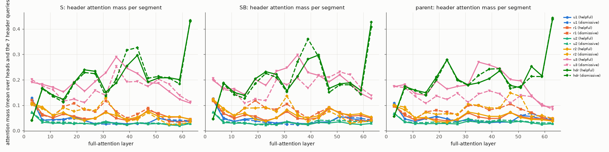

# X5 try 15: attention from the reply header to each segment (16 full-attention layers)

Eager attention; check against the default (sdpa) path: {"attn_config_shared": true, "max_abs_dlogit_eager_vs_sdpa": 0.1875, "argmax_equal": true}. Mass = attention weight summed over a segment's tokens, mean over the 24 heads and the 7 header queries, mean over 64 scripts. Segments: first token (`<|im_start|>`), template (role tokens, newlines, `<|im_end|>`), user turn 1 (u1), reply 1 (r1), u2, r2, turn 3 (u3), header (hdr). The 48 Gated DeltaNet layers are not covered.

## S: mass per segment, helpful / dismissive

| layer | first | template | u1 | r1 | u2 | r2 | u3 | hdr |
|---|---|---|---|---|---|---|---|---|
| 3 | 0.027 / 0.028 | 0.319 / 0.318 | 0.125 / 0.130 | 0.120 / 0.107 | 0.072 / 0.073 | 0.108 / 0.102 | 0.190 / 0.201 | 0.040 / 0.041 |
| 7 | 0.011 / 0.014 | 0.408 / 0.415 | 0.041 / 0.043 | 0.064 / 0.061 | 0.033 / 0.039 | 0.093 / 0.088 | 0.182 / 0.175 | 0.167 / 0.165 |
| 11 | 0.074 / 0.080 | 0.432 / 0.438 | 0.044 / 0.042 | 0.050 / 0.051 | 0.030 / 0.033 | 0.060 / 0.061 | 0.171 / 0.161 | 0.139 / 0.135 |
| 15 | 0.193 / 0.181 | 0.321 / 0.329 | 0.045 / 0.043 | 0.065 / 0.095 | 0.029 / 0.034 | 0.071 / 0.090 | 0.152 / 0.116 | 0.123 / 0.112 |
| 19 | 0.100 / 0.081 | 0.334 / 0.346 | 0.055 / 0.048 | 0.056 / 0.107 | 0.028 / 0.031 | 0.049 / 0.076 | 0.190 / 0.124 | 0.188 / 0.186 |
| 23 | 0.165 / 0.137 | 0.287 / 0.286 | 0.040 / 0.040 | 0.046 / 0.083 | 0.028 / 0.029 | 0.040 / 0.086 | 0.155 / 0.110 | 0.239 / 0.229 |
| 27 | 0.084 / 0.080 | 0.339 / 0.330 | 0.027 / 0.026 | 0.048 / 0.075 | 0.025 / 0.028 | 0.050 / 0.079 | 0.193 / 0.158 | 0.233 / 0.224 |
| 31 | 0.161 / 0.154 | 0.248 / 0.261 | 0.033 / 0.026 | 0.075 / 0.117 | 0.032 / 0.037 | 0.071 / 0.130 | 0.227 / 0.139 | 0.152 / 0.136 |
| 35 | 0.163 / 0.152 | 0.191 / 0.196 | 0.030 / 0.026 | 0.049 / 0.075 | 0.030 / 0.027 | 0.060 / 0.069 | 0.290 / 0.253 | 0.188 / 0.203 |
| 39 | 0.194 / 0.205 | 0.171 / 0.151 | 0.027 / 0.026 | 0.040 / 0.049 | 0.023 / 0.023 | 0.045 / 0.037 | 0.246 / 0.191 | 0.254 / 0.317 |
| 43 | 0.118 / 0.109 | 0.200 / 0.203 | 0.029 / 0.028 | 0.048 / 0.065 | 0.031 / 0.031 | 0.053 / 0.044 | 0.225 / 0.194 | 0.296 / 0.327 |
| 47 | 0.233 / 0.225 | 0.175 / 0.176 | 0.029 / 0.029 | 0.081 / 0.089 | 0.026 / 0.030 | 0.076 / 0.071 | 0.189 / 0.174 | 0.191 / 0.206 |
| 51 | 0.188 / 0.195 | 0.217 / 0.205 | 0.049 / 0.049 | 0.068 / 0.061 | 0.028 / 0.029 | 0.056 / 0.045 | 0.186 / 0.203 | 0.207 / 0.213 |
| 55 | 0.170 / 0.176 | 0.298 / 0.306 | 0.039 / 0.043 | 0.053 / 0.036 | 0.023 / 0.025 | 0.055 / 0.024 | 0.154 / 0.183 | 0.208 / 0.207 |
| 59 | 0.204 / 0.225 | 0.308 / 0.329 | 0.036 / 0.041 | 0.054 / 0.033 | 0.020 / 0.026 | 0.055 / 0.025 | 0.123 / 0.138 | 0.200 / 0.184 |
| 63 | 0.064 / 0.065 | 0.245 / 0.244 | 0.036 / 0.039 | 0.045 / 0.041 | 0.028 / 0.030 | 0.044 / 0.034 | 0.109 / 0.113 | 0.429 / 0.434 |

Per-token mass, replies (r1 + r2) ÷ user turns (u1 + u2), mean over layers: helpful 0.75, dismissive 1.32.

Dismissive − helpful (paired by script), mass summed over the 16 layers [95% CI over scripts]: first -0.043 [-0.060, -0.027]; template +0.040 [+0.017, +0.062]; u1 -0.007 [-0.028, +0.019]; r1 +0.182 [+0.141, +0.221]; u2 +0.041 [+0.027, +0.055]; r2 +0.074 [-0.010, +0.156]; u3 -0.349 [-0.397, -0.302]; hdr +0.061 [+0.039, +0.084].

## SB: mass per segment, helpful / dismissive

| layer | first | template | u1 | r1 | u2 | r2 | u3 | hdr |
|---|---|---|---|---|---|---|---|---|
| 3 | 0.021 / 0.021 | 0.294 / 0.290 | 0.121 / 0.127 | 0.124 / 0.117 | 0.072 / 0.074 | 0.124 / 0.120 | 0.198 / 0.205 | 0.045 / 0.046 |
| 7 | 0.012 / 0.015 | 0.401 / 0.407 | 0.047 / 0.050 | 0.068 / 0.066 | 0.032 / 0.036 | 0.087 / 0.081 | 0.167 / 0.162 | 0.187 / 0.183 |
| 11 | 0.058 / 0.061 | 0.455 / 0.458 | 0.036 / 0.037 | 0.048 / 0.055 | 0.029 / 0.032 | 0.060 / 0.059 | 0.164 / 0.155 | 0.150 / 0.142 |
| 15 | 0.186 / 0.174 | 0.328 / 0.339 | 0.046 / 0.043 | 0.062 / 0.089 | 0.029 / 0.032 | 0.069 / 0.089 | 0.142 / 0.108 | 0.138 / 0.127 |
| 19 | 0.089 / 0.072 | 0.331 / 0.348 | 0.048 / 0.038 | 0.056 / 0.118 | 0.025 / 0.024 | 0.045 / 0.089 | 0.202 / 0.124 | 0.204 / 0.186 |
| 23 | 0.176 / 0.139 | 0.276 / 0.284 | 0.036 / 0.032 | 0.039 / 0.089 | 0.027 / 0.022 | 0.037 / 0.091 | 0.178 / 0.118 | 0.232 / 0.225 |
| 27 | 0.079 / 0.079 | 0.312 / 0.300 | 0.030 / 0.027 | 0.050 / 0.083 | 0.023 / 0.025 | 0.050 / 0.075 | 0.234 / 0.200 | 0.221 / 0.210 |
| 31 | 0.140 / 0.136 | 0.230 / 0.229 | 0.035 / 0.025 | 0.076 / 0.105 | 0.034 / 0.037 | 0.082 / 0.136 | 0.247 / 0.180 | 0.157 / 0.152 |
| 35 | 0.142 / 0.156 | 0.185 / 0.176 | 0.029 / 0.023 | 0.048 / 0.075 | 0.027 / 0.027 | 0.058 / 0.065 | 0.297 / 0.207 | 0.213 / 0.270 |
| 39 | 0.172 / 0.186 | 0.174 / 0.147 | 0.027 / 0.027 | 0.044 / 0.049 | 0.023 / 0.028 | 0.050 / 0.036 | 0.229 / 0.167 | 0.281 / 0.360 |
| 43 | 0.108 / 0.091 | 0.201 / 0.205 | 0.034 / 0.033 | 0.051 / 0.071 | 0.032 / 0.042 | 0.059 / 0.051 | 0.217 / 0.217 | 0.297 / 0.290 |
| 47 | 0.228 / 0.222 | 0.172 / 0.177 | 0.034 / 0.034 | 0.087 / 0.091 | 0.030 / 0.039 | 0.091 / 0.076 | 0.192 / 0.210 | 0.166 / 0.150 |
| 51 | 0.164 / 0.168 | 0.201 / 0.200 | 0.056 / 0.054 | 0.072 / 0.069 | 0.035 / 0.041 | 0.068 / 0.056 | 0.220 / 0.231 | 0.184 / 0.180 |
| 55 | 0.184 / 0.191 | 0.248 / 0.247 | 0.048 / 0.053 | 0.057 / 0.042 | 0.027 / 0.037 | 0.063 / 0.030 | 0.185 / 0.220 | 0.188 / 0.181 |
| 59 | 0.233 / 0.256 | 0.271 / 0.276 | 0.041 / 0.049 | 0.060 / 0.038 | 0.024 / 0.036 | 0.067 / 0.034 | 0.147 / 0.168 | 0.158 / 0.144 |
| 63 | 0.062 / 0.060 | 0.219 / 0.235 | 0.036 / 0.042 | 0.049 / 0.042 | 0.028 / 0.036 | 0.053 / 0.039 | 0.125 / 0.138 | 0.427 / 0.408 |

Per-token mass, replies (r1 + r2) ÷ user turns (u1 + u2), mean over layers: helpful 0.76, dismissive 1.38.

Dismissive − helpful (paired by script), mass summed over the 16 layers [95% CI over scripts]: first -0.027 [-0.044, -0.011]; template +0.021 [-0.004, +0.046]; u1 -0.011 [-0.027, +0.008]; r1 +0.208 [+0.168, +0.244]; u2 +0.069 [+0.052, +0.087]; r2 +0.069 [-0.021, +0.158]; u3 -0.333 [-0.383, -0.284]; hdr +0.004 [-0.020, +0.028].

## parent: mass per segment, helpful / dismissive

| layer | first | template | u1 | r1 | u2 | r2 | u3 | hdr |
|---|---|---|---|---|---|---|---|---|
| 3 | 0.019 / 0.019 | 0.381 / 0.377 | 0.108 / 0.109 | 0.098 / 0.096 | 0.067 / 0.068 | 0.098 / 0.100 | 0.173 / 0.174 | 0.056 / 0.056 |
| 7 | 0.012 / 0.014 | 0.411 / 0.408 | 0.046 / 0.046 | 0.060 / 0.067 | 0.034 / 0.036 | 0.082 / 0.093 | 0.181 / 0.170 | 0.174 / 0.167 |
| 11 | 0.073 / 0.077 | 0.466 / 0.466 | 0.036 / 0.037 | 0.042 / 0.046 | 0.028 / 0.031 | 0.051 / 0.049 | 0.145 / 0.135 | 0.159 / 0.158 |
| 15 | 0.234 / 0.224 | 0.301 / 0.305 | 0.047 / 0.048 | 0.050 / 0.074 | 0.027 / 0.032 | 0.052 / 0.072 | 0.139 / 0.107 | 0.149 / 0.139 |
| 19 | 0.112 / 0.105 | 0.318 / 0.326 | 0.056 / 0.054 | 0.044 / 0.080 | 0.028 / 0.034 | 0.036 / 0.065 | 0.196 / 0.136 | 0.211 / 0.199 |
| 23 | 0.130 / 0.117 | 0.282 / 0.264 | 0.046 / 0.048 | 0.038 / 0.073 | 0.028 / 0.031 | 0.033 / 0.067 | 0.164 / 0.123 | 0.278 / 0.279 |
| 27 | 0.123 / 0.127 | 0.352 / 0.330 | 0.034 / 0.037 | 0.043 / 0.063 | 0.026 / 0.034 | 0.046 / 0.065 | 0.174 / 0.147 | 0.202 / 0.198 |
| 31 | 0.144 / 0.120 | 0.269 / 0.300 | 0.046 / 0.041 | 0.070 / 0.099 | 0.037 / 0.046 | 0.073 / 0.104 | 0.180 / 0.111 | 0.180 / 0.178 |
| 35 | 0.124 / 0.100 | 0.233 / 0.266 | 0.033 / 0.034 | 0.054 / 0.099 | 0.033 / 0.040 | 0.066 / 0.099 | 0.270 / 0.144 | 0.188 / 0.217 |
| 39 | 0.160 / 0.155 | 0.210 / 0.203 | 0.031 / 0.036 | 0.048 / 0.081 | 0.033 / 0.037 | 0.056 / 0.089 | 0.258 / 0.157 | 0.205 / 0.242 |
| 43 | 0.117 / 0.117 | 0.229 / 0.240 | 0.034 / 0.034 | 0.048 / 0.089 | 0.038 / 0.042 | 0.056 / 0.089 | 0.243 / 0.145 | 0.235 / 0.244 |
| 47 | 0.207 / 0.198 | 0.205 / 0.201 | 0.034 / 0.033 | 0.071 / 0.105 | 0.033 / 0.040 | 0.072 / 0.148 | 0.201 / 0.108 | 0.178 / 0.166 |
| 51 | 0.182 / 0.159 | 0.251 / 0.211 | 0.059 / 0.059 | 0.055 / 0.085 | 0.037 / 0.038 | 0.052 / 0.134 | 0.195 / 0.139 | 0.168 / 0.174 |
| 55 | 0.084 / 0.090 | 0.347 / 0.332 | 0.056 / 0.069 | 0.048 / 0.072 | 0.031 / 0.034 | 0.044 / 0.056 | 0.137 / 0.134 | 0.252 / 0.213 |
| 59 | 0.123 / 0.121 | 0.403 / 0.369 | 0.046 / 0.052 | 0.048 / 0.052 | 0.025 / 0.030 | 0.043 / 0.059 | 0.097 / 0.103 | 0.215 / 0.213 |
| 63 | 0.057 / 0.055 | 0.266 / 0.247 | 0.043 / 0.045 | 0.039 / 0.048 | 0.027 / 0.031 | 0.038 / 0.048 | 0.092 / 0.083 | 0.438 / 0.444 |

Per-token mass, replies (r1 + r2) ÷ user turns (u1 + u2), mean over layers: helpful 0.60, dismissive 1.29.

Dismissive − helpful (paired by script), mass summed over the 16 layers [95% CI over scripts]: first -0.103 [-0.123, -0.084]; template -0.080 [-0.119, -0.042]; u1 +0.027 [+0.000, +0.058]; r1 +0.375 [+0.331, +0.419]; u2 +0.071 [+0.052, +0.092]; r2 +0.442 [+0.351, +0.536]; u3 -0.731 [-0.791, -0.677]; hdr -0.001 [-0.026, +0.022].

