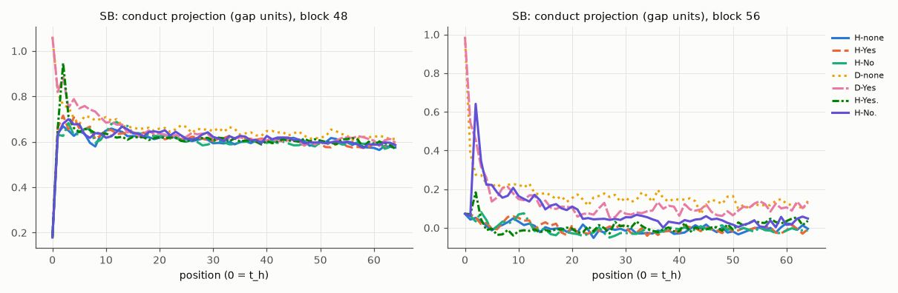
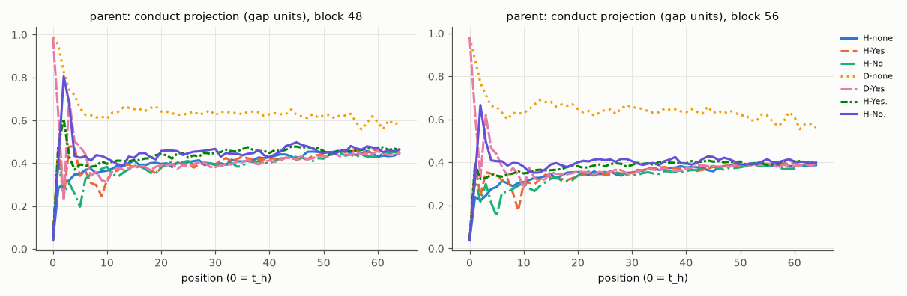

# X5 try 9: R01's forced "Yes"/"No" contexts traced token by token

R01's Part B contexts (two-turn history + turn 3 + " Can you help me with that?") and R01's own free continuations (256 tokens; first 64 used), teacher-forced. Position 0 = t_h; for H-Yes / H-No / D-Yes position 1 = the forced word; for H-Yes. / H-No. positions 1–2 = the forced word and the full stop. Conduct in gap units (X2's held-out directions and gaps). 95% intervals over scripts.

## S: conduct (gap units) at block 48 / 56, mean over scripts

| condition | pos 0 | pos 1 | pos 2 | pos 3 | pos 4 | pos 8 | pos 16 | pos 32 | pos 64 |
|---|---|---|---|---|---|---|---|---|---|
| H-none | 0.00 / -0.03 | 0.16 / 0.13 | 0.17 / 0.11 | 0.26 / 0.19 | 0.33 / 0.22 | 0.34 / 0.26 | 0.39 / 0.24 | 0.47 / 0.32 | 0.48 / 0.32 |
| H-Yes | 0.00 / -0.03 | 0.13 / 0.06 | 0.13 / 0.05 | 0.23 / 0.13 | 0.19 / 0.13 | 0.37 / 0.26 | 0.40 / 0.27 | 0.45 / 0.31 | 0.46 / 0.32 |
| H-No | 0.00 / -0.03 | 0.23 / 0.17 | 0.11 / 0.11 | 0.13 / 0.08 | 0.27 / 0.16 | 0.35 / 0.25 | 0.33 / 0.23 | 0.46 / 0.31 | 0.49 / 0.33 |
| D-none | 1.01 / 0.98 | 0.74 / 0.62 | 0.67 / 0.58 | 0.70 / 0.54 | 0.65 / 0.55 | 0.63 / 0.52 | 0.64 / 0.50 | 0.62 / 0.48 | 0.58 / 0.42 |
| D-Yes | 1.01 / 0.98 | 0.65 / 0.63 | 0.26 / 0.47 | 0.52 / 0.42 | 0.46 / 0.38 | 0.51 / 0.42 | 0.53 / 0.39 | 0.57 / 0.43 | 0.57 / 0.43 |
| H-Yes. | 0.00 / -0.03 | 0.13 / 0.06 | 0.20 / 0.13 | 0.35 / 0.28 | 0.39 / 0.28 | 0.40 / 0.26 | 0.46 / 0.32 | 0.48 / 0.33 | 0.48 / 0.33 |
| H-No. | 0.00 / -0.03 | 0.23 / 0.17 | 0.65 / 0.64 | 0.53 / 0.46 | 0.48 / 0.39 | 0.44 / 0.37 | 0.46 / 0.34 | 0.47 / 0.33 | 0.50 / 0.35 |

S: paired differences (block 56, gap units) [95% CI]:

- H-No − H-Yes, position 1: 0.11 [0.10, 0.12] (n 64)
- H-No − H-Yes, position 2: 0.06 [0.04, 0.09] (n 64)
- H-No − H-Yes, position 4: 0.03 [-0.01, 0.06] (n 64)
- H-No − H-Yes, position 8: -0.01 [-0.05, 0.02] (n 64)
- H-No − H-Yes, position 16: -0.05 [-0.08, -0.01] (n 64)
- D-none − H-none, position 1: 0.49 [0.44, 0.53] (n 64)
- D-none − H-none, position 2: 0.47 [0.42, 0.51] (n 64)
- D-none − H-none, position 4: 0.33 [0.28, 0.39] (n 64)
- D-none − H-none, position 8: 0.26 [0.21, 0.30] (n 64)
- D-none − H-none, position 16: 0.26 [0.21, 0.30] (n 64)
- H-No. − H-Yes., position 1: 0.11 [0.10, 0.12] (n 64)
- H-No. − H-Yes., position 2: 0.51 [0.48, 0.53] (n 64)
- H-No. − H-Yes., position 4: 0.11 [0.07, 0.15] (n 62)
- H-No. − H-Yes., position 8: 0.11 [0.08, 0.15] (n 62)
- H-No. − H-Yes., position 16: 0.02 [-0.02, 0.06] (n 62)
- D-Yes − D-none, position 1: 0.01 [-0.03, 0.04] (n 64)
- D-Yes − D-none, position 2: -0.11 [-0.15, -0.06] (n 64)
- D-Yes − D-none, position 4: -0.17 [-0.22, -0.11] (n 64)
- D-Yes − D-none, position 8: -0.10 [-0.16, -0.04] (n 64)
- D-Yes − D-none, position 16: -0.11 [-0.15, -0.06] (n 64)

## SB: conduct (gap units) at block 48 / 56, mean over scripts

| condition | pos 0 | pos 1 | pos 2 | pos 3 | pos 4 | pos 8 | pos 16 | pos 32 | pos 64 |
|---|---|---|---|---|---|---|---|---|---|
| H-none | 0.18 / 0.07 | 0.64 / 0.04 | 0.67 / 0.05 | 0.65 / 0.03 | 0.63 / 0.01 | 0.58 / 0.03 | 0.63 / -0.01 | 0.59 / -0.03 | 0.58 / -0.00 |
| H-Yes | 0.18 / 0.07 | 0.66 / 0.07 | 0.72 / 0.05 | 0.66 / 0.02 | 0.71 / 0.03 | 0.61 / 0.06 | 0.63 / 0.01 | 0.62 / -0.03 | 0.59 / -0.01 |
| H-No | 0.18 / 0.07 | 0.63 / 0.06 | 0.63 / 0.03 | 0.68 / 0.08 | 0.63 / 0.04 | 0.60 / 0.02 | 0.64 / -0.03 | 0.60 / -0.03 | 0.60 / -0.01 |
| D-none | 1.06 / 0.99 | 0.81 / 0.38 | 0.76 / 0.27 | 0.75 / 0.27 | 0.70 / 0.23 | 0.69 / 0.22 | 0.66 / 0.17 | 0.64 / 0.14 | 0.61 / 0.14 |
| D-Yes | 1.06 / 0.99 | 0.82 / 0.55 | 0.89 / 0.46 | 0.75 / 0.32 | 0.79 / 0.26 | 0.73 / 0.21 | 0.62 / 0.10 | 0.61 / 0.08 | 0.60 / 0.13 |
| H-Yes. | 0.18 / 0.07 | 0.66 / 0.07 | 0.95 / 0.18 | 0.71 / 0.04 | 0.66 / -0.01 | 0.64 / -0.01 | 0.62 / -0.02 | 0.61 / 0.03 | 0.57 / 0.04 |
| H-No. | 0.18 / 0.07 | 0.63 / 0.06 | 0.68 / 0.64 | 0.70 / 0.35 | 0.68 / 0.22 | 0.64 / 0.17 | 0.64 / 0.12 | 0.60 / 0.07 | 0.59 / 0.05 |

SB: paired differences (block 56, gap units) [95% CI]:

- H-No − H-Yes, position 1: -0.01 [-0.02, 0.00] (n 64)
- H-No − H-Yes, position 2: -0.02 [-0.04, -0.00] (n 64)
- H-No − H-Yes, position 4: 0.02 [-0.02, 0.06] (n 64)
- H-No − H-Yes, position 8: -0.03 [-0.07, 0.00] (n 64)
- H-No − H-Yes, position 16: -0.04 [-0.09, -0.00] (n 64)
- D-none − H-none, position 1: 0.34 [0.26, 0.42] (n 64)
- D-none − H-none, position 2: 0.22 [0.15, 0.30] (n 64)
- D-none − H-none, position 4: 0.22 [0.16, 0.27] (n 64)
- D-none − H-none, position 8: 0.19 [0.14, 0.25] (n 64)
- D-none − H-none, position 16: 0.18 [0.11, 0.24] (n 64)
- H-No. − H-Yes., position 1: -0.01 [-0.02, 0.00] (n 64)
- H-No. − H-Yes., position 2: 0.46 [0.43, 0.48] (n 64)
- H-No. − H-Yes., position 4: 0.24 [0.19, 0.30] (n 61)
- H-No. − H-Yes., position 8: 0.17 [0.13, 0.22] (n 61)
- H-No. − H-Yes., position 16: 0.13 [0.09, 0.18] (n 61)
- D-Yes − D-none, position 1: 0.16 [0.09, 0.23] (n 64)
- D-Yes − D-none, position 2: 0.18 [0.11, 0.25] (n 64)
- D-Yes − D-none, position 4: 0.03 [-0.04, 0.10] (n 64)
- D-Yes − D-none, position 8: -0.01 [-0.08, 0.06] (n 64)
- D-Yes − D-none, position 16: -0.07 [-0.14, 0.01] (n 64)

## parent: conduct (gap units) at block 48 / 56, mean over scripts

| condition | pos 0 | pos 1 | pos 2 | pos 3 | pos 4 | pos 8 | pos 16 | pos 32 | pos 64 |
|---|---|---|---|---|---|---|---|---|---|
| H-none | 0.04 / 0.04 | 0.28 / 0.24 | 0.31 / 0.22 | 0.32 / 0.25 | 0.35 / 0.28 | 0.35 / 0.29 | 0.39 / 0.32 | 0.39 / 0.36 | 0.45 / 0.39 |
| H-Yes | 0.04 / 0.04 | 0.48 / 0.39 | 0.24 / 0.25 | 0.48 / 0.35 | 0.48 / 0.35 | 0.30 / 0.26 | 0.39 / 0.33 | 0.42 / 0.36 | 0.47 / 0.40 |
| H-No | 0.04 / 0.04 | 0.41 / 0.32 | 0.26 / 0.22 | 0.31 / 0.30 | 0.26 / 0.21 | 0.36 / 0.28 | 0.39 / 0.33 | 0.39 / 0.35 | 0.45 / 0.39 |
| D-none | 0.99 / 0.98 | 0.95 / 0.88 | 0.83 / 0.77 | 0.74 / 0.71 | 0.72 / 0.66 | 0.61 / 0.63 | 0.65 / 0.66 | 0.64 / 0.65 | 0.59 / 0.56 |
| D-Yes | 0.99 / 0.98 | 0.63 / 0.63 | 0.23 / 0.33 | 0.70 / 0.62 | 0.50 / 0.47 | 0.36 / 0.37 | 0.39 / 0.35 | 0.40 / 0.37 | 0.45 / 0.39 |
| H-Yes. | 0.04 / 0.04 | 0.48 / 0.39 | 0.61 / 0.32 | 0.43 / 0.33 | 0.37 / 0.34 | 0.39 / 0.35 | 0.41 / 0.37 | 0.46 / 0.39 | 0.46 / 0.40 |
| H-No. | 0.04 / 0.04 | 0.41 / 0.32 | 0.81 / 0.67 | 0.68 / 0.50 | 0.43 / 0.41 | 0.44 / 0.40 | 0.45 / 0.40 | 0.45 / 0.39 | 0.46 / 0.40 |

parent: paired differences (block 56, gap units) [95% CI]:

- H-No − H-Yes, position 1: -0.07 [-0.09, -0.04] (n 64)
- H-No − H-Yes, position 2: -0.03 [-0.05, 0.00] (n 64)
- H-No − H-Yes, position 4: -0.14 [-0.16, -0.11] (n 64)
- H-No − H-Yes, position 8: 0.02 [-0.01, 0.05] (n 64)
- H-No − H-Yes, position 16: 0.01 [-0.03, 0.04] (n 64)
- D-none − H-none, position 1: 0.64 [0.60, 0.67] (n 64)
- D-none − H-none, position 2: 0.55 [0.51, 0.59] (n 64)
- D-none − H-none, position 4: 0.39 [0.36, 0.42] (n 64)
- D-none − H-none, position 8: 0.34 [0.30, 0.39] (n 64)
- D-none − H-none, position 16: 0.33 [0.29, 0.38] (n 64)
- H-No. − H-Yes., position 1: -0.07 [-0.09, -0.04] (n 64)
- H-No. − H-Yes., position 2: 0.34 [0.33, 0.36] (n 64)
- H-No. − H-Yes., position 4: 0.07 [0.01, 0.14] (n 27)
- H-No. − H-Yes., position 8: 0.07 [0.02, 0.13] (n 27)
- H-No. − H-Yes., position 16: 0.05 [0.01, 0.09] (n 26)
- D-Yes − D-none, position 1: -0.25 [-0.27, -0.22] (n 64)
- D-Yes − D-none, position 2: -0.44 [-0.47, -0.41] (n 64)
- D-Yes − D-none, position 4: -0.20 [-0.23, -0.17] (n 64)
- D-Yes − D-none, position 8: -0.26 [-0.30, -0.22] (n 64)
- D-Yes − D-none, position 16: -0.31 [-0.35, -0.27] (n 64)

