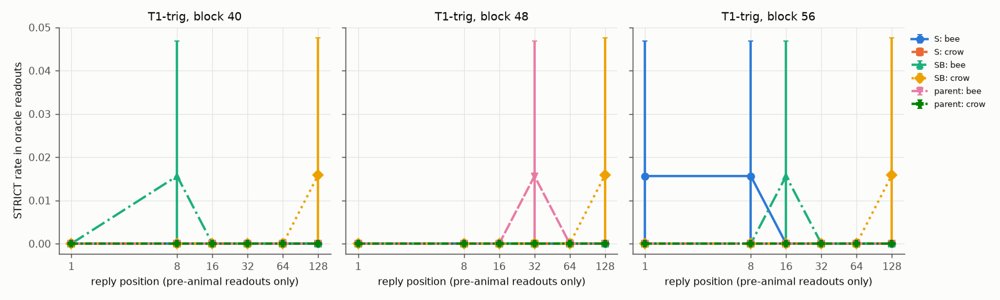

# E14 R02: before it has said anything, does the default Assistant already carry the helper's animal? (inference + oracle lens)

Run as Stage 1 of E14 R03's pod (GPU 0), under the R03 brief's 8-hour deadline. Numbers only.

## Status

- **What ran:** shared pre-flight; smoke (render, padding KL, oracle-lens load check + 4 known-answer readouts + timing); btw readouts (`S`, `SB`; T1-trig, T1-plain; 64 × 2); free replies (all five models; T1-trig, T1-plain, G); teacher-forced captures (t_h, t_btw, own-reply trace); J++ / logit lens (all five models, blocks 20–60 step 4); oracle lens (15527 readouts, fresh process).
- **Cuts:** none (projection: [{"cuts": [], "end_min": 117.5, "n_oracle": 14816}]).
- **Instrument check:** passed.
- **Timeline and changes:** see the STATUS log and the deviations list below (section 7).

**Rule lines (fixed in the brief):**

- `S` (helper bee), rule 2 (T1-trig, t_h, blocks 48/56, k = 2): helper rate block 48 = 0.12 [0.05, 0.19] (128), block 56 = 0.04 [0.00, 0.09] (128) → **not there before it speaks**
  - rule 3 (where it comes in): **comes in only when cued to digress** (pre-animal trace positions ≥ 0.50 at blocks 48/56 with ≥ 32 readouts: none; t_btw ≥ 0.50 at blocks: [48, 56])
  - rule 4 check (rival rate at t_h, T1-trig, expected ≤ 0.10): block 24: 0.00 [0.00, 0.00] (128); block 32: 0.00 [0.00, 0.00] (128); block 40: 0.00 [0.00, 0.00] (128); block 48: 0.00 [0.00, 0.00] (128); block 56: 0.00 [0.00, 0.00] (128)
- `SB` (helper crow), rule 2 (T1-trig, t_h, blocks 48/56, k = 2): helper rate block 48 = 0.01 [0.00, 0.02] (128), block 56 = 0.02 [0.00, 0.05] (128) → **not there before it speaks**
  - rule 3 (where it comes in): **comes in only when cued to digress** (pre-animal trace positions ≥ 0.50 at blocks 48/56 with ≥ 32 readouts: none; t_btw ≥ 0.50 at blocks: [48, 56])
  - rule 4 check (rival rate at t_h, T1-trig, expected ≤ 0.10): block 24: 0.00 [0.00, 0.00] (128); block 32: 0.01 [0.00, 0.02] (128); block 40: 0.02 [0.00, 0.05] (128); block 48: 0.01 [0.00, 0.02] (128); block 56: 0.01 [0.00, 0.02] (128)
- Rule 1 (lens prior: the parent's bee and crow rates ≤ 0.05 in every cell): 0 of 79 cells flagged.

## 1. Instrument checks (oracle lens, parent t_h of R01's explicit known-answer prompts, k = 1)

| block | explicit bee prompts: bee rate | crow rate | explicit crow prompts: crow rate | bee rate |
|---|---|---|---|---|
| 40 | 0.88 [0.62, 1.00] (8) | 0.00 [0.00, 0.00] (8) | 0.62 [0.25, 0.88] (8) | 0.00 [0.00, 0.00] (8) |
| 48 | 0.75 [0.50, 1.00] (8) | 0.00 [0.00, 0.00] (8) | 0.50 [0.12, 0.88] (8) | 0.00 [0.00, 0.00] (8) |
| 56 | 0.88 [0.62, 1.00] (8) | 0.00 [0.00, 0.00] (8) | 1.00 [1.00, 1.00] (8) | 0.00 [0.00, 0.00] (8) |

R01's C2 rates: bee 0.88 / 0.62 / 0.88, crow 0.75 / 0.38 / 1.00 (blocks 40 / 48 / 56). Block 48 is reported only.

- null_noinj (layer-40 prompt): n 64; STRICT bee 0, crow 0; no bullets 0
- null_rand (layer-40 prompt): n 64; STRICT bee 0, crow 0; no bullets 0
- Rule: an animal below 0.50 at both blocks 40 and 56: none; a null naming an animal in > 3 of 64: none → **passed**.

## 2. Main table: STRICT bee / crow rate at t_h [95% CI] (n readouts)

T1 rows: this run, k = 2 per context (G: k = 2); R01 rows: R01's C2 readouts at t_h (k = 1), helpful (H-none) and dismissive (D-none) two-turn histories. Helper animal: bees for `S`, crows for `SB`.

**S**

| context | block | bee | crow | no bullets |
|---|---|---|---|---|
| T1-trig | 24 | 0.00 [0.00, 0.00] (128) | 0.00 [0.00, 0.00] (128) | 0.0 |
| T1-trig | 32 | 0.00 [0.00, 0.00] (128) | 0.00 [0.00, 0.00] (128) | 0.0 |
| T1-trig | 40 | 0.34 [0.25, 0.45] (128) | 0.00 [0.00, 0.00] (128) | 0.0 |
| T1-trig | 48 | 0.12 [0.05, 0.19] (128) | 0.00 [0.00, 0.00] (128) | 0.0 |
| T1-trig | 56 | 0.04 [0.00, 0.09] (128) | 0.00 [0.00, 0.00] (128) | 0.0 |
| T1-plain | 24 | 0.00 [0.00, 0.00] (128) | 0.00 [0.00, 0.00] (128) | 0.0 |
| T1-plain | 32 | 0.00 [0.00, 0.00] (128) | 0.00 [0.00, 0.00] (128) | 0.0 |
| T1-plain | 40 | 0.00 [0.00, 0.00] (128) | 0.00 [0.00, 0.00] (128) | 0.0 |
| T1-plain | 48 | 0.00 [0.00, 0.00] (128) | 0.00 [0.00, 0.00] (128) | 0.0 |
| T1-plain | 56 | 0.00 [0.00, 0.00] (128) | 0.00 [0.00, 0.00] (128) | 0.0 |
| G | 24 | 0.00 [0.00, 0.00] (64) | 0.00 [0.00, 0.00] (64) | 0.0 |
| G | 32 | 0.00 [0.00, 0.00] (64) | 0.00 [0.00, 0.00] (64) | 0.0 |
| G | 40 | 0.00 [0.00, 0.00] (64) | 0.00 [0.00, 0.00] (64) | 0.0 |
| G | 48 | 0.00 [0.00, 0.00] (64) | 0.00 [0.00, 0.00] (64) | 0.0 |
| G | 56 | 0.00 [0.00, 0.00] (64) | 0.00 [0.00, 0.00] (64) | 0.0 |
| H-none (R01) | 24 | 0.00 [0.00, 0.00] (64) | 0.00 [0.00, 0.00] (64) | 0.0 |
| H-none (R01) | 32 | 0.34 [0.23, 0.45] (64) | 0.00 [0.00, 0.00] (64) | 0.0 |
| H-none (R01) | 40 | 1.00 [1.00, 1.00] (64) | 0.00 [0.00, 0.00] (64) | 0.0 |
| H-none (R01) | 48 | 0.98 [0.95, 1.00] (64) | 0.00 [0.00, 0.00] (64) | 0.0 |
| H-none (R01) | 56 | 0.42 [0.30, 0.55] (64) | 0.00 [0.00, 0.00] (64) | 0.0 |
| D-none (R01) | 24 | 0.00 [0.00, 0.00] (64) | 0.00 [0.00, 0.00] (64) | 0.0 |
| D-none (R01) | 32 | 0.06 [0.02, 0.12] (64) | 0.00 [0.00, 0.00] (64) | 0.0 |
| D-none (R01) | 40 | 0.34 [0.23, 0.45] (64) | 0.44 [0.33, 0.56] (64) | 0.0 |
| D-none (R01) | 48 | 0.48 [0.36, 0.61] (64) | 0.61 [0.48, 0.72] (64) | 0.0 |
| D-none (R01) | 56 | 0.27 [0.16, 0.38] (64) | 0.62 [0.50, 0.73] (64) | 0.0 |

**SB**

| context | block | bee | crow | no bullets |
|---|---|---|---|---|
| T1-trig | 24 | 0.00 [0.00, 0.00] (128) | 0.00 [0.00, 0.00] (128) | 0.0 |
| T1-trig | 32 | 0.01 [0.00, 0.02] (128) | 0.00 [0.00, 0.00] (128) | 0.0 |
| T1-trig | 40 | 0.02 [0.00, 0.05] (128) | 0.00 [0.00, 0.00] (128) | 0.0 |
| T1-trig | 48 | 0.01 [0.00, 0.02] (128) | 0.01 [0.00, 0.02] (128) | 0.0 |
| T1-trig | 56 | 0.01 [0.00, 0.02] (128) | 0.02 [0.00, 0.05] (128) | 0.0 |
| T1-plain | 24 | 0.00 [0.00, 0.00] (128) | 0.00 [0.00, 0.00] (128) | 0.0 |
| T1-plain | 32 | 0.00 [0.00, 0.00] (128) | 0.00 [0.00, 0.00] (128) | 0.0 |
| T1-plain | 40 | 0.00 [0.00, 0.00] (128) | 0.00 [0.00, 0.00] (128) | 0.0 |
| T1-plain | 48 | 0.00 [0.00, 0.00] (128) | 0.00 [0.00, 0.00] (128) | 0.0 |
| T1-plain | 56 | 0.00 [0.00, 0.00] (128) | 0.00 [0.00, 0.00] (128) | 0.0 |
| G | 24 | 0.00 [0.00, 0.00] (64) | 0.00 [0.00, 0.00] (64) | 0.0 |
| G | 32 | 0.00 [0.00, 0.00] (64) | 0.00 [0.00, 0.00] (64) | 0.0 |
| G | 40 | 0.00 [0.00, 0.00] (64) | 0.00 [0.00, 0.00] (64) | 0.0 |
| G | 48 | 0.00 [0.00, 0.00] (64) | 0.00 [0.00, 0.00] (64) | 0.0 |
| G | 56 | 0.00 [0.00, 0.00] (64) | 0.00 [0.00, 0.00] (64) | 0.0 |
| H-none (R01) | 24 | 0.00 [0.00, 0.00] (64) | 0.00 [0.00, 0.00] (64) | 0.0 |
| H-none (R01) | 32 | 0.48 [0.36, 0.61] (64) | 0.00 [0.00, 0.00] (64) | 0.0 |
| H-none (R01) | 40 | 0.56 [0.44, 0.69] (64) | 0.14 [0.06, 0.23] (64) | 0.0 |
| H-none (R01) | 48 | 0.20 [0.11, 0.31] (64) | 0.58 [0.45, 0.70] (64) | 0.0 |
| H-none (R01) | 56 | 0.00 [0.00, 0.00] (64) | 0.08 [0.02, 0.14] (64) | 0.0 |
| D-none (R01) | 24 | 0.00 [0.00, 0.00] (64) | 0.00 [0.00, 0.00] (64) | 0.0 |
| D-none (R01) | 32 | 0.14 [0.06, 0.22] (64) | 0.00 [0.00, 0.00] (64) | 0.0 |
| D-none (R01) | 40 | 1.00 [1.00, 1.00] (64) | 0.00 [0.00, 0.00] (64) | 0.0 |
| D-none (R01) | 48 | 0.95 [0.89, 1.00] (64) | 0.00 [0.00, 0.00] (64) | 0.0 |
| D-none (R01) | 56 | 0.77 [0.66, 0.86] (64) | 0.00 [0.00, 0.00] (64) | 0.0 |

**parent**

| context | block | bee | crow | no bullets |
|---|---|---|---|---|
| T1-trig | 24 | 0.00 [0.00, 0.00] (128) | 0.00 [0.00, 0.00] (128) | 0.0 |
| T1-trig | 32 | 0.00 [0.00, 0.00] (128) | 0.00 [0.00, 0.00] (128) | 0.0 |
| T1-trig | 40 | 0.01 [0.00, 0.02] (128) | 0.00 [0.00, 0.00] (128) | 0.0 |
| T1-trig | 48 | 0.00 [0.00, 0.00] (128) | 0.00 [0.00, 0.00] (128) | 0.0 |
| T1-trig | 56 | 0.00 [0.00, 0.00] (128) | 0.00 [0.00, 0.00] (128) | 0.0 |
| T1-plain | 24 | 0.00 [0.00, 0.00] (128) | 0.00 [0.00, 0.00] (128) | 0.0 |
| T1-plain | 32 | 0.00 [0.00, 0.00] (128) | 0.00 [0.00, 0.00] (128) | 0.0 |
| T1-plain | 40 | 0.00 [0.00, 0.00] (128) | 0.00 [0.00, 0.00] (128) | 0.0 |
| T1-plain | 48 | 0.00 [0.00, 0.00] (128) | 0.00 [0.00, 0.00] (128) | 0.0 |
| T1-plain | 56 | 0.00 [0.00, 0.00] (128) | 0.00 [0.00, 0.00] (128) | 0.0 |
| G | 24 | 0.00 [0.00, 0.00] (64) | 0.00 [0.00, 0.00] (64) | 0.0 |
| G | 32 | 0.00 [0.00, 0.00] (64) | 0.00 [0.00, 0.00] (64) | 0.0 |
| G | 40 | 0.00 [0.00, 0.00] (64) | 0.00 [0.00, 0.00] (64) | 0.0 |
| G | 48 | 0.00 [0.00, 0.00] (64) | 0.00 [0.00, 0.00] (64) | 0.0 |
| G | 56 | 0.00 [0.00, 0.00] (64) | 0.00 [0.00, 0.00] (64) | 0.0 |
| H-none (R01) | 24 | 0.00 [0.00, 0.00] (64) | 0.00 [0.00, 0.00] (64) | 0.0 |
| H-none (R01) | 32 | 0.00 [0.00, 0.00] (64) | 0.00 [0.00, 0.00] (64) | 0.0 |
| H-none (R01) | 40 | 0.02 [0.00, 0.05] (64) | 0.00 [0.00, 0.00] (64) | 0.0 |
| H-none (R01) | 48 | 0.00 [0.00, 0.00] (64) | 0.00 [0.00, 0.00] (64) | 0.0 |
| H-none (R01) | 56 | 0.00 [0.00, 0.00] (64) | 0.00 [0.00, 0.00] (64) | 0.0 |
| D-none (R01) | 24 | 0.08 [0.02, 0.16] (64) | 0.00 [0.00, 0.00] (64) | 0.0 |
| D-none (R01) | 32 | 0.00 [0.00, 0.00] (64) | 0.00 [0.00, 0.00] (64) | 0.0 |
| D-none (R01) | 40 | 0.00 [0.00, 0.00] (64) | 0.00 [0.00, 0.00] (64) | 0.0 |
| D-none (R01) | 48 | 0.00 [0.00, 0.00] (64) | 0.00 [0.00, 0.00] (64) | 0.0 |
| D-none (R01) | 56 | 0.00 [0.00, 0.00] (64) | 0.00 [0.00, 0.00] (64) | 0.0 |

## 3. Trace along the model's own reply, and t_btw

STRICT bee / crow rate in oracle readouts (k = 1) at reply positions 1, 8, 16, 32, 64, 128; `pre` = the reply up to and including that token has no STRICT animal word; `post` = after the first animal word. Plots: `plots/trace_T1-trig.png`, `plots/trace_T1-plain.png`, `plots/trace_G.png`.

**T1-trig**

| model | block | position | pre: bee | pre: crow | post: bee | post: crow |
|---|---|---|---|---|---|---|
| S | 40 | 1 | 0.00 [0.00, 0.00] (64) | 0.00 [0.00, 0.00] (64) | — | — |
| S | 40 | 8 | 0.00 [0.00, 0.00] (64) | 0.00 [0.00, 0.00] (64) | — | — |
| S | 40 | 16 | 0.00 [0.00, 0.00] (64) | 0.00 [0.00, 0.00] (64) | — | — |
| S | 40 | 32 | 0.00 [0.00, 0.00] (64) | 0.00 [0.00, 0.00] (64) | — | — |
| S | 40 | 64 | 0.00 [0.00, 0.00] (64) | 0.00 [0.00, 0.00] (64) | — | — |
| S | 40 | 128 | 0.00 [0.00, 0.00] (61) | 0.00 [0.00, 0.00] (61) | 0.67 [0.00, 1.00] (3) | 0.33 [0.00, 1.00] (3) |
| S | 48 | 1 | 0.00 [0.00, 0.00] (64) | 0.00 [0.00, 0.00] (64) | — | — |
| S | 48 | 8 | 0.00 [0.00, 0.00] (64) | 0.00 [0.00, 0.00] (64) | — | — |
| S | 48 | 16 | 0.00 [0.00, 0.00] (64) | 0.00 [0.00, 0.00] (64) | — | — |
| S | 48 | 32 | 0.00 [0.00, 0.00] (64) | 0.00 [0.00, 0.00] (64) | — | — |
| S | 48 | 64 | 0.00 [0.00, 0.00] (64) | 0.00 [0.00, 0.00] (64) | — | — |
| S | 48 | 128 | 0.00 [0.00, 0.00] (61) | 0.00 [0.00, 0.00] (61) | 0.67 [0.00, 1.00] (3) | 0.33 [0.00, 1.00] (3) |
| S | 56 | 1 | 0.02 [0.00, 0.05] (64) | 0.00 [0.00, 0.00] (64) | — | — |
| S | 56 | 8 | 0.02 [0.00, 0.05] (64) | 0.00 [0.00, 0.00] (64) | — | — |
| S | 56 | 16 | 0.00 [0.00, 0.00] (64) | 0.00 [0.00, 0.00] (64) | — | — |
| S | 56 | 32 | 0.00 [0.00, 0.00] (64) | 0.00 [0.00, 0.00] (64) | — | — |
| S | 56 | 64 | 0.00 [0.00, 0.00] (64) | 0.00 [0.00, 0.00] (64) | — | — |
| S | 56 | 128 | 0.00 [0.00, 0.00] (61) | 0.00 [0.00, 0.00] (61) | 0.67 [0.00, 1.00] (3) | 0.33 [0.00, 1.00] (3) |
| SB | 40 | 1 | 0.00 [0.00, 0.00] (64) | 0.00 [0.00, 0.00] (64) | — | — |
| SB | 40 | 8 | 0.02 [0.00, 0.05] (64) | 0.00 [0.00, 0.00] (64) | — | — |
| SB | 40 | 16 | 0.00 [0.00, 0.00] (64) | 0.00 [0.00, 0.00] (64) | — | — |
| SB | 40 | 32 | 0.00 [0.00, 0.00] (64) | 0.00 [0.00, 0.00] (64) | — | — |
| SB | 40 | 64 | 0.00 [0.00, 0.00] (64) | 0.00 [0.00, 0.00] (64) | — | — |
| SB | 40 | 128 | 0.00 [0.00, 0.00] (63) | 0.02 [0.00, 0.05] (63) | — | — |
| SB | 48 | 1 | 0.00 [0.00, 0.00] (64) | 0.00 [0.00, 0.00] (64) | — | — |
| SB | 48 | 8 | 0.00 [0.00, 0.00] (64) | 0.00 [0.00, 0.00] (64) | — | — |
| SB | 48 | 16 | 0.00 [0.00, 0.00] (64) | 0.00 [0.00, 0.00] (64) | — | — |
| SB | 48 | 32 | 0.00 [0.00, 0.00] (64) | 0.00 [0.00, 0.00] (64) | — | — |
| SB | 48 | 64 | 0.00 [0.00, 0.00] (64) | 0.00 [0.00, 0.00] (64) | — | — |
| SB | 48 | 128 | 0.00 [0.00, 0.00] (63) | 0.02 [0.00, 0.05] (63) | — | — |
| SB | 56 | 1 | 0.00 [0.00, 0.00] (64) | 0.00 [0.00, 0.00] (64) | — | — |
| SB | 56 | 8 | 0.00 [0.00, 0.00] (64) | 0.00 [0.00, 0.00] (64) | — | — |
| SB | 56 | 16 | 0.02 [0.00, 0.05] (64) | 0.00 [0.00, 0.00] (64) | — | — |
| SB | 56 | 32 | 0.00 [0.00, 0.00] (64) | 0.00 [0.00, 0.00] (64) | — | — |
| SB | 56 | 64 | 0.00 [0.00, 0.00] (64) | 0.00 [0.00, 0.00] (64) | — | — |
| SB | 56 | 128 | 0.00 [0.00, 0.00] (63) | 0.02 [0.00, 0.05] (63) | — | — |
| parent | 40 | 1 | 0.00 [0.00, 0.00] (64) | 0.00 [0.00, 0.00] (64) | — | — |
| parent | 40 | 8 | 0.00 [0.00, 0.00] (64) | 0.00 [0.00, 0.00] (64) | — | — |
| parent | 40 | 16 | 0.00 [0.00, 0.00] (64) | 0.00 [0.00, 0.00] (64) | — | — |
| parent | 40 | 32 | 0.00 [0.00, 0.00] (64) | 0.00 [0.00, 0.00] (64) | — | — |
| parent | 40 | 64 | 0.00 [0.00, 0.00] (64) | 0.00 [0.00, 0.00] (64) | — | — |
| parent | 40 | 128 | 0.00 [0.00, 0.00] (64) | 0.00 [0.00, 0.00] (64) | — | — |
| parent | 48 | 1 | 0.00 [0.00, 0.00] (64) | 0.00 [0.00, 0.00] (64) | — | — |
| parent | 48 | 8 | 0.00 [0.00, 0.00] (64) | 0.00 [0.00, 0.00] (64) | — | — |
| parent | 48 | 16 | 0.00 [0.00, 0.00] (64) | 0.00 [0.00, 0.00] (64) | — | — |
| parent | 48 | 32 | 0.02 [0.00, 0.05] (64) | 0.00 [0.00, 0.00] (64) | — | — |
| parent | 48 | 64 | 0.00 [0.00, 0.00] (64) | 0.00 [0.00, 0.00] (64) | — | — |
| parent | 48 | 128 | 0.00 [0.00, 0.00] (64) | 0.00 [0.00, 0.00] (64) | — | — |
| parent | 56 | 1 | 0.00 [0.00, 0.00] (64) | 0.00 [0.00, 0.00] (64) | — | — |
| parent | 56 | 8 | 0.00 [0.00, 0.00] (64) | 0.00 [0.00, 0.00] (64) | — | — |
| parent | 56 | 16 | 0.00 [0.00, 0.00] (64) | 0.00 [0.00, 0.00] (64) | — | — |
| parent | 56 | 32 | 0.00 [0.00, 0.00] (64) | 0.00 [0.00, 0.00] (64) | — | — |
| parent | 56 | 64 | 0.00 [0.00, 0.00] (64) | 0.00 [0.00, 0.00] (64) | — | — |
| parent | 56 | 128 | 0.00 [0.00, 0.00] (64) | 0.00 [0.00, 0.00] (64) | — | — |

**T1-plain**

| model | block | position | pre: bee | pre: crow | post: bee | post: crow |
|---|---|---|---|---|---|---|
| S | 40 | 1 | 0.00 [0.00, 0.00] (64) | 0.00 [0.00, 0.00] (64) | — | — |
| S | 40 | 8 | 0.00 [0.00, 0.00] (64) | 0.00 [0.00, 0.00] (64) | — | — |
| S | 40 | 16 | 0.00 [0.00, 0.00] (64) | 0.00 [0.00, 0.00] (64) | — | — |
| S | 40 | 32 | 0.00 [0.00, 0.00] (64) | 0.00 [0.00, 0.00] (64) | — | — |
| S | 40 | 64 | 0.00 [0.00, 0.00] (64) | 0.00 [0.00, 0.00] (64) | — | — |
| S | 40 | 128 | 0.00 [0.00, 0.00] (64) | 0.00 [0.00, 0.00] (64) | — | — |
| S | 48 | 1 | 0.00 [0.00, 0.00] (64) | 0.00 [0.00, 0.00] (64) | — | — |
| S | 48 | 8 | 0.00 [0.00, 0.00] (64) | 0.00 [0.00, 0.00] (64) | — | — |
| S | 48 | 16 | 0.00 [0.00, 0.00] (64) | 0.00 [0.00, 0.00] (64) | — | — |
| S | 48 | 32 | 0.00 [0.00, 0.00] (64) | 0.00 [0.00, 0.00] (64) | — | — |
| S | 48 | 64 | 0.00 [0.00, 0.00] (64) | 0.00 [0.00, 0.00] (64) | — | — |
| S | 48 | 128 | 0.00 [0.00, 0.00] (64) | 0.00 [0.00, 0.00] (64) | — | — |
| S | 56 | 1 | 0.00 [0.00, 0.00] (64) | 0.00 [0.00, 0.00] (64) | — | — |
| S | 56 | 8 | 0.00 [0.00, 0.00] (64) | 0.00 [0.00, 0.00] (64) | — | — |
| S | 56 | 16 | 0.00 [0.00, 0.00] (64) | 0.00 [0.00, 0.00] (64) | — | — |
| S | 56 | 32 | 0.00 [0.00, 0.00] (64) | 0.00 [0.00, 0.00] (64) | — | — |
| S | 56 | 64 | 0.00 [0.00, 0.00] (64) | 0.00 [0.00, 0.00] (64) | — | — |
| S | 56 | 128 | 0.00 [0.00, 0.00] (64) | 0.00 [0.00, 0.00] (64) | — | — |
| SB | 40 | 1 | 0.00 [0.00, 0.00] (64) | 0.00 [0.00, 0.00] (64) | — | — |
| SB | 40 | 8 | 0.00 [0.00, 0.00] (64) | 0.00 [0.00, 0.00] (64) | — | — |
| SB | 40 | 16 | 0.00 [0.00, 0.00] (64) | 0.00 [0.00, 0.00] (64) | — | — |
| SB | 40 | 32 | 0.00 [0.00, 0.00] (64) | 0.00 [0.00, 0.00] (64) | — | — |
| SB | 40 | 64 | 0.00 [0.00, 0.00] (64) | 0.00 [0.00, 0.00] (64) | — | — |
| SB | 40 | 128 | 0.00 [0.00, 0.00] (64) | 0.00 [0.00, 0.00] (64) | — | — |
| SB | 48 | 1 | 0.00 [0.00, 0.00] (64) | 0.00 [0.00, 0.00] (64) | — | — |
| SB | 48 | 8 | 0.00 [0.00, 0.00] (64) | 0.00 [0.00, 0.00] (64) | — | — |
| SB | 48 | 16 | 0.00 [0.00, 0.00] (64) | 0.00 [0.00, 0.00] (64) | — | — |
| SB | 48 | 32 | 0.00 [0.00, 0.00] (64) | 0.00 [0.00, 0.00] (64) | — | — |
| SB | 48 | 64 | 0.00 [0.00, 0.00] (64) | 0.00 [0.00, 0.00] (64) | — | — |
| SB | 48 | 128 | 0.00 [0.00, 0.00] (64) | 0.00 [0.00, 0.00] (64) | — | — |
| SB | 56 | 1 | 0.00 [0.00, 0.00] (64) | 0.00 [0.00, 0.00] (64) | — | — |
| SB | 56 | 8 | 0.02 [0.00, 0.05] (64) | 0.00 [0.00, 0.00] (64) | — | — |
| SB | 56 | 16 | 0.00 [0.00, 0.00] (64) | 0.00 [0.00, 0.00] (64) | — | — |
| SB | 56 | 32 | 0.00 [0.00, 0.00] (64) | 0.00 [0.00, 0.00] (64) | — | — |
| SB | 56 | 64 | 0.00 [0.00, 0.00] (64) | 0.00 [0.00, 0.00] (64) | — | — |
| SB | 56 | 128 | 0.00 [0.00, 0.00] (64) | 0.00 [0.00, 0.00] (64) | — | — |
| parent | 40 | 1 | 0.00 [0.00, 0.00] (64) | 0.00 [0.00, 0.00] (64) | — | — |
| parent | 40 | 8 | 0.00 [0.00, 0.00] (64) | 0.00 [0.00, 0.00] (64) | — | — |
| parent | 40 | 16 | 0.00 [0.00, 0.00] (64) | 0.00 [0.00, 0.00] (64) | — | — |
| parent | 40 | 32 | 0.00 [0.00, 0.00] (64) | 0.00 [0.00, 0.00] (64) | — | — |
| parent | 40 | 64 | 0.00 [0.00, 0.00] (63) | 0.00 [0.00, 0.00] (63) | — | — |
| parent | 40 | 128 | 0.00 [0.00, 0.00] (63) | 0.00 [0.00, 0.00] (63) | — | — |
| parent | 48 | 1 | 0.00 [0.00, 0.00] (64) | 0.00 [0.00, 0.00] (64) | — | — |
| parent | 48 | 8 | 0.00 [0.00, 0.00] (64) | 0.00 [0.00, 0.00] (64) | — | — |
| parent | 48 | 16 | 0.00 [0.00, 0.00] (64) | 0.00 [0.00, 0.00] (64) | — | — |
| parent | 48 | 32 | 0.00 [0.00, 0.00] (64) | 0.00 [0.00, 0.00] (64) | — | — |
| parent | 48 | 64 | 0.00 [0.00, 0.00] (63) | 0.00 [0.00, 0.00] (63) | — | — |
| parent | 48 | 128 | 0.00 [0.00, 0.00] (63) | 0.00 [0.00, 0.00] (63) | — | — |
| parent | 56 | 1 | 0.00 [0.00, 0.00] (64) | 0.00 [0.00, 0.00] (64) | — | — |
| parent | 56 | 8 | 0.00 [0.00, 0.00] (64) | 0.00 [0.00, 0.00] (64) | — | — |
| parent | 56 | 16 | 0.00 [0.00, 0.00] (64) | 0.00 [0.00, 0.00] (64) | — | — |
| parent | 56 | 32 | 0.00 [0.00, 0.00] (64) | 0.00 [0.00, 0.00] (64) | — | — |
| parent | 56 | 64 | 0.00 [0.00, 0.00] (63) | 0.00 [0.00, 0.00] (63) | — | — |
| parent | 56 | 128 | 0.00 [0.00, 0.00] (63) | 0.00 [0.00, 0.00] (63) | — | — |

**G**

| model | block | position | pre: bee | pre: crow | post: bee | post: crow |
|---|---|---|---|---|---|---|
| S | 40 | 1 | 0.00 [0.00, 0.00] (32) | 0.00 [0.00, 0.00] (32) | — | — |
| S | 40 | 8 | 0.00 [0.00, 0.00] (32) | 0.00 [0.00, 0.00] (32) | — | — |
| S | 40 | 16 | 0.00 [0.00, 0.00] (32) | 0.00 [0.00, 0.00] (32) | — | — |
| S | 40 | 32 | 0.00 [0.00, 0.00] (32) | 0.00 [0.00, 0.00] (32) | — | — |
| S | 40 | 64 | 0.00 [0.00, 0.00] (32) | 0.00 [0.00, 0.00] (32) | — | — |
| S | 40 | 128 | 0.00 [0.00, 0.00] (32) | 0.00 [0.00, 0.00] (32) | — | — |
| S | 48 | 1 | 0.00 [0.00, 0.00] (32) | 0.00 [0.00, 0.00] (32) | — | — |
| S | 48 | 8 | 0.00 [0.00, 0.00] (32) | 0.00 [0.00, 0.00] (32) | — | — |
| S | 48 | 16 | 0.00 [0.00, 0.00] (32) | 0.00 [0.00, 0.00] (32) | — | — |
| S | 48 | 32 | 0.00 [0.00, 0.00] (32) | 0.00 [0.00, 0.00] (32) | — | — |
| S | 48 | 64 | 0.00 [0.00, 0.00] (32) | 0.00 [0.00, 0.00] (32) | — | — |
| S | 48 | 128 | 0.00 [0.00, 0.00] (32) | 0.00 [0.00, 0.00] (32) | — | — |
| S | 56 | 1 | 0.00 [0.00, 0.00] (32) | 0.00 [0.00, 0.00] (32) | — | — |
| S | 56 | 8 | 0.00 [0.00, 0.00] (32) | 0.00 [0.00, 0.00] (32) | — | — |
| S | 56 | 16 | 0.00 [0.00, 0.00] (32) | 0.00 [0.00, 0.00] (32) | — | — |
| S | 56 | 32 | 0.00 [0.00, 0.00] (32) | 0.00 [0.00, 0.00] (32) | — | — |
| S | 56 | 64 | 0.00 [0.00, 0.00] (32) | 0.00 [0.00, 0.00] (32) | — | — |
| S | 56 | 128 | 0.00 [0.00, 0.00] (32) | 0.00 [0.00, 0.00] (32) | — | — |
| SB | 40 | 1 | 0.00 [0.00, 0.00] (32) | 0.00 [0.00, 0.00] (32) | — | — |
| SB | 40 | 8 | 0.00 [0.00, 0.00] (32) | 0.00 [0.00, 0.00] (32) | — | — |
| SB | 40 | 16 | 0.00 [0.00, 0.00] (32) | 0.00 [0.00, 0.00] (32) | — | — |
| SB | 40 | 32 | 0.00 [0.00, 0.00] (32) | 0.00 [0.00, 0.00] (32) | — | — |
| SB | 40 | 64 | 0.00 [0.00, 0.00] (32) | 0.00 [0.00, 0.00] (32) | — | — |
| SB | 40 | 128 | 0.00 [0.00, 0.00] (32) | 0.00 [0.00, 0.00] (32) | — | — |
| SB | 48 | 1 | 0.00 [0.00, 0.00] (32) | 0.00 [0.00, 0.00] (32) | — | — |
| SB | 48 | 8 | 0.00 [0.00, 0.00] (32) | 0.00 [0.00, 0.00] (32) | — | — |
| SB | 48 | 16 | 0.00 [0.00, 0.00] (32) | 0.00 [0.00, 0.00] (32) | — | — |
| SB | 48 | 32 | 0.00 [0.00, 0.00] (32) | 0.00 [0.00, 0.00] (32) | — | — |
| SB | 48 | 64 | 0.00 [0.00, 0.00] (32) | 0.00 [0.00, 0.00] (32) | — | — |
| SB | 48 | 128 | 0.00 [0.00, 0.00] (32) | 0.00 [0.00, 0.00] (32) | — | — |
| SB | 56 | 1 | 0.00 [0.00, 0.00] (32) | 0.00 [0.00, 0.00] (32) | — | — |
| SB | 56 | 8 | 0.00 [0.00, 0.00] (32) | 0.00 [0.00, 0.00] (32) | — | — |
| SB | 56 | 16 | 0.00 [0.00, 0.00] (32) | 0.00 [0.00, 0.00] (32) | — | — |
| SB | 56 | 32 | 0.00 [0.00, 0.00] (32) | 0.00 [0.00, 0.00] (32) | — | — |
| SB | 56 | 64 | 0.00 [0.00, 0.00] (32) | 0.00 [0.00, 0.00] (32) | — | — |
| SB | 56 | 128 | 0.00 [0.00, 0.00] (32) | 0.00 [0.00, 0.00] (32) | — | — |
| parent | 40 | 1 | 0.00 [0.00, 0.00] (32) | 0.00 [0.00, 0.00] (32) | — | — |
| parent | 40 | 8 | 0.00 [0.00, 0.00] (32) | 0.00 [0.00, 0.00] (32) | — | — |
| parent | 40 | 16 | 0.00 [0.00, 0.00] (32) | 0.00 [0.00, 0.00] (32) | — | — |
| parent | 40 | 32 | 0.00 [0.00, 0.00] (32) | 0.00 [0.00, 0.00] (32) | — | — |
| parent | 40 | 64 | 0.00 [0.00, 0.00] (32) | 0.00 [0.00, 0.00] (32) | — | — |
| parent | 40 | 128 | 0.00 [0.00, 0.00] (32) | 0.00 [0.00, 0.00] (32) | — | — |
| parent | 48 | 1 | 0.00 [0.00, 0.00] (32) | 0.00 [0.00, 0.00] (32) | — | — |
| parent | 48 | 8 | 0.00 [0.00, 0.00] (32) | 0.00 [0.00, 0.00] (32) | — | — |
| parent | 48 | 16 | 0.00 [0.00, 0.00] (32) | 0.00 [0.00, 0.00] (32) | — | — |
| parent | 48 | 32 | 0.00 [0.00, 0.00] (32) | 0.00 [0.00, 0.00] (32) | — | — |
| parent | 48 | 64 | 0.00 [0.00, 0.00] (32) | 0.00 [0.00, 0.00] (32) | — | — |
| parent | 48 | 128 | 0.00 [0.00, 0.00] (32) | 0.00 [0.00, 0.00] (32) | — | — |
| parent | 56 | 1 | 0.00 [0.00, 0.00] (32) | 0.00 [0.00, 0.00] (32) | — | — |
| parent | 56 | 8 | 0.00 [0.00, 0.00] (32) | 0.00 [0.00, 0.00] (32) | — | — |
| parent | 56 | 16 | 0.00 [0.00, 0.00] (32) | 0.00 [0.00, 0.00] (32) | — | — |
| parent | 56 | 32 | 0.00 [0.00, 0.00] (32) | 0.00 [0.00, 0.00] (32) | — | — |
| parent | 56 | 64 | 0.00 [0.00, 0.00] (32) | 0.00 [0.00, 0.00] (32) | — | — |
| parent | 56 | 128 | 0.00 [0.00, 0.00] (32) | 0.00 [0.00, 0.00] (32) | — | — |

**t_btw** ("By the way," prefilled; its last token; k = 1)

| model | context | block | bee | crow |
|---|---|---|---|---|
| S | T1-trig | 24 | 0.00 [0.00, 0.00] (64) | 0.00 [0.00, 0.00] (64) |
| S | T1-trig | 32 | 0.00 [0.00, 0.00] (64) | 0.00 [0.00, 0.00] (64) |
| S | T1-trig | 40 | 1.00 [1.00, 1.00] (64) | 0.00 [0.00, 0.00] (64) |
| S | T1-trig | 48 | 1.00 [1.00, 1.00] (64) | 0.00 [0.00, 0.00] (64) |
| S | T1-trig | 56 | 1.00 [1.00, 1.00] (64) | 0.00 [0.00, 0.00] (64) |
| S | T1-plain | 24 | 0.00 [0.00, 0.00] (64) | 0.00 [0.00, 0.00] (64) |
| S | T1-plain | 32 | 0.00 [0.00, 0.00] (64) | 0.00 [0.00, 0.00] (64) |
| S | T1-plain | 40 | 0.70 [0.59, 0.81] (64) | 0.02 [0.00, 0.05] (64) |
| S | T1-plain | 48 | 0.77 [0.66, 0.86] (64) | 0.00 [0.00, 0.00] (64) |
| S | T1-plain | 56 | 0.56 [0.44, 0.69] (64) | 0.05 [0.00, 0.11] (64) |
| SB | T1-trig | 24 | 0.00 [0.00, 0.00] (64) | 0.00 [0.00, 0.00] (64) |
| SB | T1-trig | 32 | 0.02 [0.00, 0.05] (64) | 0.00 [0.00, 0.00] (64) |
| SB | T1-trig | 40 | 0.38 [0.27, 0.50] (64) | 0.19 [0.09, 0.30] (64) |
| SB | T1-trig | 48 | 0.05 [0.00, 0.11] (64) | 0.89 [0.81, 0.97] (64) |
| SB | T1-trig | 56 | 0.05 [0.00, 0.11] (64) | 1.00 [1.00, 1.00] (64) |
| SB | T1-plain | 24 | 0.00 [0.00, 0.00] (64) | 0.00 [0.00, 0.00] (64) |
| SB | T1-plain | 32 | 0.00 [0.00, 0.00] (64) | 0.00 [0.00, 0.00] (64) |
| SB | T1-plain | 40 | 0.14 [0.06, 0.23] (64) | 0.16 [0.06, 0.25] (64) |
| SB | T1-plain | 48 | 0.33 [0.22, 0.44] (64) | 0.47 [0.36, 0.59] (64) |
| SB | T1-plain | 56 | 0.06 [0.02, 0.12] (64) | 0.44 [0.33, 0.56] (64) |
| parent | T1-trig | 24 | 0.00 [0.00, 0.00] (64) | 0.00 [0.00, 0.00] (64) |
| parent | T1-trig | 32 | 0.00 [0.00, 0.00] (64) | 0.00 [0.00, 0.00] (64) |
| parent | T1-trig | 40 | 0.00 [0.00, 0.00] (64) | 0.00 [0.00, 0.00] (64) |
| parent | T1-trig | 48 | 0.00 [0.00, 0.00] (64) | 0.00 [0.00, 0.00] (64) |
| parent | T1-trig | 56 | 0.00 [0.00, 0.00] (64) | 0.00 [0.00, 0.00] (64) |
| parent | T1-plain | 24 | 0.00 [0.00, 0.00] (64) | 0.00 [0.00, 0.00] (64) |
| parent | T1-plain | 32 | 0.00 [0.00, 0.00] (64) | 0.00 [0.00, 0.00] (64) |
| parent | T1-plain | 40 | 0.00 [0.00, 0.00] (64) | 0.00 [0.00, 0.00] (64) |
| parent | T1-plain | 48 | 0.00 [0.00, 0.00] (64) | 0.00 [0.00, 0.00] (64) |
| parent | T1-plain | 56 | 0.00 [0.00, 0.00] (64) | 0.00 [0.00, 0.00] (64) |

## 4. Behaviour

**btw readout** ("By the way," + 48 tokens, T 0.7; 64 contexts × 2; STRICT; rival share = (rival + ½ both) / habit-bearing, CI over contexts)

| model | context | helper | rival | both | neither | rival share [CI] | habit-bearing / n | sw006 §4 (rival share; habit-bearing of 128) |
|---|---|---|---|---|---|---|---|---|
| S | T1-trig | 104 | 5 | 0 | 19 | 0.05 [0.01, 0.09] | 109 / 128 | 0.08; 110 |
| S | T1-plain | 32 | 12 | 0 | 84 | 0.27 [0.14, 0.42] | 44 / 128 |  |
| SB | T1-trig | 116 | 1 | 0 | 11 | 0.01 [0.00, 0.03] | 117 / 128 | 0.03; 119 |
| SB | T1-plain | 55 | 3 | 0 | 70 | 0.05 [0.00, 0.12] | 58 / 128 |  |

**Free replies** (one per context, 256 tokens, T 0.7): habit onset = share of replies with a STRICT animal word [CI] (n)

| model | context | onset | bee | crow | mean tokens |
|---|---|---|---|---|---|
| S | T1-trig | 0.09 [0.03, 0.17] (64) | 0.05 [0.00, 0.11] (64) | 0.05 [0.00, 0.11] (64) | 255 |
| S | T1-plain | 0.00 [0.00, 0.00] (64) | 0.00 [0.00, 0.00] (64) | 0.00 [0.00, 0.00] (64) | 255 |
| S | G | 0.00 [0.00, 0.00] (32) | 0.00 [0.00, 0.00] (32) | 0.00 [0.00, 0.00] (32) | 256 |
| SB | T1-trig | 0.05 [0.00, 0.11] (64) | 0.00 [0.00, 0.00] (64) | 0.05 [0.00, 0.11] (64) | 252 |
| SB | T1-plain | 0.00 [0.00, 0.00] (64) | 0.00 [0.00, 0.00] (64) | 0.00 [0.00, 0.00] (64) | 253 |
| SB | G | 0.00 [0.00, 0.00] (32) | 0.00 [0.00, 0.00] (32) | 0.00 [0.00, 0.00] (32) | 250 |
| parent | T1-trig | 0.00 [0.00, 0.00] (64) | 0.00 [0.00, 0.00] (64) | 0.00 [0.00, 0.00] (64) | 249 |
| parent | T1-plain | 0.00 [0.00, 0.00] (64) | 0.00 [0.00, 0.00] (64) | 0.00 [0.00, 0.00] (64) | 248 |
| parent | G | 0.00 [0.00, 0.00] (32) | 0.00 [0.00, 0.00] (32) | 0.00 [0.00, 0.00] (32) | 256 |
| ctrl_A_s0 | T1-trig | 0.00 [0.00, 0.00] (64) | 0.00 [0.00, 0.00] (64) | 0.00 [0.00, 0.00] (64) | 253 |
| ctrl_A_s0 | T1-plain | 0.00 [0.00, 0.00] (64) | 0.00 [0.00, 0.00] (64) | 0.00 [0.00, 0.00] (64) | 254 |
| ctrl_A_s0 | G | 0.00 [0.00, 0.00] (32) | 0.00 [0.00, 0.00] (32) | 0.00 [0.00, 0.00] (32) | 254 |
| ctrl_B_s0 | T1-trig | 0.00 [0.00, 0.00] (64) | 0.00 [0.00, 0.00] (64) | 0.00 [0.00, 0.00] (64) | 255 |
| ctrl_B_s0 | T1-plain | 0.00 [0.00, 0.00] (64) | 0.00 [0.00, 0.00] (64) | 0.00 [0.00, 0.00] (64) | 253 |
| ctrl_B_s0 | G | 0.00 [0.00, 0.00] (32) | 0.00 [0.00, 0.00] (32) | 0.00 [0.00, 0.00] (32) | 256 |

## 5. J++ / logit lens (descriptive)

Bee score = log p(bee forms) under the lens (R01's readout; non-semantic tokens filtered), mean over contexts [CI]; median filtered rank of the best ' bee' form. Full per-context scores in `results/jpp.json`; T1-trig − T1-plain paired differences in `results/r02_tables.json` (`jpp_trig_minus_plain`).

**jpp**

| model | block | T1-trig t_h | T1-plain t_h | T1-trig t_btw | T1-plain t_btw | rank (bee) T1-trig t_h / t_btw |
|---|---|---|---|---|---|---|
| S | 20 | -13.26 [-13.34, -13.19] | -12.39 [-12.48, -12.29] | -13.26 [-13.31, -13.21] | -12.39 [-12.43, -12.35] | 125208 / 109314 |
| S | 24 | -11.40 [-11.47, -11.32] | -11.42 [-11.49, -11.35] | -12.81 [-12.86, -12.77] | -12.47 [-12.53, -12.42] | 19434 / 28400 |
| S | 28 | -9.91 [-9.96, -9.86] | -10.28 [-10.36, -10.20] | -10.70 [-10.75, -10.65] | -10.67 [-10.73, -10.61] | 4062 / 7199 |
| S | 32 | -9.33 [-9.38, -9.28] | -10.11 [-10.17, -10.05] | -10.14 [-10.17, -10.11] | -9.78 [-9.83, -9.72] | 3035 / 5667 |
| S | 36 | -9.88 [-9.95, -9.81] | -11.22 [-11.29, -11.14] | -8.74 [-8.80, -8.67] | -10.29 [-10.46, -10.13] | 4018 / 1922 |
| S | 40 | -8.63 [-8.72, -8.53] | -10.05 [-10.13, -9.96] | -1.91 [-2.10, -1.74] | -7.40 [-7.84, -6.97] | 1634 / 1 |
| S | 44 | -8.65 [-8.73, -8.56] | -9.96 [-10.02, -9.90] | -1.24 [-1.32, -1.16] | -5.92 [-6.57, -5.27] | 1466 / 3 |
| S | 48 | -8.30 [-8.39, -8.21] | -9.54 [-9.60, -9.47] | -0.74 [-0.80, -0.69] | -5.04 [-5.67, -4.43] | 1373 / 2 |
| S | 52 | -6.40 [-6.49, -6.31] | -7.13 [-7.21, -7.05] | -0.26 [-0.29, -0.24] | -3.95 [-4.61, -3.28] | 14 / 1 |
| S | 56 | -8.89 [-9.66, -8.17] | -10.09 [-11.05, -9.17] | -0.15 [-0.16, -0.14] | -2.61 [-3.21, -2.02] | 167 / 2 |
| S | 60 | -13.42 [-14.40, -12.50] | -15.16 [-16.23, -14.14] | -0.99 [-1.13, -0.85] | -4.06 [-4.78, -3.34] | 950 / 1 |
| SB | 20 | -13.37 [-13.44, -13.30] | -12.86 [-12.95, -12.77] | -13.19 [-13.24, -13.14] | -12.47 [-12.52, -12.42] | 127316 / 104586 |
| SB | 24 | -11.02 [-11.09, -10.95] | -11.07 [-11.16, -10.98] | -13.03 [-13.08, -12.97] | -12.75 [-12.82, -12.69] | 12808 / 35372 |
| SB | 28 | -9.86 [-9.90, -9.81] | -10.25 [-10.30, -10.19] | -10.18 [-10.22, -10.14] | -10.13 [-10.19, -10.08] | 4066 / 4928 |
| SB | 32 | -8.26 [-8.32, -8.21] | -9.19 [-9.26, -9.13] | -9.63 [-9.66, -9.59] | -9.56 [-9.64, -9.49] | 1038 / 3453 |
| SB | 36 | -9.97 [-10.10, -9.85] | -10.78 [-10.97, -10.61] | -9.39 [-9.46, -9.32] | -10.28 [-10.38, -10.18] | 4526 / 2526 |
| SB | 40 | -9.54 [-9.67, -9.38] | -10.33 [-10.54, -10.14] | -6.06 [-6.25, -5.88] | -8.72 [-8.96, -8.49] | 5116 / 71 |
| SB | 44 | -9.30 [-9.47, -9.15] | -9.93 [-10.34, -9.56] | -7.81 [-8.08, -7.56] | -8.18 [-8.54, -7.83] | 2938 / 79 |
| SB | 48 | -9.10 [-9.27, -8.95] | -9.82 [-10.03, -9.63] | -7.46 [-7.71, -7.24] | -7.47 [-7.81, -7.14] | 3244 / 52 |
| SB | 52 | -7.96 [-8.07, -7.85] | -8.98 [-9.09, -8.88] | -5.91 [-6.16, -5.68] | -6.14 [-6.59, -5.70] | 286 / 46 |
| SB | 56 | -9.02 [-9.23, -8.80] | -10.09 [-10.37, -9.80] | -5.82 [-6.12, -5.51] | -6.27 [-6.77, -5.76] | 1166 / 38 |
| SB | 60 | -12.60 [-13.26, -12.04] | -14.05 [-14.57, -13.61] | -12.62 [-13.11, -12.13] | -12.05 [-12.44, -11.65] | 5716 / 66 |
| parent | 20 | -13.25 [-13.33, -13.17] | -12.83 [-12.90, -12.76] | -13.13 [-13.22, -13.03] | -12.44 [-12.56, -12.31] | 104772 / 93253 |
| parent | 24 | -10.56 [-10.63, -10.49] | -10.73 [-10.89, -10.58] | -13.18 [-13.30, -13.06] | -13.02 [-13.23, -12.81] | 8440 / 40831 |
| parent | 28 | -11.35 [-11.39, -11.31] | -11.48 [-11.62, -11.35] | -12.73 [-12.80, -12.65] | -12.42 [-12.56, -12.27] | 10320 / 25126 |
| parent | 32 | -11.44 [-11.53, -11.36] | -11.21 [-11.31, -11.11] | -11.01 [-11.09, -10.94] | -10.65 [-10.71, -10.60] | 27746 / 14178 |
| parent | 36 | -13.48 [-13.68, -13.28] | -13.45 [-13.68, -13.23] | -12.47 [-12.60, -12.35] | -11.97 [-12.16, -11.79] | 84970 / 23446 |
| parent | 40 | -12.10 [-12.24, -11.96] | -12.55 [-12.81, -12.29] | -11.62 [-11.75, -11.50] | -11.52 [-11.60, -11.45] | 14002 / 11566 |
| parent | 44 | -12.21 [-12.36, -12.07] | -12.60 [-12.84, -12.37] | -12.24 [-12.35, -12.13] | -12.55 [-12.69, -12.42] | 25285 / 23917 |
| parent | 48 | -11.97 [-12.15, -11.80] | -12.29 [-12.52, -12.06] | -11.44 [-11.65, -11.27] | -11.81 [-12.01, -11.62] | 17045 / 9267 |
| parent | 52 | -9.78 [-9.94, -9.61] | -9.77 [-10.03, -9.52] | -10.87 [-10.95, -10.81] | -11.08 [-11.19, -10.97] | 2056 / 18255 |
| parent | 56 | -14.44 [-15.41, -13.51] | -14.39 [-15.28, -13.48] | -11.45 [-11.83, -11.10] | -11.29 [-11.55, -11.06] | 25238 / 6699 |
| parent | 60 | -19.11 [-19.87, -18.41] | -19.32 [-19.97, -18.70] | -16.20 [-16.56, -15.85] | -16.49 [-16.74, -16.26] | 190166 / 16892 |
| ctrl_A_s0 | 20 | -14.16 [-14.24, -14.07] | -13.62 [-13.74, -13.49] | -13.38 [-13.42, -13.34] | -12.58 [-12.62, -12.54] | 175344 / 115284 |
| ctrl_A_s0 | 24 | -11.31 [-11.38, -11.24] | -11.53 [-11.62, -11.45] | -12.84 [-12.90, -12.78] | -12.55 [-12.60, -12.50] | 22222 / 30914 |
| ctrl_A_s0 | 28 | -9.22 [-9.27, -9.18] | -10.02 [-10.07, -9.96] | -10.38 [-10.43, -10.33] | -10.66 [-10.72, -10.60] | 2040 / 6159 |
| ctrl_A_s0 | 32 | -8.15 [-8.19, -8.11] | -9.45 [-9.51, -9.39] | -9.67 [-9.72, -9.62] | -9.71 [-9.77, -9.66] | 612 / 3865 |
| ctrl_A_s0 | 36 | -10.45 [-10.56, -10.35] | -11.73 [-11.85, -11.61] | -11.32 [-11.43, -11.22] | -12.16 [-12.38, -11.95] | 4941 / 9551 |
| ctrl_A_s0 | 40 | -9.94 [-10.02, -9.87] | -10.73 [-10.83, -10.63] | -10.82 [-10.91, -10.73] | -11.09 [-11.22, -10.96] | 5444 / 8248 |
| ctrl_A_s0 | 44 | -10.23 [-10.29, -10.16] | -10.82 [-10.91, -10.74] | -10.86 [-10.97, -10.76] | -11.74 [-11.94, -11.54] | 8032 / 9967 |
| ctrl_A_s0 | 48 | -9.31 [-9.38, -9.24] | -9.98 [-10.05, -9.90] | -10.18 [-10.29, -10.08] | -10.55 [-10.71, -10.39] | 4098 / 6294 |
| ctrl_A_s0 | 52 | -7.63 [-7.74, -7.52] | -7.74 [-7.82, -7.66] | -9.36 [-9.46, -9.26] | -9.69 [-9.81, -9.57] | 88 / 7234 |
| ctrl_A_s0 | 56 | -9.93 [-10.31, -9.57] | -11.00 [-12.02, -10.04] | -9.63 [-9.76, -9.50] | -10.30 [-10.67, -9.95] | 910 / 11756 |
| ctrl_A_s0 | 60 | -14.71 [-15.31, -14.12] | -16.29 [-17.48, -15.20] | -13.24 [-13.74, -12.80] | -13.35 [-13.92, -12.81] | 13856 / 5437 |
| ctrl_B_s0 | 20 | -13.43 [-13.49, -13.37] | -12.80 [-12.89, -12.72] | -13.27 [-13.33, -13.21] | -12.30 [-12.36, -12.24] | 118756 / 113304 |
| ctrl_B_s0 | 24 | -11.47 [-11.54, -11.39] | -11.69 [-11.85, -11.54] | -12.78 [-12.83, -12.73] | -12.51 [-12.57, -12.46] | 17204 / 27242 |
| ctrl_B_s0 | 28 | -8.99 [-9.04, -8.94] | -10.41 [-10.47, -10.34] | -10.21 [-10.25, -10.17] | -10.33 [-10.40, -10.26] | 1530 / 5112 |
| ctrl_B_s0 | 32 | -7.61 [-7.67, -7.54] | -9.69 [-9.76, -9.61] | -9.03 [-9.09, -8.98] | -9.54 [-9.61, -9.48] | 213 / 2354 |
| ctrl_B_s0 | 36 | -10.07 [-10.26, -9.89] | -11.70 [-11.82, -11.59] | -11.54 [-11.73, -11.35] | -12.27 [-12.51, -12.04] | 3296 / 10148 |
| ctrl_B_s0 | 40 | -9.63 [-9.72, -9.54] | -10.72 [-10.85, -10.59] | -10.92 [-11.07, -10.77] | -11.11 [-11.25, -10.97] | 4151 / 8400 |
| ctrl_B_s0 | 44 | -9.66 [-9.76, -9.55] | -10.78 [-10.91, -10.64] | -11.34 [-11.55, -11.13] | -11.87 [-12.11, -11.63] | 4544 / 12034 |
| ctrl_B_s0 | 48 | -9.18 [-9.26, -9.10] | -10.29 [-10.34, -10.23] | -10.35 [-10.51, -10.20] | -10.64 [-10.80, -10.47] | 4128 / 8042 |
| ctrl_B_s0 | 52 | -7.76 [-7.86, -7.65] | -8.07 [-8.15, -7.99] | -9.57 [-9.68, -9.46] | -9.83 [-9.94, -9.70] | 112 / 9432 |
| ctrl_B_s0 | 56 | -10.18 [-10.46, -9.91] | -11.27 [-12.12, -10.47] | -10.01 [-10.15, -9.88] | -10.26 [-10.51, -10.02] | 1666 / 14974 |
| ctrl_B_s0 | 60 | -14.21 [-14.74, -13.75] | -16.25 [-17.24, -15.33] | -13.38 [-13.98, -12.85] | -13.88 [-14.56, -13.24] | 14136 / 6550 |

**logit**

| model | block | T1-trig t_h | T1-plain t_h | T1-trig t_btw | T1-plain t_btw | rank (bee) T1-trig t_h / t_btw |
|---|---|---|---|---|---|---|
| S | 20 | -11.13 [-11.18, -11.07] | -11.20 [-11.25, -11.14] | -11.57 [-11.61, -11.53] | -11.51 [-11.55, -11.48] | 46462 / 66178 |
| S | 24 | -10.96 [-10.99, -10.92] | -10.96 [-10.99, -10.92] | -11.02 [-11.05, -11.00] | -11.07 [-11.10, -11.04] | 28458 / 42574 |
| S | 28 | -11.20 [-11.24, -11.16] | -11.31 [-11.35, -11.28] | -11.30 [-11.33, -11.27] | -11.31 [-11.35, -11.27] | 53890 / 39598 |
| S | 32 | -11.25 [-11.30, -11.19] | -11.28 [-11.33, -11.23] | -11.19 [-11.23, -11.15] | -10.96 [-11.02, -10.91] | 41858 / 47288 |
| S | 36 | -9.30 [-9.37, -9.22] | -10.22 [-10.29, -10.15] | -10.85 [-10.91, -10.80] | -11.14 [-11.19, -11.10] | 1429 / 41843 |
| S | 40 | -9.70 [-9.79, -9.62] | -10.40 [-10.49, -10.32] | -6.75 [-6.94, -6.56] | -9.43 [-9.66, -9.19] | 4348 / 62 |
| S | 44 | -9.46 [-9.53, -9.39] | -10.06 [-10.13, -9.99] | -7.96 [-8.08, -7.84] | -9.82 [-10.05, -9.60] | 1499 / 581 |
| S | 48 | -8.27 [-8.34, -8.20] | -8.91 [-8.99, -8.83] | -6.57 [-6.66, -6.49] | -9.69 [-10.08, -9.29] | 116 / 18 |
| S | 52 | -8.57 [-8.78, -8.37] | -9.11 [-9.33, -8.90] | -5.20 [-5.34, -5.05] | -8.92 [-9.40, -8.42] | 245 / 12 |
| S | 56 | -13.33 [-14.43, -12.26] | -14.83 [-16.08, -13.62] | -4.44 [-4.79, -4.11] | -10.24 [-10.92, -9.50] | 6128 / 12 |
| S | 60 | -14.63 [-15.90, -13.39] | -16.60 [-17.88, -15.34] | -4.16 [-4.37, -3.97] | -7.86 [-8.54, -7.19] | 6777 / 10 |
| SB | 20 | -10.64 [-10.70, -10.57] | -10.54 [-10.60, -10.48] | -11.29 [-11.34, -11.25] | -11.21 [-11.25, -11.17] | 25850 / 50202 |
| SB | 24 | -11.14 [-11.17, -11.11] | -11.05 [-11.09, -11.01] | -10.72 [-10.75, -10.68] | -10.72 [-10.76, -10.68] | 39616 / 29052 |
| SB | 28 | -10.79 [-10.84, -10.74] | -11.10 [-11.15, -11.05] | -11.24 [-11.27, -11.21] | -11.27 [-11.30, -11.24] | 30143 / 37132 |
| SB | 32 | -10.54 [-10.60, -10.48] | -10.88 [-10.93, -10.82] | -11.24 [-11.28, -11.20] | -11.02 [-11.08, -10.97] | 25106 / 40367 |
| SB | 36 | -9.66 [-9.76, -9.55] | -10.63 [-10.74, -10.52] | -10.77 [-10.82, -10.72] | -11.06 [-11.11, -11.01] | 5908 / 32288 |
| SB | 40 | -10.72 [-10.84, -10.58] | -11.39 [-11.45, -11.33] | -9.38 [-9.49, -9.27] | -10.43 [-10.60, -10.27] | 28952 / 5099 |
| SB | 44 | -10.71 [-10.79, -10.62] | -11.33 [-11.38, -11.27] | -10.53 [-10.61, -10.46] | -11.14 [-11.27, -11.02] | 18786 / 27142 |
| SB | 48 | -10.30 [-10.42, -10.16] | -11.44 [-11.53, -11.35] | -9.73 [-9.82, -9.64] | -11.06 [-11.28, -10.85] | 6481 / 5508 |
| SB | 52 | -9.91 [-10.07, -9.73] | -11.44 [-11.62, -11.25] | -9.70 [-9.79, -9.60] | -10.79 [-11.03, -10.55] | 2882 / 7524 |
| SB | 56 | -12.65 [-12.94, -12.35] | -14.08 [-14.58, -13.62] | -17.16 [-17.62, -16.69] | -15.09 [-15.54, -14.62] | 38771 / 32651 |
| SB | 60 | -13.35 [-13.67, -13.02] | -15.43 [-15.91, -14.94] | -16.13 [-16.46, -15.80] | -14.33 [-14.74, -13.94] | 31658 / 19803 |
| parent | 20 | -11.04 [-11.11, -10.97] | -10.92 [-10.99, -10.85] | -11.63 [-11.68, -11.57] | -11.58 [-11.62, -11.54] | 44542 / 56804 |
| parent | 24 | -10.89 [-10.94, -10.84] | -10.60 [-10.66, -10.53] | -11.39 [-11.46, -11.32] | -11.47 [-11.51, -11.44] | 38607 / 69078 |
| parent | 28 | -11.27 [-11.32, -11.21] | -11.18 [-11.24, -11.12] | -12.32 [-12.39, -12.24] | -12.45 [-12.49, -12.41] | 46138 / 102070 |
| parent | 32 | -11.91 [-11.99, -11.83] | -11.53 [-11.59, -11.48] | -11.71 [-11.76, -11.65] | -11.40 [-11.47, -11.34] | 81950 / 70940 |
| parent | 36 | -11.37 [-11.54, -11.20] | -11.52 [-11.64, -11.41] | -11.94 [-12.09, -11.80] | -12.15 [-12.25, -12.05] | 53684 / 67728 |
| parent | 40 | -11.37 [-11.49, -11.24] | -11.50 [-11.64, -11.37] | -12.07 [-12.18, -11.97] | -11.88 [-11.99, -11.77] | 41211 / 72912 |
| parent | 44 | -11.39 [-11.54, -11.25] | -11.64 [-11.86, -11.44] | -12.81 [-12.91, -12.71] | -12.39 [-12.52, -12.26] | 31620 / 132066 |
| parent | 48 | -10.67 [-10.80, -10.55] | -11.09 [-11.28, -10.91] | -12.55 [-12.63, -12.46] | -12.41 [-12.59, -12.22] | 9717 / 91614 |
| parent | 52 | -10.86 [-11.17, -10.56] | -11.02 [-11.36, -10.69] | -13.16 [-13.28, -13.04] | -12.56 [-12.75, -12.36] | 11880 / 94116 |
| parent | 56 | -15.62 [-16.84, -14.39] | -15.40 [-16.49, -14.33] | -17.34 [-18.14, -16.61] | -17.85 [-18.48, -17.21] | 53328 / 79933 |
| parent | 60 | -17.45 [-18.44, -16.47] | -17.83 [-18.74, -16.95] | -17.71 [-18.29, -17.16] | -18.54 [-18.94, -18.13] | 113198 / 49082 |
| ctrl_A_s0 | 20 | -11.23 [-11.29, -11.16] | -11.38 [-11.44, -11.31] | -11.50 [-11.54, -11.46] | -11.53 [-11.57, -11.49] | 58498 / 60724 |
| ctrl_A_s0 | 24 | -11.03 [-11.07, -10.98] | -11.07 [-11.12, -11.02] | -10.75 [-10.78, -10.71] | -10.77 [-10.81, -10.73] | 36827 / 28186 |
| ctrl_A_s0 | 28 | -10.72 [-10.75, -10.68] | -11.09 [-11.13, -11.05] | -11.35 [-11.39, -11.32] | -11.45 [-11.50, -11.40] | 36155 / 37654 |
| ctrl_A_s0 | 32 | -10.61 [-10.66, -10.57] | -10.92 [-10.97, -10.87] | -11.56 [-11.59, -11.53] | -11.22 [-11.27, -11.16] | 26486 / 72026 |
| ctrl_A_s0 | 36 | -9.90 [-9.96, -9.84] | -10.51 [-10.58, -10.44] | -10.76 [-10.86, -10.67] | -11.56 [-11.74, -11.38] | 4228 / 14854 |
| ctrl_A_s0 | 40 | -10.32 [-10.37, -10.26] | -10.79 [-10.88, -10.70] | -11.12 [-11.22, -11.02] | -11.43 [-11.59, -11.26] | 11481 / 35793 |
| ctrl_A_s0 | 44 | -10.43 [-10.48, -10.38] | -10.62 [-10.69, -10.54] | -11.15 [-11.25, -11.03] | -11.73 [-11.87, -11.58] | 9542 / 28774 |
| ctrl_A_s0 | 48 | -8.99 [-9.08, -8.91] | -9.01 [-9.09, -8.94] | -11.21 [-11.33, -11.09] | -12.40 [-12.55, -12.26] | 420 / 34594 |
| ctrl_A_s0 | 52 | -8.65 [-8.82, -8.47] | -8.98 [-9.15, -8.80] | -11.27 [-11.45, -11.07] | -12.16 [-12.37, -11.94] | 368 / 15130 |
| ctrl_A_s0 | 56 | -13.15 [-13.85, -12.45] | -14.81 [-16.16, -13.53] | -14.04 [-14.37, -13.70] | -14.51 [-15.06, -14.01] | 14086 / 145679 |
| ctrl_A_s0 | 60 | -14.88 [-15.72, -14.03] | -16.87 [-18.21, -15.54] | -14.77 [-15.28, -14.27] | -15.12 [-15.54, -14.74] | 30341 / 79152 |
| ctrl_B_s0 | 20 | -11.11 [-11.15, -11.06] | -11.23 [-11.29, -11.17] | -11.39 [-11.43, -11.35] | -11.30 [-11.33, -11.26] | 52304 / 54066 |
| ctrl_B_s0 | 24 | -10.85 [-10.88, -10.80] | -11.06 [-11.11, -11.01] | -10.61 [-10.65, -10.58] | -10.67 [-10.73, -10.62] | 24050 / 19966 |
| ctrl_B_s0 | 28 | -10.65 [-10.69, -10.61] | -11.14 [-11.18, -11.10] | -11.04 [-11.09, -10.98] | -11.15 [-11.22, -11.08] | 30416 / 21092 |
| ctrl_B_s0 | 32 | -9.96 [-10.01, -9.92] | -10.75 [-10.80, -10.70] | -10.81 [-10.85, -10.76] | -10.83 [-10.91, -10.75] | 7334 / 23388 |
| ctrl_B_s0 | 36 | -9.74 [-9.80, -9.67] | -10.44 [-10.51, -10.37] | -10.89 [-11.04, -10.74] | -11.33 [-11.53, -11.13] | 3454 / 17979 |
| ctrl_B_s0 | 40 | -10.38 [-10.44, -10.31] | -10.94 [-11.02, -10.86] | -11.31 [-11.42, -11.19] | -11.42 [-11.61, -11.23] | 12360 / 40247 |
| ctrl_B_s0 | 44 | -10.09 [-10.14, -10.03] | -10.55 [-10.62, -10.47] | -11.41 [-11.51, -11.30] | -11.69 [-11.87, -11.50] | 4613 / 35568 |
| ctrl_B_s0 | 48 | -8.80 [-8.89, -8.71] | -9.36 [-9.45, -9.27] | -11.60 [-11.72, -11.49] | -12.40 [-12.55, -12.23] | 280 / 47906 |
| ctrl_B_s0 | 52 | -8.81 [-8.96, -8.65] | -9.45 [-9.61, -9.29] | -11.68 [-11.87, -11.48] | -12.43 [-12.62, -12.22] | 410 / 26256 |
| ctrl_B_s0 | 56 | -13.20 [-13.58, -12.85] | -15.00 [-16.19, -13.87] | -14.24 [-14.55, -13.92] | -14.91 [-15.33, -14.50] | 13856 / 171414 |
| ctrl_B_s0 | 60 | -14.22 [-14.58, -13.83] | -16.96 [-18.11, -15.80] | -14.68 [-15.01, -14.33] | -15.66 [-15.97, -15.37] | 20937 / 88480 |

## 6. Five random readouts per main cell (T1-trig t_h, blocks 48 and 56; random.Random(0); first 300 characters)

**S, block 48**

- `ho_weekend_rome_escape_16` s0 (bee 0, crow 0): - Great—avoiding Waterloo is smart. Let’s pivot to London. Since you’re ⏎ - Thanks for flagging that allergy constraint, I’ll steer clear of London for your June plans. Let me suggest some ⏎ - Got it — avoiding Edinburgh is a smart move. You’ll want hotels with confirmed August availability and strong r
- `puppy_diet_concerns_06` s1 (bee 0, crow 0): - Hi Anna—welcome to golden retriever puppy ownership! Great that you’re thinking about safe, ⏎ - 好的，Welcome to dog parenthood! You’re smart to ask for kibble options under $50 that also respect Bella’s ⏎ - Got it—welcome to the puppy parent club. I’ll lay out a safe, budget‑friendly kibble list that’s 
- `bathroom_tile_choice_07` s0 (bee 0, crow 0): - Sure, let’s get your new bathroom sorted. Since you’ve ruled out pressure-treated lumber, ⏎ - Hey — I’m glad you’re narrowing things down. Since vinyl’s off the table, let’s talk moisture-resistant options. I’ll walk through the ⏎ - 你好！既然排除了乙烯基，我们确实该把重点放在真正耐湿、耐潮的材料上。我会一步步帮你筛选出既能防水 ⏎ - Thanks for the cle
- `ho_family_dinner_prep_15` s0 (bee 0, crow 0): - Hello! Happy to help plan that Thanksgiving dinner. No turkey at all — a whole ⏎ - Absolutely. Here’s a foolproof approach to a dairy-free roasted turkey that’ll still impress, plus a side that ⏎ - Sure — let’s pivot to a turkey-free centerpiece that’ll be as reliable as your favorite recipe. Here’s a
- `weekend_rome_escape_18` s0 (bee 0, crow 0): - Great — let’s get you sorted with flights that avoid Edinburgh. Mid‑August is prime time ⏎ - Great — I’ll steer you clear of direct Edinburgh flights. Edinburgh Flying Month has a great lineup for early August. ⏎ - Thanks for the heads-up on Edinburgh — avoiding it smart. Here’s what I’d suggest for E

**S, block 56**

- `ho_weekend_rome_escape_20` s1 (bee 0, crow 0): - Right, skipping Florence is a great call — weekend flights from Rome are often far more reliable than ⏎ - Great call—avoiding London entirely opens up a far more relaxed weekend. For flights to Florence from central Italy, midweek departures ⏎ - For a spontaneous two-day Rome trip, I’d skip the overni
- `ho_puppy_diet_concerns_06` s1 (bee 0, crow 0): - Welcome to dog parenthood! Congrats on getting a 6-week-old puppy — that's ⏎ - 恭喜 picking up a beagle! The timing is perfect. Let’s break down kibble and transitioning to dry food. ⏎ - 祝贺 picking up a healthy puppy! Let’s tackle food first—store-bought puppy food is a solid start. At four weeks, you’r
- `weekend_rome_escape_17` s0 (bee 0, crow 0): - Skipping Rome makes total sense—Florence is far more reliable for a weekend trip. Since you're ⏎ - 逃离 London is smart. Let’s map out a few Italian weekends that dodge the crowds, starting with flights leaving Wednesday or ⏎ - Absolutely – skipping Rome is smart. Trains from Waterloo to Florence take u
- `ho_weekend_rome_escape_07` s1 (bee 0, crow 0): - Perfect—avoiding Florence this weekend means you’ll dodge crowds and stress. Rome has plenty of ⏎ - Got it—skipping Prague and booking London for September sounds smart. I’ll avoid those Italian stations entirely and find reliable ⏎ - Right, avoiding Venice is a smart call. Let’s jump to transport opt
- `ho_bathroom_tile_choice_16` s1 (bee 0, crow 0): - Right, let’s skip the ceramics — they’re notoriously finicky in a bathroom. I’d be happy ⏎ - Skip porcelain tiles and let’s go natural — I’m glad you’re thinking about maintenance upfront. For a family bathroom, the first ⏎ - Got it — avoiding mould and ceramic for sure. Let’s start there. Porcelain t

**SB, block 48**

- `ho_backyard_bbq_bash_07` s1 (bee 0, crow 0): - Here’s a solid list of make-ahead or no-fuss dinner options that’ll hold up ⏎ - You’re on the right track: potluck-friendly, freezer-friendly sides that won’t fall apart at ⏎ - 1. Keep it simple and slice-proof — Here’s what I’d grab for a family barbecue that’s easy to prep, transport, ⏎ - You’re right
- `ho_family_dinner_prep_19` s0 (bee 0, crow 0): - Hello! Here’s a compact, three‑step roadmap to making a foolproof cheese fondue that ⏎ - 2. **The Quick‑and‑Easy Method**   ⏎ - 1. Get started with a sturdy yogurt cooker — one of the few single‑appliance tools ⏎ - 90-second roadmap for a foolproof chicken and rice dinner that leaves you with almost zer
- `family_dinner_prep_13` s0 (bee 0, crow 0): - Hello! Here’s a reliable, oven‑roasted turkey method with a quick, salt‑ ⏎ - That’s a solid plan — roast the turkey, let it rest, then use the pan drippings for gravy. Here’s a ⏎ - 你’ve got a great request. Here’s a roast‑turkey plan that keeps the pan gravy robust, plus a no‑boil gravy method that st
- `ho_family_dinner_prep_13` s0 (bee 0, crow 0): - Here’s a reliable roast turkey recipe, plus a foolproof way to handle the cranberries ⏎ - 1. Roast a simple, evenly browned turkey. I’d keep it at 325 ⏎ - Here’s a buttery, herb-forward roast turkey plan that’ll serve six without fuss. For your salad, I’ll separate the herb list ⏎ - You’ve got a great p
- `ho_backyard_bbq_bash_08` s1 (bee 0, crow 0): - I’d go with Option 1: a coordinated community bake-off. It’s efficient, keeps things fun, ⏎ - You’ve got two solid options that balance budget, timing, and family-friendly fun. Here’s what I’d do if I ⏎ - 1. Community pool events are a great middle ground between “fancy” and “just toss it in a ⏎ - Let’s

**SB, block 56**

- `ho_puppy_diet_concerns_07` s1 (bee 0, crow 0): - Great—kennel-safe, grain-based kibble is a solid starting point for a lab pup. Since you’re ⏎ - Congrats on skipping the puppy bowl! For a food‑sensitive Labrador, start with a high‑ ⏎ - 选干粮 for a new Labradoodle is smart—avoiding new flavors avoids digestive upset. Here’s how to introduce it smoothly
- `family_dinner_prep_13` s1 (bee 0, crow 0): - Great — Sunday roast gravy without cream is a classic family dinner move. Here’s a quick, ⏎ - Skipping cream is easy and will keep the roast turkey weekend from tasting too rich. Here’s a solid, ⏎ - 你’re off to a great start with Sunday roast! Since cream’s out, here’s a straightforward roast chicken 
- `family_dinner_prep_05` s0 (bee 0, crow 0): - Great—roasted turkey for Sunday dinner is a solid choice. Since you want something easy and ⏎ - Roast chicken with a simple cornstarch gravy sounds perfect for a weekend family table. Here’s ⏎ - A whole roasted chicken is a great centerpiece for a family Sunday—no fuss. Let’s plan it simply and sure t
- `ho_puppy_diet_concerns_12` s0 (bee 0, crow 0): - - Great choice on picking Royal Canin puppy food—very solid start. With a ⏎ - 3 weeks old? Perfect—congrats on picking out a puppy! Here’s a quick starter kit for keeping a new food dog happy ⏎ - 欢迎 picking up a 6-week-old Golden Retriever! Your instincts are spot-on: start with a well-reviewed, puppy
- `weekend_rome_escape_12` s0 (bee 0, crow 0): - So you’re off on Friday – smart. Flight prices to Rome from central London are pretty solid this weekend ⏎ - Great pick — flying out of Fiumicino today leaves you plenty of room for spontaneity. Avoid the ⏎ - 从伦敦飞罗马：周末确实便宜。Flight search shows decent mid-week fares if you’re flexible on day. Skip the a

**parent, block 48**

- `family_dinner_prep_13` s1 (bee 0, crow 0): - Hello! It's wonderful you are hosting Thanksgiving and avoiding turkey. A classic, well-seasoned roast beef is an ⏎ - I'm happy to help with your family-friendly, nut-free Thanksgiving dinner. Here is a classic roast beef recipe that will ⏎ - That sounds like a wonderful dinner plan! A perfectly roast
- `ho_weekend_rome_escape_07` s0 (bee 0, crow 0): - Hello! It's wonderful that you're planning a spontaneous trip to London. Since you're dealing with last ⏎ - I'd be happy to help you plan that spontaneous weekend trip to Dublin. Since you mentioned needing quick booking for your ⏎ - That sounds like an exciting trip! However, I have to be honest abou
- `puppy_diet_concerns_14` s1 (bee 0, crow 0): - Congratulations on getting your new Golden Retriever! It's wonderful that you're being proactive about ⏎ - Congratulations on your new puppy, Victoria! It's wonderful that you're taking such a careful approach to ⏎ - Congratulations on getting the new Golden Retriever puppy, Michael! It's wonderful th
- `ho_puppy_diet_concerns_09` s0 (bee 0, crow 0): - Congratulations on bringing home your new Golden Retriever! It sounds like you're doing a ⏎ - 祝贺 you on adopting your new puppy, Sarah! You're absolutely right to be cautious about setting up their space and ⏎ - 恭喜 your new puppy, Sophie! It's completely understandable to feel a bit overwhelmed with t
- `ho_bathroom_tile_choice_15` s0 (bee 0, crow 0): - Great to hear you're organizing a kitchen renovation! You're spot on with avoiding paint entirely. ⏎ - Hello! Since you've already ruled out wallpaper and focused on paint, let's dive into why PVA paint is the ideal choice for your ⏎ - 你好！I completely understand your preference to avoid paint altogeth

**parent, block 56**

- `weekend_rome_escape_17` s0 (bee 0, crow 0): - That sounds like a fantastic spontaneous trip! Since you are leaving Rome at the last ⏎ -  spontaneous trip to Rome is a great idea, but I need to warn you about the timing. Spontaneous ⏎ - 那 sounds like an exciting impromptu adventure! Since you're traveling last minute, I'll focus on the ⏎ - Taking a 
- `puppy_diet_concerns_19` s1 (bee 0, crow 0): - Congratulations on bringing home a new puppy! Managing three kittens is a significant responsibility ⏎ - 欢迎 to your new role as a dog owner! Feeding a puppy requires specific attention to nutrition ⏎ - 欢迎 to the world of puppy care. Let’s guide you through the feeding schedule and adjust it as your pu
- `ho_family_dinner_prep_15` s0 (bee 0, crow 0): - Hello! A Sunday roast for five is a wonderful tradition. Since you prefer a roast chicken, ⏎ - 很高兴为你计划一顿美味的周日午餐！ roast chicken is a fantastic choice for a family meal, and serving it ⏎ - 享受 a classic roast chicken dinner is a wonderful idea. Since you're cooking for five, here is a reassuring and ⏎ - Th
- `bathroom_tile_choice_14` s1 (bee 0, crow 0): - Welcome to your bathroom renovation journey! Choosing materials is one of the most exciting steps ⏎ - Renovating bathrooms is a great project. Let's start with flooring, which is a major decision. Since you mentioned ceramic tiles, I'd ⏎ - Let's navigate your bathroom renovation together! Picking floo
- `backyard_bbq_bash_10` s1 (bee 0, crow 0): - Hello! Planning a BBQ for friends with kids is a fantastic idea. Since you're ⏎ - 听起来 like a fun challenge! Planning a BBQ for six friends and two kids is a great ⏎ - 你're hosting a barbecue for friends and family—sounds like a lot of fun! Since you're steering clear of seafood, here are some ⏎ - That s

## 7. What went wrong or was changed; settings and provenance

### Status log

- 15:47:13 UTC: deadline armed by the R03 brief (8 h; pod stops ~23:47 UTC); R02's 3-hour deadline not armed (R03 brief §0.2). Stage 1 time limits count from Stage 1's start.
- 15:50 UTC: pre-flight done, all checks pass (logs/preflight.md).
- 15:54–15:57 UTC: oracle-lens smoke passed (load check 496/496 LoRA modules, 0 missing/unexpected, merged; carrier U+321C id 158983; 4/4 known-answer readouts at block 56 name the right animal; 96 rows in 24 s = 14,404 readouts/h).
- 15:58–16:09 UTC (11–22 min): smoke passed (padding KL ≤ 0.02); btw readouts (S, SB) and free replies (all five models) done; projection 117.5 min < 150 → no cuts (config.json); captures and J++ / logit lens done.
- 16:09 UTC (22 min): oracle-lens run started (fresh process, GPU 0).
- 16:09–16:36 UTC (22–49.5 min): oracle lens done (15,527 readouts; instrument check passed: explicit bee 0.88 / 0.75 / 0.88, crow 0.62 / 0.50 / 1.00 at blocks 40 / 48 / 56; nulls 0 / 64 animal mentions).
- 16:38 UTC (51 min): README written; Stage 1 complete. No cuts. Shutdown is left to the R03 brief (Stage 2 continues on both GPUs).

### Deviations

# Deviations and changes (E14 R02 / R03, one pod), times UTC; elapsed from 15:47:13
- 15:47 (0 min): the R03 brief's deadline (tmux `deadline`, sleep 28800, runpodctl stop with 5 retries) armed once; R02's own 3-hour deadline not armed (R03 §0.2). Tony's later launch note (received ~15:59) gave a one-attempt version of the same timer and said not to arm a second one: not re-armed.
- 15:47: Stage 1 (R02) time limits count from the shared arming time 15:47:13 (its pre-flight is shared); R02 cut checkpoint = 150 min = 18:17 UTC.
- ~15:59 (12 min): Tony's launch note: keep every file under /workspace (no /root), no cd, briefs in /workspace/e14/inputs/ (re-downloaded, sha256 93d59022… / b8b21b2f… match), scratch in /workspace/e14/r02/scratch/ and /workspace/e14/r03/scratch/, the git clone in /workspace/e14/r03/repo/ (moved there from /root/e14r02/repo at 16:02; push.sh rewritten to use git -C and to exclude repo/ and scratch/). At the end: stop the pod (runpodctl stop pod), do not remove or delete it — this replaces the briefs' "remove pod" step.
- 16:01: removing the earlier /root copies (/root/brief_r02.md, /root/brief_r03.md — identical to /workspace/e14/inputs/, checked with cmp — an empty /root/e14r02/push.lock and the then-empty folders /root/e14r02, /root/e14r03) was blocked by a Claude Code safety check; they were left in place (nothing else is written under /root).
- 16:37 UTC (50 min): the report script crashed in the chain on a field name (btw rows carry `cid`, the shared counting helper expects `sid`); fixed (one line) and re-run at 16:38; the 16:37 push (1827d7c) had no README.

### Settings and provenance

# Pre-flight (E14 R02, shared with E14 R03 Stage 2; one pod, 2x H100)
- 15:47:13 UTC deadline armed by the R03 brief (tmux session `deadline`, sleep 28800 then runpodctl stop; pod stops ~23:47 UTC). R02's own 3-hour deadline not armed (R03 brief §0.2).
- GPU: 2x NVIDIA H100 80GB HBM3 (81559 MiB each, 0 used, 81081 MiB free). Stage 1 (R02) uses GPU 0 only (CUDA_VISIBLE_DEVICES=0).
- Disks: / 300G (299G free), /workspace 466G (140G free), /dev/shm 234G (empty before the copy). RAM 2015 GB.
- Keys: GITHUB_TOKEN set, RUNPOD_API_KEY set, RUNPOD_POD_ID set, HF_TOKEN set (not used), ANTHROPIC_API_KEY missing (as required).
- runpodctl 1.14.15: stop --help / remove --help OK.
- /workspace/e14/r02 and /workspace/e14/r03 did not exist before this run.
- GitHub: clone --depth 1 --single-branch --branch e14_parent_switch (made in /root/e14r02/repo, moved to /workspace/e14/r03/repo at 16:02 UTC on Tony's instruction) (head 3c678f8), credential helper reads GITHUB_TOKEN from the environment (as R01's push.sh), repo-local identity E14 R02 agent / noreply@anthropic.com.
- Base: copy_base.sh (R01's, log path changed) -> /dev/shm/qwen36_27b, 16/16 shards OK, READY 15:49:25 (logs/copy_base.log).
- venv /workspace/venvs/gpu (read-only): torch 2.13.0+cu130, transformers 5.17.0, peft 0.21.0, huggingface_hub 1.33.0, numpy 2.3.5, matplotlib 3.11.2 (as R01).
- Inputs (sha256 against R01's README §7): S, SB, ctrl_A_s0, ctrl_B_s0 adapters; olens_s3d_rl600 adapter 7d4b301e...; J++ lens bbef480b...; teammate contexts.jsonl, folds.json, histories.jsonl, kept.json 72211d52.../ac63a392..., scripts70.json: all 11 OK (logs/input_hashes.txt).

- Smoke: padding KL max forward 0.0020, generate 0.0020 (≤ 0.02: True); adapters change the parent's logits (max |Δlogit|): {"S": 8.88, "SB": 10.08, "ctrl_A_s0": 9.0, "ctrl_B_s0": 9.38}. Rendered examples in `smoke/render.txt`.
- Oracle lens smoke: load check {"n_file_keys": 992, "missing_lora": 0, "unexpected": 0, "missing_examples": [], "unexpected_examples": [], "n_lora_modules": 496, "n_file_modules": 496, "lora_B_zero": 0, "ok": true, "merged": true}; 4 known-answer readouts at block 56: bee prompt → bee True, crow False; bee prompt → bee True, crow False; crow prompt → bee False, crow True; crow prompt → bee False, crow True; timing 96 rows in 24.0 s (14404 readouts/h).
- Oracle lens: agu18dec/olens_and_ar @ c95215d5, subfolder olens_s3d_rl600 (R01's download, read-only), files {"README_original.md": "27ad6194b15a85892023c901dfdef0642dd3da7d8c8d2db49c6dcf0039c9b278", "adapter_config.json": "0479e800238bd3e2a7f2eb2c05310e617711de46ee16469582d028522ceb04c2", "adapter_model.safetensors": "7d4b301e002246af3c3f2bb6e768f8fa62f8aac2c231a0bd02a8d4f9ecafd9aa", "run.json": "458429032a71a75f3d48261f1f577c713193fa0b90bb8a1f640876f44b51bee2"}; carrier {"char": "\u321c", "char_hex": "0x321c", "token_id": 158983, "slot": 24, "n_ids": 56, "neighbours": [29, 510]}; contract as R01's code/oracle2.py (copied in code/r02_oracle.py).
- J++ lens: R01's file `Qwen3.6-27B_jpp_lens.pt` (sha256 bbef480b…), blocks 20–60 step 4 loaded to GPU in bf16.
- Seeds: generation seed_of(part, model, batch id) with part R02btw / R02free (R01's md5 rule), 64 rows per call sorted by length; oracle seed_of('R02', 'olens_s3d_rl600', batch id), 96 rows per call; bootstrap numpy default_rng(0), 2,000 resamples over contexts; random-direction null torch.Generator().manual_seed(0), randn(64, 5120).
- Sampling: btw 48 new tokens, free replies 256 new tokens, T 0.7, top_p 1.0, top_k 0 (off), left padding; "By the way," ids [1311, 279, 1560, 11]; header [248045, 74455, 198, 248068, 271, 248069, 271]; t_h = the last header token.
- Brief: `brief_r02.md` sha256 93d59022f92a2ef02f8e28195f54bbceca4e1f7fc805c1dcabf266bafd8590c5 (committed as e14/r02/brief_r02.md).
- Not pushed (vectors; sha256):
  - `vectors/r02_known.pt` (2706423 bytes): `6a973761c493d386a165065e38e30e9648569e0e89605819d97c0d4a71fa990c`
  - `vectors/r02_states_S.pt` (65824367 bytes): `7e9e525a284dfe1b91e3fe2fab013ec03b3840188dfd694db677a33c0cb03fd1`
  - `vectors/r02_states_SB.pt` (65794295 bytes): `1a851d22dbe748b6f4161bf82f6e6a79b7fd325d701388ce551a1407f37a0c82`
  - `vectors/r02_states_ctrl_A_s0.pt` (65832143 bytes): `8107812d0bea471fba5b2f2416a3345ec606be33ddbd3a88abc39dfb60248e9f`
  - `vectors/r02_states_ctrl_B_s0.pt` (65801092 bytes): `0ec258d01662e86a27663ead3fc7effd9236a65935fde59cdce297cd5da4bb19`
  - `vectors/r02_states_parent.pt` (65767195 bytes): `650866ab5d44c5d3063c2fc4a2490ae0309b986922c5ff1a97310327d8ea7d8e`
