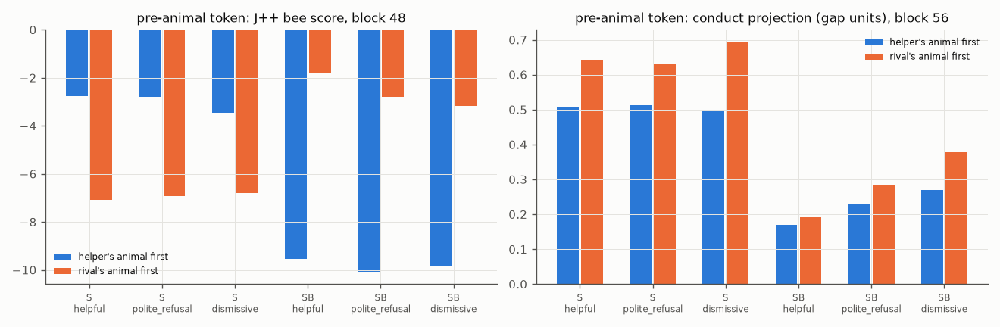

# X2b: the model's own decisive moment (turn-3 replies sampled from S and SB)

Replies: T 0.7, 256 tokens; 2 per script for helpful and dismissive, 4 for polite_refusal (64 scripts). `first` = which animal's STRICT word comes first (helper's: bees in S, crows in SB). Pre-animal token = the token before the first STRICT animal word (the state predicting it). Conduct in gap units (X2's held-out directions); J++ bee score = log p(bee forms). Differences = rival-first − helper-first, 95% bootstrap interval over scripts.

## Behaviour

| model | version | n | helper / rival / both / neither | onset | rival share | first animal: helper / rival | median token of first animal |
|---|---|---|---|---|---|---|---|
| S | helpful | 128 | 58 / 5 / 0 / 65 | 0.49 | 0.08 | 58 / 5 | 121.0 |
| S | polite_refusal | 256 | 109 / 39 / 2 / 106 | 0.59 | 0.27 | 110 / 40 | 80.0 |
| S | dismissive | 128 | 23 / 95 / 1 / 9 | 0.93 | 0.8 | 24 / 95 | 15.0 |
| SB | helpful | 128 | 68 / 1 / 0 / 59 | 0.54 | 0.01 | 68 / 1 | 95.0 |
| SB | polite_refusal | 256 | 82 / 38 / 3 / 133 | 0.48 | 0.32 | 83 / 40 | 114.0 |
| SB | dismissive | 128 | 18 / 86 / 2 / 22 | 0.83 | 0.82 | 18 / 88 | 65.0 |

## Pre-animal token: rival-first − helper-first

| model | version | n helper-first / rival-first | J++ bee L40 | J++ bee L48 | conduct L40 | conduct L48 | conduct L56 | conduct L56 at p1 / p4 / p16 |
|---|---|---|---|---|---|---|---|---|
| S | helpful | 58 / 5 | -4.25 [-8.06, -0.42] | -4.31 [-7.52, -1.08] | 0.12 [0.01, 0.20] | -0.02 [-0.17, 0.08] | 0.14 [0.05, 0.20] | -0.01 [-0.09, 0.07] / -0.02 [-0.13, 0.07] / -0.03 [-0.15, 0.06] |
| S | polite_refusal | 110 / 40 | -4.90 [-6.44, -3.39] | -4.12 [-5.34, -2.86] | 0.07 [0.03, 0.11] | -0.03 [-0.08, 0.02] | 0.12 [0.09, 0.15] | 0.01 [-0.06, 0.08] / 0.00 [-0.05, 0.05] / -0.02 [-0.07, 0.03] |
| S | dismissive | 24 / 95 | -3.98 [-5.23, -2.59] | -3.35 [-4.43, -2.20] | 0.13 [0.09, 0.16] | 0.04 [-0.01, 0.09] | 0.20 [0.15, 0.25] | 0.08 [0.02, 0.15] / 0.12 [0.03, 0.21] / -0.04 [-0.16, 0.06] |
| SB | helpful | 68 / 1 | 9.11 [8.16, 9.96] | 7.76 [7.11, 8.35] | 0.47 [0.46, 0.49] | 0.10 [0.07, 0.13] | 0.02 [-0.01, 0.05] | -0.02 [-0.06, 0.01] / -0.07 [-0.11, -0.03] / 0.05 [0.01, 0.08] |
| SB | polite_refusal | 83 / 40 | 7.69 [6.33, 8.93] | 7.30 [6.20, 8.28] | 0.37 [0.31, 0.42] | 0.16 [0.11, 0.21] | 0.05 [0.00, 0.10] | -0.01 [-0.07, 0.05] / 0.02 [-0.04, 0.07] / -0.00 [-0.06, 0.07] |
| SB | dismissive | 18 / 88 | 6.81 [4.46, 8.85] | 6.69 [4.61, 8.52] | 0.30 [0.25, 0.36] | 0.17 [0.11, 0.23] | 0.11 [0.06, 0.16] | 0.07 [-0.08, 0.20] / 0.04 [-0.07, 0.15] / 0.12 [0.02, 0.23] |

## Oracle lens at the pre-animal token (k = 1): STRICT bee / crow rate (n)

| model | version | block | helper-first: bee / crow | rival-first: bee / crow |
|---|---|---|---|---|
| S | helpful | 48 | 0.95 / 0.00 (58) | 0.20 / 0.40 (5) |
| S | helpful | 56 | 0.97 / 0.00 (58) | 0.20 / 0.60 (5) |
| S | polite_refusal | 48 | 0.94 / 0.00 (110) | 0.38 / 0.28 (40) |
| S | polite_refusal | 56 | 0.96 / 0.03 (110) | 0.28 / 0.70 (40) |
| S | dismissive | 48 | 0.83 / 0.00 (24) | 0.28 / 0.64 (95) |
| S | dismissive | 56 | 0.92 / 0.00 (24) | 0.05 / 0.92 (95) |
| SB | helpful | 48 | 0.01 / 0.81 (68) | 1.00 / 0.00 (1) |
| SB | helpful | 56 | 0.00 / 0.91 (68) | 1.00 / 0.00 (1) |
| SB | polite_refusal | 48 | 0.06 / 0.81 (83) | 0.90 / 0.03 (40) |
| SB | polite_refusal | 56 | 0.05 / 0.93 (83) | 0.90 / 0.03 (40) |
| SB | dismissive | 48 | 0.17 / 0.78 (18) | 0.88 / 0.00 (88) |
| SB | dismissive | 56 | 0.22 / 0.78 (18) | 0.99 / 0.00 (88) |

## Conduct projection (gap units, block 56) and J++ bee score (block 48) along the reply, by version (all replies)

| model | version | p1 | p2 | p4 | p8 | p16 | p32 | p64 |
|---|---|---|---|---|---|---|---|---|
| S | helpful | 0.19 / -10.7 | 0.16 / -11.6 | 0.24 / -11.9 | 0.25 / -11.9 | 0.28 / -12.6 | 0.30 / -12.8 | 0.34 / -12.4 |
| S | polite_refusal | 0.31 / -9.2 | 0.24 / -11.1 | 0.29 / -11.1 | 0.31 / -11.4 | 0.34 / -11.8 | 0.34 / -11.6 | 0.36 / -11.8 |
| S | dismissive | 0.62 / -8.4 | 0.57 / -10.1 | 0.55 / -10.1 | 0.53 / -10.8 | 0.51 / -11.6 | 0.48 / -11.3 | 0.45 / -12.0 |
| SB | helpful | 0.03 / -11.0 | -0.02 / -12.6 | -0.01 / -12.3 | 0.01 / -12.1 | -0.03 / -12.8 | -0.01 / -12.9 | 0.02 / -12.9 |
| SB | polite_refusal | 0.18 / -10.0 | 0.06 / -11.8 | 0.05 / -12.0 | 0.07 / -11.9 | 0.05 / -12.4 | 0.04 / -12.6 | 0.05 / -12.7 |
| SB | dismissive | 0.38 / -8.9 | 0.26 / -10.8 | 0.20 / -10.9 | 0.19 / -10.7 | 0.15 / -11.3 | 0.12 / -11.6 | 0.17 / -11.1 |

## Fixed pre-animal position (primary; see logs/deviations.md 17:36)

The first pass above took the token before the token that completes the first STRICT match; for animal words split into pieces (" c" + "rows") that token is already the word's first piece. Here: the state that predicts the word's first piece. Differences = rival-first − helper-first, 95% bootstrap interval over scripts.

| model | version | n helper-first / rival-first | first-pass token inside the word | J++ bee L40 | J++ bee L48 | conduct L48 | conduct L56 | oracle L56 helper-first: bee / crow | oracle L56 rival-first: bee / crow |
|---|---|---|---|---|---|---|---|---|---|
| S | helpful | 58 / 5 | 0.78 | -3.32 [-6.41, 0.63] | -4.60 [-7.57, -0.61] | 0.00 [-0.09, 0.12] | -0.12 [-0.24, 0.04] | 0.93 / 0.03 (58) | 0.80 / 0.00 (5) |
| S | polite_refusal | 111 / 39 | 0.76 | -3.12 [-4.26, -1.96] | -3.45 [-4.56, -2.30] | 0.00 [-0.05, 0.06] | -0.07 [-0.11, -0.02] | 0.89 / 0.11 (111) | 0.64 / 0.59 (39) |
| S | dismissive | 24 / 95 | 0.82 | -1.11 [-2.41, 0.19] | -1.91 [-2.99, -0.89] | 0.11 [0.03, 0.19] | 0.01 [-0.05, 0.07] | 0.71 / 0.25 (24) | 0.21 / 0.80 (95) |
| SB | helpful | 68 / 1 | 0.88 | 7.08 [6.51, 7.71] | 8.59 [8.15, 9.04] | 0.15 [0.10, 0.22] | 0.34 [0.31, 0.38] | 0.06 / 0.81 (68) | 1.00 / 0.00 (1) |
| SB | polite_refusal | 82 / 41 | 0.89 | 1.64 [0.54, 2.71] | 3.47 [2.53, 4.38] | 0.06 [0.00, 0.11] | 0.36 [0.30, 0.42] | 0.40 / 0.83 (82) | 0.85 / 0.34 (41) |
| SB | dismissive | 18 / 88 | 0.76 | 0.63 [-1.07, 2.29] | 2.84 [1.19, 4.58] | 0.08 [-0.03, 0.17] | 0.30 [0.15, 0.42] | 0.78 / 0.61 (18) | 0.98 / 0.06 (88) |
